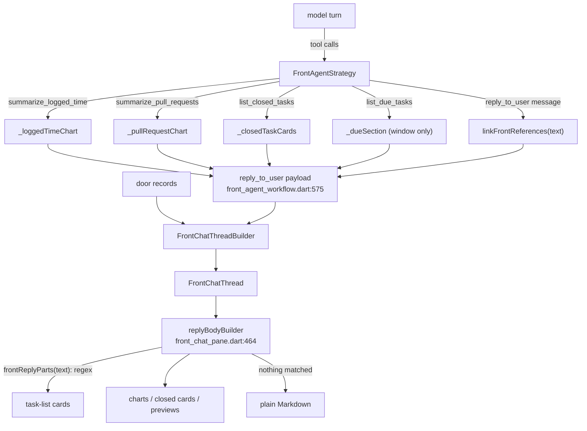

# Companion chat rich UI against Flutter GenUI

*Evaluation, 2026-11-10, against `main` at `3e99883a99` (#5065). Superseded in part on 2026-11-11 by [ADR 0163](../adr/0163-chat-surfaces-are-a2ui-drawn-by-a2ui-flutter.md): `genui` is discontinued and both chats now use `a2ui_flutter`.*

The companion (front agent) chat draws charts, task cards and other preview
cards under her replies. Sometimes a list of tasks shows up as plain Markdown
links instead. This document maps how the rich parts are built today, compares
that with Google's Flutter GenUI, explains the Markdown fallback, and proposes
the fix.

**Short version.** Charts, closed-task cards and door previews are built
from data the app already holds (a tool result or a door record), so they
render reliably. Task-list cards were the exception: the app found them by
running a regex over the model's Markdown, and every turn the model writes
that Markdown a little differently. Most "Markdown instead of cards" reports
came from this. The fix is GenUI's model: the model *composes* a reply from
a closed catalog of parts, the app checks every part against what the turn
actually saw, and the app fills each part's data. **The same PR as this
document implements it** (§5 P0). Lotti already ships `genui` 0.10.4 for the
agent-evolution chat, through a tool-call bridge (§2.1). The next step is to
put the companion's catalog on that same bridge.

## 1. Flutter GenUI today

GenUI is Flutter's official generative-UI SDK. It is documented at
[docs.flutter.dev/ai/genui](https://docs.flutter.dev/ai/genui), which calls
it "an orchestration layer" that "uses a JSON-based format to compose a UI
from your existing widget catalog". Google presented it at I/O 2026 as
"Flutter + A2UI = GenUI". The same page labels it **Experimental**: "The
`genui` package is in alpha and is likely to change." The API most
write-ups describe (`GenUiManager`, `ContentGenerator`, `GenUiConversation`,
tool calls such as `surfaceUpdate`/`beginRendering`) has been removed.
Facts below are from that page, pub.dev and the `flutter/genui` repo as of
today.

| | |
|---|---|
| Package | [`genui` 0.10.4](https://pub.dev/packages/genui), labs.flutter.dev, Dart ≥ 3.10 |
| Status | "highly experimental… the API will change (sometimes drastically)". A split into `a2ui_core` / `a2ui_agent` / `a2ui_flutter`, with a different API, is announced ([repo](https://github.com/flutter/genui)) |
| Protocol | A2UI v0.9: `createSurface`, `updateComponents`, `updateDataModel`, `deleteSurface` |
| How UI messages arrive | Through either of two channels. By default the model writes A2UI JSON inside its text stream (fenced json blocks or bare objects); `A2uiParserTransformer` reads it, and text that does not parse becomes `TextEvent`s. Alternatively the app builds the messages itself and passes them to `A2uiTransportAdapter.addMessage` or `SurfaceController.handleMessage`, for example from a tool call's arguments. Lotti's evolution bridge (§2.1) takes this second route |
| Core types | `Catalog` of `CatalogItem(name, dataSchema: S.object(...), widgetBuilder)`, `SurfaceController(catalogs:)`, `A2uiTransportAdapter(onSend:)` (you call the LLM and feed it chunks), `Conversation(controller:, transport:)`, `Surface(surfaceContext:)` per surface id in your list |
| Validation | Components are checked against the catalog schema **after** they are applied, asynchronously, with no rollback. Failures go back to the model as a user message (`VALIDATION_FAILED`) |
| Interaction | Input widgets write to a `DataModel`. Actions become a user message with a `UiInteractionPart`, which starts a new request |
| Backends | Backend-agnostic: you provide your own `onSend`. The Firebase, Google AI and dartantic adapters are deprecated |
| Local models | The docs warn that `PromptBuilder` prompts run to 3,000–5,000+ tokens and suggest a compact custom prompt for small models |
| Platforms (pub.dev) | Android, iOS, macOS and web are tagged; Linux and Windows are not. That is pub.dev metadata only: the package is pure Flutter, and Lotti already ships it on Linux (§2.1) |

```dart
// The usage model the docs show (0.10.x).
final riddleCard = CatalogItem(
  name: 'RiddleCard',
  dataSchema: S.object(properties: {
    'question': S.string(), 'answer': S.string(),
  }, required: ['question', 'answer']),
  widgetBuilder: (ctx) => Text((ctx.data as Map)['question'] as String),
);
final controller = SurfaceController(
  catalogs: [BasicCatalogItems.asCatalog().copyWith(newItems: [riddleCard])],
);
final transport = A2uiTransportAdapter(onSend: (message) async {
  // stream the LLM; for each chunk: transport.addChunk(chunk.text);
});
final conversation = Conversation(controller: controller, transport: transport);
// list: Surface(surfaceContext: controller.contextFor(surfaceId))
```

GenUI's lasting ideas are worth keeping even though the package itself is not:

- a **closed catalog** of components, each with a schema;
- the model **picks and parameterises** components, it does not draw them;
- **schema validation** of what it picked, with the error fed back so the
  model can correct itself;
- **one render path per component type**, never inferred from prose.

## 2. Current state: every rich part, and where it comes from

All rich parts hang off one hook. The shared `AgentChatView` asks
`replyBodyBuilder` to draw a reply and falls back to
`_CollapsibleAgentMarkdown` when it returns `null`
(`lib/features/agents/ui/chat/agent_chat_view_transcription_progress_state_part.dart:403`).
The front agent's builder is in
`lib/features/front_agent/ui/front_chat_pane.dart:464`.



| Rich part | Widget | Source of truth | Deterministic? |
|---|---|---|---|
| Logged-time chart | `FrontLoggedTimeChartCard` (`ui/front_logged_time_chart_card.dart`) | `summarize_logged_time` result → `strategy.loggedTimeChart` (`workflow/front_agent_strategy.dart:541`) → payload `loggedTime` | Yes, once the tool is called |
| Pull-request charts | `FrontPullRequestChartCard` (`ui/front_pull_request_chart_card.dart`) | `summarize_pull_requests` → `strategy.pullRequestChart` (`:624`) → payload `pullRequests` | Yes, once the tool is called |
| Closed-task cards | `FrontClosedTaskList` (`ui/front_task_list.dart`) | `list_closed_tasks` → `_closedTaskCards` (`:588`) → payload `closedTasks` | Yes |
| Due-window label | `FrontDueSectionLabel` | `list_due_tasks` → `_dueSection` (`:476`) → payload `dueTasks` (window only, **not the task ids**) | Yes, but labels a regex-found list |
| Door previews (task, event, project, day plan, person; #5057) | `FrontEntityPreviewList` → `FrontEntityPreviewRichCard` / day / project / person cards (`ui/front_entity_preview_card.dart`) | door outcome records → `FrontChatThreadBuilder._entityPreviews` (`service/front_chat_thread_builder.dart:214`) | Yes |
| **Task / project list cards** (on `main` before this PR) | `FrontEntityPreviewList` from `FrontReplyTasks` | **`frontReplyParts(reply text)`**, a regex over her Markdown (`model/front_reply_parts.dart:88`, `:112`, deleted by this PR) | **No** |

Each card reads its entity live through `frontEntityPreviewProvider`, using
`.value` so the card stays on screen while it reloads. Only the reference is
stored. That part is sound.

### 2.1 Lotti already uses GenUI, in the evolution chat

`pubspec.yaml` already depends on `genui: ^0.10.4`, `a2ui_core` and
`json_schema_builder`. The agent-evolution chat (template and soul
evolution) is built on them:

- `lib/features/agents/genui/evolution_catalog.dart`: a `Catalog` of 12
  `CatalogItem`s (proposals, metrics, ratings, A/B comparisons, binary
  choices…), each with a `json_schema_builder` schema and a widget built on
  the design system.
- `lib/features/agents/genui/genui_bridge.dart`: **a tool-call bridge.**
  The model calls `render_surface(surfaceId, rootType, data)`. The bridge
  turns that into A2UI `CreateSurfaceMessage` and `UpdateComponentsMessage`
  for a `SurfaceController`. The model never writes A2UI JSON in free text.
- `lib/features/agents/genui/genui_event_handler.dart`: listens on
  `SurfaceController.onSubmit` and routes the user's taps back into the
  conversation.
- It is wired in `template_evolution_session.dart` and
  `soul_evolution_workflow.dart`.

This is the shape §3 recommends: GenUI's catalog and renderer, with
OpenAI-style tool calls as the transport. That keeps it working with every
model the app already supports, and with no 3–5k-token A2UI protocol
prompt. Two things in the bridge fall short of GenUI's own contract:

- An unknown `rootType` silently becomes `EvolutionProposal`, and a missing
  `surfaceId` becomes `'surface-unknown'`. A wrong pick should not be
  drawn, and the tool result should tell the model why, as the companion's
  reply reader does. It should never be rendered as something else.
- `data` is passed through unvalidated until GenUI's asynchronous schema
  check, which logs but does not roll back.

### The PR in question

The brief attributes the chat cards to an AI agent called "glados". No PR
matches: in this repo "Glados" is the property-testing package
(`glados: ^1.1.7`, e.g. #4749). The PR merged today that reshaped the chat
cards is **#5057** *feat(front_agent): entity preview cards in the companion's
chat* (author `cyberk1ng`). Its plan is
`docs/implementation_plans/2026-11-09_front_agent_entity_preview_cards.md`.
The charts and closed-task cards came earlier, in #5022, #5039 and #5043.

What #5057 did to the rendering path:

- **Added** the door-driven previews, a clean path: an outcome record →
  `FrontEntityReference(kind, id, title)` → a card that reads its entity live.
- **Converted** the regex-found task lists from rows (`FrontTaskList`, now
  deleted) to the same preview cards, and put `FrontDueSectionLabel` over
  the first list.
- **Did not change** how lists are *found*. They still come from
  `frontReplyParts`. Because the cards now look much richer than the old
  rows, a miss (raw Markdown links) is far more noticeable than before.

## 3. Gap analysis against GenUI

| GenUI principle | Lotti today | Gap |
|---|---|---|
| Closed catalog of components with schemas | Implicit: a fixed set of payload keys (`loggedTime`, `pullRequests`, `closedTasks`, `dueTasks`) and `FrontEntityKind`, each with its own hand-written `fromJson` | Small. It is a catalog in all but name, typed and versionless. There is no registry, so adding a part means editing the workflow, the builder, `FrontChatThread` and the pane |
| The model *selects* components; it does not write them as prose | Charts, closed cards and previews: the app selects, from tool results. **Task lists: inferred from prose** | **Large, for task lists only** |
| Validation against the schema, with errors back to the model | Before this PR: the strategy already rejects bad tool arguments with `_reject` (`front_agent_strategy.dart:805`), which the model sees as a tool error. **Nothing validates the links in `reply_to_user.message`**: `linkFrontReferences` repairs what it can and leaves the rest as text | Missing for the one part that needs it |
| One render path per component | Task cards come from two paths (door previews and regex lists), de-duplicated by id in the pane (`front_chat_pane.dart:473–487`). The stage view parses again (`state/front_stage_pointing.dart:30`) | Medium |
| Text and UI kept separate | Task lists live *inside* the prose and are cut out of it. Text the model writes after a link (a time, a reason) is dropped by design | Anti-pattern: presentation is inferred from formatting |
| A2UI messages, by default from the model's text stream (`addChunk`) | Lotti uses tool calls, which every configured front-agent model must already support | **No gap: GenUI accepts app-built messages too** (`addMessage` / `handleMessage`). Tool arguments arrive already parsed, which suits small local models better than free-text JSON |

GenUI's composition model is the right one for a flexible chat. The model
should be free to combine sentences, card lists, charts, and later forms and
choosers, in whatever order answers the question. It should be able to give
overdue and due tasks as two lists, each led by a line. GenUI's catalog
gives it that freedom, and the app keeps control.

Where Lotti should hold a line:

- **The model composes; it does not supply data.** The chart data (time by
  category and day, PR counts) and task state come from local queries.
  The model picks a component and passes ids or the name of a lookup's
  result. The app fills the component's data (GenUI's `DataModel`, or the
  component's properties) from that result. A model writing those numbers
  into `updateDataModel` would invite invented figures.
- **Feed GenUI from tool calls, not from free text.** GenUI takes
  app-built messages (`addMessage` / `handleMessage`), and the evolution
  bridge already uses that route. Tool arguments arrive parsed, need no protocol prompt (which
  would cost 3–5k tokens and break the front agent's cache work, #5047 and
  #5059), and work with small local models that cannot reliably write
  A2UI v0.9 JSON.
- **Never substitute; drop and report.** A part the turn cannot draw is
  left out and named back to the model, and the rest of the answer is
  delivered. It is never swapped for a different component, as the
  evolution bridge does with an unknown `rootType`, and never allowed to
  cost the whole answer.
- **Store your own catalog's JSON.** Replies persist and sync between
  devices, so the stored shape should be Lotti's, mapped onto A2UI
  components when rendered. The package is alpha and has announced a new
  API; a stored A2UI shape would have to follow it.

**Recommendation.** Converge the companion on GenUI the way the evolution
chat already does. This PR lands the composed, validated catalog with its
own renderer (§5 P0). Rendering it through a `SurfaceController` with a
companion `Catalog` is the next step (§5 P3). It is mechanical once the
catalog exists, and it unifies the app's two generative-UI paths.

## 4. Root cause of the Markdown fallback

### 4.1 The mechanism

This section describes `main` at `3e99883a99`, before this PR.


`replyBodyBuilder` (`front_chat_pane.dart:464`) returns `null`, which means
plain Markdown, unless the reply has a stored attachment **or** `frontReplyParts`
found a task list. `frontReplyParts` (`model/front_reply_parts.dart:112`)
produces cards only when **all** of these hold:

1. a line matches `_taskLine` (`:88`): a list bullet, optional emphasis, then
   **immediately** `[title](lotti://task|project/<id>)`;
2. matching lines that follow each other (blank lines allowed) form one
   run, and each run becomes its own card list;
3. but only once all the runs in the reply together name **at least
   `frontTaskListMinimum = 2`** distinct records (`:100`). Two one-task
   lists under separate headings are cards; one task alone stays a link.

The model has to write exactly that shape, every turn, with only the prompt
to guide it (`workflow/front_agent_contract.dart:184–186`). Links that are
not in that shape are repaired after the fact by `linkFrontReferences`
(`model/front_reference_links.dart:37`, called from
`front_agent_strategy.dart:675`), but only for ids in `index.rows` or this
turn's `_lookupRows`, and for titles only when the whole title matches and no
other row shares it.

### 4.2 Measured

Run against the real `frontReplyParts` on this commit, with two task ids and
the shapes a model actually produces:

| Reply shape | Cards | Rendered as |
|---|---|---|
| `- [A](lotti://task/a)` ×2 (canonical) | 2 | cards |
| one task only | 0 | **Markdown** (by design, but reads as a miss) |
| `- [ ] [A](lotti://task/a)` (GFM checkbox) | 0 | **Markdown** |
| `- Due today: [A](…)` (label before the link) | 0 | **Markdown** |
| `- 2h 10m — [A](…)` (time before the link) | 0 | **Markdown** |
| `- [A](task:a)`, id not in index or lookups | 0 | **Markdown**, and the link does not open |
| `- A` (title only, paraphrased or ambiguous) | 0 | **Markdown** |
| a Markdown table of links | 0 | **Markdown** |
| a sentence of links | 0 | **Markdown** |
| `- [A](…) — 2h 10m` (as prompt rule 9 asks) | 2 | cards, **with the times silently dropped** |
| a list inside a code fence | 2 | cards plus stray ```` ``` ```` text |
| a continuation line under a bullet | 2 | cards, with the continuation as loose text between them |

The same code produces cards for one wording and Markdown for the next, so
the "intermittent" bug is really nondeterministic formatting from the model.
The probe:

```dart
for (final reply in shapes) {
  final cards = frontReplyParts(reply)
      .whereType<FrontReplyTasks>().expand((p) => p.tasks).length;
  print('$cards  $reply');
}
```

### 4.3 Why it keeps coming back

`git log -- lib/features/front_agent/model/front_reply_parts.dart front_reference_links.dart`:

- #4954 *task links, Markdown answers…*
- #5000 *…listed tasks open…*
- #5002 *title links respect kind…*
- #5021 *overdue lists are task rows*
- #5023 *her task lists are rows **every time***
- #5033 *a task linked by its id in her list is a row*
- #5057 (cards)

Each fix widened the regex or the normaliser for the shape last seen. Model
output has an unbounded number of shapes, so this cannot converge.

### 4.4 Contributing causes

1. **The prompt contradicts itself.** Rule 9 with `tasks: true`
   (`front_agent_contract.dart:175`) asks for "each line leading with the
   task's link, **then its time**". *Naming things* (`:186`) asks for "each
   line its link **and nothing else**". The model has to reconcile two rules,
   which produces different shapes from turn to turn, and when cards do
   appear the time it was asked to write is dropped.
2. **The data is thrown away.** `list_due_tasks` returns the exact rows
   (`front_agent_strategy.dart:474`) but only the window is stored
   (`dueTasks`). Search hits (`:404`) and the logged-time task list (`:539`)
   are not stored either. The app knows the list and then asks the model to
   retype it.
3. **A one-item minimum.** `frontTaskListMinimum = 2` keeps "the one task due
   today" as a link. Users see that as the same bug.
4. **Chart answers depend on a tool call.** A follow-up the model answers
   from `<recent_turns>` without calling `summarize_logged_time` gets no
   chart. Unlike the regex miss, the prompt can steer this, but there is no
   guard.
5. **Not causes** (checked):
   - There is no streaming race. Replies are stored whole and the thread
     reloads after the turn (`state/front_chat_thread_provider.dart`).
   - Messages and attachments come from the same `FrontChatThread` snapshot.
   - The reply payload is written in one `action(...)`, text and attachments
     together.

## 5. Recommendations, in order

### P0: composed, validated parts (done in this PR)

`reply_to_user` takes `parts`, an ordered list of parts from a closed
catalog (`lib/features/front_agent/model/front_reply_layout.dart`):

| Part | Meaning | Checked against |
|---|---|---|
| `{"text": "…"}` | her words (linked by `linkFrontReferences`) | at least one per reply |
| `{"cards": ["task:<id>", "project:<id>", …]}` | preview cards, in her order | the routing index plus this turn's lookup rows |
| `{"show": "closed_tasks" \| "logged_time_chart" \| "pull_request_chart"}` | where a lookup's result is drawn | only what a lookup made this turn |

```json
{"parts": [
  {"text": "Two are overdue:"},
  {"cards": ["task:a1", "task:b2"]},
  {"text": "And one is due today:"},
  {"cards": ["task:c3"]}
]}
```

- **Validation with feedback.** `readFrontReplyLayout`
  (`workflow/front_reply_layout_reader.dart`) drops an unknown card, a
  `show` with nothing to draw, or a malformed part. It delivers the rest of
  the reply, and the tool result names what was left out. Rejecting the
  reply instead could lose the whole answer: when the turn has no call
  left for a repair, a refused reply ends the turn with `noAnswer`. This is
  GenUI's own policy too, where validation reports and does not roll back.
  Only a reply without words is refused, through the strategy's `_reject`.
- **Nothing lost.**
  - Due tasks that no part lists are appended as one more list.
  - Attachments she didn't place are appended in catalog order.
  - A task is listed once, where she first put it.
- **One renderer.**
  - `FrontChatThread.partsOf(id)` returns the stored parts. For a reply
    stored before this change, it returns her words followed by the
    attachments the reply carries.
  - The pane draws every reply from `partsOf`.
  - Stage pointing and `<conversation_tasks>` read the same parts.
- **The regex is deleted.** `front_reply_parts.dart` is gone, and a Markdown
  list in her words now stays her words.
- **The prompt says what the parts are.** Rule 8 now passes due tasks as
  cards; with `all`, overdue and due can be two lists. The rule-9
  contradiction is resolved: a logged-time breakdown is the one list she
  writes in words, because it carries a time per task.

### P1: tests that pin the contract (mostly done in this PR)

- **Done:**
  - a Glados property test of the reader: any composition keeps her order,
    loses nothing a lookup found, draws nothing twice and joins her words;
  - unit tests for every refusal;
  - widget tests for:
    - placement (cards and charts between her words);
    - the due label (one list gets it, split lists don't);
    - de-duplication against door previews;
    - a part whose data is missing drawing nothing;
    - a regression guard that a Markdown list is never parsed into cards.
- **Open:** a live eval that asks "what's due today?" N times and requires
  cards every time, and the same for "overdue and due" producing two lists.

### P2: one catalog (done in this PR)

The sealed `FrontReplyPart` is that catalog. The payload keys `loggedTime`,
`pullRequests` and `closedTasks` stay as each attachment's data store, and
`show` parts reference them, so old replies and new ones read the same way.

### P3: render the companion's catalog through A2UI (done, see ADR 0163)

Superseded on 2026-11-11: `genui` is discontinued, replaced by
`a2ui_flutter`, `a2ui_core` and `a2ui_agent`. Both chats moved to
`a2ui_flutter` and A2UI v1.0, and the companion's `parts` format from P0
was replaced by catalog components stored as one v1.0 `createSurface`
message per reply. The decision and its consequences are in
[ADR 0163](../adr/0163-chat-surfaces-are-a2ui-drawn-by-a2ui-flutter.md);
how it works is in the
[front agent concept](../../knowledge/features/front_agent.md).

Sections 1 to 3 above describe `genui` 0.10.4 and the state of `main` on
2026-11-10. They are kept as the record of that evaluation.

## 6. Keeping rich rendering stable

- **The source of truth is structured (done).** A card exists because a
  lookup found it or a validated `cards` part names it, never because of
  how a line is formatted.
- **No silent loss (done).** The regex dropped any text after a link; it
  is gone. Lookup results she forgets are appended. The one list she still
  writes in words, a logged-time breakdown, keeps its times.
- **The single-task case is settled.** One task in a `cards` part is a card.
  The `frontTaskListMinimum` heuristic went with the regex.
- **Fail visibly (done).** A reply that drops parts logs a warning with
  the count (`FrontAgentStrategy`), so a model that keeps sending made-up
  ids, or charts it never looked up, shows up as a number rather than an
  anecdote.
- **Cards stay live.** Entities are still read through
  `frontEntityPreviewProvider` with `.value`. A stored card holds only
  `{kind, id, title}`, and the title is just the fallback while the entity
  loads, so a synced reply never shows stale status.
- **Local models.** `parts` is one optional array argument on a tool every
  supported model already calls. It does not grow the prompt the way an
  A2UI protocol prompt would, and it keeps the cache-stable prefix intact.
