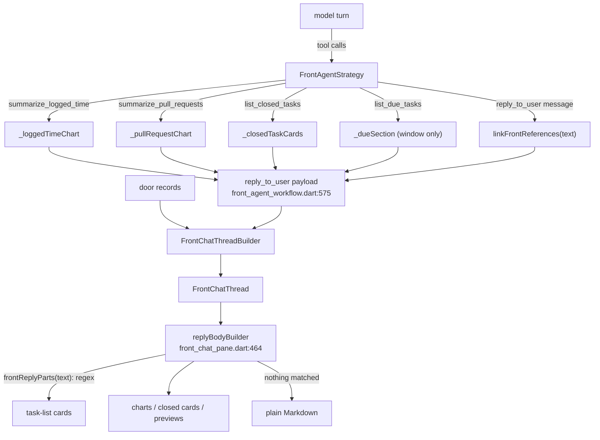

# Companion chat rich UI against Flutter GenUI

*Evaluation, 2026-11-10, against `main` at `3e99883a99` (#5065).*

The companion (front agent) chat draws charts, task cards and other preview
cards under her replies. Sometimes a list of tasks shows up as plain Markdown
links instead. This document maps how the rich parts are built today, compares
that with Google's Flutter GenUI, explains the Markdown fallback, and proposes
the fix.

**Short version.** Charts, closed-task cards and door previews are built
from data the app already holds (a tool result or a door record), so they
render reliably. Task-list cards are the exception: the app finds them by
running a regex over the model's Markdown, and every turn the model writes
that Markdown a little differently. Most "Markdown instead of cards" reports
come from this. Adopting the `genui` package would not fix it, because
GenUI also has the model write the UI as text. The fix is to give task lists
the same data-driven path the other cards already use, with the GenUI idea
of a typed catalog the model picks from, validated, in place of free-form
Markdown.

## 1. Flutter GenUI today

The API most write-ups describe (`GenUiManager`, `ContentGenerator`,
`GenUiConversation`, tool calls such as `surfaceUpdate`/`beginRendering`) has
been removed. Facts below are from pub.dev and the `flutter/genui` repo as of
today.

| | |
|---|---|
| Package | [`genui` 0.10.4](https://pub.dev/packages/genui), labs.flutter.dev, Dart ≥ 3.10 |
| Status | "highly experimental… the API will change (sometimes drastically)". A split into `a2ui_core` / `a2ui_agent` / `a2ui_flutter`, with a different API, is announced ([repo](https://github.com/flutter/genui)) |
| Protocol | A2UI v0.9: `createSurface`, `updateComponents`, `updateDataModel`, `deleteSurface` |
| How the model emits UI | **As JSON inside its text stream**: fenced json blocks or bare objects, read by `A2uiParserTransformer`. No tool calls and no structured output. Text that does not parse becomes `TextEvent`s |
| Core types | `Catalog` of `CatalogItem(name, dataSchema: S.object(...), widgetBuilder)`, `SurfaceController(catalogs:)`, `A2uiTransportAdapter(onSend:)` (you call the LLM and feed it chunks), `Conversation(controller:, transport:)`, `Surface(surfaceContext:)` per surface id in your list |
| Validation | Components are checked against the catalog schema **after** they are applied, asynchronously, with no rollback. Failures go back to the model as a user message (`VALIDATION_FAILED`) |
| Interaction | Input widgets write to a `DataModel`. Actions become a user message with a `UiInteractionPart`, which starts a new request |
| Backends | Backend-agnostic: you provide your own `onSend`. The Firebase, Google AI and dartantic adapters are deprecated |
| Local models | The docs warn that `PromptBuilder` prompts run to 3,000–5,000+ tokens and suggest a compact custom prompt for small models |
| Platforms (pub.dev) | Android, iOS, macOS, web. Linux and Windows are not listed |

```dart
// The usage model the docs show (0.10.x).
final riddleCard = CatalogItem(
  name: 'RiddleCard',
  dataSchema: S.object(properties: {
    'question': S.string(), 'answer': S.string(),
  }, required: ['question', 'answer']),
  widgetBuilder: (ctx) => Text((ctx.data as Map)['question'] as String),
);
final controller = SurfaceController(
  catalogs: [BasicCatalogItems.asCatalog().copyWith(newItems: [riddleCard])],
);
final transport = A2uiTransportAdapter(onSend: (message) async {
  // stream the LLM; for each chunk: transport.addChunk(chunk.text);
});
final conversation = Conversation(controller: controller, transport: transport);
// list: Surface(surfaceContext: controller.contextFor(surfaceId))
```

GenUI's lasting ideas are worth keeping even though the package itself is not:

- a **closed catalog** of components, each with a schema;
- the model **picks and parameterises** components, it does not draw them;
- **schema validation** of what it picked, with the error fed back so the
  model can correct itself;
- **one render path per component type**, never inferred from prose.

## 2. Current state: every rich part, and where it comes from

All rich parts hang off one hook. The shared `AgentChatView` asks
`replyBodyBuilder` to draw a reply and falls back to
`_CollapsibleAgentMarkdown` when it returns `null`
(`lib/features/agents/ui/chat/agent_chat_view_transcription_progress_state_part.dart:403`).
The front agent's builder is in
`lib/features/front_agent/ui/front_chat_pane.dart:464`.



| Rich part | Widget | Source of truth | Deterministic? |
|---|---|---|---|
| Logged-time chart | `FrontLoggedTimeChartCard` (`ui/front_logged_time_chart_card.dart`) | `summarize_logged_time` result → `strategy.loggedTimeChart` (`workflow/front_agent_strategy.dart:541`) → payload `loggedTime` | Yes, once the tool is called |
| Pull-request charts | `FrontPullRequestChartCard` (`ui/front_pull_request_chart_card.dart`) | `summarize_pull_requests` → `strategy.pullRequestChart` (`:624`) → payload `pullRequests` | Yes, once the tool is called |
| Closed-task cards | `FrontClosedTaskList` (`ui/front_task_list.dart`) | `list_closed_tasks` → `_closedTaskCards` (`:588`) → payload `closedTasks` | Yes |
| Due-window label | `FrontDueSectionLabel` | `list_due_tasks` → `_dueSection` (`:476`) → payload `dueTasks` (window only, **not the task ids**) | Yes, but labels a regex-found list |
| Door previews (task, event, project, day plan, person; #5057) | `FrontEntityPreviewList` → `FrontEntityPreviewRichCard` / day / project / person cards (`ui/front_entity_preview_card.dart`) | door outcome records → `FrontChatThreadBuilder._entityPreviews` (`service/front_chat_thread_builder.dart:214`) | Yes |
| **Task / project list cards** | `FrontEntityPreviewList` from `FrontReplyTasks` | **`frontReplyParts(reply text)`**, a regex over her Markdown (`model/front_reply_parts.dart:88`, `:112`) | **No** |

Each card reads its entity live through `frontEntityPreviewProvider`, using
`.value` so the card stays on screen while it reloads. Only the reference is
stored. That part is sound.

### The PR in question

The brief attributes the chat cards to an AI agent called "glados". No PR
matches: in this repo "Glados" is the property-testing package
(`glados: ^1.1.7`, e.g. #4749). The PR merged today that reshaped the chat
cards is **#5057** *feat(front_agent): entity preview cards in the companion's
chat* (author `cyberk1ng`). Its plan is
`docs/implementation_plans/2026-11-09_front_agent_entity_preview_cards.md`.
The charts and closed-task cards came earlier, in #5022, #5039 and #5043.

What #5057 did to the rendering path:

- **Added** the door-driven previews, a clean path: an outcome record →
  `FrontEntityReference(kind, id, title)` → a card that reads its entity live.
- **Converted** the regex-found task lists from rows (`FrontTaskList`, now
  deleted) to the same preview cards, and put `FrontDueSectionLabel` over
  the first list.
- **Did not change** how lists are *found*. They still come from
  `frontReplyParts`. Because the cards now look much richer than the old
  rows, a miss (raw Markdown links) is far more noticeable than before.

## 3. Gap analysis against GenUI

| GenUI principle | Lotti today | Gap |
|---|---|---|
| Closed catalog of components with schemas | Implicit: a fixed set of payload keys (`loggedTime`, `pullRequests`, `closedTasks`, `dueTasks`) and `FrontEntityKind`, each with its own hand-written `fromJson` | Small. It is a catalog in all but name, typed and versionless. There is no registry, so adding a part means editing the workflow, the builder, `FrontChatThread` and the pane |
| The model *selects* components; it does not write them as prose | Charts, closed cards and previews: the app selects, from tool results. **Task lists: inferred from prose** | **Large, for task lists only** |
| Validation against the schema, with errors back to the model | The strategy already rejects bad tool arguments with `_reject` (`front_agent_strategy.dart:805`), which the model sees as a tool error. **Nothing validates the links in `reply_to_user.message`**: `linkFrontReferences` repairs what it can and leaves the rest as text | Missing for the one part that needs it |
| One render path per component | Task cards come from two paths (door previews and regex lists), de-duplicated by id in the pane (`front_chat_pane.dart:473–487`). The stage view parses again (`state/front_stage_pointing.dart:30`) | Medium |
| Text and UI kept separate | Task lists live *inside* the prose and are cut out of it. Text the model writes after a link (a time, a reason) is dropped by design | Anti-pattern: presentation is inferred from formatting |
| Model writes A2UI JSON in its stream | Lotti uses tool calls, which every configured front-agent model already must support | **Lotti is ahead here.** Tool arguments arrive already parsed. Free-text JSON is the weaker channel, especially for small local models |

Where GenUI does **not** fit Lotti:

- **The model must not write data.** The chart data in Lotti (time by
  category and day, PR counts) comes from local queries. Having a model put
  those numbers into `updateDataModel` would invite invented figures.
  Lotti's rule that tool results become cards and the model writes only the
  words is the stricter design, and it should stay.
- **Platforms.** Lotti ships on Linux (Flathub) and Windows. `genui` lists
  neither.
- **Local models.** A 3–5k-token protocol prompt on every turn works against
  the front agent's prompt-cache work (#5047, #5059), and against small
  on-device models.
- **Stability.** It is alpha and announces a new API. Lotti's chat payloads
  persist and sync between devices, so a wire format owned by a moving
  external spec is a liability.

**Recommendation: do not add the `genui` dependency now.** Bring in its
catalog, selection and validation ideas through the tool-call contract the
front agent already has. Look again once the `a2ui_flutter` split ships,
lists desktop platforms and has a stable 1.x. The adapter in §6 P3 keeps that
door open.

## 4. Root cause of the Markdown fallback

### 4.1 The mechanism

`replyBodyBuilder` (`front_chat_pane.dart:464`) returns `null`, which means
plain Markdown, unless the reply has a stored attachment **or** `frontReplyParts`
found a task list. `frontReplyParts` (`model/front_reply_parts.dart:112`)
produces cards only when **all** of these hold:

1. a line matches `_taskLine` (`:88`): a list bullet, optional emphasis, then
   **immediately** `[title](lotti://task|project/<id>)`;
2. matching lines are consecutive (blank lines allowed);
3. across the reply, those lines name **at least `frontTaskListMinimum = 2`**
   distinct records (`:100`).

The model has to write exactly that shape, every turn, with only the prompt
to guide it (`workflow/front_agent_contract.dart:184–186`). Links that are
not in that shape are repaired after the fact by `linkFrontReferences`
(`model/front_reference_links.dart:37`, called from
`front_agent_strategy.dart:675`), but only for ids in `index.rows` or this
turn's `_lookupRows`, and for titles only when the whole title matches and no
other row shares it.

### 4.2 Measured

Run against the real `frontReplyParts` on this commit, with two task ids and
the shapes a model actually produces:

| Reply shape | Cards | Rendered as |
|---|---|---|
| `- [A](lotti://task/a)` ×2 (canonical) | 2 | cards |
| one task only | 0 | **Markdown** (by design, but reads as a miss) |
| `- [ ] [A](lotti://task/a)` (GFM checkbox) | 0 | **Markdown** |
| `- Due today: [A](…)` (label before the link) | 0 | **Markdown** |
| `- 2h 10m — [A](…)` (time before the link) | 0 | **Markdown** |
| `- [A](task:a)`, id not in index or lookups | 0 | **Markdown**, and the link does not open |
| `- A` (title only, paraphrased or ambiguous) | 0 | **Markdown** |
| a Markdown table of links | 0 | **Markdown** |
| a sentence of links | 0 | **Markdown** |
| `- [A](…) — 2h 10m` (as prompt rule 9 asks) | 2 | cards, **with the times silently dropped** |
| a list inside a code fence | 2 | cards plus stray ```` ``` ```` text |
| a continuation line under a bullet | 2 | cards, with the continuation as loose text between them |

The same code produces cards for one wording and Markdown for the next, so
the "intermittent" bug is really nondeterministic formatting from the model.
The probe:

```dart
for (final reply in shapes) {
  final cards = frontReplyParts(reply)
      .whereType<FrontReplyTasks>().expand((p) => p.tasks).length;
  print('$cards  $reply');
}
```

### 4.3 Why it keeps coming back

`git log -- lib/features/front_agent/model/front_reply_parts.dart front_reference_links.dart`:

- #4954 *task links, Markdown answers…*
- #5000 *…listed tasks open…*
- #5002 *title links respect kind…*
- #5021 *overdue lists are task rows*
- #5023 *her task lists are rows **every time***
- #5033 *a task linked by its id in her list is a row*
- #5057 (cards)

Each fix widened the regex or the normaliser for the shape last seen. Model
output has an unbounded number of shapes, so this cannot converge.

### 4.4 Contributing causes

1. **The prompt contradicts itself.** Rule 9 with `tasks: true`
   (`front_agent_contract.dart:175`) asks for "each line leading with the
   task's link, **then its time**". *Naming things* (`:186`) asks for "each
   line its link **and nothing else**". The model has to reconcile two rules,
   which produces different shapes from turn to turn, and when cards do
   appear the time it was asked to write is dropped.
2. **The data is thrown away.** `list_due_tasks` returns the exact rows
   (`front_agent_strategy.dart:474`) but only the window is stored
   (`dueTasks`). Search hits (`:404`) and the logged-time task list (`:539`)
   are not stored either. The app knows the list and then asks the model to
   retype it.
3. **A one-item minimum.** `frontTaskListMinimum = 2` keeps "the one task due
   today" as a link. Users see that as the same bug.
4. **Chart answers depend on a tool call.** A follow-up the model answers
   from `<recent_turns>` without calling `summarize_logged_time` gets no
   chart. Unlike the regex miss, the prompt can steer this, but there is no
   guard.
5. **Not causes** (checked):
   - There is no streaming race. Replies are stored whole and the thread
     reloads after the turn (`state/front_chat_thread_provider.dart`).
   - Messages and attachments come from the same `FrontChatThread` snapshot.
   - The reply payload is written in one `action(...)`, text and attachments
     together.

## 5. Recommendations, in order

### P0: task lists from data, not from prose

Make due lists and search results work the way `closedTasks` already does.

1. **Store the list on the reply.**
   - `list_due_tasks`: extend `FrontDueSection` with `ids` (ordered).
   - `match_to_corpus` and `summarize_logged_time(tasks: true)`: add a
     payload key such as `listedTasks: [{kind, id, minutes?}]`, set in the
     strategy where `_lookupRows.addAll` already runs (`:404`, `:474`,
     `:539`).
   - The thread builder reads it like `closedTasks`; the pane draws it
     instead of the regex result.
2. **Let the model choose a subset, validated.** Give `reply_to_user` an
   optional `cards: [{kind: task|project, id}]` argument (a GenUI-style
   catalog reference). The strategy accepts only ids in
   `index.rows + _lookupRows`, the same check `linkFrontReferences` uses.
   Anything else goes through `_reject` with an error that names the bad
   id, and the model retries. This is GenUI's validate-and-feed-back loop in
   the channel Lotti already uses. It needs no new model capability, and
   local models already support tool calling for this agent.
3. **Fix the prompt.**
   - Replace *Naming things*' list rule with: "Never list tasks in your
     words; pass them in `cards`. Name one task inline as a link."
   - Remove the contradiction in rule 9: per-task time becomes card data
     (`minutes`), not prose.
4. **Keep `frontReplyParts` only for history**: replies stored before the
   change have no `cards`. Gate it on "payload has no `cards` / `listedTasks`"
   and do not widen the regex again. Delete it once old threads have aged
   out, or keep it as read-only legacy.

Expected effect: task-list cards render whenever the tool returned tasks,
regardless of how the model words its reply. The 8 Markdown rows in §4.2 go
away for new replies.

### P1: tests that pin the contract

- **Property tests (Glados, already a dependency)** for `frontReplyParts` while
  it remains:
  - generate replies from mixed segments: prose, headings, blank lines, task
    lines in every bullet/emphasis/url shape, trailing text, fences;
  - assert that the input survives (text parts plus list lines rebuild it);
  - assert that a card id is always one the reply links;
  - assert that no `lotti://` list line is left as text once cards are drawn.
- **Property tests for the composition.** Generate subsets of
  `{text, listedTasks, closedTasks, previews, loggedTime, pullRequests,
  dueTasks}` and pump the pane. Assert:
  - the order is fixed;
  - no id appears twice across previews, closed cards and listed cards (the
    de-duplication at `front_chat_pane.dart:473–487`);
  - the due label sits over the first list;
  - `replyBodyBuilder` returns `null` only when every set is empty.

  Combinations of UI parts are where hand-picked cases miss things.
- **A strategy test** for the `cards` validation: an unknown id is rejected
  with a tool error, a valid id is stored in order, and duplicates collapse.
- **An eval case** in the front-agent live evals: the same "what's due
  today" asked N times must produce cards every time. Today that measures the
  flake rate; after P0 it guards the fix.

### P2: one catalog, one renderer

- Introduce a sealed `FrontReplyAttachment` with one `fromJson` per variant
  (`loggedTimeChart`, `pullRequestChart`, `closedTasks`, `taskCards`,
  `entityPreviews`, `dueLabel`). Add a single `attachments: [...]` list to the
  reply payload, each item `{type, version, data}`, alongside the current
  keys for old rows.
- `FrontChatThread` then holds `attachmentsByMessageId` instead of six maps,
  and the pane switches on the sealed type. Adding a part touches one model
  file and one widget.
- `front_stage_pointing.dart` reads the attachments instead of parsing again.
- An unknown `type` from a newer synced device is skipped, not fatal. That
  is the forward-compatibility behaviour the per-key `fromJson` methods
  already have.

### P3: a seam for GenUI later (optional, after P2)

If A2UI reaches a stable Flutter renderer with desktop support, a
`FrontReplyAttachment` can be written as an A2UI surface (component name
plus data) without changing storage: the catalog from P2 maps onto a
`genui` `Catalog` almost one to one. Even then, keep the data coming from
tools. The model would select components and the app would fill them.

## 6. Keeping rich rendering stable

- **The source of truth is structured.** A card exists because a tool
  result or a validated `cards` argument says so, never because of how a
  line is formatted.
- **Fail visibly in development.** Log at `warning`, through the existing
  logging service, when a reply's text has `lotti://task` links but no card
  data is attached, so the remaining misses become a count rather than an
  anecdote.
- **No silent loss.** Remove the "trailing text is dropped" behaviour along
  with the regex path. Anything worth showing becomes card data.
- **The single-task case is a product decision.** Decide whether one listed
  task is a card. With `cards` the model can say so explicitly, so the
  `frontTaskListMinimum` heuristic can go.
- **Cards stay live:** keep reading entities through
  `frontEntityPreviewProvider` with `.value`. Store only `{kind, id}` (plus
  scalar card data such as minutes), never titles or status, so a synced
  reply never shows stale entity data.
- **Local models:** P0 adds one optional array argument to a tool that every
  supported model already calls. It does not grow the prompt the way an
  A2UI protocol prompt would, and it keeps the cache-stable prefix intact.
