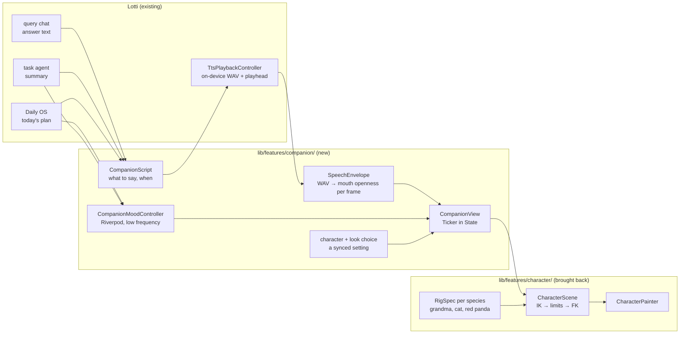
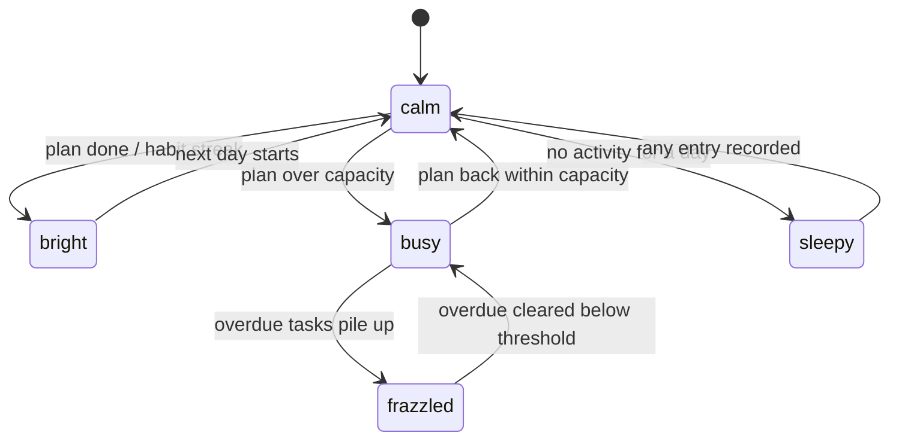
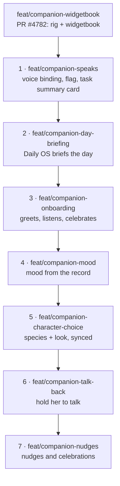
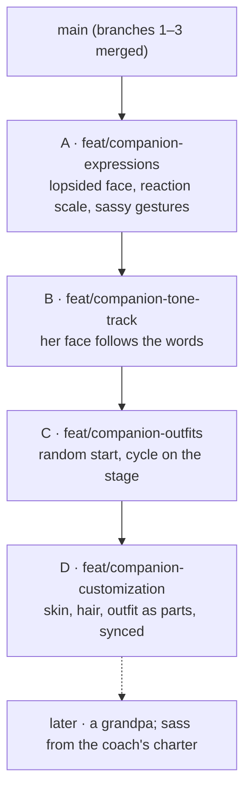

# In-App Agent Avatar: a Character You Talk To

Date: 2026-10-12
Status: proof of concept built (2026-10-13); delivery as a branch stack (2026-10-15), branches 1 (`feat/companion-speaks`), 2 (`feat/companion-day-briefing`) and 3 (`feat/companion-onboarding`) built — see "Delivery"; revised 2026-10-19 for her range and customization, branch A (`feat/companion-expressions`) built — see "Revision: her range, and making her your own"
Branch: `feat/companion-widgetbook` (PR #4782), the parent of the stack
Builds on: [2026-06-22_bones_animation_framework.md](2026-06-22_bones_animation_framework.md)
(the rig engine and its locked runtime decisions) and
[2026-10-07_tutorial_avatar_and_onboarding_video.md](2026-10-07_tutorial_avatar_and_onboarding_video.md)
(the talking presenters of the tutorial and pitch videos)

## Goal

From the product conversation (paraphrased): AI assistants are increasingly
shown as a character rather than a text box, and that is catching on. The
pitch videos already have one: a grandmother who presents Lotti. The natural
next step is to put a character **inside the app**, as the face of the
agents: you talk to it, and it talks back. It tells you what your day looks
like, or what is left on a task. Like a Tamagotchi, it is alive, and it shows
how things are going. The character should be **customizable**, the way a good
game lets you shape your own: the grandmother, a cat, a red panda, whoever the
person behind the computer wants to see.

The finished first version:

1. A **companion** on the query chat and on the Daily OS screen: a drawn
   character that reads the answer, the day's plan or a task's state aloud,
   with its mouth on the voice, and stays alive between turns. It breathes,
   blinks and glances at the screen.
2. The voice runs **on the device**, and so does the face. Nothing the
   companion says or shows leaves the machine, so the privacy story of the
   rest of the app holds.
3. Its **mood** reflects the record: perky when the day is on track, a little
   frazzled when tasks pile up. It never guilt-trips (see "Mood without
   guilt").
4. At least **two characters** to choose from (the grandmother and a cat), each
   with outfits, chosen in settings and synced like any other setting.

## What already exists (verified 2026-10-12)

Most of the pipeline is in the app today. Only the face is missing.

| Piece | Where | What it gives the companion |
|---|---|---|
| Ask your record, by voice or text | `lib/features/agents/query/` (`query_chat_controller.dart`, `query_transcription_provider.dart`) | the conversation: a spoken question in, an answer grounded in the record out |
| Speech out, on the device | `lib/features/tts/` (Supertonic ONNX engine, `TtsPlaybackController`) | the voice; `TtsPlaybackState` already exposes `status`, `position` and `duration` for the playhead |
| Speak a task's summary, speak a query answer | `ai_summary_card.dart`, `query_audio_controller.dart` | the two first things worth saying; both already route through the playback controller |
| The day's plan | `lib/features/daily_os_next/` | "what your day is going to look like" |
| Agent personality | souls (`knowledge/features/agents/templates-souls-evolution.md`) | **who** the agent is; a character is the soul's face |
| Feature-flag pattern | `enableAiSummaryTtsFlag` in `lib/utils/consts.dart`, `config_flags.dart` | the gate for a prototype |

Speech out is still behind `enable_ai_summary_tts`, because the quality of
the local voice is still being evaluated. The companion depends on that
evaluation, and the same flag is the natural gate for it.

### The rig engine already exists, in Dart

The decisive finding: Lotti's own **bones animation framework** (#3380, plan
2026-06-22) was built in this repo and later ejected into the standalone
`matthiasn/dancing_cats` repository. That repository is a pure-Dart skeletal
rig with a `CustomPainter` runtime, and it already has every mechanism the
companion needs:

- **Forward kinematics.** `SkeletonSolver` composes each bone's world
  transform from its parent's, so a limb structurally cannot detach.
- **Ribbon limbs.** `LimbRibbonSpec` and `runtime/limb_ribbon.dart` draw an
  arm as one continuous tapered surface on a Catmull-Rom curve through
  shoulder, elbow and wrist. Elbows bend through the silhouette instead of
  showing a cardboard hinge.
- **A deformable torso.** `model/trunk_surface.dart` builds a skinned mesh
  from cross-section stations. The shoulder line rides the girdle, so a raised
  arm lifts the shoulder and the yoke with it instead of opening a valley at
  the joint.
- **Joint constraints.**
  - `JointRotationLimit` gives each joint an anatomical range.
  - `armFoldCorrections` is a coupled anti-fold rule that rejects arm
    combinations no single joint limit catches.
  - `two_bone_ik.dart` is a two-bone IK solver that clamps the reach.
  - `motion_constraint_validator.dart` audits authored motion offline.
- **A face and lip-sync.** `FaceRig` and `FaceSolver`; mouth cues come from
  the Rhubarb lip-sync tool.
- **An autonomic layer.** Breathing, Poisson-timed blinks and eye-darts. The
  2026-06-22 panel called it "the soul of a Tamagotchi".

Its Phase 1 table already lists "Riverpod mood controller / Tamagotchi
product" as **a separate consumer feature**, which is this plan.

The pitch videos' grandmother is drawn by a separate Python and cairo rig
(`tools/tutorial_videos/presenter/narrator/`). That rig is **not** the thing
to port. Its character *design* (proportions, palettes, looks, gestures,
expressions) carries over as data. Its mechanics are an earlier generation of
the Dart engine's: capsule limbs and no joint limits.

So the companion is: the Dart engine brought back, a grandmother rig authored
for it, and a thin consumer feature that connects it to the chat, the voice
and the record.

## Architecture

- **`lib/features/character/`** holds the engine: model, engine, runtime and
  samples, from `dancing_cats`. Its demo, dance and scenery code stay out
  (see "What not to bring back"). It imports nothing from Lotti, which keeps
  the "no back-deps" rule of the 2026-06-22 plan (§3.6).
- **`lib/features/companion/`** is the consumer: what the character says, its
  mood, the chosen character and look, and the widget. It depends on
  `character/`, `tts/`, `agents/query/` and `daily_os_next/`, and nothing
  depends on it except the pages that show it. `make layer_check` decides the
  exact rank. A shared type that ends up needed lower down moves down rather
  than adding a break.
- **Per-frame values never pass through a provider.** The Ticker lives in
  `CompanionView`'s `State`. Riverpod carries only low-frequency inputs:
  mood, look, what is being said. This is the R3 rule of the 2026-06-22 plan
  (§6.1).

### Talking: the mouth on the voice

The on-device engine writes a WAV (`engine/wav_writer.dart`) before it plays.
So the envelope is computed **once, before playback**: RMS per 1/60 s window,
normalised to the 97th percentile. This is the same method as the videos'
`narrator/motion.py` `loudness()`. Each frame, the view reads
`TtsPlaybackState.position`, looks up the envelope and opens the mouth. The
playhead is the clock, so a stall or a seek can never desync the mouth.

That is enough for v1. Rhubarb visemes (proper mouth shapes) are a later
upgrade: Rhubarb is a native binary, so it would need a pure-Dart
phoneme-to-viseme pass over the text the TTS spoke, timed by the envelope.

### What it says

`CompanionScript` turns the record into short spoken lines. The style is the
pitch narration style: one short sentence per point, the product, not the
narrator.

| Trigger | Line comes from | Example |
|---|---|---|
| Opens Daily OS, a plan exists | the day's plan | "Four things today. The big one is the migration, at ten." |
| Opens a task with an agent summary | the summary's TL;DR | the TL;DR, read as written |
| Asks the query chat | the answer | the answer, read as written |
| Nothing planned yet | a fixed prompt | "Nothing planned yet. Tell me about your day?" |

The lines are produced from data that already exists: the companion adds no
new model call in v1. Every fixed line is localized in all catalogs, per the
l10n rules.

### Mood without guilt

The 2026-06-22 plan's product case was a character "whose mood reflects how
well the user keeps up with tasks/habits". The rule here is the one the app's
agents already follow, **"agents propose, you decide"**:

- The companion reflects state; it never punishes.
- It never sickens, starves or dies.
- It never sends a notification to make you come back.
- A missed day reads as tired, never as hurt.

A pet that makes people feel guilty so they keep returning is a dark pattern.
It also works against the one thing the pitch says: your memory, kept by you.

These are proposed states; none is implemented yet. Each maps to an
expression and an idle posture set:

- **bright:** a bigger smile and a small bounce.
- **frazzled:** a brow tilt, a hand to the forehead, and a quicker blink.
- **sleepy:** heavy lids and slow breathing.

The thresholds come from Daily OS capacity and task due dates, never from a
new score. The controller recomputes on a database notification, not on a
timer, and holds the last state while it reloads (the "never flash
established UI" rule).

### Customizable characters

The character is data: a `RigSpec`, its drawables and its face. A
customization is a choice of species, a look and colours.

- **Species.** Grandma, cat and red panda. Each species is its own rig: a
  cat's ears and tail are bones the grandma does not have. The engine already
  carries a cat (`samples/cat_in_suit.dart`), so the cat is the cheapest
  second character. The red panda is the cat rig with new proportions, a
  striped tail ribbon and its own palette.
- **Look.** This is the same idea as the videos' `narrator/looks.py`: named
  palettes and outfit switches (`grandma_stage`, `grandma_rock`, and so on),
  carried over as data. The outfit pieces are trunk surfaces and ribbon
  sleeves, so a costume deforms with the body instead of floating on it.
- **Storage.** A setting, synced across devices like the rest. The character
  is part of the record, not a server account.
- **Later.** A small "make your own" screen with species, look and three
  colour swatches, previewed live with the same `CompanionView`.

## What not to bring back

`dancing_cats` grew far past what a companion needs: Afrobeats choreography,
beat maps, color grading, camera directors, scenery shaders and a 3D
waterfront. None of these come back.

Bring back only:

- the engine (`model/` except the dance phrase and move files);
- `engine/`;
- the runtime painter, scene, ribbon, skinned mesh and constraints;
- one cat sample, trimmed to the clips a companion uses: idle, talk, a few
  gestures.

The repo's "do not hoard code" rule applies to every file. The 1,000-line
cap applies too: `character_scene.dart` (3,640 lines) and
`character_painter.dart` (2,763 lines) have to be split on the way in, not
baselined.

## Phases

| Phase | Deliverable | Exit criteria |
|---|---|---|
| 0 | Bring the engine back, trimmed, behind no UI | It compiles under the repo's analyzer at zero warnings. The engine's own tests come with it and pass. `make layer_check` and the file-size ratchet are green. |
| 1 | A grandma `RigSpec`: ribbon arms, a trunk-surface torso and dress, joint limits; the videos' looks as data | A film strip of idle, talk and the six video gestures; shoulders read as one body; no arm crosses its anti-fold limit (validator report clean) |
| 2 | `CompanionView` + `SpeechEnvelope` on the query chat, behind `enable_ai_summary_tts` | It reads an answer aloud with the mouth on the voice; widget tests on a fake clock; a raster-time profile on a real low-end Android |
| 3 | `CompanionScript` + Daily OS briefing; localized lines | It opens Daily OS and the day is read in all locales; lines come from data only |
| 4 | `CompanionMoodController` | Unit tests per transition; the diagram matches the code; no notification anywhere |
| 5 | Character choice: grandma + cat, then the red panda; synced setting | Settings preview; choice survives a restart and syncs to a second device |
| 6 | A screen recording for the pitch video | The companion briefing a day, cut into the founder production as a shot |

Phases 0–2 are the proof of concept: one character, talking, in one place.
That is enough to judge whether it is worth the rest, and enough to film.

These phases are superseded by "Delivery" below: the proof of concept took
a shorter road, so phases 0 and 1 are done or dropped, and the rest is cut
into branches.

## Proof of concept (2026-10-13)

A first cut of phases 1 and 2 exists in `lib/features/companion/`, behind no
flag and in no screen: it is shown in the widgetbook only (**Companion →
Lotti (grandma)**, **Cat** and **Red panda**). It takes a shorter road than
the phases above:

- **It ports the video rig, not `dancing_cats`.** The Python/cairo
  grandmother of the pitch videos was ported to Dart module by module. It
  already has the ribbon arms, the constrained elbow solver, the gestures and
  the looks, so she is the same character as in the videos, and it needs no
  engine brought back first (phase 0). Bringing the `dancing_cats` engine
  back stays the road for skinned outfits.
- **The cat and the red panda are species of the same rig** (2026-10-14),
  not engines of their own. A look names its `CompanionSpecies`; on an
  animal, the ears replace the bun, a furred head with a muzzle, nose and
  whiskers replaces her face (the eyes, brows and mouth are hers, so every
  mood, gesture and mouth shape works unchanged), paws replace the shoes, and
  a tail grows from behind the hip. The tail swings and an ear flicks now and
  then, both from the animator, quicker when the mood is. The red panda is
  the cat with a bigger head, rimmed ears, a white mask with tear marks, dark
  limbs and a thick ringed tail. Two looks each: `cat`, `cat_rock`,
  `red_panda`, `red_panda_bookish`.
- **The mouth has three sources** behind one `MouthTrack`: a WAV's loudness
  (`SpeechEnvelope`, as planned), the words alone (`TextLipSync`, a pure-Dart
  letter-to-viseme pass), and both together (`VoicedTextTrack`).
- **Moods are chosen by hand.** `CompanionMood` has the five proposed states'
  expressions; nothing derives them from the record yet (phase 4).
- **Not yet wired:** `TtsPlaybackController`, the query chat, Daily OS,
  `CompanionScript`, the settings choice (phase 5: the species exist, the
  setting does not), and any localized line.

The feature's README has the map of the code.

## Delivery: a stack of branches (2026-10-15)

`feat/companion-widgetbook` (PR #4782) is the parent: the rig, the three
species and the widgetbook. Every branch below starts from the tip of the one
above it, is one PR with that branch as its base, and is one commit. When a
parent is amended or merged, its child is rebased onto it
(`git rebase --onto <parent> <old-parent-tip>`).

Branches 1–3 are the investor demo: she briefs the day, reads what is left on
a task, and greets a new user. Everything after makes her a product.

### Two decisions every branch inherits

- **Her rank in the layer order moves down.** `companion` sits between
  `daily_os_next` and `onboarding` in `tool/architecture/layer_guard.dart`,
  so Daily OS, the agents and the tasks cannot mount her. She imports only
  herself and `design_system` today, and branch 1 adds `tts`. Branch 1 moves
  her to directly after `tts`. Every host is then above her, and the words
  she says are written by the host that owns the data (Daily OS writes the
  briefing, the task agent the summary), never by the companion. Anything
  she needs from higher up (the chosen character, branch 5) is handed down
  by inversion, not imported.
- **The voice stays ignorant of her.** `tts` never imports `companion`.
  `TtsPlaybackState` gains one field, the clip being played (its WAV and
  the words it was made from); the companion reads the clip itself and
  builds the mouth from it.

### 1 · `feat/companion-speaks`: her mouth on the on-device voice

The binding everything else uses, with one real host so it is not unused code.

- **Layer order.** Move `companion` to directly after `tts`; `make
  layer_check` green, no baseline entry added.
- **`TtsPlaybackState.clip`.** The WAV's path and the text it was
  synthesized from, as one record. Set when the status turns `playing`,
  cleared on stop, completion and error. Documented in the tts concept.
- **`CompanionSpeech`** (`companion/state/`). For one `sourceId`, it
  watches `ttsPlaybackControllerProvider`. When that source starts playing,
  it reads the clip once (`SpeechEnvelope.fromWav`; Supertonic writes 16-bit
  PCM, which `fromWav` takes) and builds a `VoicedTextTrack` from it and the
  clip's words. If the clip cannot be read, the fallback is `TextLipSync` on
  those words. Each utterance starts a fresh `PlayheadClock`. Another source playing, or none,
  leaves her silent. It changes only when an utterance starts or ends:
  per-frame values never pass through a provider.
- **`PlayheadClock`.** The player reports its position in coarse steps. The
  clock extrapolates between reports from a monotonic stopwatch, scaled by
  the playback speed, so the mouth moves every frame and still re-syncs on
  every report.
- **`CompanionSpeaker`** (`companion/ui/`). `CompanionView` plus the
  binding. The host gives a `sourceId`, a look, a mood and a framing; the
  words come with the clip, so they are the ones the voice was given.
- **Framing: `CompanionFraming.full`.** Head to toe, both hands in view in
  every gesture. Her box is `ControlSizes.companionCard` (136) high.
- **Flag `enable_companion`.** Seeded off, in the advanced group, with labels
  in every catalog. She is shown only when this flag is on and the speak
  control is shown (`enable_ai_summary_tts` on, engine supported).
- **First host: the AI summary card** (`agents/ui/ai_summary_card.dart`). She is
  shown head to toe, beside the TL;DR. She speaks when its speak control
  plays, through the same `sourceId`.
- **Tests:**
  - binding: silent for another source; the clip becomes a track; an
    unreadable clip falls back to the text; stop clears the track;
  - the clock, under `fakeAsync`;
  - the card with the flag on and off;
  - `clip` across the playback states.

  Each regression test is re-run with its fix reverted.
- **Docs:** the companion README and concept (the binding, with a diagram),
  the tts concept (`clip`), and the layer-order rationale, plus a changelog
  fragment for the flag.

**Commit:** `feat(companion): she speaks the task summary, her mouth on the on-device voice`

### 2 · `feat/companion-day-briefing`: she tells you what your day looks like

- **`DayBriefing`** (`daily_os_next/logic/day_briefing.dart`). Pure facts
  from the page's `DraftPlan` and `now`: how many blocks are planned
  (buffers and dropped blocks excluded), the next block, the longest, and the
  time still free. Free time is `capacityMinutes − scheduledMinutes`; the
  first draft of this plan named `remainingMinutes`, which is a single
  block's remaining estimate, not the day's. With no plan, only an invitation
  to check in. Data only, no model call.
- **The sentences** are composed in the UI (`composeDayBriefing`), because
  `logic/` imports no localization: ICU plurals in all 11 catalogs.
- **A briefing slot in the Day header** (`DayBriefingCompanion`): she leads
  the header's actions as a `bust`, `ControlSizes.avatar` (48) square, level
  with the icon buttons, so no new token. She briefs when tapped (`sourceId`
  `day-briefing:<yyyy-MM-dd>`); a second tap stops her. Her mood is `calm`
  until branch 4.
- **Deferred: the auto-brief** on the first visit of the day. It needs a
  persisted "briefed today" mark and a Daily OS setting, and whether it should
  exist at all is still open; the tap covers the demo.
- **Tests:**
  - `DayBriefing`, one test per sentence, on deterministic dates;
  - a glados property that every block count yields a sentence in every
    locale;
  - the slot, with the flag on and off.

**Commit:** `feat(daily-os): the companion briefs the day from the plan`

### 3 · `feat/companion-onboarding`: the first minute has a face

- She replaces the hero of the welcome step: full length, in the hero frame
  at its own height (`OnboardingHeroPanel.companion`), so no new token. Then
  she follows the first-capture flow as a bust, `ControlSizes.avatarHero`
  square, above the headline (`OnboardingFirstTaskView.companion`):
  - `wave` on the welcome and the prompt;
  - `listen` while the user records;
  - `think` while the task is structured;
  - `celebrate` when it appears.
- **Held gestures** are a companion addition, `CompanionView.holding`: the
  gesture replays whenever it relaxes, driven by her ticker, no timer.
- **The voice is not there yet on a first run.** The model weights download
  on the first synthesis, so onboarding cannot rely on her voice. Lines are
  the headlines already on screen, which serve as captions; she speaks them
  only when read-aloud is on and the model is already installed, never
  starting the download. While the mic is open she has no line, so she never
  talks into the recording.
- **Tests:** the gesture for each first-capture state, held gestures, the
  lines spoken or silent (model absent, read-aloud off, the flag loading
  late), and stopping when the mic opens or the surface goes.

**Commit:** `feat(onboarding): the companion greets, listens and celebrates the first task`

### 4 · `feat/companion-mood`: her mood follows the record, without guilt

- A mood provider in `daily_os_next/state/`, because that feature owns
  capacity and due tasks. It implements the "Mood without guilt" diagram,
  only the states the data can reach, and the diagram is corrected to match
  the code.
- It recomputes on database notifications, never on a timer, and keeps the
  last mood while reloading.
- Hosts pass the mood. She never notifies.
- **Tests:** one test per diagram edge, on deterministic dates.

**Commit:** `feat(companion): her mood follows the day, without guilt`

### 5 · `feat/companion-character-choice`: grandma, cat or red panda

- A species-and-look picker in settings, with a live preview.
- The choice syncs the way the theme selection does (`features/theming`).
- Hosts sit above the store but she sits below it. So the shell provides the
  choice to her through a `CompanionLookScope` that she reads, instead of her
  importing the store.
- **Tests:** the picker; the choice survives a restart; the scope reaches a
  host.

**Commit:** `feat(companion): choose her — grandma, cat or red panda — synced across devices`

### 6 · `feat/companion-talk-back`: hold her to talk

- Press and hold her to record with the existing recorder.
  - On a task or project, the words go to its query chat (`QueryCompanion`
    scope), and she speaks the answer through `query_audio_controller`.
  - On Daily OS, they go to refine, so you can say "push the dentist to
    tomorrow".
- She plays `listen` while recording and `think` while waiting.
- **Tests:** routing for each host, and the gestures for each state.

**Commit:** `feat(companion): hold her to talk, and she answers`

### 7 · `feat/companion-nudges`: nudges and celebrations

- The nudge banner dock shows her, with a mood for each nudge kind.
- A habit streak plays `celebrate`.
- The shutdown recap gets one spoken line.
- **Tests:** one test per nudge kind, plus the streak trigger.

**Commit:** `feat(companion): she delivers nudges and celebrates streaks`

### Decisions (2026-10-15)

- **Framing: head to toe** (revised 2026-10-15, replacing "torso and hands,
  never the legs"). Branch 1 first shipped a `CompanionFraming.torso`
  window, head to just below the hips. On review the owner asked for her
  full body, so the summary card shows her in `full`, and `torso` was
  removed because nothing else used it. A test walks every gesture through
  its phases and checks that both wrists stay inside the `full` window.
  `bust` stays for small sizes.
- **Her own flag, `enable_companion`.** A demo can show her without turning
  on the voice everywhere.
- **Naming.** The chat side pane is `QueryCompanion`. She is
  `CompanionSpeaker`, and the docs say which is which.
- **Her box on the summary card: `ControlSizes.companionCard`.** A
  container dimension, so a named token in `sizing_tokens.dart`, never a
  number in the host. Approved at 96 for the torso framing, and raised to
  136 with the move to full framing, so her face and hands still read.
- **Her size in the Day header: `bust` at `ControlSizes.avatar`** (decided
  2026-10-15). Full length at 136 is too tall for a header; the owner chose
  the bust, and the existing 48 avatar token fits it beside the header's
  48-high icon buttons.

## Revision: her range, and making her your own (2026-10-19)

From the product conversation of 2026-10-19 (paraphrased). The goal agents
are turning into general coaching agents, and a coach is told how to talk
to you in its **charter** ([ADR 0140](../adr/0140-a-goal-is-constituted-by-its-charter-entries.md)).
So she needs more range at runtime than five moods:

1. **Levels of approval and disapproval, and of sass**, so her reaction fits
   how a piece of work actually went.
2. **A face that follows the text**: happy through the praise, a different
   face when the read-out turns to what needs work.
3. **Outfits**: she starts in a random one for now, and a control on the
   full-screen stage cycles through them.
4. **Full customization** in settings: skin tone, hairstyles, hair colour,
   and in time a grandpa. "You should be able to create your own."

This replaces branches 4 (mood from the record) and 5 (character choice) of
"Delivery" with the stack below. Branches 6 (talk back) and 7 (nudges) stay
as planned and follow it.

### Three decisions (2026-10-19)

- **Disapproval is sass, never guilt.** "Mood without guilt" said she never
  scolds. She may now frown, raise a brow, roll her eyes or put her hands on
  her hips, but she is never hurt, never sad at you, and no reaction is ever
  attached to a notification. How much sass is the user's choice: warm is
  the default, and warm is exactly what the goal card showed before.
- **Every part combines with every other, with no ethnicity labels.** Skin
  tone, hairstyle, hair colour, eyes, outfit and accessories are independent
  choices; a few named presets are starting points, not the menu. That
  avoids deciding who may wear which hair. Differences in face shape, if
  any, stay subtle, so nothing becomes a caricature.
- **Tone labels: guessed on the device first, written by the agent later.**
  Branch B reads a sentence's tone from its section heading and a small word
  list, so it does not wait on the agent's report contract; the agent marking
  tone in its report is a later step.

### A · `feat/companion-expressions`: the range a coach needs

- **A lopsided face.** `CompanionPose` gains `browSkew` and `smileSkew`,
  each lifting one side (her right, screen right) and lowering the other; the
  smile may go below zero, turning the corners down. Both painters draw them.
- **Seven reaction moods** beside the five record moods: `proud`,
  `delighted`, `smug`, `skeptical`, `unimpressed`, `disappointed`, `stern`.
- **Six sassy gestures**: `handsOnHips`, `fingerWag`, `shrug`, `facepalm`,
  `slowClap`, `eyeRoll`. Hands on the hips needs the elbows out, which the
  arm solver never chose on its own (it keeps the most relaxed elbow), so a
  `GestureArm` may name a preferred elbow direction; the solver's rules still
  hold.
- **The reaction scale** (`companionReaction`): approval from -3 to +3 by a
  sass of warm, cheeky or sassy, each cell a mood and a held gesture. Her
  smile never falls as approval rises, at any sass; warm uses no sassy face
  or gesture.
- **The goal card moves onto the scale** at its warm end, with the same
  poses as before.
- **Widgetbook:** a "Reactions" grid of every cell, per character.
- No changelog fragment: nothing a user sees changes yet.

### B · `feat/companion-tone-track`: her face follows the words

- An expression track timed by the playhead, like the mouth: the clip's text
  split into sentences, each with an approval, the reaction changing as the
  voice reaches it. The time of a sentence comes from the same letter-by-
  letter timing `TextLipSync` uses and `VoicedTextTrack` stretches over the
  voice.
- Tones come from the host where it knows them (the day briefing composes
  its own sentences), else from a section heading ("what went well", "needs
  work") and a small word list, on the device.

### C · `feat/companion-outfits`: a random outfit, and a switch

- More grandma outfits. She starts in a random one per app launch and keeps
  it on every screen for that session; a control on the full-screen stage
  cycles through them.

### D · `feat/companion-customization`: make her your own

- A look split into parts: skin tone, hairstyle (bun, curls, afro, locs,
  braids, bob, pixie, …), hair colour (including dyed), eyes, outfit and
  accessories. Each hairstyle is its own painter with the strands that trail
  her motion; that is the bulk of the drawing.
- A settings screen with a live preview; the choice syncs like the theme
  (`features/theming`), and reaches her through a scope the shell provides,
  as branch 5 planned.

### Later

- **A grandpa**: trousers, a beard, a different silhouette, so a change to
  the body painters rather than a palette.
- **Sass from the coach**: the coaching agent's charter or persona sets her
  sass, so a coach told to be blunt gets an eyebrow.

## Testing

- **Engine.** Its existing unit and property tests come along with it (FK
  geometry, the IK reach clamp, ribbon paths, joint limits).
- **Grandma rig.** A golden film strip per gesture, plus the constraint
  validator as a test: every authored gesture passes with zero corrections.
- **Envelope.** A synthetic WAV gives a known RMS curve. The lookup by
  playhead position is exact, and it is silent outside the clip.
- **View.** `fakeAsync` and `tester.pump(duration)` only, never a real
  Ticker in a test (`test/README.md`). The mouth is closed when the state is
  `idle`/`stopped`/`error`, and open on loud frames while `playing`.
- **Mood.** One test per diagram edge, with deterministic dates.

## Risks

1. **Local voice quality.** The flag is still off. If the voice is not good
   enough, the companion is not either. Options:
   - a better on-device model;
   - a user-chosen cloud voice (ElevenLabs, Gemini), clearly labelled as
     leaving the device, never the default.
2. **Paint cost on low-end phones.** Ribbons and meshes are `Path` work every
   frame, while the 2026-06-22 plan locked `drawAtlas` for the bulk.
   Mitigations:
   - the companion is small and on one screen at a time;
   - profile first;
   - fall back to a cached raster idle loop when it is not speaking.
3. **Uncanny or annoying.** A character that talks too much is worse than
   none. It speaks only when asked, or once per screen visit, and a setting
   turns it off entirely.
4. **Scope creep from the dance engine.** See "What not to bring back".

## Open questions

- Is the companion one character for all agents, or does each agent's soul
  get its own face? The proposal: one companion, with the soul's tone in its
  words.
- Does the companion also listen (wake word, push-to-talk on the character
  itself), or only through the existing query chat input in v1?
- How should the voice choice and the character choice be tied: a voice per
  species, or chosen separately?
