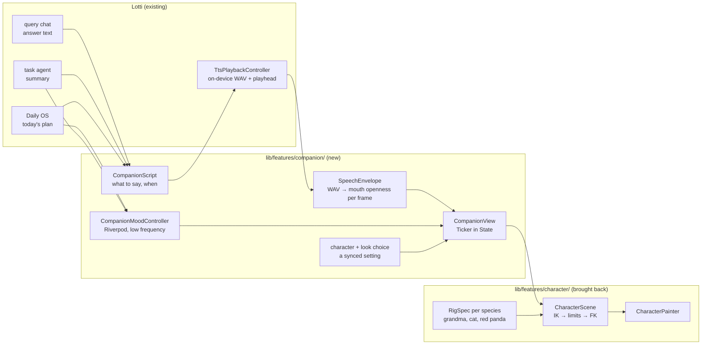
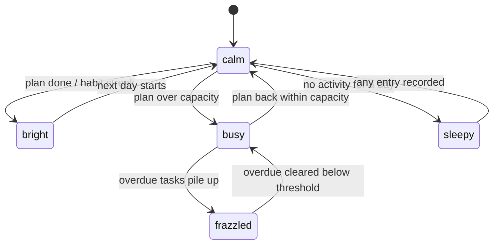

# In-App Agent Avatar: a Character You Talk To

Date: 2026-10-12
Status: proposal — nothing built yet
Branch: `feat/onboarding-guided-first-task`
Builds on: [2026-06-22_bones_animation_framework.md](2026-06-22_bones_animation_framework.md)
(the rig engine and its locked runtime decisions) and
[2026-10-07_tutorial_avatar_and_onboarding_video.md](2026-10-07_tutorial_avatar_and_onboarding_video.md)
(the talking presenters of the tutorial and pitch videos)

## Goal

From the product conversation (paraphrased): AI assistants are increasingly
shown as a character rather than a text box, and that is catching on. The
pitch videos already have one: a grandmother who presents Lotti. The natural
next step is to put a character **inside the app**, as the face of the
agents: you talk to it, and it talks back. It tells you what your day looks
like, or what is left on a task. Like a Tamagotchi, it is alive, and it shows
how things are going. The character should be **customizable**, the way a good
game lets you shape your own: the grandmother, a cat, a red panda, whoever the
person behind the computer wants to see.

The finished first version:

1. A **companion** on the query chat and on the Daily OS screen: a drawn
   character that reads the answer, the day's plan or a task's state aloud,
   with its mouth on the voice, and stays alive between turns. It breathes,
   blinks and glances at the screen.
2. The voice runs **on the device**, and so does the face. Nothing the
   companion says or shows leaves the machine, so the privacy story of the
   rest of the app holds.
3. Its **mood** reflects the record: perky when the day is on track, a little
   frazzled when tasks pile up. It never guilt-trips (see "Mood without
   guilt").
4. At least **two characters** to choose from (the grandmother and a cat), each
   with outfits, chosen in settings and synced like any other setting.

## What already exists (verified 2026-10-12)

Most of the pipeline is in the app today. Only the face is missing.

| Piece | Where | What it gives the companion |
|---|---|---|
| Ask your record, by voice or text | `lib/features/agents/query/` (`query_chat_controller.dart`, `query_transcription_provider.dart`) | the conversation: a spoken question in, an answer grounded in the record out |
| Speech out, on the device | `lib/features/tts/` (Supertonic ONNX engine, `TtsPlaybackController`) | the voice; `TtsPlaybackState` already exposes `status`, `position` and `duration` for the playhead |
| Speak a task's summary, speak a query answer | `ai_summary_card.dart`, `query_audio_controller.dart` | the two first things worth saying; both already route through the playback controller |
| The day's plan | `lib/features/daily_os_next/` | "what your day is going to look like" |
| Agent personality | souls (`knowledge/features/agents/templates-souls-evolution.md`) | **who** the agent is; a character is the soul's face |
| Feature-flag pattern | `enableAiSummaryTtsFlag` in `lib/utils/consts.dart`, `config_flags.dart` | the gate for a prototype |

Speech out is still behind `enable_ai_summary_tts`, because the quality of
the local voice is still being evaluated. The companion depends on that
evaluation, and the same flag is the natural gate for it.

### The rig engine already exists, in Dart

The decisive finding: Lotti's own **bones animation framework** (#3380, plan
2026-06-22) was built in this repo and later ejected into the standalone
`matthiasn/dancing_cats` repository. That repository is a pure-Dart skeletal
rig with a `CustomPainter` runtime, and it already has every mechanism the
companion needs:

- **Forward kinematics.** `SkeletonSolver` composes each bone's world
  transform from its parent's, so a limb structurally cannot detach.
- **Ribbon limbs.** `LimbRibbonSpec` and `runtime/limb_ribbon.dart` draw an
  arm as one continuous tapered surface on a Catmull-Rom curve through
  shoulder, elbow and wrist. Elbows bend through the silhouette instead of
  showing a cardboard hinge.
- **A deformable torso.** `model/trunk_surface.dart` builds a skinned mesh
  from cross-section stations. The shoulder line rides the girdle, so a raised
  arm lifts the shoulder and the yoke with it instead of opening a valley at
  the joint.
- **Joint constraints.**
  - `JointRotationLimit` gives each joint an anatomical range.
  - `armFoldCorrections` is a coupled anti-fold rule that rejects arm
    combinations no single joint limit catches.
  - `two_bone_ik.dart` is a two-bone IK solver that clamps the reach.
  - `motion_constraint_validator.dart` audits authored motion offline.
- **A face and lip-sync.** `FaceRig` and `FaceSolver`; mouth cues come from
  the Rhubarb lip-sync tool.
- **An autonomic layer.** Breathing, Poisson-timed blinks and eye-darts. The
  2026-06-22 panel called it "the soul of a Tamagotchi".

Its Phase 1 table already lists "Riverpod mood controller / Tamagotchi
product" as **a separate consumer feature**, which is this plan.

The pitch videos' grandmother is drawn by a separate Python and cairo rig
(`tools/tutorial_videos/presenter/narrator/`). That rig is **not** the thing
to port. Its character *design* (proportions, palettes, looks, gestures,
expressions) carries over as data. Its mechanics are an earlier generation of
the Dart engine's: capsule limbs and no joint limits.

So the companion is: the Dart engine brought back, a grandmother rig authored
for it, and a thin consumer feature that connects it to the chat, the voice
and the record.

## Architecture

- **`lib/features/character/`** holds the engine: model, engine, runtime and
  samples, from `dancing_cats`. Its demo, dance and scenery code stay out
  (see "What not to bring back"). It imports nothing from Lotti, which keeps
  the "no back-deps" rule of the 2026-06-22 plan (§3.6).
- **`lib/features/companion/`** is the consumer: what the character says, its
  mood, the chosen character and look, and the widget. It depends on
  `character/`, `tts/`, `agents/query/` and `daily_os_next/`, and nothing
  depends on it except the pages that show it. `make layer_check` decides the
  exact rank. A shared type that ends up needed lower down moves down rather
  than adding a break.
- **Per-frame values never pass through a provider.** The Ticker lives in
  `CompanionView`'s `State`. Riverpod carries only low-frequency inputs:
  mood, look, what is being said. This is the R3 rule of the 2026-06-22 plan
  (§6.1).

### Talking: the mouth on the voice

The on-device engine writes a WAV (`engine/wav_writer.dart`) before it plays.
So the envelope is computed **once, before playback**: RMS per 1/60 s window,
normalised to the 97th percentile. This is the same method as the videos'
`narrator/motion.py` `loudness()`. Each frame, the view reads
`TtsPlaybackState.position`, looks up the envelope and opens the mouth. The
playhead is the clock, so a stall or a seek can never desync the mouth.

That is enough for v1. Rhubarb visemes (proper mouth shapes) are a later
upgrade: Rhubarb is a native binary, so it would need a pure-Dart
phoneme-to-viseme pass over the text the TTS spoke, timed by the envelope.

### What it says

`CompanionScript` turns the record into short spoken lines. The style is the
pitch narration style: one short sentence per point, the product, not the
narrator.

| Trigger | Line comes from | Example |
|---|---|---|
| Opens Daily OS, a plan exists | the day's plan | "Four things today. The big one is the migration, at ten." |
| Opens a task with an agent summary | the summary's TL;DR | the TL;DR, read as written |
| Asks the query chat | the answer | the answer, read as written |
| Nothing planned yet | a fixed prompt | "Nothing planned yet. Tell me about your day?" |

The lines are produced from data that already exists: the companion adds no
new model call in v1. Every fixed line is localized in all catalogs, per the
l10n rules.

### Mood without guilt

The 2026-06-22 plan's product case was a character "whose mood reflects how
well the user keeps up with tasks/habits". The rule here is the one the app's
agents already follow, **"agents propose, you decide"**:

- The companion reflects state; it never punishes.
- It never sickens, starves or dies.
- It never sends a notification to make you come back.
- A missed day reads as tired, never as hurt.

A pet that makes people feel guilty so they keep returning is a dark pattern.
It also works against the one thing the pitch says: your memory, kept by you.

These are proposed states; none is implemented yet. Each maps to an
expression and an idle posture set:

- **bright:** a bigger smile and a small bounce.
- **frazzled:** a brow tilt, a hand to the forehead, and a quicker blink.
- **sleepy:** heavy lids and slow breathing.

The thresholds come from Daily OS capacity and task due dates, never from a
new score. The controller recomputes on a database notification, not on a
timer, and holds the last state while it reloads (the "never flash
established UI" rule).

### Customizable characters

The character is data: a `RigSpec`, its drawables and its face. A
customization is a choice of species, a look and colours.

- **Species.** Grandma, cat and red panda. Each species is its own rig: a
  cat's ears and tail are bones the grandma does not have. The engine already
  carries a cat (`samples/cat_in_suit.dart`), so the cat is the cheapest
  second character. The red panda is the cat rig with new proportions, a
  striped tail ribbon and its own palette.
- **Look.** This is the same idea as the videos' `narrator/looks.py`: named
  palettes and outfit switches (`grandma_stage`, `grandma_rock`, and so on),
  carried over as data. The outfit pieces are trunk surfaces and ribbon
  sleeves, so a costume deforms with the body instead of floating on it.
- **Storage.** A setting, synced across devices like the rest. The character
  is part of the record, not a server account.
- **Later.** A small "make your own" screen with species, look and three
  colour swatches, previewed live with the same `CompanionView`.

## What not to bring back

`dancing_cats` grew far past what a companion needs: Afrobeats choreography,
beat maps, color grading, camera directors, scenery shaders and a 3D
waterfront. None of these come back.

Bring back only:

- the engine (`model/` except the dance phrase and move files);
- `engine/`;
- the runtime painter, scene, ribbon, skinned mesh and constraints;
- one cat sample, trimmed to the clips a companion uses: idle, talk, a few
  gestures.

The repo's "do not hoard code" rule applies to every file. The 1,000-line
cap applies too: `character_scene.dart` (3,640 lines) and
`character_painter.dart` (2,763 lines) have to be split on the way in, not
baselined.

## Phases

| Phase | Deliverable | Exit criteria |
|---|---|---|
| 0 | Bring the engine back, trimmed, behind no UI | It compiles under the repo's analyzer at zero warnings. The engine's own tests come with it and pass. `make layer_check` and the file-size ratchet are green. |
| 1 | A grandma `RigSpec`: ribbon arms, a trunk-surface torso and dress, joint limits; the videos' looks as data | A film strip of idle, talk and the six video gestures; shoulders read as one body; no arm crosses its anti-fold limit (validator report clean) |
| 2 | `CompanionView` + `SpeechEnvelope` on the query chat, behind `enable_ai_summary_tts` | It reads an answer aloud with the mouth on the voice; widget tests on a fake clock; a raster-time profile on a real low-end Android |
| 3 | `CompanionScript` + Daily OS briefing; localized lines | It opens Daily OS and the day is read in all locales; lines come from data only |
| 4 | `CompanionMoodController` | Unit tests per transition; the diagram matches the code; no notification anywhere |
| 5 | Character choice: grandma + cat, then the red panda; synced setting | Settings preview; choice survives a restart and syncs to a second device |
| 6 | A screen recording for the pitch video | The companion briefing a day, cut into the founder production as a shot |

Phases 0–2 are the proof of concept: one character, talking, in one place.
That is enough to judge whether it is worth the rest, and enough to film.

## Testing

- **Engine.** Its existing unit and property tests come along with it (FK
  geometry, the IK reach clamp, ribbon paths, joint limits).
- **Grandma rig.** A golden film strip per gesture, plus the constraint
  validator as a test: every authored gesture passes with zero corrections.
- **Envelope.** A synthetic WAV gives a known RMS curve. The lookup by
  playhead position is exact, and it is silent outside the clip.
- **View.** `fakeAsync` and `tester.pump(duration)` only, never a real
  Ticker in a test (`test/README.md`). The mouth is closed when the state is
  `idle`/`stopped`/`error`, and open on loud frames while `playing`.
- **Mood.** One test per diagram edge, with deterministic dates.

## Risks

1. **Local voice quality.** The flag is still off. If the voice is not good
   enough, the companion is not either. Options:
   - a better on-device model;
   - a user-chosen cloud voice (ElevenLabs, Gemini), clearly labelled as
     leaving the device, never the default.
2. **Paint cost on low-end phones.** Ribbons and meshes are `Path` work every
   frame, while the 2026-06-22 plan locked `drawAtlas` for the bulk.
   Mitigations:
   - the companion is small and on one screen at a time;
   - profile first;
   - fall back to a cached raster idle loop when it is not speaking.
3. **Uncanny or annoying.** A character that talks too much is worse than
   none. It speaks only when asked, or once per screen visit, and a setting
   turns it off entirely.
4. **Scope creep from the dance engine.** See "What not to bring back".

## Open questions

- Is the companion one character for all agents, or does each agent's soul
  get its own face? The proposal: one companion, with the soul's tone in its
  words.
- Does the companion also listen (wake word, push-to-talk on the character
  itself), or only through the existing query chat input in v1?
- How should the voice choice and the character choice be tied: a voice per
  species, or chosen separately?
