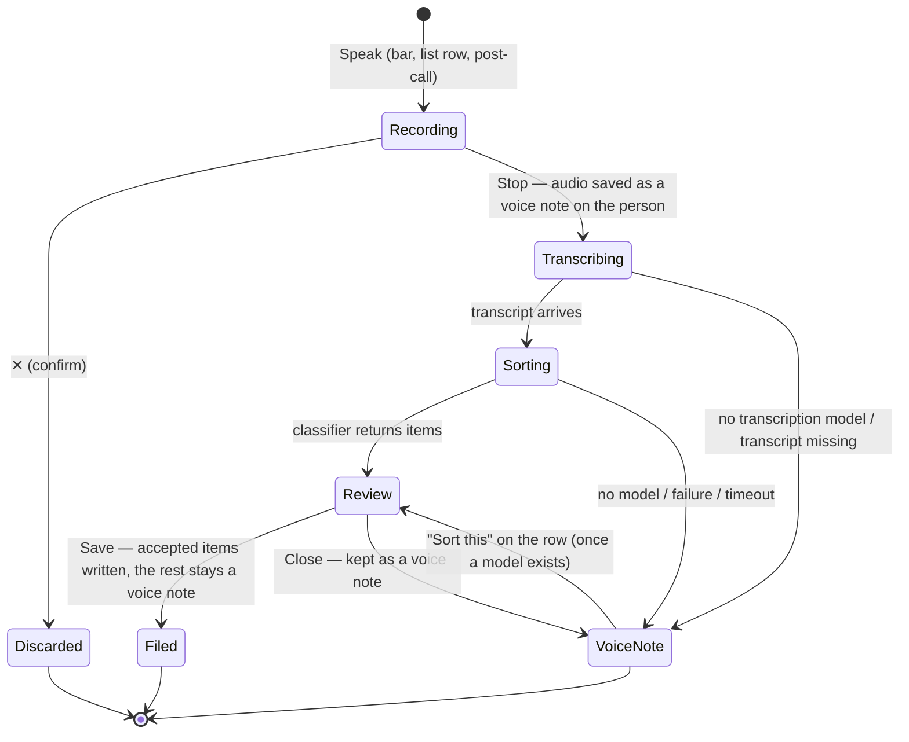

# People — the person timeline redesign

Status: **approved by the product owner on 2026-10-15** (decisions below); PR 1 in
progress. It supersedes the page composition of
[2026-09-06_people_redesign.md](2026-09-06_people_redesign.md) (the card stack),
while keeping the parts of it the panels rated well: the recorder, the cover hero,
the truthful cadence pills, the post-call loop and the token discipline.

Inputs:

- Code read of `lib/features/relationships/` (~23k hand-written lines), the
  [relationship concept](../../knowledge/features/relationships.md), ADRs 0038,
  0040, 0062, 0064, 0111, and the adjacent events, speech, agents and design-system
  modules.
- 83 baseline captures from `make people_inventory_screenshots` (the existing
  fixture rig, penguin demo world only).
- A design-review panel run on 16 of those captures: seven craft experts
  (hierarchy/IA, design-system, color, typography, spacing, interaction,
  "A-series" product craft) and three personas (ADHD busy connector, low-vision
  senior, keyboard power user). Grumpy calibrated 1–10 scoring, every claim tied to
  a screenshot or a `file:line`.

---

## Part 1 — Critique of the current feature

### Baseline scores

| Panel | Average | Range | Target |
|---|---|---|---|
| Design experts (7) | **4.5** | 4 – 5 | 9 |
| User personas (3) | **4.3** | 4 – 5 | 9 |

All three personas returned *would-struggle*. The one surface every reviewer
independently praised is the voice recorder (`check_in_recording_mobile_dark`): one
focal object, three controls with clear weight, a live status line. It is the bar the
rest of the feature must meet.

The panels also agreed that **the code is not the problem; the composition is.** The
feature is overwhelmingly token-driven — `DesignSystemSectionCard`, `DsPill`,
`DesignSystemGlassStrip`, `tokens.spacing.stepN` throughout. "Cobbled together" comes
from how those parts are stacked, so the redesign is a recomposition, not a rewrite.

### Inventory of the current surfaces

| Surface | What it holds today | Entry |
|---|---|---|
| People list | Summary card (due now / next due), bands *Due · On track · No reminders*, one row per person | `/people` |
| Person page | Hero (banner, avatar, back, agent, edit, ⋮) → header block (category, name, nickname · last spoke, cadence pills) → paused callout → post-call prompt → **Next time** card → **Briefing** card (6 states, proposals band, footer with model row) → **Check-ins** card (unbounded) → **Reach** card → **Tasks** card → glass bar (*Log check-in*, mic, call) | `/people/<id>` |
| Check-in composer | Header, note field with *Dictate*, chips (type, start, duration, feeling, topics/next time), Cancel / Save | bar, post-call prompt |
| Recorder | Orb, level line, ✕ / Stop+timer / pause | *Dictate*, mic |
| Check-in page | Crumb, title, chip row, *Edit check-in*, legacy note, Next time, `LinkedEntriesWidget` cards, glass bar (*Dictate*, comment, photo, +) | `/people/<id>/check-ins/<cid>` |
| Person editor | Photo card, Who (name, nickname, known terms, category, status), Important (switch + cadence), Reach (channels) | hero pencil |
| Agent chat | Shared agent chat surface | hero ✦ |

### Findings, by severity

**Critical** — a core job of the feature cannot be done.

| # | Finding | Evidence |
|---|---|---|
| C1 | **There is nowhere to write a note about a person.** `RelationshipData`'s doc comment says free-form notes live in the entry's `entryText`, but no UI reads or writes it. Background, where you met, a grandchild's school and gift ideas have no home, so users fake them as check-ins or lose them. `birthday` is stored but never shown or editable. | `lib/classes/relationship_data.dart:148-152`; person form has no notes field; Lena, Margit and Sam all blocked |
| C2 | **There is no timeline.** A person's history is split across three cards (Check-ins, Reach, Tasks) with three row recipes. The check-in log is unbounded and sits *above* Tasks and Reach, so those sink further with every check-in logged. Photos, notes and events cannot appear at all. | `relationship_details_page.dart:225-239`; `person_page_reach_tasks_mobile_dark` |
| C3 | **No check-in is visible on the first phone screen.** The hero, header, Next time and a 300–450 px briefing fill it. Margit concluded the person "has no history". | `person_page_mobile_dark` |
| C4 | **You can't create a task for a person from the page.** The path is: scroll past the whole log to the last card → *Link task* → type → pick the create row in a search picker. The bar and ⋮ offer no task action. | `linked_tasks_card.dart:92-147` |
| C5 | **There is no way to plan the next meeting**, although `JournalEvent` and the Daily OS Day view already exist. For a mentor or a parent, the next meeting is the single most important fact. | Sam and the interaction expert |

**High** — the job can be done, but the design works against the user.

| # | Finding | Evidence |
|---|---|---|
| H1 | **The briefing — the headline value — is the third block, and repeats the block above it.** *Next time* shows "the krill contract deadline"; the briefing then says it again. The AI plumbing (*See activity*, *Update now*, model row, tokens, attribution) is louder than the summary itself. | `person_page_mobile_dark`, `person_page_desktop_dark`; flagged by all 7 experts |
| H2 | **The voice paths can't be told apart.** *Log check-in* (waving-hand icon), an unlabelled mic disc, the composer's large *Dictate*, the check-in page's *Dictate* pill: four shapes and three words for one act. Lena couldn't tell whether the mic records at once or opens the sheet. | `relationship_action_bar.dart:133-171`; `check_in_capture_mobile_dark` |
| H3 | **After dictating, the composer shows two texts** (the take's transcript in a nested box, then a separate line under it), and users can't tell which one is the check-in. | `check_in_transcript_ready_mobile_dark` |
| H4 | **The opened check-in looks like a different app.** The legacy `LinkedEntriesWidget` cards stamp `8/1/2026 12:58 PM` beside a header chip reading `Sat 1 Aug · 12:44` (Margit reads 8/1 as 8 January). It is the third date grammar on the feature. | `check_in_open_mobile_dark`, `check_in_detail_view.dart` |
| H5 | **One hue carries five meanings.** `interactive.enabled` teal means pressable, the agent, *Delightful*, the post-call wash and a persona hue. In the sentiment pills, *Neutral* (grey fill) stands out more than *Good* or *Delightful*. | `ui/shared/sentiment.dart:19`; `post_interaction_prompt.dart:135-137` |
| H6 | **The chip grammar contradicts itself.** Solid bordered = editable fact, tinted = sentiment, dashed = unset slot … and also the action *Edit check-in*. Topics render as bordered pills that look tappable but aren't. | `check_in_open_mobile_dark`, `person_check_ins_mobile_dark` |
| H7 | **The call disc sits in the capture bar and can start a real call by accident.** It has no label and nothing confirms before dialling, which a low-vision user fears. Call and email also appear a second time in the Reach card. | `person_page_mobile_dark`; Margit blocker |
| H8 | **Desktop is a stretched phone column**: no reading width, the briefing runs the full 1,300 px, and nothing is keyboard-operable except Ctrl+Enter in the composer. | `person_page_desktop_dark`; Sam blocker |

**Medium**

| # | Finding | Evidence |
|---|---|---|
| M1 | **Duplicated doors.** Agent internals has three entry points (briefing header, *See activity*, ⋮). Cadence is shown in four places and editable in four. Photo editing has two. | UI inventory |
| M2 | **The post-call prompt's emphasis is inverted.** *Yes, log it* is secondary and *Dismiss* tertiary, on a teal wash that reads as an AI surface. | `person_page_post_call_mobile_dark` |
| M3 | **Typography.** Slashed zeros and tabular figures inside running text (`Sat 1 Aug 12:44` looks monospaced), card labels the same size as their content, and *Commander Pip Frostbeak* wrapping in list rows. | `relationship_timestamps.dart`; `people_list_mobile_dark` |
| M4 | **The People summary card repeats the list below it**: "1 due" over a band titled "Due · 1". | `people_list_mobile_dark` |
| M5 | **The sparkle means "important person" in the list but "agent" on the page.** | `people_list_row.dart` |
| M6 | **The collapsed header puts its title over the banner photo** with weak protection. | `person_check_ins_mobile_dark` |
| M7 | **Raw Material widgets in a design-system surface**: the hero's `PopupMenuButton`, the unlink `IconButton`, the form's `Switch`, three `CircularProgressIndicator`s, the narrative field's `width: focused ? 2 : 1`, and a raw `Divider(height: 1)`. | `person_header.dart:544`, `linked_tasks_card.dart`, `check_in_narrative_field.dart:121`, `check_in_detail_view.dart:750` |
| M8 | **The person form uses legacy `LottiTextField`; the composer uses `DesignSystemTextInput`.** | `relationship_form_modal.dart` |

**Low / privacy consistency**

| # | Finding |
|---|---|
| L1 | Check-ins are kept out of search on purpose (ADR 0037, 0064), but a check-in's **comments and recordings are ordinary entries and are searchable** in the Logbook. Decide this once for the timeline, and fix it for check-in contents in the same stroke (see open question Q3). |
| L2 | `knownTerms` ("Names that come up") is the only free-text field in the editor, and it is a spelling aid, not a notes field. Margit read it as notes. |

---

## Part 2 — Design proposal

### Principles

1. **One page, one story.** Who they are, then what to know before you talk, then
   everything that happened and will happen, in time order. Nothing else gets a card.
2. **One verb to capture, by voice first.** Speaking is the primary act everywhere.
   Typing is the second act. Everything else lives in one create menu.
3. **One row grammar.** Every item on the timeline (check-in, note, voice note,
   photos, task, event, agent suggestion) uses the same row: a neutral type tile, a
   caption meta line in one date grammar, and a body. Type is carried by icon and
   word, never by colour alone.
4. **One elevated surface.** Only the *Before you talk* block sits on a card. The
   timeline is the page itself: borderless rows with day headers.
5. **Agent quietly present.** The briefing stays central (it is the feature's value),
   but its plumbing — refresh, model, cost, activity — moves behind one quiet ⋯.

### The person page (phone)

```
┌──────────────────────────────────────┐
│ ‹                          ✦    ⋮    │ glass toolbar: back · agent · manage
│ ░░░░░░░░ banner (shorter) ░░░░░░░░░░ │
│ (◉)  Commander Pip Frostbeak         │ avatar inline with name, not overhanging
│      Penguin Operations              │
│ [⚠ 5 days over] [🔔 Weekly ▾]        │ one status pair; tap ⚠ → Speak / Plan
│ [☎ Call] [✉ Message] [@ Email]       │ contact row, labelled; call confirms
│                                      │
│ ┌ Before you talk ─────────────────┐ │ the only card (aiCard surface)
│ │ Bring up  The krill contract,    │ │ user's own Next-time lines first,
│ │           due on the 28th.       │ │ with attribution caption
│ │ Avoid     Re-litigating pad-3.   │ │
│ │ ──────────────────────────────── │ │
│ │ Pip is in good spirits; the      │ │ agent takeaway, bodyLarge, ≤3 lines
│ │ deadline is the thing to raise.  │ │
│ │ ● Thriving · updated 3 h ago   ⋯ │ │ one caption row; ⋯ = Update, Activity,
│ └──────────────────────────────────┘ │ model; sources on expand
│                                      │
│ About Pip                            │ pinned notes + birthday, max 3 lines
│  Met at the 2019 ice summit. Hates   │ each, "Show all (5)"
│  calls before 10.          🎂 12 Mar │
│                                      │
│ All · Check-ins · Notes · Tasks · …  │ filter pills (from 8 items)
│ UPCOMING                             │ calmEyebrowStyle, sticky
│ ▢ Sun 18 Oct 15:00 – 17:00           │ event row
│   Coffee with Pip                    │
│ ○ Send Pip the krill contract  Fri   │ open task with due date
│ THIS WEEK                            │
│ ☎ Sat 1 Aug 12:44 · Call · 11 min    │ check-in row
│   Walked through the launch window   │
│   slipping a week. Pip is calm…      │
│   ☺ Good · launch window · krill     │ glyph+word sentiment, topics as caption
│   🎙 1 recording · 💬 1 comment       │
│ ✎ Fri 31 Jul · Note                  │ note row
│   Prefers mornings; ask about Tilly. │
│ ▣ Thu 30 Jul · 3 photos              │ photo strip row (thumbnails)
│   [▪][▪][▪]                          │
│ ✦ Suggested · Book the pad-3 review  │ agent proposal row, ✓ / ✕
│ JULY                                 │
│ …                                    │
│ Show earlier                         │
├──────────────────────────────────────┤
│ [ 🎙 Speak            ] [✎]  [ + ]    │ sticky glass bar
└──────────────────────────────────────┘
```

- **Toolbar ⋮ (manage the person):** Edit person · Link / update contact · Agent
  internals · Delete. The pencil leaves the toolbar. Built on
  `DesignSystemContextMenuAnchor`, replacing the Material `PopupMenuButton`.
- **Bar:**
  - **Speak** (primary `DsGlassPill`, mic) opens the recorder straight away (Part 2,
    "Speak your mind").
  - **✎ Check-in** (`DsGlassRoundButton`, labelled tooltip) opens today's composer
    for a typed or explicit check-in (option A).
  - **+** (`DsGlassRoundButton`) opens the create menu, as a `DsActionModal` on
    phone and a `DesignSystemContextMenu` on desktop: *Add a note about Pip* ·
    *Create a task for Pip* · *Add photos* · *Plan a meeting* · *Log a check-in*.
  - Call leaves the bar.
- **Contact row:** labelled `DesignSystemButton`s (small, outlined) for the channels
  the device can service. Call opens a one-line confirmation sheet ("Call Pip on
  mobile?"). The post-call loop is unchanged. The *Reach* card is gone; editing
  channels stays in the person editor.
- **Upcoming:** future events, plus open tasks that have a due date, pinned above
  the dated history. Open tasks without a due date sit at their creation date.
- **About:** notes the user pinned (star on a note row), plus the birthday. It is the
  answer to "where we met / gift ideas", and it shows nothing when empty: the empty
  state lives in the timeline.
- **Empty person:** the timeline shows one teaching line ("Speak after you talk to
  Pip — or add a note, a task or a meeting") above three ghost rows, and the bar's
  Speak pill gets a one-time pulse.

### The person page (desktop, ≥ the split breakpoint)

```
┌ People list ┐┌───────────────────────── detail pane ─────────────────────────┐
│             ││ hero (shorter)                                    ✦  ⋮        │
│             ││ (◉) Commander Pip Frostbeak  [⚠ 5 days over] [🔔 Weekly ▾]     │
│             ││┌ timeline (kDetailContentMaxWidth) ──────┐┌ rail (fixed) ──────┐ │
│             │││ filters                                 ││ Before you talk    │ │
│             │││ UPCOMING …                              ││ About Pip          │ │
│             │││ THIS WEEK …                             ││ Contact (☎ ✉ @)    │ │
│             │││                                         ││ Reminders          │ │
│             ││└─────────────────────────────────────────┘└────────────────────┘ │
│             ││              [ 🎙 Speak ] [✎] [+]   (glass bar, centred)         │
└─────────────┘└─────────────────────────────────────────────────────────────────┘
```

Keyboard: `s` speak, `c` check-in, `n` note, `t` task, `e` plan a meeting, `j/k` move
through the timeline, `Enter` open. The shortcuts are shown in the tooltips and
registered through the existing `AppCommandHost` keyboard system.

### The timeline row (new design-system component)

The design system has no timeline item today (the closest are the journal's
`LinkedEntriesWidget` and `GroupedCardRowSurface`). Add
**`DesignSystemTimelineRow`** under
`lib/features/design_system/components/timeline/`, with
**`DesignSystemTimelineSectionHeader`**:

```
┌──────────────────────────────────────────────┐
│ [tile]  caption meta · · ·            trailing │  tile: ControlSizes.iconChip,
│         body (bodyMedium, ≤3 lines,            │  background.level03, glyph in
│         sentence-aware clamp)                  │  text.mediumEmphasis
│         footer slot (sentiment, counts, media) │
└──────────────────────────────────────────────┘
   hairline divider in decorative.level01, inset to the text column; step3 rows
```

- **Slots:** `leading` (type tile), `meta` (`DsTieredText`), `body`, `footer`,
  `trailing` (a pill or an action), plus `onTap`, `onLongPress` and `semanticsLabel`
  (asserted at construction, per the component contract).
- **Ramp:** section header = `calmEyebrowStyle`; meta = caption with the new
  `dateFigureFeatures` (tabular, no slashed zero); body = bodyMedium; footer = caption.
  Never more than three sizes in a row.
- **Colour:** neutral tiles for every type. The only tinted tile is the agent's (the
  aiCard wash plus a sparkle), for suggestions. Amber is used only for due or
  overdue, the success check only for done, and teal only on actions.
- **Sentiment:** a glyph plus a word, with the ink on the glyph only. *Neutral* shows
  nothing. This takes `interactive.enabled` off *Delightful*.
- **Reused** by the person timeline **and** the check-in page (replacing
  `LinkedEntriesWidget` there), so both pages share one row and one date grammar.

### One date grammar

`relationship_timestamps.dart` keeps exactly three named forms, and every date on the
feature (including what used to come from the journal cards) goes through them:

| Form | Example | Use |
|---|---|---|
| point in time | `Sat 1 Aug 12:44` | rows, chips |
| day | `Sat 1 Aug` | section headers, due dates |
| relative age | `3 h ago`, `5 days over` | status lines only |

Durations are written `11 min` or `1 h 30`. Date figures use `dateFigureFeatures`, not
`slashedZero`.

### Before you talk (the briefing)

- One `aiCard` surface replaces both the Next time card and the briefing card.
- **Order:**
  1. The user's own *Bring up* / *Avoid* lines (`NextTimeFacts`), with a caption
     naming the source check-in.
  2. The agent's takeaway in bodyLarge, at most three lines, with *Read more*
     expanding the full TL;DR and its sources.
  3. One caption row: a health dot and word, "updated 3 h ago", and ⋯ holding
     *Update now*, *See activity* and the model/provider row (with cost).
- **When there's a next meeting**, the card says so: "Before Sunday's coffee". That
  is the moment the user opens it.
- **Out-of-date and failed states** keep today's semantics (the previous briefing
  stays readable). Only their chrome shrinks to the caption row, plus one inline
  primary (*Update now* / *Try again*) when action is needed.
- **Agent suggestions** leave the card and become rows in the timeline under
  "Suggested", with ✓ / ✕ and swipe (`ProposalRow` behaviour, timeline-row look).
- **Not enrolled:** the card becomes a one-line offer ("Get a briefing before you
  talk to Pip") with a single primary *Turn on*. The cadence picker moves to the
  bell pill's sheet, which already exists.

### Capture flows

#### Option A — an explicit check-in

✎ Check-in (or *Log a check-in* in the create menu, or the post-call *Yes, log it*)
opens today's composer, with these changes from the panel:

- **Dictated words become the editable body.** The take is shown as a compact audio
  chip (duration, play, *Remove recording* with an undo toast). There is no second
  text.
- **Voice alone is enough to save.** The save reason moves into the field's helper
  text. The Ctrl+Enter hint shows on desktop only.
- **The post-call prompt** gets a primary *Yes, log it* (mic, `startSpeaking: true`)
  and a quiet *Dismiss*, on `background.level02` with a hairline border, addressing
  the person by nickname.

#### Option B — Speak your mind



1. **Record.** *Speak* opens the existing recorder sheet titled "Speak about Pip",
   with a quiet hint under the orb: *"A conversation you had, something to remember,
   or a plan."* A caption names the model and provider that will sort it ("Sorted on
   this device by Ollama · qwen3" / "Sorted by Gemini"), so nothing leaves the device
   unannounced. This mirrors how the briefing names its model before *Brief now*.
2. **Stop.**
   - The audio is saved **immediately as a voice note on the person's timeline**
     (`RelationshipLink` person → audio). A crash, a kill or a closed sheet therefore
     always leaves a sensible voice note, never a lost recording.
   - Transcription runs through `CheckInTranscriptionService` (the default profile's
     transcription slot, with the person's names corrected).
3. **Sort.**
   - A new skill, `sort_person_capture`, is one forced tool call (the
     `recording_summary_tool.dart` pattern) on the person's resolved profile
     (`ProfileAutomationResolver.resolveForSubject`, thinking slot).
   - It returns up to three items:
     - `checkIn {interactionType, startedAt?, durationMinutes?, topics[], bringUp?, avoid?, summary}`
     - `note {text}`
     - `meeting {title, start, durationMinutes}`
     - `task {title, dueDate?}`
   - Every date is ISO local and validated deterministically by round-trip (the
     `relationshipTaskProposalError` precedent). An invalid date drops the field,
     never the item.
   - The prompt carries now, the user's time zone and the person's name, and never
     the contact channels.
4. **Review.**
   - "Here's what I heard" shows the transcript, collapsed to two lines, then one
     timeline-row card per item:
     - *Log as a check-in — Call · today 12:40 · 10 min*
     - *Plan a meeting — Coffee with Pip · Sun 18 Oct 15:00 – 17:00*
     - *Keep as a note*
   - Each card has ✓ / ✕ and editable chips that reuse the composer's pickers
     (`pickCheckInStart`, `showCheckInDurationPicker`). One **Save** files every
     accepted item at once (the *Confirm all* pattern). Sentiment is never inferred:
     it stays the user's (ADR 0038).
5. **File.**
   - check-in → `createCheckIn` + `attachEntriesToCheckIn(audio)`, and the voice
     note's `RelationshipLink` is retired. The timeline then shows the check-in
     holding the recording, not a duplicate.
   - meeting → a planned `JournalEvent`, linked to the person and to the audio.
   - task → linked as today.
   - note → the voice note stays and gains its transcript as the body.
   - The briefing is touched once.
6. **Fallbacks.**
   - No transcription model, or no thinking model: the recording stays a voice note,
     and its row offers *Sort this* once a model exists.
   - Classification is **always reviewed, never auto-filed**. The agent rule "proposals
     need confirmation" (relationship agent contract, rule 4) applies here too.

Entry points: the person bar's *Speak*, the post-call prompt, and a long-press on a
People list row (record straight into that person).

#### Notes, tasks, photos, meetings (the create menu)

| Item | Sheet | Written as |
|---|---|---|
| Note | `DesignSystemTextInput` multi-line with in-field Dictate, a *Pin to About* toggle, Save. Typed or spoken. | `JournalEntry` (pinned = `meta.starred`) |
| Task | `EntryCreationService.createTaskAndOpen` prefilled with the person's category and privacy | `Task` |
| Photos | `importImagesForPlatform` | `JournalImage`s, grouped into one row per day |
| Meeting | Title (prefilled "Meet {nickname}"), day, start, duration (the same pickers as the composer) | planned `JournalEvent` with `dateFrom`/`dateTo`; appears on the Daily OS Day view |
| Check-in | today's composer | `CheckInEntry` |

Every item inherits the person's category and private flag, and is linked person → item
with `RelationshipLink`.

### Check-in page

- The same hero, glass bar and timeline row as the person page.
- Its contents (recordings, comments, photos) render as `DesignSystemTimelineRow`s, so
  `8/1/2026 12:58 PM` disappears.
- *Edit check-in* moves into the toolbar ⋮.
- Topics become caption text.
- The page's own Next time card goes. Those lines are already in the chip area's
  details and in *Before you talk*.
- The primary in the bar becomes *Add recording*.

### People list

- The summary card is replaced by one "Up next" line (the next due person plus a
  one-line briefing teaser).
- Names are 16/600 and never wrap the pill. The due pill moves onto the meta baseline
  so every row has the same height.
- The sparkle leaves list rows.
- A long-press on a row starts *Speak* for that person.

---

## Part 3 — Implementation plan

### Data model (no schema migration, no new link or entity type)

**Decision: a person's timeline is the set of `RelationshipLink` targets from the
person**, plus their check-ins.

- **Reuses an existing link.** `RelationshipLink` (person → X) already exists, already
  syncs, and today binds check-ins and tasks. Extending its target set to
  `JournalEntry` (note), `JournalAudio` (voice note), `JournalImage` (photo) and
  `JournalEvent` (meeting) needs **no migration, no new link variant and no ADR 0042
  amendment.**
- **Older clients are safe.** Older readers resolve targets by type
  (`getLiveTasksByIds` filters `type='Task'`; check-ins are read through the indexed
  `subtype`), so they ignore the new targets.
- **Plain `BasicLink` person → entry stays non-timeline.** Today it carries the avatar
  and banner images and leftover dictation takes, which is exactly why it cannot be
  the timeline signal.
- **Where it is written.** One repository entry point,
  `RelationshipRepository.addToTimeline(personId, entryIds)`, used by every create
  path, plus `removeFromTimeline`.
- **The existing `RelationshipEntry.entryText`**, written by no UI today, is read as a
  first pinned note at read time with no rewrite — the ADR 0062 precedent.
- **Delete cascade.**
  - Deleting a person tombstones the notes, voice notes and photos only it holds (the
    `_softDeleteEntriesOf` rule).
  - Tasks and meetings survive, as tasks do today: they are independent entities the
    user may have elsewhere.
  - *Remove from Pip's timeline* on a row unlinks; *Delete* deletes.
- **Recorded as a new ADR, 0138** ("a person's timeline is their RelationshipLink
  targets"), amending ADR 0038's link semantics. The concept and the code map are
  updated with it.

**Reads.**

- `JournalDb.relationshipTimelineTargets(personId, {before, limit})`: the typed link
  rows joined to live journal rows, keyset-paged by `dateFrom`, private-filtered. A
  single query, with no N+1.
- The pure function `buildPersonTimeline(...)` merges those targets with check-ins and
  agent proposals into sections (*Upcoming* / *This week* / months), groups same-day
  photos and applies the filters. It is pure, so it is table-tested.
- `personTimelineControllerProvider(personId)` is a hand-written
  `AsyncNotifier.family`, matching `RelationshipDetailController`'s style.
  - It wakes on the person id (a link write already notifies it) and on the ids it
    holds.
  - It keeps the last data on reload (`skipLoadingOnReload`, per the
    no-flash-on-refresh rule).
  - It loads the first 60 days plus Upcoming, then pages by *Show earlier*.

**Agent context** (an ADR 0040 amendment in the same ADR):

- `relationship_facts_renderer.dart` gains bounded sections:
  - **NOTES**: pinned notes, plus the 10 newest, each capped at 400 characters.
  - **UPCOMING**: meetings in the next 30 days, plus open tasks with due dates.
  - **VOICE NOTES**: transcripts, newest 5.
- Avatar and banner images and contact channels stay out.
- Phase A's "evidence changed" watermark also takes the newest `updatedAt` among the
  timeline targets, so a new note or meeting makes the briefing out of date, exactly
  as a new check-in does.
- The task-proposal validator accepts a note id as a source alongside check-in ids.

### Ordered pull requests

Following the "bigger, fewer PRs" practice: four PRs, each independently shippable
behind the existing `enable_relationships` flag. Each is iterated through the
design-review panel until **both panel averages are ≥ 9 on regenerated captures**
before it is opened, with before/after pairs from the inventory rig published via
`make pr_screenshots_publish`.

**PR 1 — The timeline page (the structural lever)**

1. ADR 0138 and concept updates (relationships, design-system component contracts).
2. Repository work: `addToTimeline` / `removeFromTimeline`; the DB query; the delete
   cascade extension; the `entryText` read-time migration.
3. The pure `buildPersonTimeline` and its sections; `personTimelineControllerProvider`.
4. The design system: `DesignSystemTimelineRow`, `DesignSystemTimelineSectionHeader`,
   `dateFigureFeatures` and the three date forms; promote `PersonLeadingGlyph` into the
   design system as the type tile.
5. The person page recomposed: shorter hero with the avatar inline; the status pair;
   the contact row with call confirmation; *Before you talk* (merging `NextTimeCard`
   and the briefing chrome, with suggestions moved to timeline rows); *About*; the
   timeline sliver.
   - Deleted: `CheckInsCardSliver`, `LinkedTasksCard`, `ReachCard`, `NextTimeCard`
     (with their tests rewritten, not dropped).
6. The bar: Speak (which opens today's recorder → composer until PR 4), ✎ Check-in,
   and the create menu with **Note, Task, Photos, Check-in**. Note sheet with
   pin-to-About.
7. The toolbar ⋮ on `DesignSystemContextMenuAnchor`; the pencil moves inside.
8. The desktop two-column layout and the keyboard shortcuts.
9. Agent facts: NOTES and VOICE NOTES; the watermark.
10. l10n in every catalog (informal register), a `changelog.d` fragment, and the
    README and concept rewritten for the new page.

**PR 2 — One grammar on every check-in surface**

1. The check-in page on `DesignSystemTimelineRow`; *Edit check-in* into ⋮; *Add
   recording*.
2. Composer: transcript-as-body with the audio chip; voice-only save; helper-text
   reason; desktop-only shortcut hint.
3. Post-call prompt emphasis and surface.
4. Chip grammar documented in `DsPill`'s contract, and violations fixed; sentiment as
   glyph plus word (adding mood glyphs to `LottiIcons` only if the existing set can't
   carry it — ask first).
5. People list: *Up next* line, row height, no sparkle, long-press to Speak.
6. The raw-Material sweep (M7) and `LottiTextField` → `DesignSystemTextInput` in the
   person form; a birthday field in the editor.

**PR 3 — Plan a meeting**

1. The meeting sheet (title, day, start, duration) creating a planned `JournalEvent`
   linked to the person.
2. Upcoming rows; *Before you talk* keyed to the next meeting ("Before Sunday's
   coffee"); the ⚠ pill's *Plan a meeting* action.
3. Agent facts: UPCOMING. The meeting shows on the Daily OS Day view through the
   existing event projection (verified with a test there).

**PR 4 — Speak your mind**

1. The `sort_person_capture` skill: tool schema, parser, deterministic date validator
   and prompt (bounded, no channels).
2. `PersonCaptureService`: record → voice note → transcript → sort → review model,
   with a pure, table-tested state machine like `CheckInSpeechPhase`.
3. The review sheet (timeline-row item cards, editable chips, Save) and the filing
   transaction.
4. *Sort this* on unsorted voice-note rows; the model/provider caption in the
   recorder; entry points (bar, post-call, list long-press).

### Tests (per PR, one test file per source file)

- **Pure logic, table-tested with deterministic dates:**
  - `buildPersonTimeline`: sections, upcoming pinning, photo grouping, filters, the
    legacy `entryText`, private filtering, paging boundaries.
  - The date forms and the `dateFigureFeatures`.
  - The capture state machine.
  - The sort-result validator: round-trip dates, dropped fields, at most three items,
    no sentiment.
- **Repository (in-memory `JournalDb`):**
  - `addToTimeline`'s link rows and their notifications.
  - The delete cascade: notes, voice notes and photos go; tasks and meetings stay;
    shared entries stay.
  - The timeline query's keyset paging; older-type readers unaffected
    (`getLinkedTasks` still returns only tasks).
- **Agent:** facts renderer golden-string tests for the NOTES, UPCOMING and VOICE
  NOTES bounds; the Phase A watermark moving on a new note; the proposal validator
  accepting note sources.
- **Widgets:**
  - `DesignSystemTimelineRow`: the slots, the semantics assertion, large text and
    both themes.
  - The person page:
    - section order;
    - every create-menu path writes the expected entity and link;
    - call confirmation;
    - Before you talk in all six agent states;
    - no loading flash on a background reload.
  - The review sheet: accept/reject, chip edits, Save files exactly the accepted
    items.
- **Regression tests re-run with the fix reverted** (the repo rule), and the
  inventory rig extended with the new states (empty timeline, Upcoming, About, create
  menu, meeting sheet, review sheet), so the after captures come from the same
  fixtures as the before.
- **Locally**, only the touched test files run via dart-mcp. CI runs the sharded
  suite.

### Decisions (product owner, 2026-10-15)

| # | Question | Decision |
|---|---|---|
| Q1 | Bar create control | **+** — the toolbar ⋮ stays "manage this person"; the bar's + opens the create menu. |
| Q2 | Meetings vs `enableEventsFlag` | **Always on people** — a person's meetings show on their timeline and the Day view regardless; only the Events tab stays gated. |
| Q3 | Search and embeddings | **Hidden** — notes, voice notes and photos on a person's timeline are excluded from Logbook search and embeddings like check-ins, and check-in contents are fixed to match, in PR 1. |
| Q4 | Briefings without reminders | **Out of scope** for this plan (ADR 0111 unchanged). |
