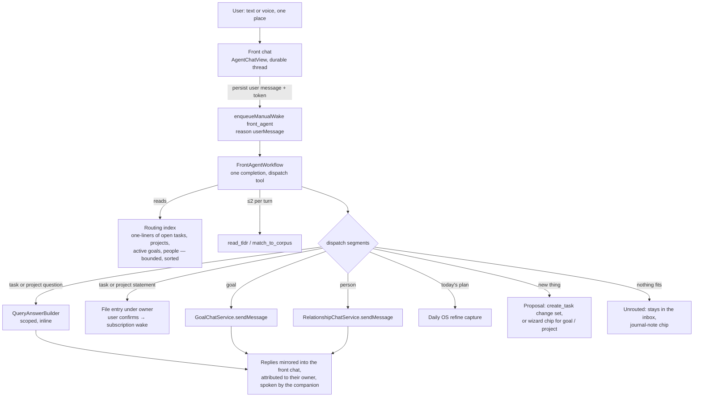

# Single Agent Entry Point: one front agent that dispatches

Date: 2026-10-23
Status: concept and plan; the owner's decisions on the open questions are in §5 (2026-10-23); slice 0 in progress
Builds on: [2026-10-12_in_app_agent_avatar.md](2026-10-12_in_app_agent_avatar.md)
(the companion, whose branch 6 "hold her to talk" this plan re-points),
[2026-08-08_reusable_chat_interface_requirements.md](2026-08-08_reusable_chat_interface_requirements.md)
(the shared chat component every surface below reuses) and
[2026-07-22_day_agent_directive_status_protocol.md](2026-07-22_day_agent_directive_status_protocol.md)
(no RPC between agents: durable entities and wake tokens only)

## Goal

One place where the user talks to a single front agent, the companion. She
decides where each request belongs and hands it to the task, goal, project or
person agent that owns it, or files it when nothing owns it yet. Today a
conversation can only start from the thing it is about, so the user has to
know where to go before saying anything. The character experience the avatar
plan describes, one companion you talk to, does not work without this.

Terms used below: the **front agent** is the runtime identity (`front_agent`);
the **companion** is her face and voice; a **specialist** is any existing agent
she dispatches to; a **door** is the code path through which a specialist
already receives user input today.

## 1. Survey: how agent chat is wired today

Verified 2026-10-23 against the worktree at `42a70cfdf5` (1.1.62).

### Two chat architectures, and task agents have neither

| Surface | Turn path | Reply path | Voice | Scope |
|---|---|---|---|---|
| Goal chat (`lib/features/goals/ui/goal_agent_chat_pane.dart`) | `GoalChatService.sendMessage` (`lib/features/goals/service/goal_chat_service.dart`): persists `AgentMessageEntity(kind: user)` + payload, arms a lease-elected recovery `ScheduledWakeEntity` (`goal-chat:<id>`, ADR 0069), then `enqueueManualWake(reason: userMessage, triggerTokens: {goal-chat-message:<id>})` | `reply_to_user` tool → `AgentMessageEntity(kind: action)` keyed by `operationId`; UI watches `agentChatProjectionProvider` (`lib/features/agents/state/agent_chat_projection.dart`) | `chatRecorderControllerProvider` via `AgentChatView` | prompt-enforced: "not a general assistant", redirects off-topic |
| Person chat (`lib/features/relationships/ui/widgets/relationship_chat_pane.dart`) | `RelationshipChatService.sendMessage` — same pattern, token `relationship-chat-message:<id>`, **no recovery record** | same | same | same |
| Query chat "Ask" on a task or project (`lib/features/agents/ui/query/query_chat_pane.dart`, flag `enable_query_chat`) | `QueryChatController.send` runs `QueryAnswerBuilder` **inline**, no wake; history is `AgentQueryChatEventEntity` | streamed provisional answer; task scope may add `proposedActions` via `QueryTaskActionPlanner` → `ChangeSetBuilder` → inline `QueryActionReview` | same recorder | structural (`QueryScope` + live access checks) |
| Template evolution chat (`lib/features/agents/ui/evolution/evolution_chat_page.dart`) | in-memory session with the template's evolution agent, no wake | whole response | own input widget | one template |
| Daily OS check-in / refine | `CaptureController` → `CaptureEntity` + `parseCapture` outbox job → day-agent wake `capture_submitted:<id>` | reconcile list, drafted plan | own recorder | the planner's categories |
| Companion (`lib/features/companion/`) | **no input**; TTS of host-authored text (`CompanionSpeaker`) | — | — | — |

Three facts shape everything below:

1. **A task agent never receives a user turn.** "Ask" on a task is the query
   pipeline, which reads the task's maintained report and may *propose*
   changes, but the task agent's own tool list has no `reply_to_user`
   (`lib/features/agents/tools/agent_tool_registry.dart`). The only way user
   words reach a task agent today is a journal entry linked to the task, which
   wakes it through its subscription. Project chat is query-only as well.
2. **Wakes carry no message.** `WakeOrchestrator.enqueueManualWake`
   (`lib/features/agents/wake/wake_orchestrator.dart`) takes an agent id, a
   reason and trigger tokens; the established pattern is *persist a durable
   entity, pass its id as a token*. Agent-to-agent handoff does not exist
   beyond that (query-chat.md: "agent-to-agent questions are not yet
   implemented"); the Daily OS coordinator talks to per-day agents through
   `DayDirectiveEntity` / `DayStatusEventEntity`, never by waking them.
3. **The record is only ever changed through change sets**, except for ADR 0102's
   short pre-approved list (`docs/adr/0102-pre-approved-agent-changes.md`),
   which notably includes the day agent's `create_task_from_phrase`.
   Confirmation runs through `ChangeSetConfirmationService`
   (`lib/features/agents/service/change_set_confirmation_service.dart`), with
   idempotent effects across devices (ADR 0075).

### The derived index that exists

- `AgentReportEntity.oneLiner` / `tldr` / `content`
  (`lib/classes/agents/agent_domain_entity.dart`) for task, project **and
  goal** agents (`update_report`, `update_goal_report`).
- Batch read paths by id: `getLatestTaskReportsForTaskIds`,
  `getLatestReportsByAgentIds` (`lib/database/agents/agent_repo_queries.dart`).
  **There is no "every one-liner at once" query**; the nearest catalogue is
  `QuerySummaryReader.discover()` (`lib/features/agents/query/query_summary_reader.dart`),
  one category, ≤200 tasks, `{title, status, tldr}` — and it deliberately
  excludes one-liners ("never the action-focused one-liner").
- The day agent already embeds a **bounded task corpus** in capture wakes
  (`DayAgentCorpusService.buildTaskCorpusSnapshot`,
  `lib/features/daily_os_next/agents/service/day_agent_corpus_service.dart`:
  ≤200 open tasks as `{taskId, title, status, categoryId, due, estimate, priority}`),
  matches phrases against it with FTS5 (`match_to_corpus`, ≤8 candidates) and
  classifies with fixed thresholds: `≥0.75` strong, `0.5–0.75` low confidence,
  `<0.5` new (`lib/features/agents/model/seeded_directive_content.dart`).
  **This is a working dispatcher, scoped to tasks and one day.**
- Embeddings are Ollama-only, flag-gated, local, with freshness gaps; no agent
  has vector search as a tool. Not a routing substrate.

### Tool-call discipline that exists

- Hard: `maxTurnsPerWake = 10` (`lib/features/ai/conversation/conversation_repository.dart`).
- Soft: `goalMemorySearchesPerWake = 3` — the tool stays listed, the handler
  returns a refusal string after the cap (`lib/features/goals/workflow/goal_memory_search.dart`).
- `ConversationStrategy.toolsForTurn` is the per-turn hook; its only user
  (`TaskAgentStagedToolExposure`) *widens* the set after turn 0. Nothing
  shrinks a set mid-conversation today.
- The "41 tool queries in one turn" incident is not recorded anywhere in the
  repo; this plan treats it as the motivating anecdote.

### Cost and caching that exist

- `consumption_events` carries `agent_id`, `thread_id`, `wake_run_key`;
  `sumConsumptionByAgent` exists, a per-thread sum does not, and the
  `ConsumptionSummaryPill` shows only on task and goal detail.
- Prefix rule: consecutive wake prompts are byte-identical up to the append-only
  tail, blocks ordered by volatility, machine-checked
  (`knowledge/features/agents/memory-and-compaction.md`). Cached input tokens
  are recorded from the provider's usage. No provider-specific cache markers
  are sent.
- The cheap tier that gets compact scaffolds and temperature 0: `deepseek-v4.1-flash`,
  `glm-5.3-flash`, `qwen3.5-122b-a10b`, `mistral-small-4-119b-instruct`.
  DeepSeek quirks to design around: a named `tool_choice` with one tool is
  rewritten to `auto`, and a pinned choice is answered with prose.

### The companion today

An animated character with on-device TTS, a synced `CompanionCustomization`
(`skinTone, hairStyle, hairColour, outfitId, sass`), and **no input and no
prompt role**: `CompanionSass {warm, cheeky, sassy}` only picks faces and
gestures (`lib/features/companion/model/companion_reaction.dart`). Agent
personality is a separate thing, the template **soul**, injected as its own
`## Your Personality` block by `TaskAgentPromptBuilder`. The avatar plan's
branch 6 would route "hold her to talk" **by host screen** (task page → that
task's query chat, Daily OS → refine). This plan replaces that: she is one
place, and *she* decides.

### Doc drift found while surveying

Not fixed here; worth a follow-up in the knowledge bundle. `wake-orchestration.md`
says `WakeReason` has five values (six; `userMessage` is missing); `overview.md`
says agents are created `active` (`createTaskAgent` rewrites to `dormant` when
the setup is disabled); `relationships.md` says chat stacks as its own page on
every layout (desktop opens a side sheet); `GoalAgentWorkflow`'s class comment
says it runs only on escalation wakes; `goals.md` both removes and keeps
"Ask why". The static Melious catalogue id `deepseek-v4-flash-0731` and the
evaluated `deepseek-v4.1-flash` are not reconciled anywhere.

## 2. Proposed architecture



### 2.1 Identity and registration

- `AgentKinds.frontAgent = 'front_agent'` (`lib/classes/agents/agent_constants.dart`),
  one singleton identity per user with the fixed id `front_agent`, created
  lazily on first open the way `daily_os_planner` is
  (`getOrCreatePlannerAgent`). Its `allowedCategoryIds` start **narrow**:
  the day planner's allow-list when one exists, otherwise empty until the user
  opts categories in. **Every index source and every lookup filters through
  that allow-list** — tasks, projects and goals are category-scoped and a
  project or goal outside it is neither listed nor a valid destination. People
  rows are a second, separate opt-in (decision 4).
- **Her own inference setup**, resolved through
  `agentResolvedSetupResolversProvider` like the relationship agent, defaulting
  to the cheapest evaluated model that passes slice 0. It is used for routing
  only, where a stable prefix pays; a question walked through a door runs on
  the destination's setup, so answers keep the quality the user chose there
  (decision 8).
- **Template-less runtime kind**, the goal/relationship precedent (ADR 0053,
  0059): a `FrontAgentWorkflow` contributed through `agentWakeRunnersProvider`
  (`lib/features/agents/state/agent_runtime_registry.dart`), registered in the
  composition root and pinned by the `agent runtime registrations` test group.
  No template, no soul document, no evolution ritual in v1 — the persona is
  the companion's, see 2.6.
- Lives in a new `lib/features/front_agent/` (model, service, workflow, state,
  ui, README) and imports agents, goals, relationships, daily_os_next and
  companion *downward*. Nothing in those features imports it. It sits at the
  top of the layer order with settings.

### 2.2 The turn path: the goal-chat pattern, verbatim

`FrontChatService.sendMessage` copies `GoalChatService` including the
recovery record (ADR 0069), so a message sent on one device is answered
exactly once by whichever device wins the lease:

1. persist `AgentMessagePayloadEntity {text}` and
   `AgentMessageEntity(kind: user, threadId: messageId)` under `front_agent`;
2. `notifyUiOnly`;
3. arm `ScheduledWakeEntity` `front-chat:<messageId>`, due in 30 min;
4. `enqueueManualWake(agentId: front_agent, reason: userMessage,
   triggerTokens: {front-chat-message:<id>}, supersede: false, initiator: user)`
   and await `runCompletions` for that run key.

**The front wake writes the dispatch record and nothing else.** Walking the
doors happens in `FrontChatService` *after* `runCompletions` reports the
front run finished, outside any wake slot. The goal and person chat services
enqueue a specialist wake and await its completion; calling them from inside
the front wake would deadlock at concurrency 1, with the front run holding the
only slot while it waits for a run that cannot start. The walker is
durable and duplicate-safe: the recovery record stays **pending until the
walker has finished**, not until the front run completes, so a crash between
the two leaves a retry trigger; and before a door is invoked the segment is
**claimed** with a conditional update under a stable idempotency key
(`<dispatchMessageId>:<segmentIndex>`), so two devices or a retry cannot walk
the same segment twice — the claim, then the door, then the result ids, the
`ChangeDispatchIntents` discipline. A door that enqueues a wake does not
block the walker either; the reply arrives through the projection when it
lands.

The chat UI is `AgentChatView` over `agentChatProjectionProvider(front_agent)`,
extended with a card registry entry for the new `dispatch` action kind (REQ-06:
unknown kinds already degrade to text). The thread is **one continuous
thread** with day dividers rendered by the projection; "today" and the inbox
are filtered views of it, never separate threads (decision 7).

### 2.3 Routing: the index first, lookups second, search never by default

**The routing index** (`FrontRoutingIndex`, new, in the front feature) is a
bounded, deterministic catalogue built per wake with existing reads, no model
call:

| Rows | Source | Fields rendered |
|---|---|---|
| open tasks, ≤200 | `DayAgentCorpusService.buildTaskCorpusSnapshot` generalised to the front agent's allow-list and no day (lift the shared part into `lib/features/agents`, the day agent keeps its day-ordering and `blockedBy`) | `id, title, status, category, due, oneLiner?` |
| projects, ≤50, in the allow-list | project list + `getLatestReportsByAgentIds` | `id, title, oneLiner?` |
| active goals, ≤50 | goal spec heads + goal report heads | `id, statement, oneLiner?` |
| tracked people, ≤50, only when opted in | relationship list | `id, name` |

**What a row's `id` is.** A task or project row carries the journal entity's
id; a goal row carries the **goal agent's id** (goals have no journal record;
the statement is the active spec head's), which is exactly what
`GoalChatService.sendMessage` requires; a person row carries the
**relationship entry's id**, and the door resolves it through
`relationshipAgentIdFor(relationshipId)` and refuses unless
`usableRelationshipAgent` finds an active `relationship_agent` behind it —
the same gate the person chat applies. Both chat services re-check the
kind and lifecycle themselves, so a stale row cannot reach a wrong agent.

Every cap is deterministic: tasks keep the corpus ordering (due and overdue
first, then open by recency), the other kinds take the most recently updated.
When a kind is truncated the block says so (`+N projects not shown`) and the
model's only move for a name it cannot see is `match_to_corpus` for tasks or
`ask_user` for the rest — it never guesses an id. The bound, counted over
every row at every cap: 200 task rows at ~25 tokens, 50 project and 50 goal
rows at ~20, 50 name-only people rows at ~8 — ~7.5k, plus the ~1k contract
above it, lands at the 8k cold-prefill target of ADR 0057 in the worst case
and well under it on a typical day; the warm prefix is what the cache pays
for.

Rows are **sorted by id within each kind and rendered with one fixed format** so the block is
byte-stable between turns unless the record changed. One-liners are included
on purpose: they are the "action-focused" sentence that says what a task is
*about right now*, which is the routing signal; query chat's reason for
excluding them (it answers *questions* from TL;DRs) does not apply to picking
a destination. ~200 rows × ~25 tokens ≈ 5k tokens, inside the ≤8k cold-prefill
target ADR 0057 sets for once-a-day agents, and far under a warm prefix.

**One completion per turn in the common case, never more than three**, with a
fixed tool list:

| Tool | Purpose | Cap |
|---|---|---|
| `dispatch` | the terminal artifact: `segments[]`, see 2.5 | once, ends the turn |
| `read_tldr(ids ≤ 5)` | second rung of the ladder for a shortlist the model cannot separate on one-liners | 1 |
| `match_to_corpus(phrase)` | FTS fallback for an **open** task the truncated index omits; closed tasks are not destinations and the lookup does not return them | 1 |
| `ask_user(question, options ≤ 3)` | the short clarifying question; terminal | once |
| `reply_to_user(text)` | her own words, terminal when nothing is dispatched | once |

Lookups are capped the goal-memory way: the tool **stays listed** and the
handler returns a refusal string once the cap is reached. Removing a tool
mid-conversation changes the request prefix and voids the provider cache,
which is the opposite of what a routing turn wants. The front agent's own cap
is **three provider calls per user turn**, and the repair round counts against
it: two lookups then `dispatch`, or one lookup, an invalid `dispatch` and its
one repair. An invalid `dispatch` after two lookups fails closed with her
"I could not place that" reply, and the message stays retryable. The eval
reports calls per turn against that bound. With DeepSeek Flash the tool
list must never shrink to one, or `tool_choice` gets rewritten; it has five.

The index is the cheap lookup the brief asks for. FTS is the only search, it
is local, and it is a fallback. Vector search is not part of this design.

### 2.4 Confidence, clarification, fallback

Reuse the day agent's thresholds, which models already see in their directive
text, so one vocabulary covers both: `≥0.75` strong, `0.5–0.75` low,
`<0.5` none.

| Situation | Behaviour |
|---|---|
| one strong candidate | dispatch; the reply names the destination ("Asked the *Henderson* project") so a wrong guess is visible and one tap away from correction |
| two or more candidates within 0.15 of each other, or the best is low | `ask_user` with the candidates as chips; **no dispatch** this turn |
| the segment is a **statement** that would file under an owner | always shown as a confirmation card in v1, whatever the confidence (see 2.7); flipping strong matches to auto-file is a later, measured decision |
| nothing above 0.5 | the segment is `unrouted`: it stays in the thread, counted in an **inbox** chip in the chat header, with "make it a task / start a goal / save as a note" chips |

The inbox needs no new entity. Every user message is already a durable
`AgentMessageEntity`; the `dispatch` record (2.7) marks a segment `unrouted`,
and the projection filters on that. Acting on a chip rewrites the outcome.

### 2.5 Multi-intent input

The `dispatch` tool takes a list, and the prompt contract requires the list
to *cover the input*:

```text
dispatch {
  segments: [
    { span: { start, end },          // offsets into the input, in order, disjoint
      text: "<the input slice at span, verbatim>",
      intent: question | statement | instruction,
      destination: { kind: task|project|goal|person|day|new|journal|unrouted, id? , newKind?: task|goal|project },
      confidence: 0..1,
      note?: "<one line the companion says about this segment>" }
  ]
}
```

Rules enforced in code, not prompt: ≤8 segments; spans are given as offsets,
must be **ordered and non-overlapping**, and `text` must equal the input slice
at those offsets, so a repeated or overlapping phrase cannot stand in for
words the model skipped; the spans and the gaps between them form a partition
of the input, and the gaps are never dropped: a gap holding ≥20 % of the
input's non-whitespace characters becomes an `unrouted` segment of its own,
and when the gaps **together** hold ≥20 % every gap that contains a word
becomes one (punctuation-only gaps are absorbed), so several small
omissions cannot add up to uncovered text; a destination id must
exist in the index or in a lookup result this turn (the
`QueryTaskActionTargetUnavailable` retry pattern: one repair completion,
inside the three-call bound of 2.3, then fail closed). A voice note that mentions three tasks and a
goal becomes four segments, four doors, one confirmation card with one row
per segment, the way the Daily OS reconcile list shows parsed items.

### 2.6 Voice of the conversation: one persona, attributed words

Decision 2 (2026-10-23): **single persona, attributed text, no relay.** The companion is one
character because one voice (TTS) and one face say every reply; the *text* of
a specialist's answer is shown as it came, with a small owner badge. This is
the honest version of a single persona:

- it costs zero extra completions (a relay that rewrites every specialist
  reply in her words doubles the cost of each dispatch and adds a second wake
  to wait for);
- it keeps traceability: the user can see *which agent's view* this is, which
  the approval rules require anyway;
- her own words — the routing sentence, clarifying questions, the inbox
  chips — are hers, and carry the persona.

The persona is a **separate prompt block** (`## Your Personality`), the same
seam `TaskAgentPromptBuilder` uses for souls, rendered from
`CompanionSass` through a three-entry table of voice directives in the front
feature. Routing instructions never mention tone; the personality block never
mentions routing. The block changes only when the user changes sass, so it is
cache-neutral. Sass therefore reaches a prompt for the first time, but only
this one; the specialists keep their souls.

A relay mode (she rewords specialist replies) is not planned: it is a lossy,
costly extra hop. It would only be reconsidered if the attributed version
reads as a hand-over in practice.

### 2.7 Approval and traceability

Nothing the front agent does alters the record by itself:

| Outcome | Who writes what | Approval |
|---|---|---|
| question to a task/project | `QueryAnswerBuilder` answer in the front thread; proposed actions go through the existing `QueryActionReview` → change set | as today |
| question to a goal/person | the specialist's `reply_to_user` in its own thread, mirrored into the front thread by `operationId` | none needed, nothing changes |
| statement under a task | a journal **text entry with the user's verbatim words**, linked to the task — the same write dictation into a task makes today | one tap on the confirmation card; always, by decision 1. Auto-filing strong matches may return later as an **opt-in setting**, once the slice-0 eval and real use show it is reliably right |
| statement under a project | **deferred** (decision 5): no project door yet. She asks which of the project's tasks it belongs to (`ask_user` with the project's open tasks as chips) or it goes to the inbox | — |
| statement to a goal/person | `GoalChatService` / `RelationshipChatService.sendMessage` with the segment text | none; it is a chat turn, the specialist's own proposals stay gated as today |
| "move the dentist to tomorrow" | Daily OS refine capture for today | the plan diff review that exists |
| new task | a `create_task` change set item (the project agent's existing gated tool, category suggested from the index) | change set confirmation |
| new goal / project | a chip that opens the existing wizard pre-filled; no write | the wizard |
| journal note | a chip; writes the verbatim text as an entry | the tap |

**The routing decision itself is the audit record.** The `dispatch` tool call
is persisted as an `AgentMessageEntity(kind: action)` whose metadata holds
every segment with destination, confidence, and — filled in as doors are
walked — the resulting ids (entry id, specialist message id, change set id).
Undo on a filed entry works through the existing entry deletion; the
dispatch record keeps the pointer so the inbox can show "unfiled again".

What is left open for the provenance work (phase 0 mapping, 2026-09-25): a
filed entry is user-authored text placed by an agent, and `Metadata` has no
field to say so. Until provenance phase 1 gives entries an origin, the
dispatch record is the only trace. Flagged as an open question.

### 2.8 Cost

Per turn: one routing completion on the cheap tier in the common case, three
provider calls at the most (2.3), plus whatever the door costs (a query answer, or a specialist wake that would
have run anyway had the user gone there directly). Attribution:
`consumptionAgentId: front_agent`, `consumptionThreadId: <front thread>`,
`wakeRunKey` per turn, through the existing `ConversationRepository.sendMessage`
arguments. The specialist's cost stays on the specialist.

UI: `ConsumptionSummaryPill` in the front chat header via `sumConsumptionByAgent`,
and a per-turn line under each reply read from the wake run's consumption
rows (the `thread_id` index that does not exist yet is added in the slice that
needs it). The soft cap is the count-and-refuse mechanism in 2.3; the number
and the "fishing" rationale are stated in the directive text, like the goal
agent's.

### 2.9 Context and caching

Prompt layout, by volatility, the task-agent rule applied:

1. system contract: routing rules, thresholds, tool discipline (constant);
2. `## Your Personality` (changes on sass change);
3. the routing index (changes when the record changes; sorted and fixed-format
   so a quiet day is byte-identical);
4. the conversation tail: the last N user/dispatch/reply rows, append-only;
5. volatile: `<current_local_time>`, the pending message.

The front agent **holds no raw context**. It never reads entries; it reads
one-liners, at most five TL;DRs, and its own tail. Specialists keep their own
raw context in their own threads, which is what makes dispatching cheaper than
answering. Compaction reuses ADR 0057's compactor with the goal budget
(≤8k). `cached_input_tokens` is already recorded per call; the eval in slice 0
reports the cache-hit ratio across consecutive turns so the index ordering is
checked, not assumed.

## 3. Answers to the brief's questions, in one place

1. **Routing** — a deterministic, bounded index of one-liners rendered into the
   prompt; one completion emits `dispatch`; TL;DRs for ≤5 ids and FTS as capped
   fallbacks. No embedding search. (2.3)
2. **Ambiguity** — day-agent thresholds; ask only when candidates are close or
   the best is weak; statements always confirm in v1; unrouted segments live
   in an inbox that is just the thread filtered. (2.4)
3. **New things** — propose, never create: `create_task` change set, wizard
   chips for goals and projects, a journal-note chip; the segment stays in the
   inbox until acted on. (2.4, 2.7)
4. **Voice** — one persona carried by voice, face and her own sentences;
   specialist text shown attributed; no relay. (2.6)
5. **Approval** — every record write goes through a door that already has a
   gate, or a one-tap confirmation; the `dispatch` action record is the audit
   trail. (2.7)
6. **Multi-intent** — `dispatch.segments[]` with verbatim spans, coverage and id
   validity enforced in code; one confirmation card per turn. (2.5)
7. **Cost** — one cheap completion in the common case and never more than
   three, count-and-refuse rather than tool removal, attributed to
   `front_agent` and shown in the chat. (2.8)
8. **Context and caching** — five blocks by volatility, sorted index, no raw
   entries, measured cache-hit ratio in the eval. (2.9)

## 4. Incremental plan

Each slice is one PR, green, flagged, with its tests; nothing in a slice depends
on a later one. `enable_front_agent` is seeded off until slice 3.

### Slice 0 — the dispatcher without a face (no UI) — landed

What is in `lib/features/front_agent/` (and its README):

- `AgentKinds.frontAgent`, the singleton identity under the fixed id
  `front_agent` and its lazy, transaction-rechecked creation
  (`FrontAgentService`).
- `FrontRoutingIndex` with the caps of 2.3, and the lift of the corpus out
  of `daily_os_next`: `lib/features/agents/service/open_task_corpus.dart`
  owns which open tasks are listed and in which order (and the FTS phrase
  match, ranks included); `DayAgentCorpusService` keeps its row shaping and
  `blockedBy`, byte-identical, pinned by its existing tests.
- `FrontAgentWorkflow` + `FrontAgentStrategy`, the `dispatch` contract, the
  validator (the rules of 2.5 in code), count-and-refuse lookups, the
  repair round inside the three-call bound, deterministic record ids with a
  committed-check over all three carriers, and registration through
  `agentWakeRunnersProvider` and `agentResolvedSetupResolversProvider`
  (pinned in `test/app_bootstrap_test.dart`). Model resolution is
  `ProfileResolver.resolveStandalone` — the chain of 2.1 already existed.
- `FrontChatService` (persist, notify, wake, await) pulled forward from
  slice 1 so a turn can be driven end to end; the ADR 0069 recovery record
  stays in slice 1 with the UI.
- **The eval**: `test/features/ai/eval/front_agent_routing_eval_live_test.dart`
  over `support/front_agent_routing_scenarios.dart` — single intent strong,
  two near candidates, a closed task named by the user (expected: not a
  destination, she says so), three-intent voice note, nothing matches,
  "push the survey to tomorrow", a project statement (decision 5). Per
  scenario it reports the outcome, lookups, provider calls against the
  three-call bound and cached input tokens, to an artifact outside the
  repository; `FRONT_AGENT_EVAL_MODEL` picks the model. The 41-call turn is
  added as a regression case once its surface is known (decision 6). The
  "open task the truncated index omits" case needs a real journal and joins
  the eval when slice 1 runs it through the workflow.
- Deterministic tests, one per file, for the index, the validator, the
  strategy, the contract, the resolution, the workflow, the builder, the
  services and the providers.

### Slice 1 — ask anything, she finds who knows (smallest useful slice)

- `FrontChatService` (goal-chat pattern with recovery), the front thread,
  `AgentChatView` with the dispatch card, opened from a side sheet on desktop
  and a modal sheet on phone **at the app-shell level**, so it opens from any
  tab and leaves every tab's stack alone. Entry: a bust button in the
  navigation chrome and a keyboard command.
- Questions only: task/project → query pipeline (scoped, answer mirrored and
  attributed); goal/person → the chat services, reply mirrored by `operationId`.
  Clarifying chips. Unrouted questions get her honest "nothing I know owns
  that" reply.
- Cost pill, per-turn cost line, the `thread_id` index.
- No journal writes in this slice: no task, project, goal, person or entry is
  created or changed. The only writes are the front thread's own — chat
  payloads, messages, dispatch records and the recovery record — all in
  `agent.sqlite`. Screenshots per surface.

### Slice 2 — statements, filing, and the inbox

- `statement` segments: the confirmation card, filing a verbatim text entry
  under a task or project (owner's subscription wake does the rest), goal and
  person statements through their chat services.
- Multi-segment cards; the inbox chip and its projection filter; the three
  chips for unrouted segments (`create_task` change set, wizard deep links,
  journal note).
- Dispatch record gains the result ids; undo path.

### Slice 3 — she talks, and listens

- Replies spoken through `CompanionSpeaker` (`sourceId: front-chat`), her
  `listen` / `think` gestures on record and wait, the avatar plan's branch 6
  re-pointed: press-and-hold the bust records into the front chat wherever you
  are; the TTS↔recorder barge-in interlock the chat requirements flag as a
  known gap (REQ-11) lands here because this is the first surface that needs it.
- The `## Your Personality` block from `CompanionSass`.
- Flag flips to on by default once the slice-0 eval holds across the cheap tier.

### Slice 4 — the doors that need their own work

- Daily OS: `day` segments become refine captures for today.
- The project door: filing a statement under a project, once project agents
  have a way to take one.
- Auto-filing strong statement matches as an **opt-in setting**, if the
  slice-2 confirmation data says the false-positive rate justifies it.
- A knowledge concept `knowledge/features/front_agent.md` written with slice 1
  and kept current; the doc drift listed in §1 fixed in the same change.

## 5. Decisions (owner, 2026-10-23)

The questions the first draft left open, and the answers the sections above
now reflect:

1. **Filing without asking: no.** Always confirm with one tap; agents do not
   change the record without approval. Auto-filing returns, if at all, as an
   opt-in setting once the slice-0 eval and real use show high-confidence
   routing is reliably right. (2.4, 2.7)
2. **Attributed specialist text, no relay.** Keeps traceability and avoids a
   lossy, costly hop; the persona is voice, face and her own sentences. (2.6)
3. **An app-shell sheet**, reachable from anywhere, not an eleventh tab. (slice 1)
4. **Narrow allow-list by default**, categories opted in by the user; people
   one-liners are a separate opt-in. (2.1, 2.3)
5. **Project statements deferred.** Until a project door exists she asks which
   task it belongs to, or it goes to the inbox. (2.7, slice 4)
6. **The 41-call turn** becomes an eval regression case once the owner has
   found which surface it was. (slice 0)
7. **One continuous thread** with day dividers; per-day and inbox are filtered
   views. (2.2)
8. **Her own cheap inference setup for routing** (stable, cached prefix); the
   destination's setup for the answers. (2.1)

Still open, for the provenance work rather than this plan: a filed entry is
user-authored text placed by an agent, and `Metadata` has no field to say so
(2.7).
