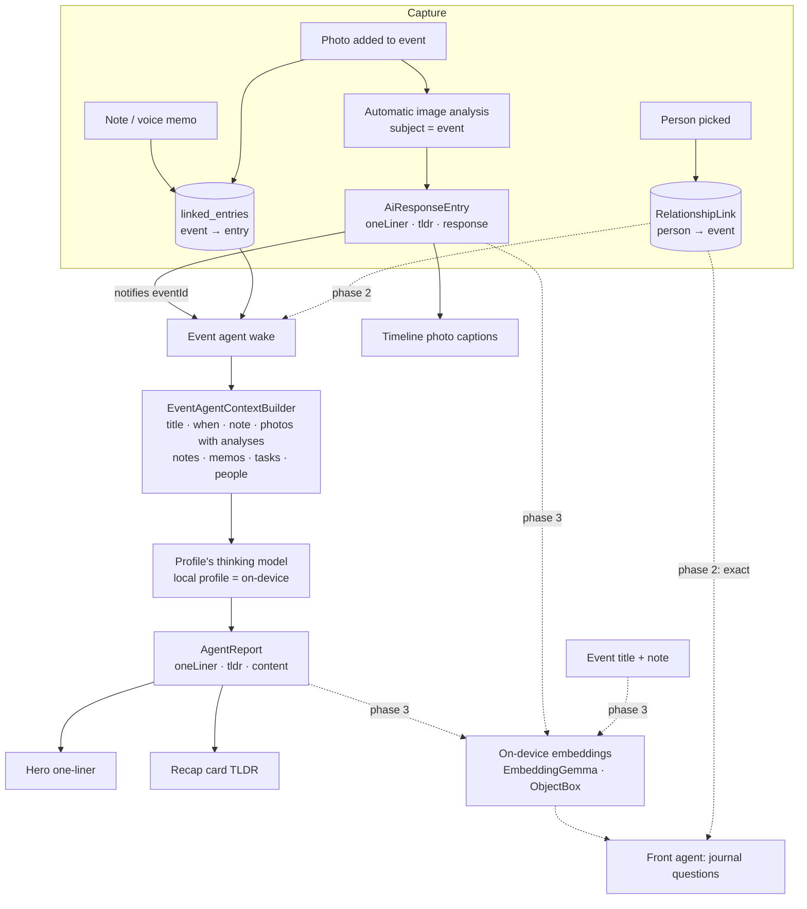

# Event Agent — From Raw Event Data to an Event Record

> **Status:** proposal. The first slice shipped in #4935 and #4937 (see
> [What the first slice ships](#what-the-first-slice-ships)); the
> [audit](#audit--2026-11-01) records what is done and what is open.
> **Date:** 2026-11-01
> **Scope:** events detail surface, the existing event agent, image analysis in
> event context, on-device search over events, and person links.

The goal: an event page that reads as a *record* of what happened, written
from the raw material the user drops onto it — photos, notes, voice memos —
without the user having to write it. And a record that can be found again
months later by asking for it in plain words: "what did I do with Pip this
spring?", "when was the last time we went to the Ice Garden?".

This is not a new agent. The **event agent already exists** — a recap writer
with the task agent's report contract (`update_report` with `oneLiner`,
`tldr` and `content`), a content gate, auto-attach per category and the
human-only rating/cover invariant. It is documented in
[project and event agents](../../knowledge/features/agents/project-and-event-agents.md#event-agents).
This plan closes the gaps between that agent and the record we want.

---

## UI inventory

Every event-facing widget, what it shows, and how it maps onto the unified
timeline that Goals, People and Tasks share (`lib/widgets/timeline/`).

| Widget | File | Role | Unified-timeline mapping |
|---|---|---|---|
| `EventDetailPage` | `lib/features/events/ui/pages/event_detail_page.dart` | Route glue: watches the event, its links, photo analyses and the agent's report; wires edits | Same page/view split as goals and people |
| `EventDetailView` | `lib/features/events/ui/widgets/event_detail_view.dart` | Hero sliver, recap slot, photo grid, timeline, tasks rail, docked bar | Body column = shared `TimelineView` |
| `_HeroSliver` / `_HeroContent` | `event_detail_view_hero_content_part.dart` | Cover, category/status pills + rating, title, recap one-liner, date line | Event-specific header (goals and people have their own) |
| `EventStarRating` | `lib/features/events/ui/widgets/event_star_rating.dart` | 0–5 stars, per-star hover, half stars on long press | — |
| `EventAiSummaryCard` | `lib/features/events/ui/widgets/event_ai_summary_card.dart` | The agent's TLDR, *Read more*, *Update now*; awaiting/error states | The task agent's card: `AgentSummaryCardSurface`, `TldrHeader`, `TldrBody`, compact `AgentAutomationRow` |
| `EventPassiveSummaryCard` | `lib/features/events/ui/widgets/event_passive_summary_card.dart` | The event note when no agent is attached | Plain section card with a plain `TldrHeader` |
| `ChangeSetSummaryCard.event` | `lib/features/agents/ui/change_set_summary_card.dart` | Accept/reject the agent's follow-up-task proposals | Shared with tasks |
| `EventPhotoGrid` + gallery viewer | `lib/features/events/ui/widgets/event_photo_gallery.dart` | Flat photo wall; full-screen viewer with Set cover | Events only |
| `eventTimelineBeat` | `lib/features/events/ui/widgets/event_timeline_beat.dart` | Maps an `EventTimelineEntry` to a `TimelineBeat` | The adapter onto `lib/widgets/timeline/TimelineView` — photo, note, time span and audio beats. **Not** the rail goals and people use (see below) |
| `EntryActionBar` | `lib/features/journal/ui/widgets/entry_action_bar.dart` | Sticky bar: Add a task · record · Add sheet | Same bar as the entry page; stays |
| `EventCard` / `EventFeatureCard` | `lib/features/events/ui/widgets/event_card.dart`, `event_feature_card.dart` | Overview cards with cover, date, read-only stars | — |
| `LinkedEventCard` | `lib/features/events/ui/widgets/linked_event_card.dart` | An event inside another entry's timeline | — |
| `EventCoverImage`, `EventOverlayPill`, `EventCoverPicker`, `EventStatusPicker` | `lib/features/events/ui/widgets/` | Hero chrome and pickers | — |

**Alignment with the unified timeline — not aligned yet.** Goals
(`goal_checkin_timeline.dart`) and People (`person_timeline_view.dart`) render
their timelines on the design system's `DesignSystemTimelineRow`. Events are
the last caller of the older `lib/widgets/timeline/TimelineView`, which was
extracted from the event page for sharing and has since been left behind.
The diff, row by row:

| | People / goals (`DesignSystemTimelineRow`) | Events (`TimelineView`) |
|---|---|---|
| Rail mark | `DesignSystemTimelineTile` with one glyph per kind (note, mic, image, calendar); `agent` tone for agent rows | Plain primary dot, no glyph |
| Meta line | `DsTieredText`: `time · kind · tail`, shedding segments on a narrow width | Time label only |
| Text | `FoldedWords` | `FoldedWords` (same) |
| Recording | Light playback + `RecordingTranscript` with awaiting/retry | Full `AudioPlayerWidget` + transcript |
| Photos | A small footer strip (`_PhotoStrip`) under a "N photos" meta line | A 2.4 : 1 lead band with a caption, plus thumbs |
| Sections | `DesignSystemTimelineSectionHeader` per run | None (one event, one day) |
| Accessibility | One required `semanticsLabel` sentence per row | Per-widget semantics |

What stays deliberately different is the photographic hero (events are
memories, the hero is the cover), the photo grid above the rail, and the
sticky `EntryActionBar`, which remains the one place the event grows from.
Whether the wide photo band survives the move is the one design call in it:
see [PR B](#follow-up-prs).

---

## What the first slice ships

Concrete UI fixes plus the start of the record's data flow (#4935; the recap
card's move onto the task agent's card is #4937):

1. **Rating in the state row.** The stars sit in the same wrapping row as the
   category and status pills instead of a centred row of their own under the
   date (`flutter_rating` centred its full-width row).
2. **Per-star hover only.** `EventStarRating` makes each star its own
   `DsQuietInk` target with the Material overlay silenced; the hovered star
   lifts by itself and nothing is painted across the row. (`flutter_rating`
   gave every star an `InkResponse` whose radius equalled the star size, so its
   hover ink overlapped the neighbours and read as one highlight around the
   group.)
3. **Wide, short timeline photos.** The shared rail's lead frame is a band at
   2.4 : 1, held between 96 and 180 logical pixels tall, instead of a fixed
   196-pixel block that read tall on a phone column.
4. **One-line photo captions.** A photo on the timeline is captioned by the
   one-liner of its newest image analysis, falling back to the user's note;
   captions hold to two lines.
5. **Header summary.** The agent's `oneLiner` reads under the title in the
   hero; its `tldr` reads in the recap card below. Both come from the one
   report the agent already writes. Since #4937 that card is the task agent's
   own (`AgentSummaryCardSurface`, `TldrHeader`, `TldrBody`, the compact
   `AgentAutomationRow`), and an event without an agent shows its note on
   the plain `EventPassiveSummaryCard`.
6. **Photo analyses reach the agent.** `EventAgentContextBuilder` now renders
   each photo with what its analysis saw (`one-liner`, else `tldr`), via the
   same bulk lookup the task agent uses (`fetchAiResponsesForImages`). Before,
   the analysis ran and woke the agent, but the wake only saw photo notes.

---

## Architecture

### 1. How the header one-liner and TLDR are generated

- **Trigger.** The agent's subscription is the bare event id. A direct event
  edit, a new linked entry, or an image analysis landing on one of its photos
  (the analysis runner notifies the subject id it ran for) wakes it. The
  content gate keeps a bare-title event from spending a run.
- **Input.** `EventAgentContextBuilder` renders title, status, the date range
  and the event note, then the linked-entries digest: photos (caption + what
  the analysis saw), notes, voice-memo transcripts and linked tasks. Rating
  and cover are never rendered — the human-only invariant.
- **Output.** One `update_report` call per wake with all three tiers:
  `oneLiner` (≤ one sentence — the hero line), `tldr` (one to three sentences
  — the recap card) and `content` (the full recap). The page reads the newest
  report; `.value` keeps the last recap on screen through a background reload.
- **Stays as is.** No new tool, no new state. The record *is* the report.

### 2. Image analysis in event context

Image analysis **already runs** for photos added to an event: the Add sheet
passes `linkedFromId: eventId`, the automatic trigger uses that id as the
subject, `resolveForSubject` finds the event agent through its `agentEvent`
link, and its profile's image-analysis skill runs when it is set to automate.
The result is an `AiResponseEntry` linked from the photo, with `oneLiner` and
`tldr` tiers when the model can call the publishing tool.

Gaps, in order of value:

| Gap | Where | Change |
|---|---|---|
| The agent never saw the analysis | `EventAgentContextBuilder.buildLinkedEntriesContext` | **Done in this slice** |
| The page showed only the note | `eventTimelineEntryFor` | **Done in this slice** (`imageSummaryFor`) |
| The wake is accidental: the runner adds `linkedTaskId` to its notify set, and the event id rides in that slot | `skill_inference_runner.dart` `_notifyParentTasksOfNestedResponse` | Name the parameter for what it is (subject id) and keep the event in the set on purpose; pin it with a test |
| The analysis prompt gets no event context (`buildTaskDetailsJson` is task-only) | `ai_input_repository.dart` | When the subject is a `JournalEvent`, pass title, date and note so "who is this" questions read the scene in context |
| Backfill only fills missing analyses for task photos | `inference_backfill_queue.dart` | Extend the detector to photos linked from events |
| An event with no category never automates | profile automation gate | Product decision: events without a category stay manual (matches tasks) |

### 3. Embedding-based search, on-device

The pipeline exists: EmbeddingGemma-300m on ONNX Runtime, 768-dimension
vectors, per-category ObjectBox HNSW shards, behind `enableEmbeddingsFlag`
(ADR 0148, [embeddings and search](../../knowledge/features/ai/embeddings-and-search.md)).
Nothing leaves the device. What it does not index today:

- **Events.** `EmbeddingContentExtractor` has no `JournalEvent` arm, so titles
  and notes are never embedded.
- **Image analyses.** The extractor reads `AiResponseEntry.entryText`, which
  the analysis runner leaves empty; the text lives in `data.response` and the
  tiers.
- **Event recaps.** Only the task agent's reports are embedded
  (`EmbeddingProcessor.processAgentReport`, keyed by task id).
- **The front agent's crawler** drops events from its `sourceTypes`, so even a
  full-text hit on an event title is discarded.

Proposed, as one change:

1. `JournalEvent` → `title + note` in the extractor, with its own entity type.
2. Image analyses → extract `oneLiner`, else `tldr`, else `response`. The
   photo's entry stays unembedded; its analysis stands in for it.
3. Event recaps → a `processAgentReport` variant keyed to the event id, so a
   recap hit resolves to its event, not to an agent row the journal cannot
   open.
4. Add `JournalEvent` to `QueryJournalCrawler.sourceTypes`, and render an
   event document as title, when, recap TLDR and people.

Storage stays the per-category shard the event's category selects; an event
without a category lands in the uncategorised shard like any other entry.
Re-embedding is driven by the existing update notifications (event edit,
report written, analysis written).

### 4. Person tags → relationships

A person is a `RelationshipEntry`. A person-to-event link already exists:
`EntryLinkType.relationship` (`RelationshipLink`), directed **person → event**,
written by `PersonTimelineRepository.addToTimeline` and removed by
`removeFromTimeline`; `personTimelineLinkTargets` lists a person's events, and
an event with such a link already shows on that person's timeline and on the
Day view. It is a fixed, synced, queryable row in `linked_entries` — exactly
the "person tag" the record needs. **No new link type.**

What is missing is the event side:

1. **A People row on the event page.** Read the incoming relationship links
   for the event (the reverse read `recorded_time.dart` already does with
   `typedLinksForTaskIds(…, types: {relationship})`, filtered on `toId`), show
   each person as an avatar chip, and add/remove through the repository
   methods above. The link write notifies both ends, so the person's page and
   the event page refresh on their own.
2. **People in the agent's context.** Render the linked people's names in the
   digest, so the recap names who was there.
3. **Exact answers before fuzzy ones.** "What events did I do with Pip?" is a
   graph read — the person's relationship links filtered to `JournalEvent` —
   not a vector search. The front agent should resolve a named person first
   and run the exact read, and use embeddings only for the open half of a
   question ("…at the Ice Garden"). "When was the last time" is the same read
   sorted by date, intersected with a meaning search for the place.
4. **Past events for the relationship agent.** Its facts renderer lists only
   upcoming meetings; past shared events are the history it should read.

### Keeping it local

There is no "local only" switch today; locality follows the profile. The
event agent resolves its model through the agent's profile — the category's
default at creation — then the template, then the Settings default, and uses
the thinking slot. Image analysis uses the same profile's vision slot. With a
local profile (Ollama or oMLX — the seeded "Local" profiles are desktop-only)
both stay on the device, and embeddings are on-device by construction. To
*guarantee* it, the wake could check `profileIsLocal` (which already fails
closed on any non-local slot) when the user asks for local-only, the way the
synced-audio dispatcher does; that is a product decision, not part of this
plan.

---

## Audit — 2026-11-01

Against `main` at #4937. Each verdict was checked in the code, not the PR text.

| # | Item | Verdict | Evidence / what is missing |
|---|---|---|---|
| 1 | Explore what an event agent needs for a good record | **Done (exploration)** | This document. The agent already exists (recap writer, `update_report` with `oneLiner`/`tldr`/`content`, content gate, auto-attach — `event_agent_workflow.dart`, `event_tool_definitions.dart`); what it lacks is inputs (people, see 5) and reach (search, see 4), not a new agent |
| 2 | One-liner and TLDR in the header | **Done** | #4935: `recapOneLiner` under the title (`event_detail_view_hero_content_part.dart`, `EventDetailPage._recapOneLiner`); TLDR on the task agent's card since #4937 (`event_ai_summary_card.dart`) |
| 3 | Image analysis automatically in event context | **Partly done** | Already runs: the Add sheet passes `linkedFromId: eventId`, the automatic trigger uses it as the subject, and `subjectAgentLinkTypes` resolves the event agent through `agentEvent` (`subject_agent_lookup.dart`). Since #4935 the result reaches the page (captions) and the agent (photo digest). Missing: event context in the analysis prompt (`ai_input_repository.dart` returns early for non-tasks), backfill for event photos (task-only), a deliberate rather than incidental wake (`linkedTaskId` in `skill_inference_runner.dart`), and a profile fallback for an event without an agent (`subjectProfileIdOf` has no event arm) |
| 4 | Embeddings + natural-language search | **Open** | `EmbeddingContentExtractor` has no `JournalEvent` or image-analysis arm; event recaps are never embedded (only the task agent calls `processAgentReport`); `QueryJournalCrawler.sourceTypes` leaves out `JournalEvent`, so the front agent drops events even from full-text hits |
| 5 | Person tags linked to tracked relationships | **Open (model exists)** | The link exists: `EntryLink.relationship`, person → event, written by `PersonTimelineRepository.addToTimeline`. The event page reads only outgoing links, has no people UI, and the agent's context never sees the people |
| 6 | Inventory of the event UI elements | **Done** | [UI inventory](#ui-inventory), updated for #4937 |
| 7 | Align the event timeline with the unified timeline | **Open** | Events alone still use `lib/widgets/timeline/TimelineView`; goals and people use `DesignSystemTimelineRow` — the row-by-row diff is in the [inventory](#ui-inventory) |
| 8 | One-liner on timeline images | **Done** | #4935: `imageSummaryFor` in `event_view_mapping.dart`, fed by `imageAnalysisOneLiner` on the page |
| 9 | Wide, short timeline images | **Done** | #4935: `leadAspectRatio = 2.4`, 96–180 px (`timeline_view.dart`). Revisit in PR B |
| 10 | Rating in the status row | **Done** | #4935: `EventStarRating` inside the state-row `Wrap` with category and status |
| 11 | Hover on single stars only | **Done** | #4935: one `DsQuietInk` per star, `hoverScale` on the hovered star; per-star semantic actions and the `IconSizes.m` token added in review |
| 12 | Coding prompt / audit | **Done** | This audit |

#4937 is not a checklist item of its own: it is part of item 2 (the TLDR now
lives on the task agent's card) and of item 1 (the event agent shares the
task agent's surface, header, report body and freshness strip instead of a
bespoke card). It changed the inventory — `EventPassiveSummaryCard` is new,
the summary card's refresh icon is gone, and *Update now* is the manual
re-wake — and it removed the enhanced card shadow app-wide.

## Follow-up PRs

Each is independent and sized for one pull request.

### PR A — People on the event (item 5)

- **Read:** the event's incoming `RelationshipLink`s
  (`typedLinksForTaskIds({eventId}, types: {relationship})`, filtered on
  `toId == eventId`, live and not hidden), resolved to `RelationshipEntry`s —
  the reverse of `personTimelineLinkTargets`. A provider in `relationships`
  keyed by event id, refreshed on `LINK_CHANGED` for that id.
- **UI:** a *People* row on the event page (avatar chips, design-system chip
  and avatar components), and a person picker sheet over
  `relationshipsListControllerProvider` behind an *Add person* chip. Add uses
  `PersonTimelineRepository.addToTimeline(personId, eventId)`; remove uses
  `removeFromTimeline`. Both notify both ends, so the person's timeline
  updates on its own. No new link type, no migration.
- **Agent:** `EventAgentContextBuilder` renders `### People` with their names,
  so the recap names who was there; the relationship agent's facts renderer
  gains past shared events (today it lists only upcoming meetings).
- **Layering:** events may read relationships (it ranks above them); the
  shared picker lives with relationships.

### PR B — Event timeline on `DesignSystemTimelineRow` (item 7)

- Map each `EventTimelineEntry` to a row: tile glyph by kind (note, mic,
  image, timer), a `DsTieredText` meta line `time · kind · tail`
  (duration for recordings and time spans), `FoldedWords` / `RecordingTranscript`
  bodies with the light playback the people timeline uses, one
  `semanticsLabel` sentence per row, `onTap` opening the entry with the event
  as `linkedFromId`.
- Photos: a footer under the row. Decide band vs strip with the owner — the
  wide band was asked for (item 9) and events are photo-led, so the default
  is to keep the 2.4 : 1 band as the row's footer, caption included.
- Then delete `lib/widgets/timeline/` (`TimelineView`, `timeline_models.dart`)
  and their test, since nothing else uses them.
- Before/after captures from `events_manual_screenshots_test.dart`.

### PR C — Events in natural-language search (item 4)

- **Index:** `EmbeddingContentExtractor` gains `JournalEvent` (title + note,
  own entity type) and image analyses (`oneLiner`, else `tldr`, else
  `response` — the runner leaves `entryText` empty). Event recaps embed through
  a `processAgentReport` variant keyed to the event id, so a hit resolves to
  the event, not an agent row. Vectors stay in the per-category ObjectBox
  shard on device (ADR 0148), behind `enableEmbeddingsFlag`.
- **Query:** `QueryJournalCrawler` admits `JournalEvent` — a new
  `QuerySourceKind.event` (the enum is persisted with an `unknown` fallback,
  so an older client degrades), a document text of the note else the title
  (the one-representation rule), routing to `/events/<id>` in the front
  chat, and gating on `enableEventsFlag` like every other event surface.
- **People-first answers:** "what did I do with Pip?" resolves the person and
  reads PR A's links exactly; embeddings answer only the open half ("…at
  the Ice Garden"), intersected with that set and sorted by date for "when
  was the last time".

### PR D — Image analysis with event context (item 3)

- `AiInputRepository` builds an event details block (title, when, note,
  linked people once PR A lands) when the subject is a `JournalEvent`, so the
  analysis reads the scene in context.
- `_notifyParentTasksOfNestedResponse` names its parameter for what it is
  (the subject id) and keeps the event in the notify set on purpose, pinned
  by a test.
- Backfill: the detector also offers analyses for photos linked from events.
- Profile fallback: decide whether an event without an agent should analyse
  through the category default (`subjectProfileIdOf` gains an event arm) —
  today it does not.

## Open decisions

- Should the hero one-liner fall back to the event note when there is no agent?
  Today the hero stays title and date alone, which keeps the human's note in
  the recap card where it has always been.
- Is a local-only enforcement switch per category wanted, or is the profile
  choice enough?
