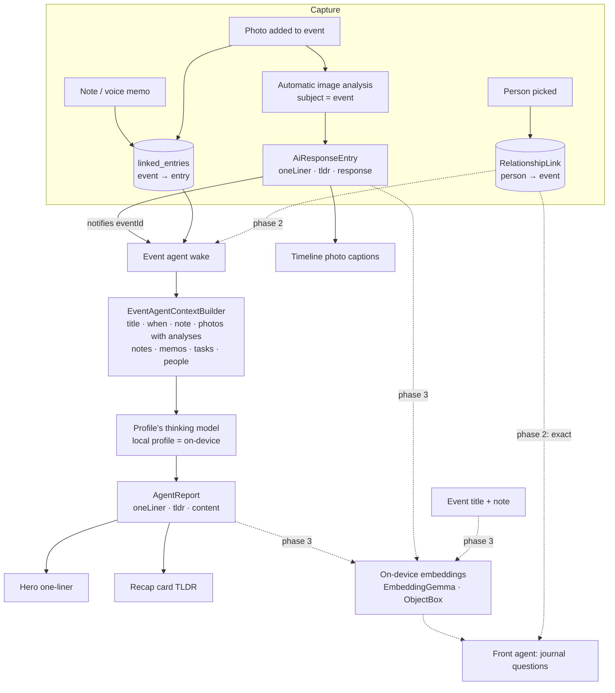

# Event Agent — From Raw Event Data to an Event Record

> **Status:** proposal, with a first slice shipped alongside it (see
> [What the first slice ships](#what-the-first-slice-ships)).
> **Date:** 2026-11-01
> **Scope:** events detail surface, the existing event agent, image analysis in
> event context, on-device search over events, and person links.

The goal: an event page that reads as a *record* of what happened, written
from the raw material the user drops onto it — photos, notes, voice memos —
without the user having to write it. And a record that can be found again
months later by asking for it in plain words: "what did I do with Pip this
spring?", "when was the last time we went to the Ice Garden?".

This is not a new agent. The **event agent already exists** — a recap writer
with the task agent's report contract (`update_report` with `oneLiner`,
`tldr` and `content`), a content gate, auto-attach per category and the
human-only rating/cover invariant. It is documented in
[project and event agents](../../knowledge/features/agents/project-and-event-agents.md#event-agents).
This plan closes the gaps between that agent and the record we want.

---

## UI inventory

Every event-facing widget, what it shows, and how it maps onto the unified
timeline that Goals, People and Tasks share (`lib/widgets/timeline/`).

| Widget | File | Role | Unified-timeline mapping |
|---|---|---|---|
| `EventDetailPage` | `lib/features/events/ui/pages/event_detail_page.dart` | Route glue: watches the event, its links, photo analyses and the agent's report; wires edits | Same page/view split as goals and people |
| `EventDetailView` | `lib/features/events/ui/widgets/event_detail_view.dart` | Hero sliver, recap slot, photo grid, timeline, tasks rail, docked bar | Body column = shared `TimelineView` |
| `_HeroSliver` / `_HeroContent` | `event_detail_view_hero_content_part.dart` | Cover, category/status pills + rating, title, recap one-liner, date line | Event-specific header (goals and people have their own) |
| `EventStarRating` | `lib/features/events/ui/widgets/event_star_rating.dart` | 0–5 stars, per-star hover, half stars on long press | — |
| `EventAiSummaryCard` | `lib/features/events/ui/widgets/event_ai_summary_card.dart` | The agent's TLDR, *Read more*, *Update now*; awaiting/error states | The task agent's card: `AgentSummaryCardSurface`, `TldrHeader`, `TldrBody`, compact `AgentAutomationRow` |
| `EventPassiveSummaryCard` | `lib/features/events/ui/widgets/event_passive_summary_card.dart` | The event note when no agent is attached | Plain section card with a plain `TldrHeader` |
| `ChangeSetSummaryCard.event` | `lib/features/agents/ui/change_set_summary_card.dart` | Accept/reject the agent's follow-up-task proposals | Shared with tasks |
| `EventPhotoGrid` + gallery viewer | `lib/features/events/ui/widgets/event_photo_gallery.dart` | Flat photo wall; full-screen viewer with Set cover | Events only |
| `eventTimelineBeat` | `lib/features/events/ui/widgets/event_timeline_beat.dart` | Maps an `EventTimelineEntry` to a `TimelineBeat` | **The adapter onto the shared rail** — photo, note, time span and audio beats |
| `EntryActionBar` | `lib/features/journal/ui/widgets/entry_action_bar.dart` | Sticky bar: Add a task · record · Add sheet | Same bar as the entry page; stays |
| `EventCard` / `EventFeatureCard` | `lib/features/events/ui/widgets/event_card.dart`, `event_feature_card.dart` | Overview cards with cover, date, read-only stars | — |
| `LinkedEventCard` | `lib/features/events/ui/widgets/linked_event_card.dart` | An event inside another entry's timeline | — |
| `EventCoverImage`, `EventOverlayPill`, `EventCoverPicker`, `EventStatusPicker` | `lib/features/events/ui/widgets/` | Hero chrome and pickers | — |

**Alignment with the unified timeline.** The event timeline already renders
through the shared `TimelineView` — the same rail, dot, connector, folded
words, transcript states and open affordance as goals and people. Events pass
no glyph and no kind label, which keeps their rail the plain primary dot. What
remains different is deliberate: the photographic hero (events are memories,
the hero is the cover) and the photo grid above the rail. The sticky
`EntryActionBar` stays as the one place the event grows from.

---

## What the first slice ships

Concrete UI fixes plus the start of the record's data flow:

1. **Rating in the state row.** The stars sit in the same wrapping row as the
   category and status pills instead of a centred row of their own under the
   date (`flutter_rating` centred its full-width row).
2. **Per-star hover only.** `EventStarRating` makes each star its own
   `DsQuietInk` target with the Material overlay silenced; the hovered star
   lifts by itself and nothing is painted across the row. (`flutter_rating`
   gave every star an `InkResponse` whose radius equalled the star size, so its
   hover ink overlapped the neighbours and read as one highlight around the
   group.)
3. **Wide, short timeline photos.** The shared rail's lead frame is a band at
   2.4 : 1, held between 96 and 180 logical pixels tall, instead of a fixed
   196-pixel block that read tall on a phone column.
4. **One-line photo captions.** A photo on the timeline is captioned by the
   one-liner of its newest image analysis, falling back to the user's note;
   captions hold to two lines.
5. **Header summary.** The agent's `oneLiner` reads under the title in the
   hero; its `tldr` stays in the recap card below. Both come from the one
   report the agent already writes.
6. **Photo analyses reach the agent.** `EventAgentContextBuilder` now renders
   each photo with what its analysis saw (`one-liner`, else `tldr`), via the
   same bulk lookup the task agent uses (`fetchAiResponsesForImages`). Before,
   the analysis ran and woke the agent, but the wake only saw photo notes.

---

## Architecture

### 1. How the header one-liner and TLDR are generated

- **Trigger.** The agent's subscription is the bare event id. A direct event
  edit, a new linked entry, or an image analysis landing on one of its photos
  (the analysis runner notifies the subject id it ran for) wakes it. The
  content gate keeps a bare-title event from spending a run.
- **Input.** `EventAgentContextBuilder` renders title, status, the date range
  and the event note, then the linked-entries digest: photos (caption + what
  the analysis saw), notes, voice-memo transcripts and linked tasks. Rating
  and cover are never rendered — the human-only invariant.
- **Output.** One `update_report` call per wake with all three tiers:
  `oneLiner` (≤ one sentence — the hero line), `tldr` (one to three sentences
  — the recap card) and `content` (the full recap). The page reads the newest
  report; `.value` keeps the last recap on screen through a background reload.
- **Stays as is.** No new tool, no new state. The record *is* the report.

### 2. Image analysis in event context

Image analysis **already runs** for photos added to an event: the Add sheet
passes `linkedFromId: eventId`, the automatic trigger uses that id as the
subject, `resolveForSubject` finds the event agent through its `agentEvent`
link, and its profile's image-analysis skill runs when it is set to automate.
The result is an `AiResponseEntry` linked from the photo, with `oneLiner` and
`tldr` tiers when the model can call the publishing tool.

Gaps, in order of value:

| Gap | Where | Change |
|---|---|---|
| The agent never saw the analysis | `EventAgentContextBuilder.buildLinkedEntriesContext` | **Done in this slice** |
| The page showed only the note | `eventTimelineEntryFor` | **Done in this slice** (`imageSummaryFor`) |
| The wake is accidental: the runner adds `linkedTaskId` to its notify set, and the event id rides in that slot | `skill_inference_runner.dart` `_notifyParentTasksOfNestedResponse` | Name the parameter for what it is (subject id) and keep the event in the set on purpose; pin it with a test |
| The analysis prompt gets no event context (`buildTaskDetailsJson` is task-only) | `ai_input_repository.dart` | When the subject is a `JournalEvent`, pass title, date and note so "who is this" questions read the scene in context |
| Backfill only fills missing analyses for task photos | `inference_backfill_queue.dart` | Extend the detector to photos linked from events |
| An event with no category never automates | profile automation gate | Product decision: events without a category stay manual (matches tasks) |

### 3. Embedding-based search, on-device

The pipeline exists: EmbeddingGemma-300m on ONNX Runtime, 768-dimension
vectors, per-category ObjectBox HNSW shards, behind `enableEmbeddingsFlag`
(ADR 0148, [embeddings and search](../../knowledge/features/ai/embeddings-and-search.md)).
Nothing leaves the device. What it does not index today:

- **Events.** `EmbeddingContentExtractor` has no `JournalEvent` arm, so titles
  and notes are never embedded.
- **Image analyses.** The extractor reads `AiResponseEntry.entryText`, which
  the analysis runner leaves empty; the text lives in `data.response` and the
  tiers.
- **Event recaps.** Only the task agent's reports are embedded
  (`EmbeddingProcessor.processAgentReport`, keyed by task id).
- **The front agent's crawler** drops events from its `sourceTypes`, so even a
  full-text hit on an event title is discarded.

Proposed, as one change:

1. `JournalEvent` → `title + note` in the extractor, with its own entity type.
2. Image analyses → extract `oneLiner`, else `tldr`, else `response`. The
   photo's entry stays unembedded; its analysis stands in for it.
3. Event recaps → a `processAgentReport` variant keyed to the event id, so a
   recap hit resolves to its event, not to an agent row the journal cannot
   open.
4. Add `JournalEvent` to `QueryJournalCrawler.sourceTypes`, and render an
   event document as title, when, recap TLDR and people.

Storage stays the per-category shard the event's category selects; an event
without a category lands in the uncategorised shard like any other entry.
Re-embedding is driven by the existing update notifications (event edit,
report written, analysis written).

### 4. Person tags → relationships

A person is a `RelationshipEntry`. A person-to-event link already exists:
`EntryLinkType.relationship` (`RelationshipLink`), directed **person → event**,
written by `PersonTimelineRepository.addToTimeline` and removed by
`removeFromTimeline`; `personTimelineLinkTargets` lists a person's events, and
an event with such a link already shows on that person's timeline and on the
Day view. It is a fixed, synced, queryable row in `linked_entries` — exactly
the "person tag" the record needs. **No new link type.**

What is missing is the event side:

1. **A People row on the event page.** Read the incoming relationship links
   for the event (the reverse read `recorded_time.dart` already does with
   `typedLinksForTaskIds(…, types: {relationship})`, filtered on `toId`), show
   each person as an avatar chip, and add/remove through the repository
   methods above. The link write notifies both ends, so the person's page and
   the event page refresh on their own.
2. **People in the agent's context.** Render the linked people's names in the
   digest, so the recap names who was there.
3. **Exact answers before fuzzy ones.** "What events did I do with Pip?" is a
   graph read — the person's relationship links filtered to `JournalEvent` —
   not a vector search. The front agent should resolve a named person first
   and run the exact read, and use embeddings only for the open half of a
   question ("…at the Ice Garden"). "When was the last time" is the same read
   sorted by date, intersected with a meaning search for the place.
4. **Past events for the relationship agent.** Its facts renderer lists only
   upcoming meetings; past shared events are the history it should read.

### Keeping it local

There is no "local only" switch today; locality follows the profile. The
event agent resolves its model through the agent's profile — the category's
default at creation — then the template, then the Settings default, and uses
the thinking slot. Image analysis uses the same profile's vision slot. With a
local profile (Ollama or oMLX — the seeded "Local" profiles are desktop-only)
both stay on the device, and embeddings are on-device by construction. To
*guarantee* it, the wake could check `profileIsLocal` (which already fails
closed on any non-local slot) when the user asks for local-only, the way the
synced-audio dispatcher does; that is a product decision, not part of this
plan.

---

## Phases

| Phase | What | Notes |
|---|---|---|
| 1 | UI fixes, hero one-liner, analysis captions, analyses in the agent's context | **This slice** |
| 2 | People row on the event page, people in the agent's context, past events for the relationship agent | Reuses `RelationshipLink`; needs a person picker sheet |
| 3 | Events, image analyses and event recaps embedded; events in the front agent's crawler; person-first query planning | Behind `enableEmbeddingsFlag` |
| 4 | Event context in the analysis prompt; backfill for event photos; deliberate (named) event wake on analysis | Small, independent |

## Open decisions

- Should the hero one-liner fall back to the event note when there is no agent?
  Today the hero stays title and date alone, which keeps the human's note in
  the recap card where it has always been.
- Is a local-only enforcement switch per category wanted, or is the profile
  choice enough?
