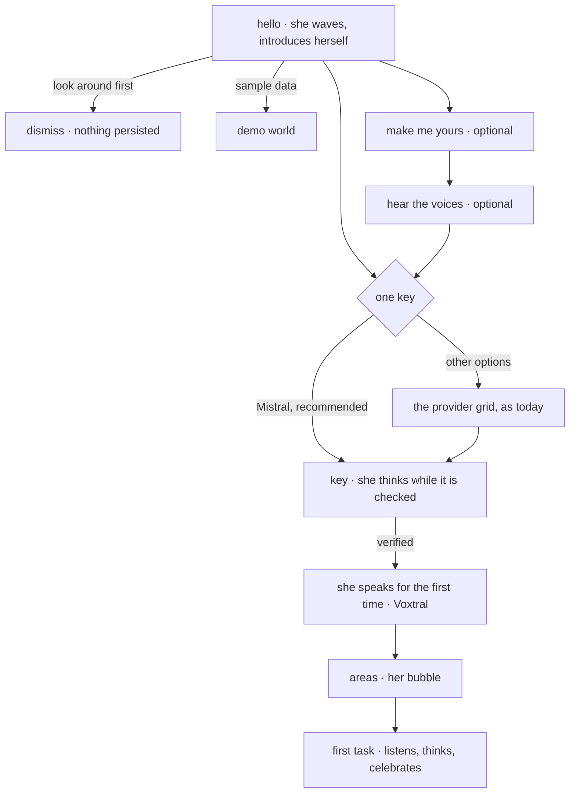

# Companion-guided onboarding

**Status:** proposed · **Date:** 2026-11-05

## Why

The first-run flow works, but it reads as a settings wizard with a mascot
beside it. The welcome shows her waving, and after that the user meets a
grid of six provider tiles, a key form, a success card, an area picker and the
first recording. She only comes back at the last step, and on a first run she
says nothing, because the on-device voice model is not installed yet.

The one thing a new user needs to hear is that **a single API key is all it
takes to get started**, and that we recommend Mistral. Today the screen never
says it: it offers a choice of six providers and leaves the user to work it
out.

This plan rebuilds the first-time experience around the character. She leads
every step, says why each step matters, lets the user make her their own, and
lets them hear the voices she can have before they choose one.

## What stays

- The machinery underneath stays:
  - the show-cadence, the replay from Settings › Onboarding and the metrics store;
  - live key verification (`ConnectionVerifierController`);
  - the provider and profile seeding;
  - the area step and how it writes consent;
  - the voice-to-task first capture.
- The full-screen transparent route and the crossfading step host
  (`_OnboardingFlow`) stay as they are. The new steps slot into them.
- The "Explore with sample data" and "Look around first" exits stay.

## The new flow

| Step | She | On screen |
|---|---|---|
| Hello | waves; full length | "Hi, I'm Lotti." A speech bubble: everything Lotti does starts from one API key, and the bubble asks whether to set it up. |
| Make me yours | turns for the camera; changes as you tap | Skin tone, hair, hair colour, outfit, and "Surprise me". Skippable, and it states plainly that all of this lives in Settings › Companion. |
| Hear the voices | mouths each sample | Three cards, each with a play button: **On-device** (free, private, works offline), **Mistral Voxtral** (included with the key), **ElevenLabs** (optional, needs its own key). |
| One key | points at the card | A single large Mistral card marked *Recommended* (EU-hosted, one key covers thinking, transcription and her voice). "Other options" opens today's provider grid. |
| Key | holds `think` while the key is checked; `celebrate` once it is verified; shrugs if it is rejected | Today's key panel, with her above it. |
| First words | speaks with the Voxtral voice | "There, now you can hear me." The connected provider's seeded profile already names `voxtral-mini-tts-3-0` as its read-aloud model. |
| Areas · first task | as now, with her bubble carrying the headline | unchanged logic |

Each copy line is localised in every catalog, in the informal register.

## Decisions to confirm

1. **Her flag.** Today she appears only when `enable_companion` is on.
   - **Recommended:** onboarding shows her regardless of the flag, because the flow is built around her. The flag keeps gating her everywhere else in the app.
   - **Alternative:** turn the flag on by default, which affects the whole app.
2. **The cast.** Choosing a character (Grandpa, Aunt, Uncle) lives in #4987, which is not merged yet.
   - **Recommended:** this stack is built on `main`, so the "Make me yours" step ships with skin tone, hair, hair colour and outfit.
   - Character choice is added to that step once #4987 merges, as one small follow-up commit.
3. **Voice samples.** The clips are generated once and bundled as WAV, because her lip-sync (`loadSpokenTrack`) reads WAV. Each clip is 24 kHz mono and about 5 s, roughly 240 KB.
   - **Recommended:** English only, 3 clips (about 0.7 MB). Every other app language would add 3 clips per language, about 9 MB in total.
   - Generating the Voxtral and ElevenLabs clips needs those API keys. A script reads the keys from the environment (`tool/onboarding_voice_samples/`), so the maintainer runs it and the keys never touch the repo. The on-device clip is rendered by the app's own Supertonic engine.
4. **Talking before the key.** Before the key is in she stays silent, with captions only, as she does now.
   - Speaking every onboarding line from baked clips would mean one clip per line per language.
   - Instead she speaks for the first time once the key is verified, and that is the moment worth showing off.

## Stacked branches

All branches stack on this docs branch and ship as one PR from the head into
`main`. Each branch carries its own tests (modular, 100 % of the changed
lines), changelog fragment and before/after screenshots.

1. **`feat/onboarding-companion-lead`:** she leads.
   - The speech-bubble component (`OnboardingCompanionStage`).
   - Her presence decoupled from the flag (decision 1).
   - The rewritten hello copy, centred on "one key".
   - The new *one key* step: Mistral recommended, with today's grid behind "Other options".
2. **`feat/onboarding-make-her-yours`:** the optional customisation step.
   - It writes `CompanionCustomization` through the existing controller and has a "Surprise me" option.
   - Metrics events for shown, changed and skipped.
3. **`feat/onboarding-voice-samples`:**
   - The bundled clips and the generator script.
   - `TtsPlaybackController.playClip(sourceId, asset, text)`, so a bundled clip plays through the same player and lip-sync as synthesised speech.
   - The voice cards. Playback stops when a card is replayed and when the step is left.
4. **`feat/onboarding-first-words`:**
   - Her reactions while the key is checked.
   - She speaks through the connected provider's seeded read-aloud slot (`TtsCloudRoute.fromProfile`) once the key is verified. Captions remain the fallback.
   - Her bubble on the area and first-task steps.
5. **Docs:** `knowledge/features/onboarding.md` (the flow diagram, her beats, the new steps and events) and `lib/features/onboarding/README.md`, updated alongside each branch rather than at the end.

## Risks

- **Height jumps between steps.** The flow animates its height, so a taller stage shifts the panel. She keeps one fixed frame height across steps, and only the bubble and controls below her change.
- **Audio on a first run.** The sample cards play bundled files, and nothing downloads.
- **A clip still playing when the user moves on.** Every step that plays audio stops its own `sourceId` on `dispose`, deferred to a microtask as `OnboardingCompanion` already does.
- **Metrics continuity.** The existing event names keep their meaning, and new steps add new events. The funnel derivations gain the new steps without renumbering the old ones.
