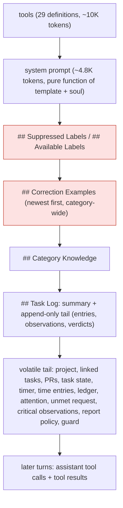

# Task-agent prompt cache and observation volume

Date: 2026-11-08

Scope: why a task agent on DeepSeek V4.1 Flash, served by Mistral, reports a 64 %
cache hit rate where 80 %+ was expected; what the provider cache can and cannot
keep; which prompt blocks break the cached prefix; why observations read as long
and repetitive; and a ranked plan with a way to check each step.

Every claim about the code cites the file it was read from on `main` at
`0a29d0112c`, before any of the changes below.

**Status:** H1, H2, H4 and the per-wake fingerprint of H6 ship in the same pull
request as this document. H3 waits for a DeepSeek eval and a report-only
execution guard. H5 is a product decision and is not built. The Stats-tab
opening-request rate of H6 is not built either; the SQL below measures it.

## Summary

- **Hypothesis: 64 % is roughly the hit rate a wake gets from its own later
  turns alone.** The totals fit a first request that misses almost entirely,
  including the ~15K-token system prompt and tool list that never change,
  with later turns re-using the request before them. Totals cannot show which
  requests hit or which wakes were bursts, so this stays an inference until
  the per-request query in [Measurement](#measurement) confirms or refutes it.
- **Mistral publishes no cache lifetime.** The one independent measurement, of
  Mistral models reached through OpenRouter, was cold within 5 minutes. The same
  DeepSeek weights stay warm for 12+ hours on DeepSeek's own API and go cold in
  5–15 minutes on Azure. The host decides the lifetime, not the model.
- **An hourly wake can never hit a cache that lasts minutes.** The fast bursts
  (seconds apart) are the wakes that bypass the hourly window on purpose: a
  timer stop, a finished transcript, a task moved to done. Those wakes *should*
  hit, and the numbers say they mostly do not.
- **Observations are not misplaced.** In compacted mode they sit at the end of
  the append-only `## Task Log`, which is the right place for an append-only
  stream: only the newest ones miss. Moving them into the volatile tail would
  re-send *all* retained observations uncached on every wake. The real prefix
  breakers are blocks that get **rewritten** near the top: the label lists, the
  correction examples, and the tool list on the forced report retry.
- **The scaffold asks for verbose observations.** It tells the agent to record
  "ANYTHING private" and warns that skipping the tool loses context forever. The
  report's prose is deliberately withheld from the next wake, so the agent uses
  observations to carry state. Nothing tells it to deduplicate or to cite instead
  of restating.

| # | Hypothesis | Cache hit rate | Token cost | Latency | Effort |
|---|---|---|---|---|---|
| H1 | Send `prompt_cache_key` (the agent id) to Mistral | High, uncertain: the main lever for burst wakes | −20 to −35 % input cost if bursts start hitting | Lower first-token time on burst wakes | S |
| H2 | Move the rewritten head blocks (labels, correction examples) into the volatile tail | Medium: saves a full log re-read after every label decision | Proportional to log size | Same | S |
| H3 | Keep the forced report retry on the full tool list | Medium, on the wakes that retry | One whole conversation per retry | One prefill per retry | M (needs a DeepSeek eval) |
| H4 | Terse observation contract plus schema limits, dedup and a single rendering | Small directly; compounds over the task's life | Grows with task age; fewer folds | Smaller prompts | M |
| H5 | Coalesce user-action bursts for a short window | No change in rate | −2 wakes in a 3-wake burst | +seconds before the agent reacts | S, product decision |
| H6 | Report the opening-request hit rate per provider | None; this is the measurement | None | None | S |

Rejected: moving observations into the volatile tail (see
[Observation placement](#observation-placement)).

## 1. Baseline: how the numbers are measured

### What the Stats tab sums

- Every wake writes **one `WakeTokenUsageEntity` per model**
  (`persistWakeTokenUsage`, `lib/features/agents/workflow/wake_token_usage.dart`).
  The executor's row adds up every turn of the wake, including the forced
  `update_report` retry (`usage.merge(retryUsage)`,
  `lib/features/agents/workflow/task_agent_execute.dart:474`). The report
  editor's pass is a separate row under its own model id
  (`task_agent_execute.dart:519`), so it is not part of these numbers.
- The Stats tab groups rows by model. **"Wakes" counts rows**
  (`aggregateByModel`, `lib/features/agents/state/agent_query_providers.dart:560`),
  so 8 wakes means 8 executor rows.
- `cachedInputTokens` is a subset of `inputTokens`. Total = input + output +
  thoughts, and the hit rate is cached ÷ input
  (`lib/features/agents/model/agent_token_usage.dart:40`).
- The cached count comes from `usage.prompt_tokens_details.cached_tokens`
  (`lib/features/ai/repository/completion_usage_parser.dart`), the field Mistral
  documents.

### The observed numbers

| | Total | Per wake |
|---|---|---|
| Input | 643,724 | 80,466 |
| of which cached | 411,904 | 51,488 |
| of which uncached | 231,820 | 28,978 |
| Output | 9,942 | 1,243 |
| Thoughts | 0 | 0 |
| Total | 653,666 (≈ 654K) | |

411,904 ÷ 643,724 = 0.640, which is the 64 % shown.

### What the numbers imply

We measured the fixed header with a scratch test, not checked in, using the
seeded Laura directives and this model id:

- system prompt: **19,217 characters** (≈ 4.8K tokens);
- 29 tool definitions serialized the way the Mistral repository sends them:
  **35,494 characters** (≈ 10K tokens).

So about **15K tokens** precede the user message, unchanged on every wake. If
only those 15K tokens had hit on each wake's first request, the cached total
would be about 8 × 15K = 120K higher, roughly **82 %**. The observed 29K uncached
tokens per wake is about the size of a whole opening prompt (header plus a young
task's log and tail). That is what you would see if the first request misses
completely and later turns re-use the request before them.

This is an inference from the totals. The data to confirm it is already on the
device (see [Measurement](#measurement)): each provider call is stored with its
`wake_run_key`, `turn_index` and `cached_input_tokens`.

## 2. Prompt cache lifetime and what invalidates it

### Mistral (the host here)

The model `deepseek-v4-1-flash-1017` is served by Mistral itself
(`lib/features/ai/util/known_models.dart:178`). From
[Mistral's prompt caching page](https://docs.mistral.ai/studio/conversations/advanced/prompt-caching):

- caching is automatic and prefix-based, in **64-token blocks**; prompts under
  64 tokens never hit;
- cached tokens cost **10 % of the input price**;
- `prompt_cache_key` ("a stable application-level identifier, such as a
  conversation ID, session ID, or workflow ID") *increases the chance of a hit*
  but does not guarantee one, and must not contain secrets or sensitive data;
- **no TTL, eviction policy or invalidation rule is published.**

Independent measurement
([monperrus, "How long does a prompt cache live?"](https://gist.github.com/monperrus/9784f52d5144975fd11be7f642c4a8fc),
2026-10-02/03, 3 replicas per age, one re-check per primed prefix):

| Endpoint | Survival | Bracket |
|---|---|---|
| OpenRouter → Mistral (mistral-small-3.2, mistral-large-2512) | 0/3 warm at 5 min | **< 5 min** |
| DeepSeek API (deepseek-v4-flash) | 3/3 warm at every age to 12 h | ≥ 12 h |
| Azure AI Foundry (deepseek-v4-flash) | 1/3 at 5 and 10 min, 0/3 at 15 min | < 5 min, sometimes 10 |

Mistral was only measured through OpenRouter, which splits caches across
upstreams, so the < 5 min figure is indicative only. The safe working
assumption for Mistral is a lifetime in **minutes**, and we should measure our
own (see H6).

### DeepSeek's own API, for comparison

[DeepSeek's KV cache guide](https://api-docs.deepseek.com/guides/kv_cache): the
cache is on disk, on by default and best effort; an unused cache is "usually
cleared within a few hours to a few days". A hit requires a full match of a
persisted prefix unit. DeepSeek reports `prompt_cache_hit_tokens` rather than
`prompt_tokens_details.cached_tokens`. Lotti does not talk to that endpoint for
this model, so this is context only. It does show that the same weights behind
a different host can keep hourly wakes warm.

### What makes a request miss

1. **Lifetime or eviction**: the entry is gone (unpublished on Mistral, likely
   minutes, and load-dependent).
2. **Routing**: the request lands on a replica that never saw the prefix. This
   is what `prompt_cache_key` exists to reduce, and Lotti does not send it
   (`lib/features/ai/repository/mistral_inference_repository.dart:685`).
3. **A byte change**: one changed token voids every block after it. In request
   order: the tool list (serialized ahead of the messages by the chat
   template), the system prompt, then the user message from the top down.

## 3. Wake spacing

Cadence rules (`knowledge/features/agents/wake-orchestration.md`, *Task-agent
wake cadence*):

| Trigger | When the wake runs on `hourly` |
|---|---|
| Ordinary change (subscription match) | Coalesced, 1 hour after the first change |
| Timer stopped, task moved to DONE (`WAKE_FLUSH`) | Now, and the countdown is cleared |
| Transcript finished (`requestContentWake`) | Now, bypassing the throttle |
| Image analysis | Within 1 minute |

The burst in the example, three wakes in 18 seconds, has exactly the shape of
these bypasses: a timer stop, a dictated note, then the task moved to done.
Everything that runs on the hourly countdown is at least an hour after the
previous wake, far past any lifetime measured for Mistral. So:

- **Hourly wakes are outside the cache window by design** on this host. No
  prompt reordering changes that. Only a host with a long-lived cache does.
- **Burst wakes are inside any plausible window** and are where the 80 % target
  must come from. With a byte-stable prefix they should re-use the whole header
  plus the previous log. The totals suggest they do not, which points at
  routing (H1) or a prefix break (H2, H3) rather than at lifetime.
- The unchanged-input gate already ends a wake whose inputs match the last
  completed one before any inference (`task_agent_execute.dart:132`), so
  identical re-wakes cost nothing today.

## 4. Prompt structure

### The request a wake sends



The order is stable-first on purpose, and the comments say why
(`lib/features/agents/workflow/task_agent_context_builder.dart:497-508`). The
`## Task Log` is append-only by construction: events order by capture time
(`EventPosition`, `lib/features/agents/projection/input_events.dart:5-16`), an
edit appends a new event, and each event renders as exactly one line
(`renderCompactedSourceLine`,
`lib/features/agents/projection/compaction_summary.dart:188`). Between folds,
wake *N*+1 shares wake *N*'s bytes up to the end of wake *N*'s log.

### What breaks the prefix today

| Breaker | Where | How often | Cost of one break |
|---|---|---|---|
| **Available labels exclude the task's assigned labels**, and suppressed labels list the rejected ones | `lib/features/agents/tools/task_label_handler.dart:166`, rendered first at `task_agent_context_builder.dart:515` | Every label the user confirms, rejects or assigns. Frequent on a young task, where label suggestions come first | The whole user message, including the log |
| **Correction examples**, newest first and capped, for the whole category | `lib/features/agents/tools/correction_examples_builder.dart:46`, rendered at `task_agent_context_builder.dart:524` | Every checklist-title correction anywhere in the category | The whole user message, for every task in that category |
| **Forced `update_report` retry sends one tool instead of 29** | `lib/features/agents/workflow/task_agent_workflow.dart:334` | Every wake that needed a report and did not publish one | The whole conversation so far (tools come first) |
| Tool gates that flip between wakes: a PR gets linked, a linked task appears, search comes up | `lib/features/agents/tools/task_agent_tool_gate.dart:138` and below; computed per wake even with `narrowToolSurface` off (`task_agent_execute.dart:359-380`) | Rare and legitimate | Everything |
| A fold rewrites the summary | `AgentWakeMemory.compactAndAssemble`, 50K-token tail budget down to 20K (`lib/features/agents/workflow/agent_wake_memory.dart:128`) | Once per ~30K tokens of new log | The log onward. By design, and unlikely on a same-day task |

The system prompt is a pure function of the template and soul versions
(`lib/features/agents/workflow/task_agent_prompt_builder.dart`). Tool schemas
are static (`buildToolDefinitions`, `task_agent_context_builder.dart:431`).
Label definitions sort by name (`database.drift`, `allLabelDefinitions`).
Neither is a breaker.

The front agent already follows the rule the forced retry breaks: "The list
never shrinks mid-conversation (prefix stability) and never drops to one"
(`lib/features/front_agent/workflow/front_agent_contract.dart:193`). There is a
catch: for DeepSeek, the narrowed list is the only thing that forces the call,
because pinning `tool_choice` makes DeepSeek answer in prose
(`lib/features/ai/util/forced_tool_choice.dart:14-23`). H3 therefore needs an
eval before it ships.

### Observation placement

The worry was that observations sit inside the stable prefix and void it on
every change. They do sit there, as observation-tagged lines in the
`## Task Log` tail in compacted mode (`task_agent_context_builder.dart:690`).
The legacy fallback puts them in `## Agent Journal` in the tail instead. But
they are **appended**, never rewritten, so they void nothing that came before.

Moving them into the volatile tail would make things worse. Take wake *N*+1 with
one new captured entry:

- **Today**: `[header][log of N][new entry + observations of N][tail]`. Only the
  new entry and wake *N*'s observations miss.
- **Observations in the tail**: `[header][entries of N][new entry][all observations][tail]`.
  The new entry is inserted ahead of the observation block, so **every retained
  observation** misses on every wake that captured anything.

The rule that follows is about whether a block is **appended or rewritten**,
not how often it changes. Append-only blocks belong at the end of the stable
prefix. Blocks that are rewritten belong in the tail. The two head blocks above
are the rewritten ones.

One real duplication: in compacted mode, critical observations render twice,
once in the log and again under `## Prior Critical Observations (Self-Review)`
(`_writePriorCriticalObservations`, `task_agent_context_builder.dart:688`,
called before the compacted/legacy branch).

## 5. Why observations are long and repetitive

What the agent is told (all in `task_agent_prompt_builder.dart` unless noted):

- "Call `record_observations` for **ANYTHING** private: your own reasoning,
  things you noticed, patterns across wakes … **Skipping this tool means that
  context is lost forever** on the next wake." (line 450)
- "Your report and observations are your **persistent memory** across wakes."
  (line 706)
- The tool itself: "note patterns, insights, failure notes, or **anything worth
  remembering** … include a **full paragraph** of context" for critical ones
  (`lib/features/agents/tools/task_planning_tool_definitions.dart:314`).
- Meanwhile the previous report's prose is withheld from the next wake on
  purpose (`task_agent_context_builder.dart`, after the observations block).

Together these produce the patterns visible in the Observations tab, described
here in general terms:

1. **Restated state**: a closed time entry described again in several
   observations, though the entry is in the log with its id and its range.
2. **Repeated guidance**: the same "this is settled, do not re-propose it" note
   written on two wakes.
3. **Verbatim transcripts**: a dictated sentence copied into the observation,
   though the transcript is a log line the agent can cite by id.
4. **Narrated rules**: the status rule from the scaffold explained back at
   length.
5. **Digest blocks**: task status, pull request diff stats, checklist state and
   which tools were called, packed into one paragraph. Each of those is in the
   prompt fresh on every wake (task state, `## Pull Requests`, the ledger).

What is missing:

- Nothing says "record nothing if nothing new". The day agent has exactly this
  rule: "forward-looking learnings and patterns ONLY … never day recaps"
  (`lib/features/agents/model/seeded_directive_content.dart:335`).
- Nothing says "check the log for an observation that already says this".
- Memory links already exist (`[[supersedes:<id>]]`, `[[refines:<id>]]`,
  `lib/features/agents/memory/memory_links.dart`), but the task scaffold never
  mentions them.
- The schema has no `maxItems` or `maxLength`
  (`recordObservationsParameters`,
  `lib/features/agents/workflow/agent_observations.dart:15`).

The cost compounds. In compacted mode an observation stays verbatim in the tail
until the next fold, so it is re-sent on every request of every later wake:
cheaply when cached, at full price when not. It also brings the fold closer,
and each fold is a prefix break plus a summarizer call.

## 6. Observation format spec

**Purpose:** keep only what a future wake needs and **cannot read** from the
task log, the task state, the proposal ledger, the pull request section or its
own tools.

**Record:**

- why a non-obvious decision was taken (a status, an estimate, a declined
  proposal), in one sentence;
- a user preference or settled question not stored anywhere else;
- an anomaly or pattern across wakes;
- a tool failure or a capability gap;
- grievance, excellence and template-improvement notes, which feed
  `FeedbackExtractionService` and so keep their context.

**Never record:**

- task state, checklist state, time entries, pull request stats or which tools
  ran this wake: they are in context every wake;
- verbatim user words: cite the log line instead, as `(id: <entryId>)`;
- restatements of scaffold rules;
- something an earlier observation already says. If it still holds, write
  nothing. If it changed, write the change and add `[[supersedes:<id>]]`.

**Shape:**

- one fact per item, no headings and no lists inside an item;
- `routine` and `notable`: at most **280 characters** (enforced);
- `critical`: aim for **600 characters** (prompt guidance only), as three
  short sentences: what
  happened, why it matters, what should change;
- at most **3 non-critical items per call** (enforced; critical notes are
  not capped);
- **zero is a normal outcome.** A wake with nothing new records nothing.

Examples, from the penguin demo world:

| Instead of | Write |
|---|---|
| "The timer entry for the ice-floe survey ran 14:02–14:47 and was closed; the entry text says 'surveyed the north floe'; no further time entries are open …" (again, on three wakes) | nothing: the entry is in the log |
| "User said: 'Yeah, Waddle is basically finished now, just the fish count left.' Because the status rule says …" | "Status kept IN PROGRESS: the user says only the fish count remains (id: 7f3a…)." |
| "Project Waddle thread is fully closed; the user confirmed the name; do not re-litigate the spelling …" (twice) | Once: "The project name 'Waddle' is settled and its spelling is intended; do not propose renaming it." |
| "Task DONE; PR #12 merged (+120/−40, 9 files); checklist 5/5; used update_checklist_items and set_task_status …" | nothing: status, PR and checklist are in context |

**Enforcement as shipped**, so the contract does not rest on the prompt
alone:

1. `recordObservationsParameters` takes `maxItems`; the task tool passes 3.
   The text description states the 280-character limit, since JSON Schema
   cannot tie a `maxLength` to `priority`.
2. The shared `parseRecordObservations` is unchanged; the task handler then
   applies `applyTaskObservationContract`
   (`lib/features/agents/workflow/task_observation_contract.dart`) against the
   wake's recalled observations and its own earlier calls. It skips a routine
   or notable note over 280 characters, a note whose normalised text (case,
   spacing, punctuation) equals an earlier one, and non-critical notes past
   the third; the reply names each, and a call with nothing left is an error.
   Critical notes are only ever skipped as repeats: they feed template
   evolution, so the 600-character aim stays guidance. Reworded repeats still
   get through; only exact matches after normalising are caught.
3. Critical observations render once. In compacted mode,
   `## Prior Critical Observations` lists only those no longer in the visible
   tail, meaning they were folded into the summary.

**Retention:**

- **Never evict between folds.** Removing an observation from the middle of
  the tail rewrites bytes after it and voids the cache, which is worse than
  carrying it.
- **Evict at the fold**, which rewrites the prefix anyway. Tell the summarizer
  (`AgentLogLlmSummarizer`) to drop superseded observations and those that only
  restate state, keeping decisions, preferences and open grievances.
- Legacy fallback: `taskObservationLookback = 20`
  (`task_agent_context_builder.dart:41`) can stay. With the limits above, 20
  items are at most a few thousand tokens.

## 7. Hypotheses in detail

### H1: send `prompt_cache_key` to Mistral

- **Change:** in `MistralInferenceRepository._generate`
  (`mistral_inference_repository.dart:685`), add
  `'prompt_cache_key': ?promptCacheKey`. Carry the key from
  `ConversationRepository.sendMessage` down through `CloudInferenceWrapper` and
  `CloudInferenceRepository`. Task, project and day agents pass their agent id. Mistral docs suggest exactly this kind of
  "workflow ID".
- **Privacy:** an agent id is a random UUID with no content. It tells the
  provider only that requests belong together, which the shared prefix already
  reveals. Send it only to providers that document the field (Mistral; OpenAI
  if that path is wired), because strict OpenAI-compatible servers can reject
  unknown fields.
- **Expected:** burst wakes' opening requests reuse the header and previous
  log. If five of the eight wakes were bursts each regaining ~20K, the rate
  rises to about 80 %. Hourly wakes are unaffected.
- **Check:** the opening-request hit rate for wakes started under 5 minutes
  after the previous one, before and after the change.

### H2: move rewritten blocks out of the head

- **Change:** in `TaskAgentContextBuilder.buildUserMessage`, emit the
  label-context and correction-example sections in the volatile tail, after
  `## Current Task Context`, instead of first. This is the least intrusive
  option. The alternative for labels, listing every in-scope label and
  letting the task state show which are assigned, keeps them cacheable but
  changes what the model sees and needs an eval.
- **Cost:** both blocks are small (a JSON list of label names; at most
  `maxExamples` correction lines). Re-sending them uncached each wake costs far
  less than re-reading the log after each label decision.
- **Docs:** `knowledge/features/agents/task-agents.md` (*Prompt composition*)
  says the header "stays byte-identical across wakes". That is untrue while the
  label lists lead, so it gets updated in the same change.
- **Check:** the opening-request hit rate on wakes right after a label
  confirmation or rejection, plus the prefix hashes from H6.

### H3: keep the tool list on the forced report retry

- **Change:** keep the full tool list in `_forceUpdateReportIfMissing`
  (`task_agent_workflow.dart:334`) and rely on the retry message. For models
  that honour it, pin `tool_choice` as today.
- **Risk:** for DeepSeek the narrowed list is what forces the call
  (`forced_tool_choice.dart`). Before switching, measure the retry's
  `update_report` rate on a fixture set with the full list. Ship only if it
  stays at parity; otherwise keep the narrowed list for DeepSeek only.
- **Guard:** the narrowed list is also what keeps the retry from mutating.
  With the full list advertised, `TaskAgentStrategy` would execute any other
  tool the model returns, alongside `update_report` or instead of it, and a
  report-rate eval would not notice. So advertising the full list needs a
  report-only execution mode for the retry turn: every other call is answered
  with an error result and never runs.
- **Expected:** the retry re-uses the whole wake conversation (often 30K+
  tokens) instead of re-reading it.
- **Check:** how often `no report published — retrying with forced
  update_report` is logged, and that call's cached share.

### H4: terse observations

The spec is in [section 6](#6-observation-format-spec). Files touched:

- `task_agent_prompt_builder.dart`: replace "ANYTHING private … lost forever"
  (line 450) and rework the *Observations* bullet (line 644) to match the spec,
  including the memory-link instruction;
- `task_planning_tool_definitions.dart:314`: tool and text descriptions;
- `agent_observations.dart`: `maxItems` and the parser checks;
- `task_agent_context_builder.dart`: render critical observations once;
- `AgentLogLlmSummarizer`: the fold drops superseded and restating
  observations;
- `task_agent_evidence_synthesis.dart`, if the compact scaffold carries its
  own observation wording.

**Expected:** a small direct gain in hit rate, since the newest observations
are the uncached part of the log. The larger gain is in total input on
long-lived tasks, and in fewer folds. **Check:** observation characters per wake
and per task, and the number of folds per 100 wakes.

### H5: coalesce bursts (product decision)

Three wakes in 18 seconds cost three full prompts. A short window (for example
20 s) after a `WAKE_FLUSH` or transcript wake would fold such a burst into one
wake, saving about 2 × 80K input in the example. That is more than any cache
fix saves. The cost is that the agent reacts seconds later, against the
documented intent that "a user who just finished speaking does not wait out
the agent's coalescing window". It is for the owner to decide, so it is listed
and not recommended.

### H6: measure the opening request separately

The Stats tab blends the opening request (cross-wake reuse) with later turns
(within-wake reuse), and only the first says anything about wake spacing or
prefix stability. Two additions, both local and content-free:

1. Show **opening-request hit rate** next to the current one in
   `agent_token_usage_section.dart`, computed from consumption events.
2. Log, per request, under the `agentWorkflow` domain: turn index, prompt
   tokens, cached tokens, seconds since this agent's previous request, and short
   hashes of the tool list and of each stable block (labels, corrections,
   knowledge, log). A changed hash next to a miss names the breaker without
   logging any text.

## Measurement

Every provider call is already stored in the on-device `ai_consumption.sqlite`
(`lib/features/ai_consumption/database/consumption_database.drift`,
`consumption_events`). Nothing leaves the device. Replace `:agentId` with the
agent's id. `created_at` is the request's *start*, in epoch seconds; its end is
`created_at + duration_ms / 1000`. The model name is in `provider_model_id`:
`model_id` holds a model-config id, which agent conversations do not set
(`AiInteractionCapture._finish`,
`lib/features/ai_consumption/service/ai_interaction_capture.dart`).

Opening request versus later turns:

```sql
WITH calls AS (
  SELECT wake_run_key, created_at, input_tokens,
         -- Mistral may omit cached_tokens on a miss; that is a miss, not unknown.
         COALESCE(cached_input_tokens, 0) AS cached_input_tokens,
         duration_ms,
         ROW_NUMBER() OVER (
           PARTITION BY wake_run_key ORDER BY created_at, turn_index
         ) AS call_no
  FROM consumption_events
  WHERE agent_id = :agentId
    AND provider_model_id = 'deepseek-v4-1-flash-1017'
    AND wake_run_key IS NOT NULL
)
SELECT CASE WHEN call_no = 1 THEN 'opening' ELSE 'later' END AS kind,
       COUNT(*) AS calls,
       SUM(input_tokens) AS input,
       SUM(cached_input_tokens) AS cached,
       ROUND(1.0 * SUM(cached_input_tokens) / SUM(input_tokens), 3) AS hit_rate,
       ROUND(AVG(duration_ms)) AS avg_ms
FROM calls
GROUP BY kind;
```

The opening request's hit rate, by gap since the previous wake:

```sql
WITH calls AS (
  SELECT wake_run_key, created_at, input_tokens,
         COALESCE(cached_input_tokens, 0) AS cached_input_tokens,
         duration_ms,
         ROW_NUMBER() OVER (
           PARTITION BY wake_run_key ORDER BY created_at, turn_index
         ) AS call_no,
         MAX(created_at + duration_ms / 1000.0)
           OVER (PARTITION BY wake_run_key) AS ended
  FROM consumption_events
  WHERE agent_id = :agentId
    AND provider_model_id = 'deepseek-v4-1-flash-1017'
    AND wake_run_key IS NOT NULL
),
openings AS (
  SELECT *, created_at - LAG(ended) OVER (ORDER BY created_at) AS gap_s
  FROM calls
  WHERE call_no = 1
)
SELECT wake_run_key, gap_s, input_tokens, cached_input_tokens,
       ROUND(1.0 * cached_input_tokens / input_tokens, 3) AS hit_rate,
       duration_ms
FROM openings
ORDER BY created_at;
```

What to read from them:

| Result | Meaning |
|---|---|
| Opening ≈ 0 even at gaps under a minute | Routing or a prefix break: test H1 first, then H2/H3 |
| Opening high under a few minutes, ≈ 0 beyond | Consistent with a lifetime in that bracket, but not proof: a long-gap wake may also have changed its prefix (check the fingerprint) or reached another replica. Measure the lifetime with repeated requests on a fixed prefix and key |
| Later turns well below (n−1)/n of their input | Breaks within the wake: the forced retry (H3) |
| `duration_ms` falls as the cached share rises | The latency gain, measured |

For the burst wakes in the example, the gap query gives the answer to "do fast
wakes re-use the cache?" from data already on the device.

## Rollout

1. **H6 first**: the queries above, then the per-request diagnostic line. This
   gives a baseline per provider.
2. **H1 and H2 together**: small, independent, with no behaviour change for
   the model. Re-measure after about a day of normal use.
3. **H4**: prompt and schema contract, fold-time eviction. Check that grievance
   extraction still sees enough context (`feedback_extraction_service.dart`).
4. **H3**: behind a fixture eval for DeepSeek.
5. **H5**: only if the owner wants it.

**Target:** opening-request hit rate ≥ 70 % on wakes under 5 minutes apart, and
an overall rate of 80 %+ on bursty tasks. On this host, hourly-only tasks will
not reach 80 % and should not be expected to. At Mistral's 10 % price for
cached tokens, going from 64 % to 80 % cuts the input bill by about a third
(231,820 + 0.1 × 411,904 ≈ 273K input-equivalents today, ≈ 180K at 80 %).

## Not verified here

- Per-request data for the agent in question: the totals above come from the
  report, and the device database was not read. The split into opening and
  later requests is an inference until the first query runs.
- Mistral's real cache lifetime for this model on its own API; only
  OpenRouter-routed Mistral traffic has been measured publicly.
- Token counts for the header are character-based estimates. The chat
  template's rendering of tools changes the exact number.
- `Thoughts: 0` for a reasoning-capable model: either reasoning is off for this
  profile or Mistral does not report reasoning tokens. Not investigated.
