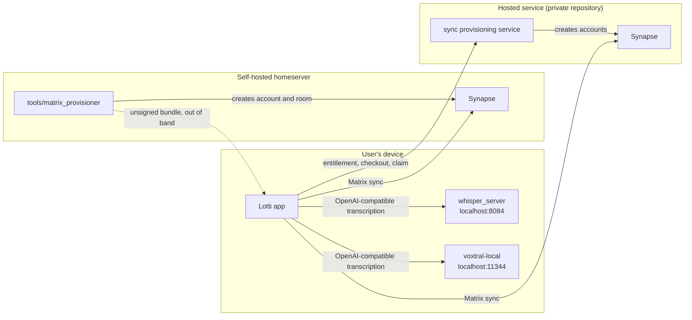

# What is here, and what is not

This repository holds the app and what a user runs **beside** it. The hosted
services an operator runs **for** users — paid sync provisioning with its
deploy stack, the AI proxy, the credits ledger and their dashboard — live in a
separate private repository, because they are how one operator runs paid
features rather than part of what people install.

| Group | Where | App depends on it | Built or tested in CI |
|-------|-------|-------------------|-----------------------|
| **Local inference servers** the user installs beside the app | `services/whisper_server`, `services/voxtral-local` | Yes, as optional providers at a default `localhost` URL | Released as binaries by `python-services-release.yml` on a version tag |
| **Self-hosting provisioning** for someone running their own homeserver | `tools/matrix_provisioner`, `services/shared/matrix` | Indirectly: the app redeems the bundles it prints | Tested by `python-tools-ci.yml` |
| **Hosted services** of the paid offering | Private repository | Paid Lotti Sync only, over HTTP, in builds that set `LOTTI_SYNC_API_URL`; the AI proxy only if a user points a generic provider at it | In that repository |

`services/qwen/` is not a service: it is a README recipe for running a Qwen
model locally with `mlx_vlm`.

# Local inference servers

`whisper_server` and `voxtral-local` expose an OpenAI-compatible transcription
API on the user's machine. The app knows them only as provider types whose
default base URLs are `http://localhost:8084` and `http://localhost:11344`
(`ProviderConfig.defaultBaseUrls`); routing to them is described in
[AI provider routing](../features/ai/provider-routing.md), and how a desktop
node advertises them in [node profiles](../features/sync/node-profiles-and-auto-trigger.md).
Their release is part of the tag pipeline in
[Platform targets, CI and release](platform-and-release.md).

# Self-hosting provisioning

`tools/matrix_provisioner` creates a sync account and its encrypted room on
the user's own Synapse and prints the bundle a first device imports; its
provisioning flow and bundle codec are the `services/shared/matrix` package.
It issues unsigned (v2) bundles, which the app accepts for every homeserver
that is not the hosted service's — self-hosting needs nothing from the
operator. The user-facing walkthrough is the manual's *First device* page.

# The hosted services, seen from the app

The app's only contract with the hosted side is the one it needs for paid
sync: the HTTP routes under `/api/v1/client/` that `lib/features/sync/subscription/`
calls (entitlement, checkout session, session status, claim, rotation
confirmation, portal link), and the bundle wire format — v2 unsigned, v3 with
an Ed25519 attestation the app verifies against `kLottiSyncBundleTrust`. Both
are described in the [sync overview](../features/sync/overview.md#paid-sync-web-checkout-and-signed-bundles).

The AI proxy is not a dependency at all: the generic OpenAI-compatible
provider offers a default base URL of `http://localhost:8002/v1`, named
"AI Proxy (local)", and nothing else in the app is specific to it.

# Related

* [Platform targets, CI and release](platform-and-release.md) - the release
  pipeline that ships the local inference servers.
* [Security and privacy posture](security-and-privacy.md) - what leaves the
  device, and to which provider.
