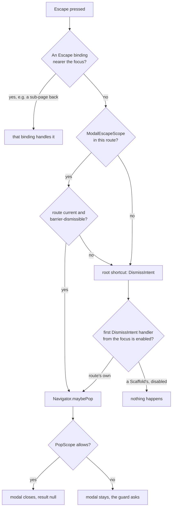

**If a tap outside a modal closes it, Escape closes it too — with the same
result.** That is the whole rule. A modal that is not barrier-dismissible
ignores both. Everything below is how the app keeps that true and where it
used not to be.

# The rule

| The modal is… | Tap on the scrim | Escape | Android back |
|---|---|---|---|
| barrier-dismissible (the default everywhere) | closes, result `null` / `false` | closes, result `null` / `false` | closes |
| barrier-dismissible, a `PopScope` that cannot pop | held | held | held |
| not barrier-dismissible | stays open | stays open | closes, unless a `PopScope` holds it |

- **Same result.** Escape dismisses through `Navigator.maybePop`, exactly as the
  scrim does, so a dialog awaiting a value gets the same `null`, and
  `showConfirmationModal` answers `false` for both.
- **A guard holds against both.** A form that must not lose a draft wraps its
  content in a `PopScope(canPop: false)` and asks first. The scrim, Escape, the
  close button and back all go through it. This is the preferred way to protect
  work. Making the modal non-dismissible is not.
- **Back is the one asymmetry.** Flutter's system back pops the top route
  whatever `barrierDismissible` says; only a `PopScope` stops it. Every modal
  in `lib/` is barrier-dismissible today, so the asymmetry has no live case.

# Barrier-dismissible or explicit close only

Default to barrier-dismissible. Every modal in `lib/` is.

Refuse the scrim (and with it Escape) only when an accidental close would cost
something nothing else can protect:
- an operation in flight that cannot be cancelled midway;
- the app's own quit overlay (`AppClosingOverlay`, a `ModalBarrier(dismissible:
  false)` that is meant to stay up).

A modal that refuses the scrim must show its own way out (a Cancel or Close
button), or hold the user only for the length of the operation.

# The shared components

| Need | Use | Escape |
|---|---|---|
| Any adaptive sheet — bottom sheet on a phone, dialog on a wide window | `ModalUtils.showSinglePageModal`, `showMultiPageModal`, `showSingleSliverPageModal`, or for a custom type, page flow or decorator `ModalUtils.showWoltModal` | built in (`ModalEscapeScope` on every page) |
| A yes/no question — delete, roll back, discard | `showConfirmationModal` (`isDestructive: false` for one that loses nothing) | built in; answers `false` |
| A confirm that then runs an operation with progress | `ConfirmationProgressModal.show` | built in |
| A panel beside the page (agent chats, internals) | `showSideSheetPane` | built in |
| A list of actions from a bottom sheet | `showModalActionSheet` | Flutter's own (no scaffold inside) |
| A plain Material `showDialog` / `showModalBottomSheet` with no `Scaffold` in its content | as is | Flutter's own |
| A route of your own whose content hosts a `Scaffold` | wrap the content in `ModalEscapeScope` | from the scope |
| A scrim drawn inside the page, not a route (the mobile navigation drawer, the Daily OS onboarding spotlight) | wrap scrim and panel in `OverlayEscapeScope(active:, onDismiss:)` | from the scope; focus returns on close |

**Do not call `WoltModalSheet.show` directly.**
`test/architecture/wolt_modal_entry_point_test.dart` fails on any call
outside `ModalUtils.showWoltModal`. **Do not hand-build an `AlertDialog`
confirm.** Fifteen of them were folded into `showConfirmationModal`. They had
drifted into four button styles, and one delete had no destructive styling at
all.

# How Escape reaches a modal

Flutter maps Escape to `DismissIntent` at the app root. Every `ModalRoute`
answers it, enabled exactly when the route is barrier-dismissible. The lookup
starts at the **focused** widget and stops at the **first** `DismissIntent`
handler it meets, whether that handler is enabled or not.

A `Scaffold` registers such a handler for its drawer. It stays disabled while
no drawer is open. A focused text field also forwards the intent upward with
`Actions.invoke`, which stops at the same first handler.

So inside any modal whose content has a scaffold, a focused control made Escape
do nothing. That covered every Wolt sheet, since Wolt lays each page inside its
own scaffold and `LegacyMaterialBridge.modalSurface` adds a second. It also
covered the routes hosting a settings page. With nothing focused, the focus
sits on the route's own scope, above the scaffold, and Escape worked. That is
why the bug only showed up once a field had focus.

`ModalEscapeScope` avoids the intent lookup altogether. It catches the Escape
**key** with its own `Shortcuts` on the way up from the focused widget. Below
the app root, nothing else maps Escape, so the scope sees the key first. It
dismisses only when its route is current and barrier-dismissible; otherwise it
stands aside and the key carries on as before. A binding nearer the focus
still wins. For example, the filter modals map Escape on a sub-page to "back
one page".

An overlay drawn inside the page has no route, so nothing in it holds focus.
`OverlayEscapeScope` takes focus when the overlay becomes active, answers
`DismissIntent` with the overlay's own dismiss callback, and when the overlay
goes it hands focus back to whatever held it before. It notes that holder
synchronously and restores after the frame, because the drawer excludes the
page from focus in the same build that opens it and only lifts the exclusion
in the build that closes it.

# Keyboard expectations inside a modal

- **Escape** closes the modal, or steps back one page in a multi-page modal
  that maps it, or first hides an open text-selection toolbar.
- **Tab** moves among the modal's own controls. A route scopes focus
  traversal, so Tab does not leave the modal. Focus returns to the control
  that opened it when the modal closes.
- **Enter** activates the focused button. Composers that take multi-line
  text, such as the person note and the goal charter, save on ⌘/Ctrl+Enter, so
  plain Enter can stay a newline.

# Verifying a change

Widget tests pin the rule: `modal_escape_scope_test.dart`,
`overlay_escape_scope_test.dart`, the `showWoltModal` group in
`modal_utils_test.dart`, and an Escape case in each scaffolded route's own
test (dashboard side panel, onboarding welcome, demo AI setup, navigation
drawer, onboarding spotlight). By hand, on a desktop build:

1. Open the sheet, click into its first field, press Escape. It closes, and
   whatever awaited it sees `null`, or `false` for a confirm.
2. Do the same on a form with unsaved changes. The discard question appears
   instead.
3. Open a sub-page of the task filter modal and press Escape. It steps back
   one page, and a second Escape closes the modal.

# Not yet consolidated

These are known duplicates, left as they are because folding them changes what
the user sees:
- The six delete confirms built on `showModalActionSheet` with no Cancel
  button.
- The three hand-built text-prompt dialogs.
- The AI provider/model/prompt delete confirm. It is a richer `AlertDialog`,
  with a cascade warning listing what else goes, which `showConfirmationModal`
  has no slot for.
- The three Material `Dialog` shells that repeat the same inset and
  height arithmetic: command palette, keyboard shortcuts and history.

None of them breaks the dismissal rule. Each is a stock route with no scaffold
inside.
