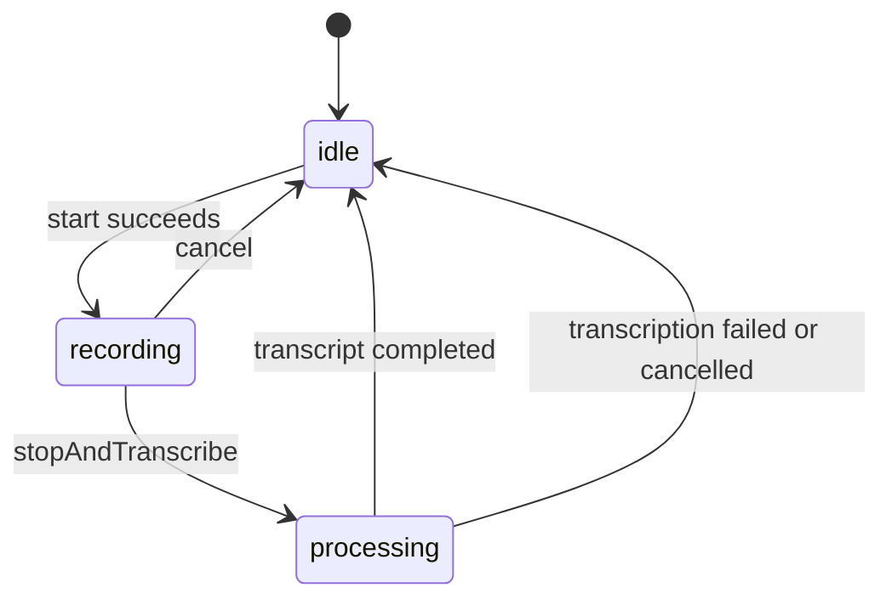

# Ownership and consumers

`AgentChatView` supplies the shared conversation surface used by goal and
relationship agents and [scoped queries](query-chat.md). Query hosts supply
their own projected history and conversation ID, activity and footer slots,
and turn off scrolling on new replies (`scrollOnReplies: false`) so a reader
stays on earlier evidence; a new user turn, or the start of sending, still
scrolls to the latest message. After that the thread **follows its latest
message as it grows** while the reader is at the bottom: a reply's cards or a
door's answer arrive after the reply's own frame, and a lazily built list's
real height after the first jump, so one jump landed short. The reader
turning back up — a drag, a wheel, toward the top (`UserScrollNotification`,
`ScrollDirection.forward`) — stops the following at once; where any scroll
ends decides whether it resumes (within `spacing.step9` of the bottom). The
first is what keeps a long thread readable: while the following held through
a slow drag still near the bottom, every row laid out above corrected the
list's extent, each correction jumped back to the end, and the reader never
got off the bottom. A conversation restored where it was left keeps its
place until something new arrives.
While a reply is on its way the thread shows `AgentTypingIndicator`'s
pulsing dots (unspaced inside the bubble), stopped under reduced motion; a
test of a sending thread pumps frames rather than settling.
`groupAttachmentsWithReply` places a consumer's supporting widgets inside the
reply surface and its reading width, under a transparent Material ancestor for
interactive disclosures; other hosts keep separate attachments.
`composerHelper` is the line the composer says under its field — only what
the chat supports — and `mentionOptions` what `@` offers there (the front
agent's categories); without them the composer says nothing about `@`.
`footerTrailingBuilder` lets a host tail a bubble's footer line — after the
author and the time, on the same line — with a widget of its own, so a turn's
metadata stays one row.

Three opt-ins turn the surface into a conversation with someone rather than a
log; the front agent uses all three, every other host keeps the defaults.
`conversational` sets the agent's replies as unboxed prose (her thinking
state too, so a turn never changes shape on answering), keeps the user's
words in a soft bubble capped short of the far edge on a phone, and drops the
author-and-time line, leaving the footer only for what `footerTrailingBuilder`
adds. `voiceFirst` makes talking lead: on a desktop-width window the field
takes the keyboard at once, while a phone keeps its keyboard down until the
field is tapped, so talking stays one tap. **Nothing said goes out by
itself**, in any chat: Done ends a take and its words land in the field —
after anything already there — to be read, corrected and sent like typed
words. A draft that came from what was said still goes out through
`onSendSpoken` when the host gives one (`_draftSpoken`, cleared once the
field is emptied or sent), so the host knows the turn was spoken; starting to
record stops any voice that is speaking first
(`ChatRecorderController.start`), so the microphone never records the
app. `contentMaxWidth` gives the thread and the composer's controls one
centred reading column: the list's side gutter grows with the window (never
under `step5`) and the composer keeps its controls to the same width, so the
field's edges line up with the messages while the whole pane scrolls; the
front agent passes `kProseMeasureWidth`, other hosts take the full width.
`replyBodyBuilder` lets a host draw an agent reply's body itself, given a
`prose` function that renders a stretch of Markdown as the view renders
replies; a null return keeps the usual collapsible Markdown. The front agent
uses it to draw her lists of tasks as task rows.
A view with `composerEnabled` off, or under a route that covers it
(`ModalRoute.isCurrentOf` false), ignores the shared recorder's results — no
error toast, no draft: when two views of one conversation are mounted (the
front agent's stage over its pane), only the one in front acts on a finished
recording, so what was said lands once.
`replyTextStyle` lets the host select its answer typography from design tokens;
scoped queries use `bodySmall`, while other hosts retain `bodyMedium`.
Hosts can supply `onLinkTap` to resolve each link against its containing message.
That opt-in preserves the rich reply's accessible text and link actions, with
only author/time on the enclosing semantic node. Other hosts keep the existing
flattened message announcement.
**One chat input everywhere.** Every chat's composer — the companion's,
the in-task query chat's, a goal's, a person's — and the Daily OS composer
are the design system's `DesignSystemChatInput` (see
[component contracts](../design_system/component-contracts.md#one-chat-input-for-typing-and-talking)),
driven here by `chatRecorderControllerProvider`: its phase from the
recorder's status, its levels from `getNormalizedAmplitudeHistory`, Done to
`stopAndTranscribe`, cancel to `cancel`. Recording changes only the input's
bottom row, so nothing jumps as it starts, and the voice runs across all the
width the row has (`DesignSystemVoiceWaveform`, the last four seconds of the
take). The companion's stage carries the conversation's own composer, so it
records the same way. There is no per-host recording layout.

Its composer and the agent improvement input widgets use
the same voice-input primitives under `agents/ui/chat/`:

- `ChatRecorderController` and `ChatRecorderState` manage a temporary recording,
  streamed transcript feedback, and typed errors.
- `chat_amplitude_history.dart` provides bounded history and normalization
  functions; the design system's `DesignSystemVoiceWaveform` renders the
  normalized samples (the evolution chat and the goal charter sheet use it
  directly).
- `chatRecorderErrorMessage` maps error kinds to localized messages.
- `thinking_parser.dart` separates reasoning from visible assistant text;
  `ThinkingDisclosure` renders it collapsed by default in improvement replies.

These helpers have no dependency on a standalone chat feature. Inference and
model discovery belong to [AI batch transcription](../ai/batch-transcription.md).
Daily OS calls that service directly without depending on the agent recorder.
The goal/relationship hosts retain ownership of sending and durable history;
improvement conversations retain their own evolution workflow.

# Recorder lifecycle

Start checks microphone permission, records to an app-scoped temporary `.m4a`
file, samples amplitude, and arms a maximum-duration stop. The injected clock
also supplies elapsed capture time on amplitude updates; a new recording resets
it to zero; the input shows it in tabular figures, so the clock crossing a
minute never moves the controls. Stop moves to
`processing`, streams transcription chunks into `partialTranscript`, then
publishes the finished `transcript` or a typed error and returns to `idle`.
The UI consumes the finished transcript into its editable composer. During
processing the partial text shows where the words will land — in the input,
after anything already written, in quieter ink, up to the field's six lines —
with Cancel and a spinner in the controls' place, so a stalled transcription
always has its way out. Empty progress has a localized transcription label.
Partial text is never sent or copied into the draft before transcription
finishes.

Hosts can pass a lazy `resolveTranscriptionTarget` callback into `start`. It is
captured for that recording and awaited immediately before transcription;
cancellation or disposal during resolution prevents submission. Scoped queries
supply their [category-default policy](query-chat.md); goal and People chats,
and the goal charter sheet, supply their subject's
[transcription profile](../ai/profile-resolution.md#the-transcription-profile)
through `subjectDictationProvider`. Callers that omit the callback retain the
transcription service's automatic discovery behavior.

An optional `correctTranscript` callback (`ChatTranscriptCorrector`) belongs
to the same take and is used only with an explicit route: once the words are
in, it receives them and the route that heard them, and its answer becomes the
transcript. The subject dictation's corrector runs the speech-dictionary
correction on the profile's post-processing model when a speech-to-text
engine heard the words. A corrector that throws, and silence, keep the words
as heard. A third, `resolveDictionaryCategory`
(`ChatDictionaryCategoryResolver`), names the category whose speech
dictionary the explicit route's request carries, so a multimodal model reads
the subject's terms in its prompt and a speech-to-text engine gets them as a
hint; discovery never asks for one. `AgentChatView` forwards all three
callbacks to `start`. Without a goal to name, `goalDictationProvider` hands
the chat `SubjectDictation.unavailable()`, whose every take fails as "no
audio model" rather than falling back to discovery.

Every recording captures a monotonically increasing operation ID before the
first startup await. Cancellation also recognizes pending startup while its
visible status is still idle. Permission, temporary-directory creation and
native start recheck the operation before proceeding. An abandoned startup
releases its local recorder/files before cancellation or disposal finishes; a
new start cannot overtake that cleanup. Amplitude
and transcription callbacks must match that ID and `ref.mounted` before writing
state. Cancel increments the ID before cleanup, so stale callbacks cannot
replace a newer recording's state. Stop captures that operation's recorder,
file and transcription route before awaiting native work, and rechecks its ID
after stop. A stale completion never cleans up shared resources. Cleanup
captures and detaches the owned resources synchronously, and concurrent cancel
calls join one cleanup. Completion and cancellation publish `idle` only after
cleanup finishes, so a new capture cannot overlap deletion of the previous
recording. Disposal invalidates the operation and joins an existing cleanup;
cleanup failures remain best-effort and are caught. If amplitude setup fails
after native recording starts, startup releases the transferred resources before
publishing an idle `startFailed` result, so the composer can record again.

`ChatRecorderState.copyWith` clears transcript, partial transcript, and error
fields when omitted. Status, amplitude history and elapsed time retain their previous values.
Callers preserving a partial result must explicitly pass it again.

# Reasoning rendering

The parser preserves the order of visible and thinking segments, including
open-ended markers during streaming. `EvolutionChatBubble` renders the thinking
segments through `ThinkingDisclosure`, separately from the visible answer.
The disclosure supports keyboard toggling, expanded/collapsed semantics,
Markdown selection, and copying. Collapsing reasoning is presentation; it does
not remove that text from any inference context.

# Invariants

- Cancelled or disposed recording operations do not publish stale results.
- Recording errors reach the UI through localized error kinds, not diagnostic
  English exception strings.
- Waveform history is bounded and normalization clamps out-of-range samples.
- These shared UI primitives own neither user-managed chat persistence nor
  agent wake scheduling.
