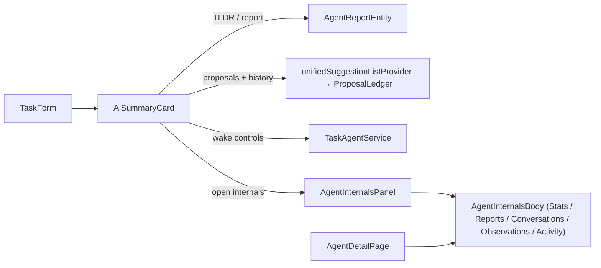
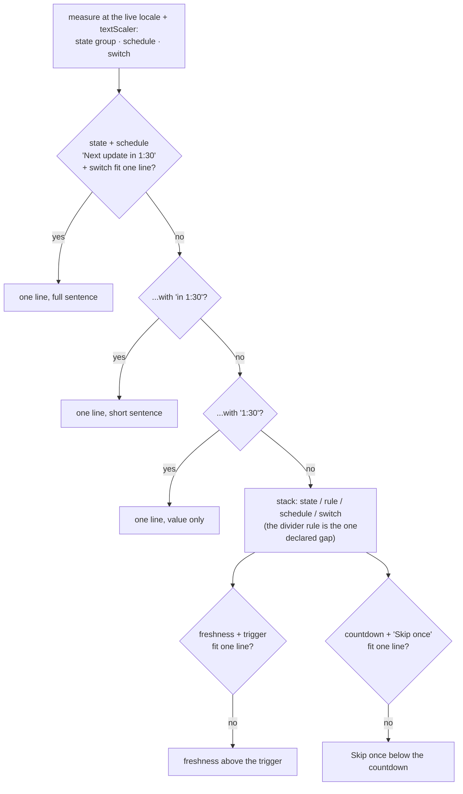
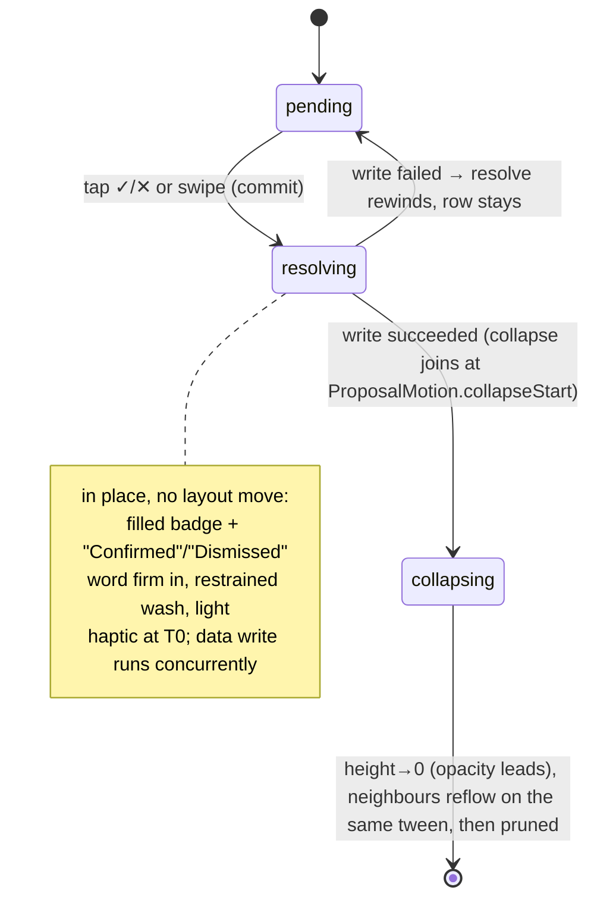
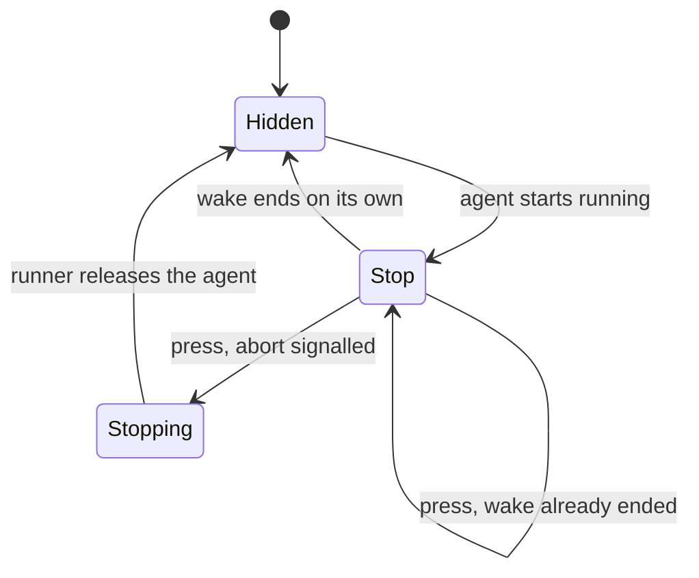
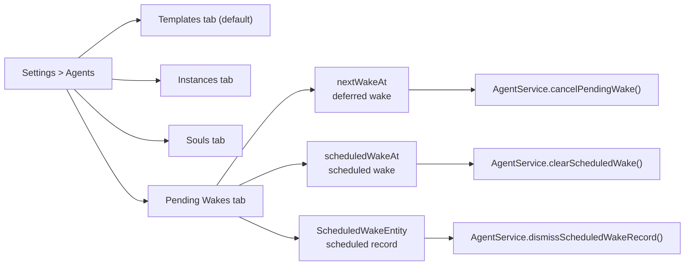
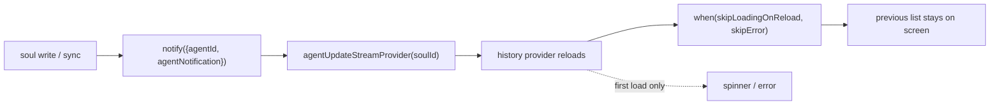
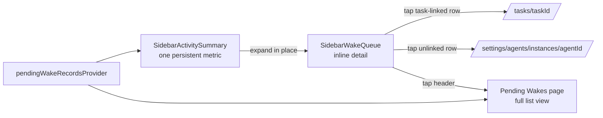

None of these widgets owns business logic. They read from the providers in
`state/agent_providers.dart` and dispatch through the same services.

Agent markdown renders through `AgentMarkdownView`, which wires
`handleMarkdownLinkTap`, `markdownLinkStyleSheet` and
`buildFocusableMarkdownLink` from `widgets/markdown_link_utils`. Links render as
focusable widgets rather than text spans, so a citation can be reached with Tab
and activated with Enter. The shared tap handler beams app-local routes such as `/tasks/<id>` or
`lotti://tasks/<id>` through `NavService`; only `https`, `http` and
`mailto` links reach the platform launcher, and any other scheme is ignored.

Markdown written by a model or synced from another device never fetches an
image: `AgentMarkdownView`, the thinking disclosure and the AI response modal
pass `buildBlockedMarkdownImage`, which shows the image's host in its place, so
a prompt-injected image URL cannot leak data the moment the text is shown.
What's New keeps loading images: they are the project's own release art.

# `AiSummaryCard` — the task-details AI surface

The single AI surface on the task detail page, replacing the earlier
`AgentSuggestionsPanel` + `TaskAgentReportSection` split. It renders **above**
the task's checklists and linked tasks, right under the task header (and any
legacy body).

Contents:

- **TLDR header** (`AgentReportEntity.tldr`, falling back to the report's full
  content when there is no separate TLDR — `resolveReportTldr`) plus an inline
  expandable Goal / Achieved / Next / Learnings block under a quiet *Read more /
  Show less* text link. *Chat* (`QueryAskButton(disc: true)`,
  a glyph-only `DsAiDiscButton` announced as *Ask about this task*) leads the
  header's trailing rail, left of the read-aloud `TtsPlayButton`, which wears
  the same disc. It stands there whether or not a summary exists, and is
  absent while query chat is off; the task page's app bar carries no chat
  entry of its own. The subtitle under *AI summary* is the agent's template
  name when it has one (e.g. *Task Laura*), otherwise the agent's display
  name; it is never the task title.
- **The companion** — with `enable_companion` on, the drawn character of
  [the companion feature](../companion.md) is the card's identity mark in
  place of the sparkle badge (`CompanionSpeaker`). Where she stands is a
  `CompanionPlacement`, chosen from the card body's width rather than the
  window's, by `CompanionReportScaffold` — the header/body/footer block the
  goal agent's read card shares, so both report cards place her alike:
  - **beside** (body at least `besideMinWidth`, 480): head to toe, `full`
    framing, `ControlSizes.companionCard` (168) high, as a leading rail
    (`CompanionBesideReport`) beside a column holding the badge-less
    `TldrHeader`, the report body and the freshness row, so the title, agent
    name, summary, links and *Out of date* share one edge. Her slot is the
    `bust` window's width; the rest of her `full` frame hangs into the card
    padding and the column's leading inset, never further than either. The
    column is at least her rail's height with the freshness row at its foot,
    and a `step4` floor under her shoes matches that row's bottom inset, so
    under a short summary her feet and the status band end on one line.
  - **header** (narrower): her `bust` drawn inside the header's badge tile
    (`TldrHeader.figure`), grown to `ControlSizes.avatar`, with the tile's
    accent fill with the quiet decorative hairline (a portrait, not the
    badge's accent border), as far below the card's top as in from its side;
    the summary keeps the full card width.
    A tap on that tile (`TldrHeader.onFigureTap`, its own control apart from
    the title's tap-to-internals ink) opens `CompanionStagePage`: her `full`
    framing head to toe on the dark stage, with a control that changes her
    outfit for the session, a close control, and the same read-aloud control (`SummaryReadAloudButton`) for the words the card
    showed. She speaks the task's utterance there too, so a summary being
    read aloud carries on in her mouth.

  Her tile stands outside the header's tap-to-internals ink at either
  width, so only the title and agent name (and the *Open agent internals*
  link) open the internals; on a wide card she is no control at all; with no badge border in
  that ink, the agent name takes the accent on hover and the ink draws its
  focus ring.

  She is the read-aloud control's face: shown only while that control is,
  and speaking its utterance — the task id as `sourceId`, in the words the
  voice was given at the tap — so a tap on the control is what makes her
  talk.
- **Proposed changes** — rows from `unifiedSuggestionListProvider`, each a
  `PendingSuggestion`, confirmable or rejectable by tap or swipe (`> 70px` →
  confirm, `< -70px` → reject; in between snaps back). Change-set confirms
  route through `ChangeSetConfirmationService`; backfill rows go to
  `confirmBackfillSuggestion` / `dismissBackfillSuggestion`, and a host may
  supply its own `onConfirm` / `onReject`. *Confirm all* batches `confirmAll` over
  distinct change sets. The list ends with the task's
  [inference backfill suggestions](../ai/inference-backfill.md) — mechanical
  rows with no change set behind them, which confirm into the backfill queue,
  reject into a device-local dismissal, and are all queued by *Confirm all*.
- **`History · N`** — lazily expands resolved ledger entries with
  `Confirmed` / `Dismissed` tags; dismissed and retracted entries are struck
  through and dimmed, confirmed ones are not. It is a section of its
  own (`ProposalHistorySection`), not a rail inside *Proposed changes*, and it
  rides with the expanded report: collapsed, the card shows the summary and the
  decisions still open and nothing else. A report with no *Read more* — no
  tldr/content split, so no expanded state to gate on — shows history
  unconditionally rather than stranding it behind a control that never renders.
- **The freshness strip** — `AgentAutomationRow.compact`, always present: the
  summary's age or *Out of date*, with *Update now* beside it. See *What the
  card says about freshness* below.

`AgentAutomationRow` is also the goal detail report control, and the body of
the maintenance band in the internals panel. Task, project and goal agents
therefore share the same freshness, manual update, countdown, Skip once, and
automatic-update interaction rather than maintaining parallel responsive
implementations (a project band offers no Skip once: its countdown is to a
synced update slot, which the next change would arm again). Each feature supplies its own scheduling service and state;
the widget owns only the presentation and countdown expiry callback.

## Reading column and information grouping

Report reading and agent controls sit in separate information groups. The report
is the hero: header, TLDR (reading measure capped at `TldrBody.maxReadingWidth`,
900 logical px, even when the card is wider, rendered with the editor-aligned `body.bodySmall` token),
disclosure and proposals form one linear reading column at every width. With no
open proposals there is no *Proposed changes* section at all — the header, its
divider and its padding go with the rows, because an empty band said nothing the
missing rows had not already said. The disclosure row carries the summary's
trailing gap inside its own 48-high (`TapTargets.minimum`) tap target, so the card adds no bottom inset
under the report body. Proposal prose uses the same unmodified `body.bodySmall` metrics as the
report rather than a separate line height.

Each proposal is a neutral hairline row leading with its content: the change kind
renders as an inline meta-toned prefix of the row text ("Update · …") at the
body's own size. Colour alone separates it — **taxonomy never gets a chip or the
accent family**. One anatomy at every width: text leads, verdict actions trail
vertically centred, capped at the summary's reading measure. The per-row ✕
(neutral wash) and ✓ (accent wash) are matched in weight and asymmetric in hue,
each in a 48×48 hit zone (`RowActions.buttonSize`) around a `step7` disc, with a
`step2` dead band between them.

## What the card says about freshness

**The strip is always there on the task card**, with *Update now* on its
trailing edge. An earlier revision rendered a zero-height box while the summary
was current, on the grounds that a permanent *Up to date* line said nothing;
but the trigger then only existed once the summary was behind, so the reader
could not find it when they wanted a fresh read anyway.

**Current reads as an age, not a verdict.** The word is the report's age —
*20 min ago*, *2 days ago*, and the date from a week on (*Sep 18*, with the year
once it is not this year's) — from `relativeAgeOrDateLabel` over the report's
`createdAt`. A bare *Up to date* could not tell a summary from this morning
from one from last month. The check glyph and its tooltip (*Summary is up to
date*) still carry the state. The row arms one timer for the label's next
change (`untilNextAgeBucket`), not a tick per second; a dated label waits for
the next local midnight, so *Dec 20* gains its year on New Year's Day. Dates are
the viewer's: `relativeAgeOrDateLabel` reads both instants in local time. A caller that passes no timestamp still gets *Up to date*; a card
with no report shows the trigger alone, which is how the first summary gets
written. The strip pays its own bottom inset from the card, because the dense
trigger and the bare word bring no air of their own.

When the summary *is* behind — the caller's stale watermark, a change queued
behind the throttle countdown, or a run rewriting the report — the word becomes
*Out of date*, which outranks the age. State and its remedy stay adjacent.

The compact row does not derive staleness from the countdown, so the task card
folds it into `isStale` itself: it passes `AgentStateEntity.isReportBehindAt(now)`,
which is the stale watermark OR a `nextWakeAt` still ahead of `now`. A task
change arms that deadline without touching `reportStaleAt`, so reading the
watermark alone left the card silent — looking current — for the whole
countdown.

The task card also hands the compact row that `nextWakeAt`, and while the
strip reads *Out of date* and no run is in flight, the countdown rides **in the
trigger**: *Update now · 1:30*. *Out of date* alone looked like a summary left
to rot, and the remedy is where the reader looks for what happens next. The
label keeps *now* because a tap still runs the update immediately; the time is
when it runs by itself. Screen readers hear *Update now, Next update in 1:30*
rather than the separator. At zero the plain *Update now* returns, and a
current summary or a run in flight (*Thinking…*) never shows a time.

Ticking digits move nothing here either: the label uses tabular figures
(`DesignSystemButton.tabularFigures`), and the button holds the widest width it
has shown for the current deadline, so `10:00` → `9:59` cannot pull its leading
edge in.

A task card also puts *Skip once* beside that counting trigger
(`AgentAutomationRow.compact(onSkipScheduledUpdate: …)`): the countdown is
where a paid run is announced, so it is where the reader can decline it,
without first opening the internals panel. It is offered only while the
trigger counts, and leaves with the time when the deadline passes. The row
measures the freshness word, *Skip once* and the counting trigger at the live
locale and text scale; when the three cannot share a line, *Skip once* takes
its own line under the trigger rather than squeezing the word or truncating
the time. The full schedule sentence and the switch stay in the internals
panel. The project card reads the watermark alone for `isStale` and
passes its next update slot (`projectNextUpdateProvider`) as the deadline, so
a stale project summary reads *Out of date* beside *Update now · 34:59*; it
keeps `showsFreshConfirmation: false`, so its strip still takes no height
while its report is current.

Everything else that used to sit in a footer under the summary — the schedule
sentence, the automatic-updates switch, the model identity and the setup
chevron — is **agent plumbing**, and lives behind *Open agent internals*. That
is six controls the primary reading surface no longer carries.

## The maintenance band lives in the internals panel

`AgentMaintenanceSection` is the band, and it is mounted above the panel's tabs
by any host that governs its agent's report — the task summary card and the
project summary card, each passing an `AgentMaintenanceScope` (a kind and the
task or project id) when it pushes the route. A surface that only *reads* an
agent — the relationship briefing, the goal page's activity link — passes none
and gets the tabs alone.

The band answers **two** questions and keeps each one in one place:

| Question | Where |
|----------|-------|
| *Is this current, and can I refresh it now* | Freshness word plus the manual trigger, on the leading edge |
| *Does it refresh itself, and when next* | The automatic-updates switch with the countdown as its own readout, on the trailing rail |

The model identity sits below both.

**Grouping the countdown with the switch rather than the trigger is deliberate** —
it is the switch's readout, and putting the trigger between the two halves made
"Automatic updates" read as a caption for the button.

**The band derives its own state** from the agent providers keyed by `agentId`,
and dispatches `triggerReanalysis` on the scope's kind (`TaskAgentService` or
`ProjectAgentService`), and a task band's `cancelScheduledWake`. A project band
adds two settings rows under the switch: the daily wake limit
(`AgentWakeBudgetRow`, see [the daily wake budget](wake-orchestration.md#the-daily-wake-budget))
and the update frequency (`AgentUpdateIntervalRow`, a stepper over
`ProjectUpdateSlots.choices` that writes `AgentService.updateUpdateIntervalMinutes`
and then re-plans a pending slot onto the new grid, see
[update slots](project-and-event-agents.md#stale-reports-and-update-slots)). A
task band with automatic updates on adds the wake cadence instead
(`AgentWakeCadenceField`, writing `TaskAgentService.updateWakeCadence`): its
"Category: …" entry names the cadence the task follows until it chooses, via
`inheritedTaskWakeCadenceProvider`, see
[task-agent wake cadence](wake-orchestration.md#task-agent-wake-cadence). It does not take callbacks from
whoever opened it: it renders inside a pushed route, and the surface underneath
is free to rebuild or go away. The automatic-updates switch is the exception
that is *not* dispatched — it writes `AgentConfig`, the same record whoever owns
the agent, and `TaskAgentService` is where that write lives.

*Skip once* latches the **deadline** it was tapped against, not a boolean, so a
wake rescheduled while the panel is open counts down again instead of staying
hidden behind a cancellation of the run before it. The latch lives in
`AgentAutomationRow`, so the band and the task card share it: the countdown
withdraws on the tap, the row keeps reading *Out of date* until the caller's
state catches up, and a skip callback that completes `false` (the band's and
the card's both log and toast the failure) or throws gives the countdown and its
action back for a retry; a throw is reported through `FlutterError.reportError`
rather than lost.

Its `aiCard.footerWash` and hairline **are** the container; nothing inside
draws a second fill, border or radius. An earlier revision boxed the automation
controls in a nested card, costing a nesting level, two horizontal insets and a
third leading edge — and in the light theme that inner fill *was* the band's own
fill, so it was invisible anyway.

The band pays `spacing.step4` horizontally and each row adds `spacing.step2`, so
every glyph lands on `spacing.cardPadding`, while interactive rows still get ink
that breathes around their content.

**Vertically the band spaces its row boxes, not the text inside them.** The
band itself pays `spacing.step2` vertical padding, and the cadence, budget and
interval rows each add `step2`. Its *interactive* rows are touch-target boxes
taller than the ink inside them, at their own minimums: the switch row and
*Skip once* at `spacing.step7`, the identity rows at `step6`; the trigger is a
dense 24-high button. Within the automation row the only declared gaps are the
`DesignSystemDivider` rule (with `step1` vertical padding) between the state
group and the schedule group when the row stacks, and a `step3` gap inside the
stacked state pair. The schedule line stays a bare text row (`_ScheduleLabel`
reserves width, never height); it needs no target of its own, and the boxes
above and below it space it. Extra declared gaps stack on top of those boxes and
the band pays twice — an earlier `step5` between two stacked rows rendered as
~34px of visible space.

The switch row earns its height rather than reserving it. An earlier revision
wrapped the 40×24 switch in a `step9` box "for a full-size interaction target",
but `DesignSystemToggle` owns its own `InkWell`, so that outer box was inert: it
cost 48px of column while the only thing a finger could hit stayed the 24px
track. The whole row is the gesture now — tapping the label toggles the setting
— and it publishes `excludeFromSemantics`, because the switch inside is already
the accessible control and a second unlabelled button node beside it is noise.

## The manual trigger is never absent

*Update now* occupies the same slot in every state, and a run in flight swaps its
label and glyph in place (`DesignSystemButton.isLoading` → spinner +
`Thinking…`) rather than vacating the row. Until #3568 the countdown *replaced*
the trigger, so running the agent by hand meant cancelling the schedule first.

Cancelling one pending run is a worded `Skip once` grouped with the countdown it
cancels — not a bare glyph beside the switch it does not control. It calls
`cancelScheduledWake` and leaves automatic updates on.

**Skipping saves the run, not the fact that the summary is behind.** A change
waiting out its countdown does not move `reportStaleAt` — the throttle deadline
is its only trace, which is why the card reads `isReportBehindAt`. Cancelling
the deadline alone therefore left a report that missed the change reading *Up
to date*. `TaskAgentService.cancelScheduledWake` first marks the report stale
(`AgentService.markReportStale`) when the state is behind but not yet stale,
then cancels the pending wake, so the summary keeps reading *Out of date* until
the next change's run or *Update now* refreshes it — the same mark disabling
automatic updates writes over a pending countdown.

**Accent is spent on the trigger alone.** It sits at
`DesignSystemButtonSize.dense` — the caption tier — so accent means "this starts
work", and nothing in the maintenance band shares a type tier with
`Confirm all`.

`Skip once` is the trigger's opposite and is inked at `aiCard.bodyText`: the
same register as the countdown it acts on. An action rendered *fainter* than the
static text beside it inverts the two. It carries no underline and no hover
fill — the word's own ink lifts a step (`bodyText` → `titleText`) on hover,
focus and press; a decorated cancel out-decorated the value it cancels while
giving the band a third dialect for "this is tappable".

**The alert tint is spent on the freshness glyph alone.** The word stays
`aiCard.bodyText` in both states. Tinting it too made the quiet maintenance
band the loudest thing on the card — louder than `Confirm all`, the action that
actually changes the task — and in dark it read at *lower* contrast than the
plain ink it replaced. The state is already said twice, in the glyph and in the
word, so colour is not carrying it alone.

Both `Skip once` (`_SkipAction`) and the model-identity row
(`_SetupIdentityRow`) are `DsQuietInk` quiet links — no hover fill — with an
explicit `Semantics(button: true, label:)` above the ink and `ExcludeSemantics`
below it. That ordering is the accessibility fix: both predecessors excluded
semantics *above* their `InkWell` and so published a button with no tap
action.

One layout detail is easy to get wrong: **`DesignSystemButton` pays its own
content inset**, so a button box on the leading edge puts its *glyph* inside the
inset — invisible until the row stacks, and then reading as a broken column. The
trigger sets `alignsLabelToLeadingEdge` to cancel it.

## Prose degrades before payloads do

`AgentAutomationRow` measures its localized labels with a `TextPainter` at
the live `MediaQuery.textScalerOf` rather than branching on a pixel breakpoint —
no constant can know whether "Automatische Aktualisierungen" fits beside a
trigger at 1.3× text scale.

The schedule wording steps down `Next update in 1:30` → `in 1:30` → `1:30`; when
no rung fits the row stacks onto the shared leading edge, and at the narrowest
measures **the state pair and the schedule pair each split onto their own lines
too**. **The countdown value, the trigger and the switch never degrade**; the
automatic-updates label and the idle helper prose wrap to two lines rather than
truncating.

**Ticking digits move nothing.** The schedule label reserves the width of the
wording captured when the deadline was latched, and the fit decision is taken
against that same reserved width — so a `1:00:00` → `59:59` transition can
neither resize the label nor flip the row between its two forms. The reservation
is measured in the *painted* style: tabular figures change digit advance, and
measuring without them clips the payload.

Freshness is a glyph **and** a word, never colour alone; the full sentence lives
in the tooltip. **A visible countdown, or a report refresh in flight, is itself
proof the summary is behind**: `AgentAutomationRow` derives one outdated flag —
the caller's `isStale` OR a ticking countdown OR the run in flight — and the
glyph, word and tooltip all read that flag. So the band never says "Up to date"
beside "Next update in …", even when the caller's staleness watermark has not
caught up with the scheduled wake — and never beside "Thinking…" either. The
summary on screen is the one the run is replacing, and `reportFreshAt` is
written only once the wake succeeds (see
[task agents](task-agents.md#freshness-watermarks)), so the word flips to "Up
to date" only after the run has ended, and a failed run leaves it reading
whatever the watermark says. The band hides the countdown while a run is in
flight, which is exactly when the caller's flag is most likely still `false`:
without the running term, that frame read "Up to date" with the spinner beside
it. On the **project** card, which passes `showsFreshConfirmation: false`, the
same flag decides whether the strip speaks at all, so a card that says nothing
is a card whose summary is genuinely current — never one that has simply not
caught up; the task card's compact strip always speaks. Which runs count is the caller's to say: `isRunning` (agent-wide, and what
keeps the trigger busy) is the default, right for task agents whose every
completed wake advances the watermark; the goal page passes
`goalReportWakeInFlightProvider` as `isRefreshingReport`, because a goal
agent's chat replies and Phase A subscription ticks hold the same lock without
touching the read, and must not declare a fresh one out of date. With
automation on and nothing pending
the line reads "Updates on changes", so flipping the switch never leaves a
hole that resizes the panel. The whole switch row is the interaction target — tapping the label
toggles the setting — on a `spacing.step7` minimum; the switch's
own 40×24 track is too short in one dimension to be the target by itself. When
setup is missing, the disabled toggle explains itself via an info tooltip and
the trigger is disabled rather than hidden.

## The setup region

It compares the live route fingerprint with the immutable final-author route on
the visible report. Equal routes collapse to one editable identity line (*Current setup* appears
only in its semantics label); different routes add a separate *This report*
attribution line, the one visible label. Above `TextScales.large` the
attribution row stops shedding segments: its route moves to its own line under
the label and wraps.

Both rows **shrink-wrap** — a stretching `Column` hands its children a *tight*
width, which silently defeats the `MainAxisSize.min` they declare and inflates
their ink, tooltip and tap target to the full reading measure.

**Routes shed segments rather than wrapping or ellipsising.** A route is
structured, so `inferenceRouteIdentityTiers` drops whole segments —
`Qwen 3.5 Plus · Alibaba · via Melious.ai` → `Qwen 3.5 Plus · Melious.ai` →
`Qwen 3.5 Plus` — instead of ellipsising away the serving provider and leaving the
connective "via" stranded behind it. **Only the last rung may ellipsise.** The
fixed `This report` label never gives ground; its route does. The full route stays
in the semantics label, and the setup row's tooltip **names its action**
(`Change AI setup`) rather than repeating a route that is usually fully visible.

**Both rows are the same row box**, sharing a horizontal inset and a `step6`
minimum height (the setup row's glyph is `IconSizes.s`). That is what keeps the
card's bottom margin constant whether or not the attribution line exists.
Padding alone could not: the tappable row's ink box contributes optical air
below its text that a bare text row does not, so a revision that equalised the
*declared* padding still shifted the card's bottom edge on screen as a report
aged into a different route. Space row boxes, not text.

## Proposal accept/reject motion

Timing and curves come from the hand-authored `MotionDurations` / `MotionCurves`
/ `ProposalMotion` tokens in `motion_tokens.dart` (M3 duration scale + emphasized
easing). They are **not** in the generated `ThemeExtension` pipeline because
`Duration` and `Curve` are not lerp-able.

Each `ProposalRow` runs a two-beat exit on two controllers:

Invariants:

- **The committed row never moves on the action frame.** It acknowledges in place
  for `ProposalMotion.resolveHold`, then collapses; the height collapse *is* the
  reflow (`SizeTransition`, `alignment: topCenter`), so neighbours slide up on
  the same tween with no snap. The inter-row gap lives inside the collapse so
  nothing snaps on prune.
- **Nothing in the section changes height in a single frame.** The task page
  pins the card's bottom edge while a proposal resolves, so any instant change
  inside the section would snap the content above it. Four things that used to
  unmount now ease out instead: the row's trailing slot keeps
  `RowActions.footprintWidth` while resolving (a narrower placeholder let the
  text rewrap and the row lose a line before its collapse); the pending pill
  fades in place at zero rather than leaving the header line; the Confirm-all
  rail is always mounted inside a `SizeFadeCollapse` and collapses when a
  confirm leaves one row — and stays for the whole of a Confirm-all sweep via
  `_confirmAllSweeping`, rather than dropping while the last row is still
  leaving; and the section itself is retained (`_lastProposalsSection`) inside a
  `SizeFadeCollapse` so it collapses as a unit after the last row, then is
  dropped from `onCollapsed` at zero height. A section that returns afterwards
  gets a fresh wrapper (`_proposalsGeneration`) so it stands at full height at
  once and only its new rows reveal themselves.
- **The history band waits for the sweep.** The first confirm already writes a
  ledger entry, and a report with nothing behind Read more shows history
  unconditionally — so the band is latched (`_showHistory`) while any row is
  still collapsing and reveals afterwards through a `SizeFadeEntrance`, animated
  only when it appears after the initial load.
- **The shell, not the provider, removes the row.** `_AiSummaryShellState` keeps
  a `Set<String> _exitingFingerprints`; `onResolveStart` records a fingerprint so
  the visible list re-inserts it even after the provider drops it, and
  `onResolveEnd(removed:)` prunes on animation complete — or keeps the row on a
  failed write.
- **Confirm-all** is a staggered resolve→collapse sweep (per-row
  `ProposalMotion.staggerStep * min(cascadeIndex, 8)`) with **one**
  `selectionClick` haptic for the whole gesture (a single row's commit uses
  `lightImpact`). At gesture time the shell synchronously adds every batch
  fingerprint to `_exitingFingerprints` *before* either persistence or the
  stagger timers begin, so a provider re-query that resolves proposals
  immediately cannot unmount a row mid-animation. This matters most for
  `update_checklist_item`: checking an existing item is fast enough to beat a
  later row's stagger, whereas the slower checklist insert path used to hide the
  race.
- **Tap-guard:** while any row is collapsing the shell passes `settling: true`,
  so surviving rows treat tap and swipe as inert until the exit completes — a
  fast second action cannot hit a row that moved under the pointer.
- **Swipe hint:** a one-shot, one-directional nudge on the first row, gated by
  the session-scoped `proposalSwipeNudgePlayedProvider` so it never re-fires on
  promotion; suppressed under reduced motion.
- **Accessibility:** on commit an assertive `SemanticsService.sendAnnouncement`
  speaks the verdict plus remaining count; the committed row is
  `ExcludeSemantics`'d immediately so there is no ghost focus; action buttons
  carry explicit `Semantics(button:)` roles and labels.
- **Entrance reveal** — the dual of the exit. Proposal rows that arrive *after
  the first seeded batch* reveal their height open from zero with a fade via
  `SizeFadeEntrance`, so content below eases down instead of being shoved in one
  frame; the first batch is seeded without animation, so statically loaded
  content stays instant. `SizeFadeEntrance` is one-shot and built on
  `SizeTransition` rather than `AnimatedSize` on purpose: it reveals once then
  sits inert, leaving a proposal row collapsing *inside* it entirely to that
  row's own choreography — an enclosing `AnimatedSize` would try to re-drive and
  assert on that inner per-frame size change.
- **Reduced motion** (`MediaQuery.disableAnimations`): no resolve/collapse
  travel, instant prune, instant pill swap, instant entrance — but the haptic
  still fires, because it is feedback rather than motion.

### The card anchors

The task page pins one edge per resolve. While the card is in view it pins the
**card's bottom edge**, so a row collapsing inside the card — every accepted or
dismissed proposal, and the whole staggered Confirm-all sweep — leaves the rows
still to come, the rail and everything below the card exactly where they were,
and the summary above slides down into the vacated space. While the card has
scrolled **fully above** the viewport it pins the seam just below the work bands
instead, so neither a new proposal growing the card nor a resolved row collapsing
it moves the visible area.

The collapse side matters for *every* tool and *both* verdicts: `_confirm` and
`_reject` share the choreography, so a dismissed proposal shrinks the card
exactly as an accepted one does. The card band reports its own height delta
(`ViewportStableSizeReporter`) whenever a hold is armed, so the correction lands
pre-paint rather than one frame late per frame of the collapse; the anchor is
the fallback. Which edge is pinned, and why the two anchors are mutually
exclusive, is the page's concern — see
[task detail composition](../tasks/detail-composition.md#which-edge-holds).

## Holding the list steady during a wake

The card keeps the last visible suggestion list in widget state while a wake
runs. If the provider briefly reloads to an empty or partial open list without
ledger entries resolving the missing fingerprints, the card merges those
unresolved previous rows back in. Explicit resolution still wins: confirmed,
rejected and retracted fingerprints in the ledger remove the matching row
immediately.

# `AgentModelSheet` — one adaptive Wolt route

The setup sheet is a single multi-page Wolt route. Its overview branches to
embedded profile, provider and model pages by **changing the route's page
index** — it never opens a second picker modal over the setup sheet. A single
provider skips the provider page; multiple providers drill down and use the Wolt
back affordance to return within the same route.

Every branch uses `DesignSystemSelectionRow`, and the provider/model branches
reuse `InferenceProviderSelectionRow` / `InferenceModelSelectionRow`, so branding
and selection markers stay identical to the standalone inference picker without
coupling the setup flow to their modal wrappers.

The overview is a **settings summary, not another picker page**: a grouped
*Current setup* card exposes the active profile and effective thinking route as
noun-labelled navigation rows. Automation is intentionally absent because the
maintenance band in the agent internals panel owns it. The destructive *Turn
off AI for this agent* action is isolated below the setup group and swaps in
place for its own explanation with Cancel/confirm — not another page. The model
row, *Use profile default*, *Copy category default* and *Turn off AI* appear only
when the sheet is opened for an entity (`entityId`); goal and other
profile-only opens show the profile row alone.

```mermaid
sequenceDiagram
  participant User
  participant Sheet as AgentModelSheet
  participant Controller as _AgentSetupFlowController
  participant TaskUI as Task-column ScaffoldMessenger

  User->>Sheet: open profile / provider / model page
  Sheet->>Sheet: change page index in same Wolt route
  User->>Sheet: choose terminal profile or model
  Sheet->>Controller: persist inference setup
  alt write succeeds
    Controller-->>Sheet: true
    Sheet->>Sheet: close setup route
    Sheet->>TaskUI: show scoped confirmation
  else write fails
    Controller-->>Sheet: false / throws
    Sheet->>TaskUI: remain open, show error toast
  end
```

Profile and model rows are **terminal choices**: the flow controller
(`_AgentSetupFlowController`, persisting through `TaskAgentService` —
`updateAgentProfile`, `updateAgentThinkingModelOverride`,
`updateAgentInferenceSetup`) persists the new `AgentInferenceSetup` first, then closes the whole route and shows the
localized confirmation through the `ScaffoldMessenger` captured from the
task-details column. Model rows optimistically move the selection marker as soon
as a tap is accepted while a busy guard prevents a second write; a failed write
restores the persisted selection, leaves the route open, and reports the error
through the same captured task-column messenger.

Navigation and toast delivery use the **stable** navigator and messenger captured
when the sheet opens, so a database-driven Wolt page rebuild cannot misclassify a
successful save as a failure. The controller binds the exact modal route and
closes only while that route is still current, so completing a save after manual
dismissal cannot pop the task screen underneath.

`taskAgentSetupOptionsProvider` retains the loaded profile/model/provider catalog
across independently mounted Wolt pages, and consumers unwrap the last successful
async value during refreshes, so navigation never flashes an empty page. The
catalog is derived from `aiConfigsByTypeProvider`, the repository's per-type
config streams, so a model, provider or profile added or deleted — locally or
through sync — recomputes it in place; no picker shows the list from app start.

Daily OS reuses the same resolution and picker primitives without depending on
the task-agent service: the planner's Stats tab detects `AgentKinds.dayAgent` and
opens `DailyOsInferenceSetupSheet`. All paths persist through `DayAgentService`
before closing. A profile choice clears the direct model override; a later model
choice retains that profile as its base. The general default stays on the
day-agent template, so the instance sheet cannot silently change the default for
future planner creation.

# The doorway and the menu on an agent's page

A page an agent serves — a goal's, a person's — reaches that agent the same
way. On desktop the conversation opens from
[`AgentChatButton`](../../../lib/features/agents/ui/agent_chat_button.dart):
the AI card's accent pair and the sparkle, the whole recommended touch target answering, one
announcement for screen readers. The page's overflow menu is built from
[`agent_menu_items.dart`](../../../lib/features/agents/ui/agent_menu_items.dart):
one row style (`agentMenuItem`, with a destructive variant in the error ink),
a switch row that keeps the same icon slot (`agentToggleMenuItem`) instead of
Material's differently indented checked tile, and `agentInternalsMenuItem` —
*Agent internals*, the panel's own title, under the tune glyph. Both menus
order themselves the same way: the page's own actions, a divider, the agent's
actions ending in the internals, a divider, delete.

# `AgentInternalsPanel` and `AgentInternalsBody`

`AgentInternalsPanel.show` opens the panel in the app's shared side sheet
([`side_sheet.dart`](../../../lib/widgets/modal/side_sheet.dart)): on a wide
window a right-anchored panel over the shared scrim (half the window, clamped
600–800 px); on a phone a full-height bottom sheet. Every host opens it the same
way — task and project cards, the goal page, the person page's menu and chat
header, and the sidebar's wake rows for agents whose wake has no subject page of
its own (a goal's or a person's), which used to jump to the Settings instance
page instead. On the task and project cards it is reachable two ways: the header
(its whole badge, title and name block is the tap target, from the shared
`TldrHeader`) and the quiet *Open agent internals* text link under the report,
which `TldrBody` shows whenever the host passes `onOpenInternals` — not only
when the report is expanded. The goal agent's read uses `TldrHeader` plus an
overflow-menu item; the relationship briefing deliberately omits the link and
offers its own *See activity* button. It is a thin shell —
header and close button; the sheet owns width, edge and scrim, and shows no
drag handle on a phone, whose opaque strip would otherwise sit over the close
button — hosting the host's optional
`AgentMaintenanceSection` and then `AgentInternalsBody`, once
`agentIdentityProvider` resolves. The band sits *above* the tabs because it is
the one thing here the reader changes rather than reads, and because it belongs
to the agent as a whole rather than to any one tab's log. A tap on the scrim, Esc and the close
button all pop the sheet. The panel's colored background is painted by its own `Material`, so conversation
and report expansion tiles paint their ink on that surface. An opaque decorated
box between those tiles and Material would trigger a framework assertion.

`AgentInternalsBody` is the shared tabbed body — **Stats / Reports /
Conversations / Observations / Activity** — used both inside the panel and as the
body of the standalone `AgentDetailPage`. Each tab is owned by an existing
component plus a Stats card wrapping the agent's template, profile, controls and
current `AgentStateEntity`. There is no panel-specific logic; both consumers see
the same tabs and behaviour. The Stats tab's token-usage heading carries the
agent's lifetime cost — the `ConsumptionSummaryPill` over
`agentConsumptionTotalsProvider` — so every agent's internals attribute what it
has cost, whatever its kind; per-report attribution stays on the report and
conversation cards. The Stats setup row opens the shared inference
setup sheet for agent kinds that can persist instance profiles even when they do
not own a task, such as goal agents. Kinds on none of those paths omit the row
entirely rather than reporting a route they cannot resolve: a relationship agent
owns neither a task nor a template, so `agentResolvedSetupProvider` returns null
*by construction*, and the row used to render that silence as "No AI setup" under
an error glyph — about an agent that resolves its model through the person's own
profile and briefs with it daily. The rule is keyed on the kind, not on a null
resolution, because a null resolution for a kind that *should* have one is a real
misconfiguration this row is the only place to see. A row that cannot be opened
also drops its chevron, which otherwise promised a destination that does not
exist. Task-only category defaults and direct
thinking-model overrides remain hidden on that profile-only path. Because goal
agents have no template assignment, their Stats row resolves the persisted
identity profile directly through `goalAgentResolvedSetupProvider`; saving a
profile invalidates that resolver together with the identity so the effective
route is shown immediately. The resolver (`resolveStandalone`) tries, in
order: a typed `inferenceSetup`, which resolves strictly — broken or disabled
never falls through; then the legacy `profileId`; then the Settings default
profile; and only when **no** default profile is selected, the built-in GLM 5.2
fallback used by `GoalAgentWorkflow`. A selected default that cannot resolve is
reported as broken. For legacy goal identities that
still carry only `AgentConfig.profileId`, the profile-only sheet uses that value
as its selected base profile until the next save writes the typed setup.

# Stopping a running wake

A hung inference can be stopped from wherever the agent is being read, not
only from the sidebar's wake rows. All of these places use one control,
`AgentStopWakeButton` in
[`agent_stop_wake_button.dart`](../../../lib/features/agents/ui/widgets/agent_stop_wake_button.dart),
which calls `AgentService.abortRunningWake` — the same abort as the sidebar's ×,
a pause and the run timeout (see
[the execution bound](wake-orchestration.md#wake-execution-bound)):

- **The agent's header.** `AgentRunningControls` puts the running spinner and
  *Stop* side by side in `AgentDetailPage`'s app bar and in the
  `AgentInternalsPanel` header, so the stop is reachable whichever tab is open.
- **The conversation list.** In the Conversations tab, the live wake's thread
  carries a *Running* badge and, while collapsed, *Stop* in its row. The row is
  found by run key (`agentRunningThreadIdProvider`, over
  `WakeRunner.runKeyFor`), not by recency. Until the running wake writes its
  first message, the newest thread is still the previous wake's.
- **The live conversation.** Expanded, that thread opens on a callout saying
  the agent is still working, with *Stop* as its trailing action. The row's
  stop leaves when the callout arrives, so a thread never shows two.

A thread whose wake run is `aborted` — stopped, paused or timed out — reads
*Stopped* afterwards. `wakeRunStatusForThreadProvider` re-reads the run when
the agent starts or stops running, and the drain records `aborted` before it
releases the lock. *Running* outranks *Stopped*, so a stale read cannot mark
the live thread stopped.

The control has no state the runner does not have, apart from the moment
between the press and the release:

*Stopping…* swaps the glyph for a spinner and ignores further taps. The state
resets when the agent goes idle, so a button that stays mounted — the app bar's
— offers *Stop* again for the agent's next wake.

# Settings surfaces

*Settings → Agents* is the operator entry point, with four tabs (`Templates` is
the default landing):

The **pending-wakes dashboard is intentionally narrower than the full message
log** — it shows only wake records that can still fire: `nextWakeAt` (the
per-device deferred subscription deadline), `scheduledWakeAt` (written now only
by template improvers; a project agent's is a retired legacy field), and pending
`ScheduledWakeEntity` records — among them the Daily OS day pre-warms, whose
subject is the day id derived from the `day:<dayId>` `workspaceKey`, and project
update slots under `ProjectUpdateSlots.workspacePrefix`.

Cards read the page-scoped 1 Hz `wakeCountdownTickerProvider` rather than each
spawning a `Timer`, and recompute remaining time from `clock.now()` on every
tick, so the countdown does not drift when frames arrive late. Deleting a card
clears only the represented marker.

The **instances dashboard stays deliberately lightweight**: it drives the shared
`AgentListingShell` with type, lifecycle/status and soul filter axes, showing a single
result count and a per-group active-count badge when grouped by status. There is
no aggregate total/active/dormant/destroyed breakdown line.

Templates and Souls are the only tabs exposing create FABs, wrapped with the
shared bottom-navigation clearance so they do not sink behind the floating app
shell on narrow layouts.

## History sections and reload behaviour

Five list sections on the template and soul detail pages read a
`FutureProvider.autoDispose.family`:

| Section | Provider | Reloads while open? |
|---|---|---|
| Soul → Info → Version History | `soulVersionHistoryProvider` | yes — every soul write |
| Soul → Info → Soul Evolution History | `soulEvolutionSessionHistoryProvider` | yes — every soul write |
| Template → Reports tab | `templateRecentReportsProvider` | yes, but only on some events |
| Template → Stats → Version History | `templateVersionHistoryProvider` | no |
| Template → Instances | `templateInstanceOverviewProvider` | yes, but only on template-scoped events (via `templateInstanceTokenBreakdownProvider` → `templateTokenUsageRecordsProvider`), the same gap as Reports |

The Template Instances section (added in #3855) renders one row per instance
created from the template, whatever its lifecycle: the task title (or the
agent's display name), a lifecycle pill, *Started · Last active*, the token
total, a tap that opens the instance and a button that opens its task. It is
wired into the template detail page through `agent_template_detail_sections.dart`
and backed by the `TemplateInstanceOverview` model
(`model/template_instance_overview.dart`) and `templateInstanceOverviewProvider`
in `state/template_query_providers.dart`.

`agentUpdateStreamProvider(id)` filters `UpdateNotifications.updateStream` down
to sets *containing* `id`. Soul sections are well served: soul entities carry
`agentId: soulId`, so every soul write lands the id in the set.

Templates are patchier, because **a template id is not an agent id**. It reaches
a notification set from agent initialization, template evolution, and from sync
only for `WakeTokenUsageEntity`. **A report landing therefore does not refresh
the Reports tab**, and `templateVersionHistory` watches no stream at all. Both
are known gaps rather than intended behaviour; closing them means widening a
producer's notification set or subscribing to the shared `agentNotification`
topic — and the latter has real blast radius, since the same providers back
`SoulEvolutionReviewPage` and `TemplateTokenUsageSection`, whose `when` calls
still take the defaults.

The four soul and template history sections each pass
`skipLoadingOnReload: true` **and** `skipError: true` to `when`; the Instances
sliver does not yet, and still swaps to a spinner on reload. The
distinction matters: `AsyncValue.when` already defaults `skipLoadingOnRefresh` to
true, so an explicit `invalidate` was never the risk — a *reload* from a watched
dependency is, and it defaults to showing the spinner. `skipError` covers the
other half: a reload that throws yields `AsyncError` carrying the previous value,
and the default would swap the list for the error widget. Either would collapse
the section's height and shift everything below it mid-read. An initial load
still shows the spinner and an initial failure still shows the error, because
neither has a previous value to keep.

# Sidebar wake queue

`SidebarActivitySummary` owns the persistent representation, on the desktop
rail and in the mobile drawer. It watches `ongoingWakeRecordsProvider` and
`pendingWakeRecordsProvider`, counts scheduled wakes inside a **one-hour
lookahead**, and contributes one compact sparkle (`LottiIcons.aiSpark`) + total
metric beside recording and timer activity.

Selecting the summary expands `SidebarWakeQueue` **in place**, surfacing a quiet
sentence-case `Agents` sublabel with a summary such as `1 active · 2 queued`, the
top running wake (green dot, `Working · mm:ss`, linked title), the next compact
scheduled row (neutral dot, `Queued · ETA`), and a compact overflow row when more
are hidden.

It renders as a quiet neutral card with no accent rail or tint, and reserves no
permanent sidebar height — the summary's expanded state *is* the detail surface.
**Agent activity is always observed; no feature flag can hide active or queued
work.**

Rows are actionable: task-linked wakes route to `/tasks/<taskId>` with a small
open-task glyph, while unlinked or project-only wakes fall back to the agent
instance route. The trailing cancel button is a separate hit target, so opening
the work item and stopping the wake never compete.

Rows are driven by the page-scoped `wakeCountdownTickerProvider`, so the sidebar
shares one ticker instead of spawning a timer per row. Wakes outside the one-hour
lookahead stay out of the inline sidebar and remain on the full page; additional
in-window wakes collapse into the overflow row rather than turning the navigation
rail into a wake manager. The collapsed icon-only sidebar suppresses the slot
entirely.

The shared proposal sections accept host row builders, and `ProposalRow` accepts
optional confirmation/rejection callbacks and a details slot. Hosts without
callbacks retain the task confirmation service. Relationship card/chat hosts
supply their own scoped service and evidence/history details; see
[deferred relationship suggestions](../relationships.md#deferred-task-suggestions).
The kind resolver recognizes `create_and_link_task` by literal tool name,
keeping shared agent UI independent of the relationship feature.
