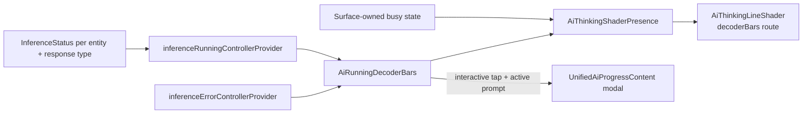
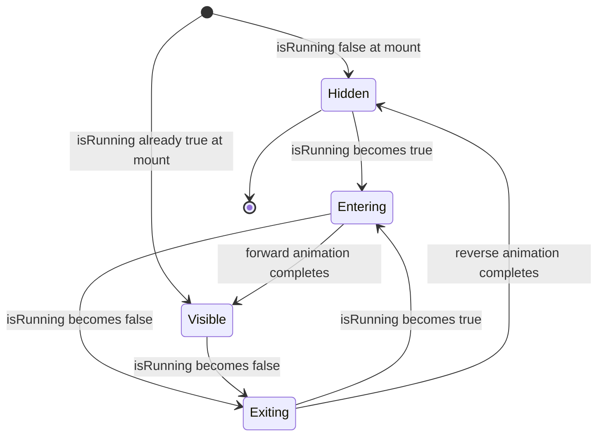

# Two shaders, registered in pubspec

| Asset | Renders |
|-------|---------|
| `shaders/ai_voice_input.frag` | The transparent tension-loop voice orb |
| `shaders/ai_thinking_line.frag` | Five horizontal thinking routes — quiet thread, packet scan, circuit trace, probability band, decoder bars — sized for action-bar use |

`ai_state_shader_animation.dart` is the barrel: it holds the assets, the program
cache and the shared `aiSetShaderColor` uniform helper, and re-exports the voice
and thinking widget/painter families from their standalone libraries.
`AiVoiceOrbPalette` lives in `ai_voice_orb_palette.dart`, which hosts import
directly; the barrel does not re-export it.

## The voice shader

It contains **only** the production program — unused experimental variants are
not compiled into the runtime effect. `AiVoiceInputShader` creates one
`FragmentShader` per loaded program and reuses it while animation time and live
dBFS uniforms change, rather than allocating a native shader every frame.

The widget accepts a dBFS value (`-80..0` by default), matching
`record.Amplitude.current` and `measurePcm16Amplitude(...).dbfs`.

When the OS reduce-motion setting is on, the time ticker holds still on one
static frame that is still tinted by the live dBFS. When the program cannot load,
`AiVoiceInputFallbackPainter` draws a CPU approximation.

**Five shared quadrature harmonic pairs and four bounded pressure lobes drive
every contour.** Each ribbon gets a different phase by mixing those bases rather
than evaluating a new trigonometric pressure field, and **the render path
contains no `exp` or `pow`.** It composites two hero ribbons, secondary contours,
hairlines and reusable halos into a transparent premultiplied result.

The voice orb takes its colours as an `AiVoiceOrbPalette` of body, glint and
halo. `AiVoiceOrbPalette.fromTokens` derives them from the design tokens it is
handed, never from the ambient theme, and reads the surface's brightness from
`background.level01`. On a dark surface the body is the interactive teal, the
glint the high-emphasis text colour — so the pressure-lit ribbons bloom white —
and the halo the body deepened to 72 %. On a light surface the glint is the
accent's hue at 0.60 lightness, a lit teal rather than dark ink, the halo sits
midway between body and glint, and the `onLightSurface` flag narrows and softens
the shader's halos and glints. The shared recorder's `RecordingLevelVisualizer`
shows the orb for the modern recording style (the analog VU meter otherwise),
builds the palette from the ambient tokens, and on a light surface sets the orb
in a soft radial lit pool. The Daily OS `VoiceButton` passes its own teal
accent; the onboarding `RecordingStylePicker` passes the card's own surface
tokens.

# Two adapters

**`AiRunningDecoderBars`** is the provider-driven adapter. It watches
`inferenceRunningControllerProvider` for one entity and a set of response types,
listens to the matching `inferenceErrorControllerProvider` instances, and
delegates its visual lifecycle to `AiThinkingShaderPresence`. Interactive hosts
also use it as the labelled tap target that resolves the active prompt and opens
`UnifiedAiProgressContent`.

It appears in `TaskDetailsPage` (the interactive `topSlot` of `TaskActionBar`,
for image analysis, audio transcription, audio summary, prompt generation and
image generation), `EntryDetailsPage` (the interactive `topSlot` of
`EntryActionBar`, for image analysis, audio transcription, audio summary and
prompt generation), `UnifiedAiProgressContent` (while running but before
progress text), and the sticky action bar of the
`UnifiedAiProgressUtils.progressPage` modal.

**`AiThinkingShaderPresence`** is the local-state adapter for surfaces that
already own a busy flag and therefore must not depend on an entry inference
provider: the cover-art generation modal, the Daily OS capture, reconcile,
drafting and refine surfaces (through `DayPlanningThinkingShader` on the
day-planning glass action bar, or directly on the drafting page), and the
onboarding hero (`OnboardingThinkingBarsHero`). The cover-art modal keeps the presence widget mounted in
a fixed status region while its local `isRunning` changes, so the shader can
complete its exit envelope as the error or completion icon appears.

# The presence envelope is a lifecycle, not a toggle

`AiThinkingShaderPresence` animates the reserved vertical height and the shader
amplitude, pulse and opacity over 340 ms (`easeInOutCubic`) when activity starts
or stops, then removes the shader subtree once the exit animation is fully
collapsed — so a finished inference leaves no reserved space behind. A presence
mounted while its activity is already running starts fully shown, with no entry
animation.

# Failures are separate from the lifecycle

Skill inference failures are retained separately from the coarse
`InferenceStatus` by `inferenceErrorControllerProvider`. Every
`AiRunningDecoderBars` listens for that detail on each of its response types:
when a non-empty failure arrives, it shows a 12-second design-system error toast
whose description is the detail — for a `TranscriptionException`,
`HTTP <status> · <provider> · <message>`, otherwise the error's text — then
**consumes it** by clearing the provider, so rebuilds do not replay the same
failure.

# Widgetbook

`lib/features/ai/widgetbook/ai_shader_animations_widgetbook.dart` is the tuning
surface, with knobs for speed, intensity, geometry, colours, randomness and dBFS.
The thinking matrix renders every route at once for side-by-side comparison. The
voice preview builds an `AiVoiceOrbPalette` from the colour knobs and treats a
light background knob as a light surface.

The voice playground has a Widgetbook-only recorder control that starts a metered
mic session and polls `AudioRecorder.getAmplitude()` every 20 ms. The shader
input runs through a dBFS envelope with **instant attack and slower release**, so
voice onsets stay responsive while short dips do not collapse the rings abruptly.

The default metered path writes only to a temporary file and deletes it when
recording stops. A PCM stream mode remains available as a diagnostic and fallback
dBFS source, with input-device selection and raw peak/RMS diagnostics to catch
silent default devices. The readout uses tabular numeric features so dBFS and
counter changes do not move the surrounding UI, and voice processing defaults off
to match the production recorder path.
