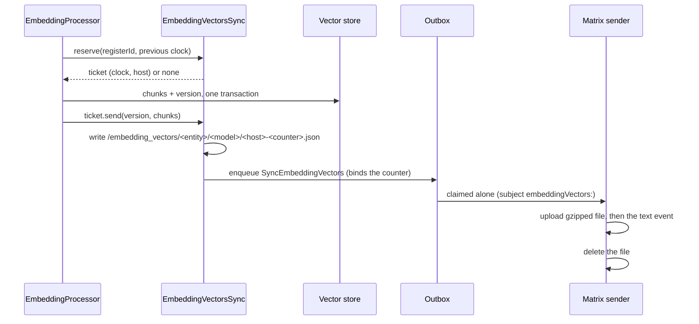
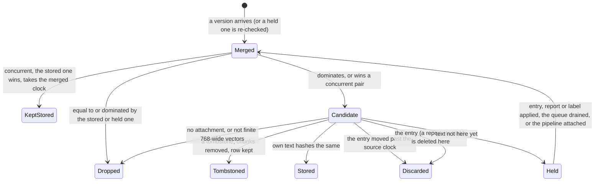
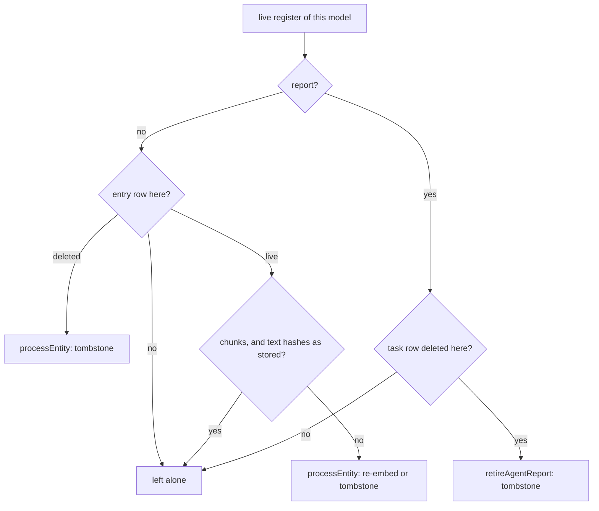

The vectors one device embeds reach the user's other devices, so a phone can
search an entry by meaning without embedding it
([ADR 0150](../../../docs/adr/0150-embedding-vectors-sync-as-a-tracked-register.md)).
It still embeds the query itself. Off by default behind `sync_embeddings`,
which also needs `enable_embeddings`; the pipeline itself is
[Embeddings and search](embeddings-and-search.md).

The vectors of one entry under one model form a **register**,
`<entityId>|<modelId>`, synced like any tracked kind
(`SyncSequencePayloadType.embeddingVectors`): every version takes a counter of
the host that wrote it, receipts are recorded on arrival, and a missed version
is found as a gap and asked for ([sequence and backfill](../sync/sequence-and-backfill.md)).

| Component | Where | Role |
|-----------|-------|------|
| `EmbeddingRegister` | `ai/database` | One version: register clock, source clock, content hash, tombstone flag; kept per shard beside its chunks (`EmbeddingRegisterEntity`) |
| `EmbeddingProcessor` | `ai/service` | Writes a version on every store and every removal, under the entry's lock |
| `EmbeddingShare` / `EmbeddingVersionTicket` | `ai/embedding_sync` | What the processor reserves a version through, and has what was stored unshared sent; implemented by sync |
| `EmbeddingVectorsSync` | `sync/embedding_vectors` | Reserves, writes the attachment, enqueues; answers backfill, deep backfill and Add Device; runs the catch-up |
| `SyncEventProcessor` (embedding vectors part) | `sync/matrix` | Resolves the attachment, hands the version to the sink, records the receipt |
| `EmbeddingSyncReceiver` | `ai/embedding_sync` | The merge, the tombstone path and the hash check |
| `HeldEmbeddingVersions` | `ai/embedding_sync` | Versions waiting for their text, in `embedding_vector_holds.json` |
| `EmbeddingReconciler` | `ai/service` | Finds stored vectors that drifted from their entry, for `EmbeddingService` to settle at start |

Sync ranks above the AI feature (`tool/architecture/layer_guard.dart`), so both
seams — `EmbeddingShare` and `SyncedEmbeddingSink` — are defined here and
implemented or called from sync. The sync stack is built before the embedding
pipeline, which attaches itself (`EmbeddingVectorsSync.attach`) once its store
is open.

# Two clocks

- **The register's own clock** carries the sync guarantees: reservation,
  receipts, dominance and backfill. Only the device that embeds an entry, or
  removes its vectors, bumps it. A receiver merges the clock it receives into
  the one it stores and never adds a counter of its own.
- **The source clock** is the entry's clock when it was embedded (or, for a
  tombstone, the version it was removed at): which text the vectors describe.
  The **content hash** pins that text, label names of a task included.

A version stored while sharing was off has no register clock; no peer can know
of it until it is versioned and sent — by Add Device, and by
`shareUnversioned` ([below](#sharing-what-was-stored-unshared)).

# Sending

- **Nothing is shared** before the pipeline attaches, while either flag is
  off, without a host — and then the version is stored without a clock, to
  be shared later — or when the vectors came from sync: storing a received
  version sends nothing.
- **A store that fails releases the ticket;** `send` never throws: a version
  the outbox refused is released and settled like any other reservation.
- **The row travels alone.** Its subject keeps it out of the dequeue-time
  bundler, so an older build that cannot decode it replays only that row.
  Priority is low, behind journal entities, so the entry usually arrives
  first.
- **One file per version.** Writing a version deletes the files of the
  register's earlier ones, and a sent version deletes its own. A queued row
  whose file is gone — an exact copy already went out, or a newer version
  replaced it — is sent without one, and receivers record only its receipt.
  The sender may run in the sync isolate (ADR 0142); the file is how the
  vectors reach it.

# Receiving

The apply arm reads the attachment from its descriptor, never from disk —
`AttachmentIngestor` skips `/embedding_vectors/` — and throws while it has not
arrived, so the queue retries. A version that arrives before the pipeline has
attached, on a device that will run it, is retried too. Once the sink returns,
the receipt is recorded, with those of the versions the message covers,
whatever the outcome; a sink failure records none.

- **The text both sides hash is built the same way on every device.** A
  task's text names its labels — private ones too, whatever the device's
  privacy toggle says (`EmbeddingProcessor.buildLabelResolver` reads
  `getAllLabelDefinitionsIncludingPrivate`). It once followed the toggle, so
  a device hiding private items hashed a task with a private label
  differently from one showing them: the receiver held the version for good
  — same entry clock, so never discarded — with its receipt recorded, and
  showed fewer embeddings than its peer while reporting nothing missing.
  The start-time reconcile re-embeds the tasks still embedded the old way
  ([below](#reconciling-at-start)).
- **An agent report's text is its one-liner, TLDR and body**
  (`EmbeddingContentExtractor.extractAgentReportText`). A receiver also
  accepts a version hashed from the body alone, as writers before
  whole-report embedding made them.

- **The tie-break reads only the two versions:** the larger source clock
  under `VectorClock.compareCanonically`, then a tombstone over live vectors of
  the same text, then the lower originating host. Every device keeps the same
  winner whatever its own text; one still on an older text holds the winner
  until the text arrives.
- **Dropped versions of another model**, and versions arriving while either
  flag is off, still record their receipts.
- **The receiver stores the sender's chunks as they are,** in the shard of its
  own copy's category; it does not chunk again.
- **Holds are persisted**, newest per register, with the labels a held task
  waits on. A report also waits for its task, whose category decides the
  shard it is stored in. They are re-checked from `onJournalEntityApplied`,
  `onAgentEntityApplied` (reports live in the agent database),
  `onEntityDefinitionApplied` (a label's name is part of a task's text),
  every time the inbound queue drains, whenever a config flag changes (holds
  wait while a flag is off), and when the pipeline attaches — a new build
  may hash a held version's text the way its sender did. The attach re-check
  runs without holding up start; `detach` waits for it. A pass writes the
  holds file once, not once per version (`HeldEmbeddingVersions.batch`).
- **A report's text comes from the agent database** through
  `agentReportTextReader`, which builds an `AgentRepository` over the
  registered `AgentDatabase` per read. It once looked the repository up as a
  service, which is never registered, so every report version a peer shared
  was held until a later report's tombstone replaced it — and each task's
  current report never was.
- **A deleted entry is never waited for.** "Not here" means two things: not
  arrived yet, or deleted here — the row remains, hidden from the live read
  (`journalEntityByIdIncludingDeleted`). Only the first is held. A version
  whose entry, or whose report's task, is deleted here is discarded, and a
  hold of one left by an older build goes at the attach re-check. Such a
  hold never resolved: no text was coming, and no tombstone either when
  the deletion was made where vectors were not shared, or was a task's
  (its reports' vectors outlived it).
- **Holds are shown, not counted missing.** Their receipts are recorded, so
  the sequence log never asks for them, and a deep backfill only delivers
  them to the hold again. Sync health lists their number under the
  embeddings (`watchHeldCount`), the gap between this device's count and a
  peer's.

# Reconciling at start

A device's stored vectors can drift from its own entries without any local
edit to notice: a deletion it only received, a label renamed (a task's text
names its labels, the task's clock does not move), a text built while the
privacy toggle hid a label's name. Such vectors keep the device's count
apart from its peers' and wait forever on a peer that receives them.
`EmbeddingService` therefore reconciles once per start, in the first batch
that finds embeddings on and the model downloaded:

- **`EmbeddingReconciler.entriesToReprocess`** reads every live journal
  register in batches against the rows they describe, deleted ones
  included, and queues for `processEntity` those whose entry is deleted,
  whose text no longer hashes as stored (labels named whatever the privacy
  toggle says), or whose live version has no chunks. `processEntity` then
  does what a local edit would: re-embeds — a new version, dominating every
  copy — or removes with a tombstone. The model is called only for those.
- **Chunk sets with no register** — embedded before registers existed —
  are checked the same way, and `adoptUnregistered` writes an unshared
  register for each that still matches: a journal entry's with the entry's
  clock as its source, a report's as it is. Under the entry's lock, and only
  while the set is still unregistered with the same content hash.
- **`retireReportsOfDeletedTasks`** tombstones the report vectors of every
  task deleted here (`EmbeddingProcessor.retireAgentReport`). A task
  deleted from now on takes them along itself (`processEntity`).
- **Only rows this device holds count.** An entry or task with no row at
  all is left alone: a journal restored from an older backup lacks rows its
  vector store still describes, and retiring those would remove the vectors
  from every device.

# Sharing what was stored unshared

Vectors stored while `sync_embeddings` was off, before the pipeline attached
or before this device had a host carry no clock, and adopted ones neither.
No backfill can ask for them, and the catch-up round only advertises shared
registers. `EmbeddingShare.shareUnversioned`, implemented by
`EmbeddingVectorsSync`, versions and sends each live one of this model
through `sendCurrent` — the path Add Device takes — and is run:

- after the start-time reconcile, so adopted sets go out in the same start;
- when the pipeline attaches, without holding up start, tracked with the
  re-checks so `detach` waits for it;
- on every flag change, so turning `sync_embeddings` on shares what was
  embedded while it was off.

A version without chunks is skipped — no peer could store it, and the
reconcile embeds it again — and one that fails is logged and left for the
next run. `sendCurrent` re-reads the register under the entry's lock, so two
runs never version one twice.

# Removals

Every removal is a version: a tombstone, a bumped clock and no chunks. A
receiver keeps the tombstone's row even when it held no vectors, so a late copy
of an older live version is dominated by it.

- **A deleted entry** announces its removal even when this device never held
  its vectors: another device may have shared some, and a receiver never
  processes a synced deletion. Its source clock is the deleted version's, so it
  beats a concurrent embed of the text before.
- **Text under the minimum** removes vectors only when some are stored.
- **A superseded agent report** gets a tombstone of its own register from the
  writer's cleanup; a receiver writes none, and never runs the
  one-report-per-task cleanup itself.
- **A tombstone made from the entry's version, or a later one, is not embedded
  over** — by the backfill, say, before the deletion arrives.
- **A model change starts new registers.** The retired store's deletion sends
  nothing.

# Backfill, deep backfill, restore, Add Device

- **Backfill** answers a counter with the version held now, its attachment
  written afresh from the store: an exact resend, a hint at a newer version, or
  `deleted` when nothing is held.
- **Deep backfill** lists the shared registers it can serve, tombstones
  included (`EmbeddingVectorsDeepBackfillStore`), and Sync health counts the
  same list (`sharedRegisters`). A live version without chunks is left out:
  `prepareResend` has nothing to send for it, so a backfill request for it
  is answered "deleted", and counting it would show a gap no peer closes.
  The start-time reconcile re-embeds it. A device that does not store vectors
  takes no part (`DeepBackfillStore.participates`): an empty range would ask
  for every vector only to drop them.
- **Catch-up.** A dropped version's receipt is recorded, so it is never asked
  for again. The first time a device can store for a model — the pipeline
  attached and both flags on — it runs a deep backfill round of the vectors
  alone (`runRound(only:)`) and records `embedding_vectors_caught_up.<model>`.
- **Restore** repopulates the sequence log from the shared registers.
- **Add Device** sends every register after the onboarding End barrier
  (`HistoricalSyncService.sendEmbeddingVectors`): low priority, the vectors
  would delay End. A register it cannot enqueue becomes a
  `ReSyncItemType.embeddingVectors` failure, retried with the rest.

# The model

[`EmbeddingVectorSync`](../../../specs/tla/README.md#embeddingvectorsync--vectors-shared-between-devices)
checks the merge against any delivery order, redelivery, entries that arrive
late, concurrent embeds and removals: no device stores vectors of a text it
never held, receivers never bump, a held version is always released, and
every device converges on one version — or one tombstone. `SyncPipeline` runs
the family through the transport (`SyncPipelineEmbeddingVectors`).

Open questions it leaves as residuals:

- **Entries their writer never embedded** — written with the flag off, on
  Windows, without the model — stay unembedded on receivers until a local edit
  or a backfill.
- **A label rename** changes a task's hash on every device; a peer holds the
  task's vectors until a device that stores them starts again and its
  reconcile re-embeds the task. Every device that stored them does, so the
  task is embedded once per device; the concurrent versions converge.
- **Vectors of a report whose agent was deleted here** stay: the reports
  are gone with the agent, but the vectors carry no agent id, and a report
  with no row is never taken for deleted. A peer that receives one later
  holds it.
- **Clocks of a discarded version are not merged.** A device whose entry moved
  past a version drops it, clock and all; the content still converges.
- **Windows** neither sends nor receives until its ONNX worker lands.
