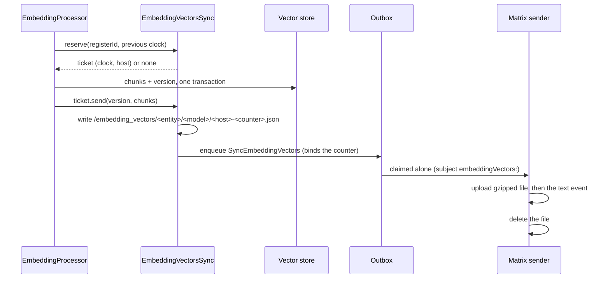
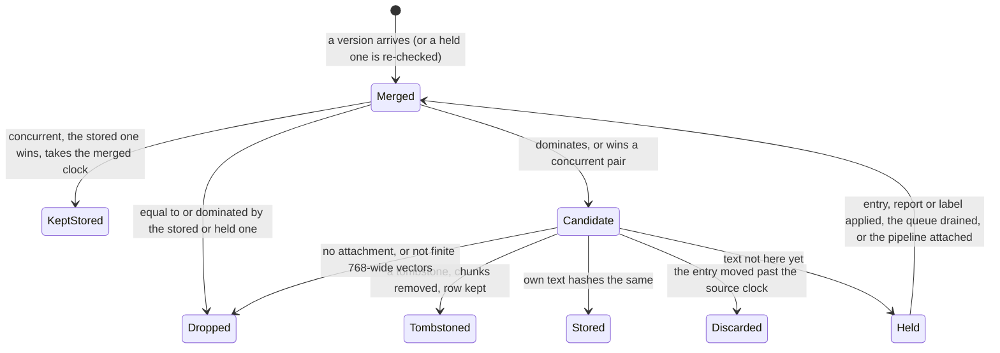

The vectors one device embeds reach the user's other devices, so a phone can
search an entry by meaning without embedding it
([ADR 0150](../../../docs/adr/0150-embedding-vectors-sync-as-a-tracked-register.md)).
It still embeds the query itself. Off by default behind `sync_embeddings`,
which also needs `enable_embeddings`; the pipeline itself is
[Embeddings and search](embeddings-and-search.md).

The vectors of one entry under one model form a **register**,
`<entityId>|<modelId>`, synced like any tracked kind
(`SyncSequencePayloadType.embeddingVectors`): every version takes a counter of
the host that wrote it, receipts are recorded on arrival, and a missed version
is found as a gap and asked for ([sequence and backfill](../sync/sequence-and-backfill.md)).

| Component | Where | Role |
|-----------|-------|------|
| `EmbeddingRegister` | `ai/database` | One version: register clock, source clock, content hash, tombstone flag; kept per shard beside its chunks (`EmbeddingRegisterEntity`) |
| `EmbeddingProcessor` | `ai/service` | Writes a version on every store and every removal, under the entry's lock |
| `EmbeddingShare` / `EmbeddingVersionTicket` | `ai/embedding_sync` | What the processor reserves a version through; implemented by sync |
| `EmbeddingVectorsSync` | `sync/embedding_vectors` | Reserves, writes the attachment, enqueues; answers backfill, deep backfill and Add Device; runs the catch-up |
| `SyncEventProcessor` (embedding vectors part) | `sync/matrix` | Resolves the attachment, hands the version to the sink, records the receipt |
| `EmbeddingSyncReceiver` | `ai/embedding_sync` | The merge, the tombstone path and the hash check |
| `HeldEmbeddingVersions` | `ai/embedding_sync` | Versions waiting for their text, in `embedding_vector_holds.json` |

Sync ranks above the AI feature (`tool/architecture/layer_guard.dart`), so both
seams — `EmbeddingShare` and `SyncedEmbeddingSink` — are defined here and
implemented or called from sync. The sync stack is built before the embedding
pipeline, which attaches itself (`EmbeddingVectorsSync.attach`) once its store
is open.

# Two clocks

- **The register's own clock** carries the sync guarantees: reservation,
  receipts, dominance and backfill. Only the device that embeds an entry, or
  removes its vectors, bumps it. A receiver merges the clock it receives into
  the one it stores and never adds a counter of its own.
- **The source clock** is the entry's clock when it was embedded (or, for a
  tombstone, the version it was removed at): which text the vectors describe.
  The **content hash** pins that text, label names of a task included.

A version stored while sharing was off has no register clock; no peer can know
of it. Add Device versions it before it is sent.

# Sending

- **Nothing is shared** before the pipeline attaches, while either flag is
  off, without a host — and then the version is stored without a clock — or
  when the vectors came from sync: storing a received version sends nothing.
- **A store that fails releases the ticket;** `send` never throws: a version
  the outbox refused is released and settled like any other reservation.
- **The row travels alone.** Its subject keeps it out of the dequeue-time
  bundler, so an older build that cannot decode it replays only that row.
  Priority is low, behind journal entities, so the entry usually arrives
  first.
- **One file per version.** Writing a version deletes the files of the
  register's earlier ones, and a sent version deletes its own. A queued row
  whose file is gone — an exact copy already went out, or a newer version
  replaced it — is sent without one, and receivers record only its receipt.
  The sender may run in the sync isolate (ADR 0142); the file is how the
  vectors reach it.

# Receiving

The apply arm reads the attachment from its descriptor, never from disk —
`AttachmentIngestor` skips `/embedding_vectors/` — and throws while it has not
arrived, so the queue retries. A version that arrives before the pipeline has
attached, on a device that will run it, is retried too. Once the sink returns,
the receipt is recorded, with those of the versions the message covers,
whatever the outcome; a sink failure records none.

- **The text both sides hash is built the same way on every device.** A
  task's text names its labels — private ones too, whatever the device's
  privacy toggle says (`EmbeddingProcessor.buildLabelResolver` reads
  `getAllLabelDefinitionsIncludingPrivate`). It once followed the toggle, so
  a device hiding private items hashed a task with a private label
  differently from one showing them: the receiver held the version for good
  — same entry clock, so never discarded — with its receipt recorded, and
  showed fewer embeddings than its peer while reporting nothing missing.
  `EmbeddingService.start` re-embeds every task that carries a private label
  (`JournalDb.taskIdsWithPrivateLabels`) in its first batch that finds
  embeddings on and the model downloaded; the content hash skips those
  already embedded from that text.
- **An agent report's text is its one-liner, TLDR and body**
  (`EmbeddingContentExtractor.extractAgentReportText`). A receiver also
  accepts a version hashed from the body alone, as writers before
  whole-report embedding made them.

- **The tie-break reads only the two versions:** the larger source clock
  under `VectorClock.compareCanonically`, then a tombstone over live vectors of
  the same text, then the lower originating host. Every device keeps the same
  winner whatever its own text; one still on an older text holds the winner
  until the text arrives.
- **Dropped versions of another model**, and versions arriving while either
  flag is off, still record their receipts.
- **The receiver stores the sender's chunks as they are,** in the shard of its
  own copy's category; it does not chunk again.
- **Holds are persisted**, newest per register, with the labels a held task
  waits on. A report also waits for its task, whose category decides the
  shard it is stored in. They are re-checked from `onJournalEntityApplied`,
  `onAgentEntityApplied` (reports live in the agent database),
  `onEntityDefinitionApplied` (a label's name is part of a task's text),
  every time the inbound queue drains, and when the pipeline attaches — a
  new build may hash a held version's text the way its sender did.
- **Holds are shown, not counted missing.** Their receipts are recorded, so
  the sequence log never asks for them, and a deep backfill only delivers
  them to the hold again. Sync health lists their number under the
  embeddings (`watchHeldCount`), the gap between this device's count and a
  peer's.

# Removals

Every removal is a version: a tombstone, a bumped clock and no chunks. A
receiver keeps the tombstone's row even when it held no vectors, so a late copy
of an older live version is dominated by it.

- **A deleted entry** announces its removal even when this device never held
  its vectors: another device may have shared some, and a receiver never
  processes a synced deletion. Its source clock is the deleted version's, so it
  beats a concurrent embed of the text before.
- **Text under the minimum** removes vectors only when some are stored.
- **A superseded agent report** gets a tombstone of its own register from the
  writer's cleanup; a receiver writes none, and never runs the
  one-report-per-task cleanup itself.
- **A tombstone made from the entry's version, or a later one, is not embedded
  over** — by the backfill, say, before the deletion arrives.
- **A model change starts new registers.** The retired store's deletion sends
  nothing.

# Backfill, deep backfill, restore, Add Device

- **Backfill** answers a counter with the version held now, its attachment
  written afresh from the store: an exact resend, a hint at a newer version, or
  `deleted` when nothing is held.
- **Deep backfill** lists the shared registers, tombstones included
  (`EmbeddingVectorsDeepBackfillStore`). A device that does not store vectors
  takes no part (`DeepBackfillStore.participates`): an empty range would ask
  for every vector only to drop them.
- **Catch-up.** A dropped version's receipt is recorded, so it is never asked
  for again. The first time a device can store for a model — the pipeline
  attached and both flags on — it runs a deep backfill round of the vectors
  alone (`runRound(only:)`) and records `embedding_vectors_caught_up.<model>`.
- **Restore** repopulates the sequence log from the shared registers.
- **Add Device** sends every register after the onboarding End barrier
  (`HistoricalSyncService.sendEmbeddingVectors`): low priority, the vectors
  would delay End. A register it cannot enqueue becomes a
  `ReSyncItemType.embeddingVectors` failure, retried with the rest.

# The model

[`EmbeddingVectorSync`](../../../specs/tla/README.md#embeddingvectorsync--vectors-shared-between-devices)
checks the merge against any delivery order, redelivery, entries that arrive
late, concurrent embeds and removals: no device stores vectors of a text it
never held, receivers never bump, a held version is always released, and
every device converges on one version — or one tombstone. `SyncPipeline` runs
the family through the transport (`SyncPipelineEmbeddingVectors`).

Open questions it leaves as residuals:

- **Entries their writer never embedded** — written with the flag off, on
  Windows, without the model — stay unembedded on receivers until a local edit
  or a backfill.
- **A label rename** changes a task's hash on every device; the task is
  unsearchable by meaning until its next local edit's vectors arrive.
- **Clocks of a discarded version are not merged.** A device whose entry moved
  past a version drops it, clock and all; the content still converges.
- **Windows** neither sends nor receives until its ONNX worker lands.
