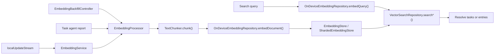
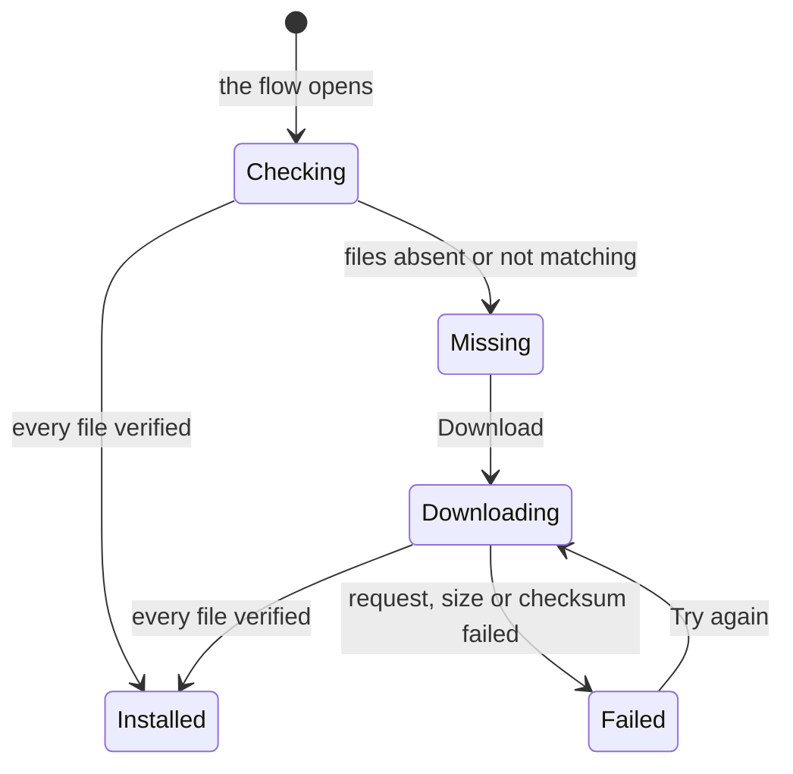
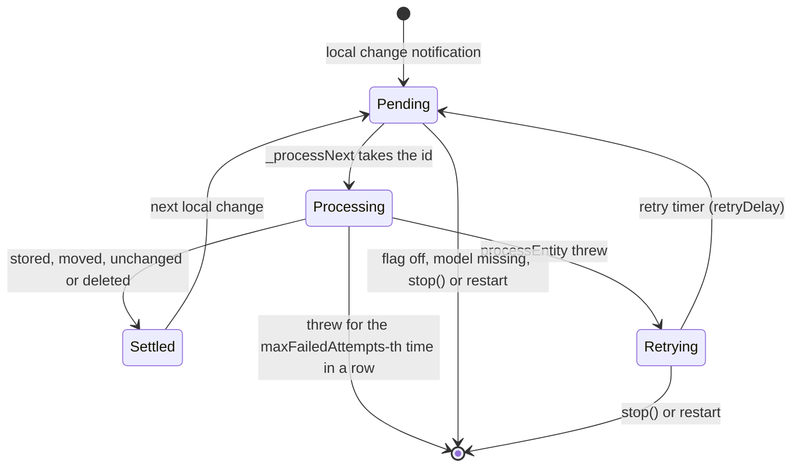

The AI feature owns local embeddings and vector search — the one place where the
app stores data outside Drift. The index is a **regenerable local cache**: each
device embeds what it writes, and with `sync_embeddings` on it shares those
vectors with the user's other devices and stores theirs
([embedding vectors sync](embedding-vector-sync.md)). The vectors come from one
model running on the device, EmbeddingGemma-300m
([ADR 0144](../../../docs/adr/0144-on-device-embeddings-use-embeddinggemma.md)),
the only embedding provider
([ADR 0148](../../../docs/adr/0148-embeddings-run-only-on-the-device.md));
nothing leaves the device to embed text.

| Component | Role |
|-----------|------|
| `EmbeddingService` | Listens to local update notifications and performs real-time embedding work, retrying ids that failed |
| `EmbeddingBackfillController` | The manual backfill of whole categories from settings |
| `EmbeddingProcessor` | Hashes content, chunks text, generates embeddings, writes atomically; one run per entity at a time |
| `OnDeviceEmbeddingRepository` | The one provider: the model's download and its embeddings, as a document or as a query |
| `GemmaEmbedder` / `GemmaTokenizer` | The model on the bundled ONNX Runtime, and its tokenizer in Dart |
| `PinnedModelFiles` | Verified, coalesced downloads of pinned model files, shared with the speech models |
| `EmbeddingStore` | Storage abstraction |
| `ShardedEmbeddingStore` | Production implementation, backed by **per-category ObjectBox shards** in one directory per model |
| `VectorSearchRepository` | Embeds the query and resolves hits back to tasks or entries |

**Search by meaning never stands alone.** The tasks and journal pages run it
beside the full-text search on every query and list what it adds after the
word matches, under a "Related by meaning" heading (ADR 0149); there is no mode
switch. That page side is
[browse, search and linking](../journal/browse-and-linking.md#one-search-the-words-then-the-meaning).

# Constraints

- **Gated by `enableEmbeddingsFlag`.** Off by default. Every writer checks it:
  the service per batch, the backfill per run, and the agent's report writer
  per report.
- **Requires the model on this device.** Until the user downloads it, nothing
  is embedded and vector search finds nothing. See
  [Model availability](#model-availability).
- **macOS, iOS, Linux and Android only.** The pipeline starts where the ONNX
  plugin runs inference off the thread that draws the app
  (`OnDeviceEmbeddingRepository.isPlatformSupported`). The Windows plugin
  answers on the platform thread, so there nothing is registered, and the
  generate-embeddings tile and vector search stay hidden as they do when the
  store fails to open.
- **Queries and documents are embedded differently.** The model was trained
  with a prompt for each (`task: search result | query: ` and
  `title: none | text: `), so search embeds with `embedQuery` and every writer
  with `embedDocument`.
- **Only local writes are embedded as they happen.** The service listens to
  `localUpdateStream`, so an edit that arrives by sync, or one an agent makes
  (routed through `notifyUiOnly`), is not re-embedded until the entry is next
  edited locally or a backfill covers it. With `sync_embeddings` on, a synced
  edit arrives with the vectors its writer made instead. See
  [Keeping up with the journal](#keeping-up-with-the-journal).
- **Every store and every removal is a version** of the entry's register
  (`EmbeddingRegister`), written in the same ObjectBox transaction as its
  chunks; a removal is a tombstone. See
  [embedding vectors sync](embedding-vector-sync.md).
- Tasks can be embedded with **label-enriched** text, not just raw title and
  body.
- **A task has at most one report in the index.** Once a new report is
  embedded, every other report embedded for its task is deleted
  (`EmbeddingStore.agentReportIdsForTask`), not just the one it replaced: a
  report whose own embedding was skipped — model missing, text too short —
  would otherwise leave the one before it searchable for good. A failed or
  skipped embed deletes nothing, so the task stays findable by its last
  embedded report. The cleanup runs in `EmbeddingProcessor.processAgentReport`
  under the task's lock, so an earlier report's run cannot delete a newer
  report's vector.
- Agent reports are stored with `taskId` metadata, so a search hit can resolve
  back to the owning task.

Embedding indexing participates in [work attribution](attribution.md): it begins
before its first chunk and finalizes a typed `embeddingVector` output after the
store replacement succeeds. It records **no interactions**: no provider is
called and nothing is consumed.

# Model availability

The model is about 218 MB — `onnx/model_q4.onnx`, its `.onnx_data` weights and
`tokenizer.json` from `onnx-community/embeddinggemma-300m-ONNX`, pinned by
revision with each file's size and SHA-256 (`embeddingGemma`). It is downloaded
only when the user asks, from the "generate embeddings" flow in Maintenance,
which shows its name, size and the Gemma Terms of Use it is distributed under.
The backfill there stays disabled until the model is on this device.

- **Files are published only when verified.** `PinnedModelFiles` streams each
  file to a `.part`, refuses one past its pinned size, checks the SHA-256 and
  only then renames it into
  `<application support>/embedding_models/<id>/<revision>`. Concurrent installs
  share one download, and a removal is refused while one runs. Speech models
  use the same class, under `sherpa_models`.
- **The embedder is loaded once, on first use.** `OnDeviceEmbeddingRepository`
  loads `GemmaEmbedder` on the first embedding and keeps it; a load that fails
  is tried again on the next call. The app registers one instance, so the
  service, the backfill, search and the report writer share it.
- **A missing model is routine, not an error.** Every embedding call throws
  `EmbeddingModelNotInstalledException` until the download is done. The
  service and the report writer check for the model before they start and do
  nothing without it; search returns no hits and logs nothing.

`GemmaEmbedder` decodes the tokenizer in a background isolate, adds the prompt,
cuts the input at 512 tokens and returns the unit-length 768-dimensional
`sentence_embedding`, refusing a vector that is zero or not finite. The session
uses half the cores, at most four. On Linux the plugin runs inference on a
worker thread (a Lotti patch), because the GTK main thread also runs the app's
UI isolate; `integration_test/embedder_parity_test.dart` checks its vectors
against Python's and measures that stall. The tokenizer is ported to Dart, so
the app needs no native tokenizer library, and
[`tool/embedding_eval`](../../../tool/embedding_eval/README.md), which chose
the model and which any later model change runs through first, checks the port
token for token against Hugging Face `tokenizers`.

# One store per model

A store's HNSW index has the width of the model that filled it
(`kEmbeddingDimensions`, 768, baked into the ObjectBox entity), so each model
gets a directory of its own: `objectbox_embeddings_embeddinggemma-300m-q4`. The
stores of the retired model — mxbai-embed-large through Ollama, 1024 wide, in
`objectbox_embeddings` and then `objectbox_embeddings_sharded` — cannot be
opened with the current entity and match no query the current model makes;
`deleteRetiredEmbeddingStores` removes them at start, and the backfill
rebuilds the index. Every directory is a `rebuild` store in the
[backup catalog](../backup-and-restore.md).

# Keeping up with the journal

Three writers feed one store with no shared queue: the service, the manual
backfill, and the task agent's report writer. Each run reads the journal,
waits on the model, then writes. Nothing corrects a stale row later, so every
rule here is about the row a run leaves behind when it is the last one. The
protocol is model-checked in
[`EmbeddingFreshness`](../../../specs/tla/README.md#embeddingfreshness--the-index-keeps-up-with-the-journal).

- **One run per entity at a time.** `EmbeddingProcessor` holds a per-entity
  lock from the journal read to the store write, so a run that read an older
  version can never land after one that read a newer version. Every local edit
  queues a run that starts after it, so the last run reads the latest text.
- **Gone means no vectors.** A run that finds the entry deleted (the read hides
  soft-deleted rows) or its text under the 20-character minimum deletes the
  entry's vectors. Search also skips hits whose entry no longer exists, which
  covers vectors left by deletions made before this rule.
- **Reports follow their task.** Every run over a task moves the task's report
  embeddings to the task's category, whether or not the task has a vector of
  its own. The report writer reads the task's category and writes under the
  task's lock, so a recategorisation is either seen by the writer or processed
  after the report is stored.
- **Failures are retried, in memory.** A failed id is kept and queued again
  after `EmbeddingService.retryDelay` (5 minutes). An id is dropped after
  `EmbeddingService.maxFailedAttempts` (3) failures in a row, so an entity that
  fails the same way every time is not retried for as long as the app runs;
  its next edit starts a fresh count. A restart loses the pending and retry
  sets; the backfill is the repair.
- **No model, no work.** A batch that finds the flag off or the model missing
  drops its pending ids, and one whose model disappears mid-batch stops there.
  The backfill after the download is the repair.
- **A crash between two shards keeps the newer copy.** A replace or a move
  writes the new shard before deleting the old copy. If the process dies in
  between, `_rebuildIndexes` keeps the copy whose chunks were written last
  (`createdAt`; a move re-stamps it), rather than the shard whose name sorts
  last.

Open questions the model leaves as residuals:

- **Synced edits arrive with their vectors** when `sync_embeddings` is on
  ([embedding vectors sync](embedding-vector-sync.md)). An entry whose writer
  never embedded it — the flag off there, Windows, no model — is still not
  embedded on the receiver until a local edit or a backfill.
- **The model id is stored with each chunk but never compared.** A store
  directory per model keeps a change of model from mixing vectors, but within
  one directory nothing checks the id.
