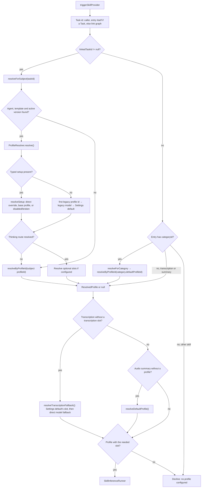
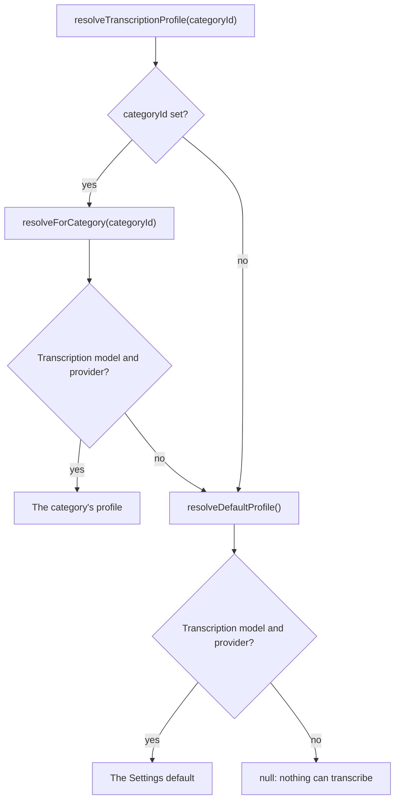

# Entry points

`ProfileResolver` is the shared resolution engine for agent wakes.
`ProfileAutomationResolver` wraps it for skill execution:

| Entry point | Question it answers |
|-------------|---------------------|
| `resolveForSubject(subjectId)` | Subject-linked execution (a task, project or person). Tries the agent path, then the subject's own `profileId` |
| `resolveForCategory(categoryId)` | Standalone entries with no parent task. Reads `CategoryDefinition.defaultProfileId` and resolves it directly |
| `resolveAutomationFallbacks(subjectId)` | The ordered, de-duplicated profiles a subject *inherits*: its own `profileId`, then its category's current `defaultProfileId`. Used only by `ProfileAutomationService` — see [execution paths](execution-paths.md) |
| `resolveDefaultProfile()` | The device's Settings default profile. Used for recording summaries no task or category reaches, and for the post-processing route of the direct transcription fallback |
| `resolveTranscriptionProfile({categoryId})` | The profile a recording without a task transcribes through: the category's `defaultProfileId` when it owns a transcription slot, else the Settings default when it does, else null. The one rule goal and People recordings, their chats' dictation and the automation fallback all follow — see [the transcription profile](#the-transcription-profile) |
| `categoryOfSubject(subjectId)` | The category a subject (task, project, person, goal entry) is filed under, for the rule above |

The resolver reads agents and their templates through two ports the AI
feature declares in `profile_automation_providers.dart`:
`automationSubjectAgentLookupProvider` (the agent assigned to a subject) and
`automationTemplateLookupProvider` (an `AgentTemplateVersionLookup`, which the
agents feature's `AgentTemplateService` implements). Both throw until the
composition root (`buildProviderOverrides`) wires them, so the AI feature does
not depend on the agents feature.

`triggerSkillProvider` picks between the first two. It takes the caller's
`linkedTaskId`, else the entry itself when it is a `Task`, else a task found in
the entry-link graph (outgoing links first, then incoming). With a task it
calls `resolveForSubject`; otherwise it looks up the entry, reads its
`categoryId`, and calls `resolveForCategory`. An entry with neither declines
the skill, except transcription and recording summaries. A transcription that
resolves no transcription slot falls back to
`ProfileAutomationService.resolveTranscriptionFallback` — the Settings
default's transcription slot, then the direct model fallback; a recording
summary that resolves no profile falls back to `resolveDefaultProfile`. Skills whose
`contextPolicy` is `fullTask` are hidden from the popup for entries without task
context, except `Summarize Recording`, and the provider declines them without a
task except for transcription and audio-summary skills.

An `AgentConfig.inferenceSetup` is authoritative: `resolveSetup` honors a direct
thinking-model override and its optional base profile, or returns disabled/broken.
It never falls through to unrelated defaults. On the skill path, a disabled or
broken setup yields no profile, and `resolveForSubject` then resolves the
subject's own `profileId`. Without a typed setup, the first
configured profile id wins selection: agent, version, then template. If that
profile cannot resolve, the legacy model (`version.modelId ?? template.modelId`)
is tried, followed by the device's selected Settings default.

`resolveStandalone` supports agents without templates. It honors a typed setup
or legacy agent profile, then the Settings default; a built-in model is used only
when no Settings default was selected. A deleted or unusable selected default
fails closed. Relationship agents additionally retain their person/category
profile steps, described in [relationships](../relationships.md).

The fallback is device-local (`AI_DEFAULT_INFERENCE_PROFILE` in `SettingsDb`),
because provider availability and credentials vary by device. Choosing or
clearing it is explicit; profile deletion never substitutes another provider.
The setting does not change authoritative setups or enable automation policies.

**Only the thinking slot is fatal to profile resolution.** Optional slots
resolve best-effort. An explicitly selected but unavailable Chat model sets
`ResolvedProfile.chatModelUnavailable`: agent wakes still resolve, while query
chat presents its existing recoverable setup error. An unavailable audio
post-processing model sets `audioPostProcessingModelUnavailable` the same way,
and only the recording summary fails.

# Choosing a chat model

The inference profile editor has an optional **Chat model** slot. It accepts
text-input/text-output models without requiring function calling. Set this to,
for example, GLM-5.3 Flash while keeping DeepSeek Flash as Thinking for agent
work. Existing profiles have no Chat selection and retain their current route.

`chatModelId` stores a model row id and syncs with the profile. Its resolved
model, provider and configuration remain independent of an agent's direct
Thinking override. When unset, the effective Chat route inherits the resolved
Thinking route, including that override. When selected but unavailable, query
chat fails closed instead of switching models. Both retrieval and synthesis use
the effective Chat route; transcription continues using its own slot.

Chat participates in provider usage, pinning capabilities, locality checks and
demo-copy reference pruning. A selected Chat model counts as a user edit during
seed-profile migration and orphan cleanup; seeding does not introduce a Chat
default or clear an unavailable selection.

# Choosing an audio post-processing model

The editor's optional **Audio post-processing** slot picks the model for the
step after a transcription: correcting the transcript against the speech
dictionary and writing the recording's one-liner, TLDR and summary. It
accepts tool-capable models that take text input, because the step reads the
transcript as text and publishes through a tool call. Set it to keep that step on, for example, DeepSeek while
agents think on GLM; existing profiles have no selection and keep running the
step on Thinking.

`audioPostProcessingModelId` stores a model row id and syncs with the profile.
Its resolved route is independent of an agent's direct Thinking override;
unset, `effectiveAudioPostProcessing*` inherits the resolved Thinking route.
Selected but unavailable, the step fails visibly instead of switching models —
see [execution paths](execution-paths.md) for how a held transcript is still
written.

Like Chat, the slot participates in provider usage, pinning capabilities,
locality checks — it reads the transcript of synced audio, so a cloud model
here makes a profile non-local — and demo-copy reference pruning, and counts
as a user edit during seed-profile migration and orphan cleanup. Seeding sets
no default for it.

An older client drops the field when it saves the profile, since it does not
know it: editing a profile on a device that predates the slot clears the
selection, as it did for Chat.

# Choosing a read-aloud model

The editor's optional **Read aloud** slot picks the cloud speech model that
reads summaries, goal reports and query answers aloud. It offers models whose
output is audio — today Voxtral TTS on Mistral. The voice is not chosen here:
the speech feature resolves it per language from that provider's catalog. Unset, read-aloud keeps the on-device
voice; there is no other fallback, and the on-device voice is never something
the slot has to name. Which surface resolves which profile, and how a voice is
chosen per language, is in [text-to-speech](../tts.md#which-voice-speaks).

`speechModelId` stores a model row id and syncs with the profile. It never
borrows the thinking route: unset or unresolvable, `ResolvedProfile.speech*`
stays null. It participates in provider usage, the profile cards and
demo-copy reference pruning. It is deliberately **not** part of
`profileIsLocal`: speech synthesis receives text the user asked to hear, never
the synced audio that check guards, so a cloud voice does not stop a local
transcription profile from auto-running. Nor does it take part in pinning,
since nothing is spoken automatically.

Seeding names it on the Mistral (EU) profile only (`voxtral-mini-tts-3-0`),
and only when that profile is created; an existing profile is never
rewritten to add it.

# Model slots and sync hygiene

Model slots store `AiConfigModel.id` — the local model row id — with a legacy
`providerModelId` fallback. `resolveInferenceProviderForProfileSlot` first tries
an exact model-row id match, and only then falls back to the old provider-native
lookup for profiles written before the migration. A matched row whose
provider is unusable resolves to nothing; the legacy lookup is not tried.

On that legacy path, when multiple synced model rows share the same
`providerModelId`, provider resolution **walks every candidate**. It skips rows
whose provider no longer exists or lacks required credentials, and returns the
first usable row whose provider type owns that known model id. When no usable
row matches that type, or the id is not a known model, the first usable row
wins.

This is deliberate sync hygiene: an orphaned duplicate row from another device
must not abort an agent wake when a valid provider/model pair is still configured
locally.

# The transcription profile

A recording that belongs to no task — a goal's check-in, a person's check-in,
a voice note filed in a category — transcribes through the profile
`ProfileAutomationResolver.resolveTranscriptionProfile` picks, in a strict
order:

No model is named in code: the slot's provider and model, and the
post-processing route that follows, come from whichever profile wins. Who asks:

- **`ProfileAutomationService`**, whenever no automated skill owns
  transcription for a subject (`tryTranscribe`, `requestTranscription`, the
  probes) or the manual popup's profile has no slot
  (`resolveTranscriptionFallback`). The subject's category comes from
  `categoryOfSubject`. The winning profile runs the built-in
  `Transcribe (Task Context)` skill with an automated assignment.
- **`CheckInTranscriptionService`** for every People check-in and capture,
  with the person's category.
- **`subjectDictationProvider`** (`lib/features/ai/state/subject_dictation_providers.dart`)
  for dictation into a goal's or a person's agent chat and a goal's charter
  sheet: its `resolveTarget` hands the chat recorder the slot's route, and its
  `correct` runs the dictionary correction on the profile's
  `ResolvedProfile.transcriptCorrectionRoute` when a speech-to-text engine
  heard the words — the step a check-in's recording gets. Those surfaces never
  reach `AudioTranscriptionService.discoverTarget`.

Before this order existed, a goal check-in whose category automated nothing
went straight to the direct model fallback below, whose provider ranking put
the on-device engine first: minutes per recording on a model nobody chose,
while the Settings default named a fast one. Chat dictation in goals and
People ran on discovery, which picks the seeded Melious Whisper.

# The direct transcription fallback

The last step of `ProfileAutomationService._tryTranscriptionFallbacks`,
reached only when neither the category nor the Settings default profile can
transcribe — a device whose profiles name no transcription model at all. It
scans configured audio-to-text model rows and builds an **ephemeral**
`ResolvedProfile` around the selected model and the built-in
`Transcribe (Task Context)` skill — it does not persist a profile.

Candidate ranking prefers installed sherpa models, then Mistral, Melious,
OpenAI, Whisper, and Voxtral, followed by other audio-to-text providers.
Candidates need a resolvable provider and any required API key; sherpa also
requires a verified local model. HTTP endpoint validation is left to the
provider. Equal-ranked models are ordered by name. The fallback works without
a profile.

Its transcription model fills the ephemeral profile's thinking slot, so the
post-processing that follows a speech-to-text transcript borrows a route
instead: the device's Settings default profile's audio post-processing
model, or its thinking model (`ProfileAutomationResolver.resolveDefaultProfile`,
copied into the ephemeral profile's post-processing slot, unavailability
included). With no default selected, or a selected default that does not
resolve, the ephemeral profile is marked
`audioPostProcessingDisabled`: nothing post-processes, whatever the
speech-to-text model's own capability flags claim, and the transcript is
written as heard.

The direct `AudioTranscriptionService` path used by Daily OS capture/refine
prefers installed sherpa models, then Mistral contextual Voxtral and a Mistral batch audio model; next come
the seeded Melious Whisper Large v3 default, other Melious transcription models,
and contextual Melious Voxtral. Gemini Flash follows, then the first remaining
audio-capable model. Realtime-only Mistral models are excluded because they
require a WebSocket pipeline. Explicit profile targets bypass this discovery.

# Profile pinning

`AiConfigInferenceProfile.pinnedHostId` is the vector-clock host UUID of the
device that should auto-run this profile on **synced** audio entries.
`SyncedAudioInferenceDispatcher` consults it at trigger time: **pinned-or-skip,
with no fallback.**

The pinning UI filters the known sync-node directory by the node capabilities
the profile's local provider types require; cloud provider types are exempt, so
a profile with a cloud slot can be pinned but the locality gate then skips
every entry. The selector is embedded in `inference_profile_form.dart`.

## Locality is fail-closed

`profileIsLocal(profile, repo)` returns true **iff every populated model id
resolves to a provider in `{ollama, omlx, voxtral, whisper, sherpa}`**.

A referenced-but-unresolved model id counts as **not local**. A legacy
`providerModelId` shared by several model rows also counts as unresolved,
unlike the resolver's walk over duplicate rows. That prevents a
deleted cloud-provider config from masking a profile as safe to auto-route. The
dispatcher gates on this helper *after* the pin match, so even a buggy pinning UI
cannot route synced audio to a cloud model.

## Why the dispatcher does not reuse `tryTranscribe`

When a `JournalAudio` arrives over Matrix sync, `SyncedAudioInferenceDispatcher`
runs the inference flow itself rather than calling `AutomaticPromptTrigger`.

`tryTranscribe` would re-enter the ranked direct-model fallback described above,
which can route through Mistral, OpenAI or Gemini — silently breaking the
local-only promise of a pinned profile.

The dispatcher also uses `ProfileAutomationResolver.resolveProfileIdForSubject` — a
sibling of `resolveForSubject` returning the **raw profile id** rather than a
`ResolvedProfile` — so it can read `pinnedHostId` and call `profileIsLocal` on
the raw config. It deliberately does **not** consult `category.defaultProfileId`,
which would skip agent-level overrides and let a category edit retroactively
re-route which device claims an entry. It reads only the legacy profile ids
(agent, version, template) and never `AgentConfig.inferenceSetup`, so a typed
setup's base profile does not decide pinning. Synced audio with no linked
parent task is skipped.

The full receive-side flow lives in
[sync node profiles and auto-trigger](../sync/node-profiles-and-auto-trigger.md).
