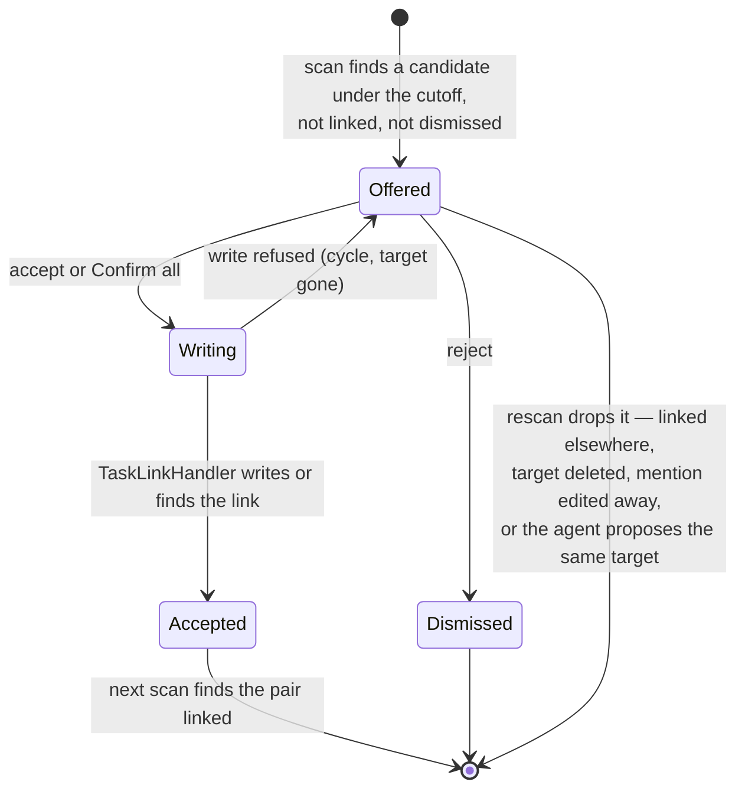
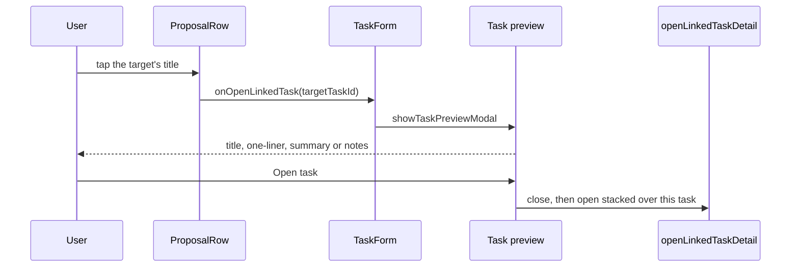

# What it is for

People write about earlier work in passing: *"blocked by the relay repair"*,
*"same problem as last week"*, *"follow-up to the census export"*. Each such
sentence names an edge of the task graph that nobody draws. This feature reads
those sentences, finds the task each one most likely means, and offers the
link as a suggestion in the task's *Proposed changes* list.

**The user draws every edge.** A suggestion is derived from stored data every
time the list is built and is never written anywhere; accepting it is the only
thing that creates a link, through the same handler a confirmed agent
`link_task` proposal uses. Rejecting it writes nothing to the journal.

**It is mechanical and local.** No language model reads the text: a cue table
spots the sentence, and the on-device embedding model
([embeddings and semantic search](embeddings-and-search.md)) finds the task.
Nothing leaves the device. The task's agent is not involved — its tools and
wake context are unchanged — though its card hosts the rows, as it does
[inference backfill suggestions](inference-backfill.md).

```mermaid
flowchart LR
  Notes["task notes"] --> Detect
  Entries["linked log entries<br/>text and transcripts,<br/>newest 20"] --> Detect
  Detect["detectPriorWorkMentions<br/>cue per sentence"] --> Query["query: sentence<br/>minus its cue,<br/>or the task title"]
  Query --> Cache{"searched before<br/>in this scan or the last?"}
  Cache -- no --> Search["searchRelatedTasks<br/>embedQuery + ObjectBox"]
  Cache -- yes --> Hits
  Search --> Hits["hits: task id + distance"]
  Hits --> Cut["drop self and<br/>distance > 0.55"]
  Cut --> Dedup["drop tasks already linked<br/>(any link, either direction)"]
  Dedup --> Read["read candidates fresh<br/>drop deleted"]
  Read --> Relation["relationForCandidate"]
  Relation --> Rank["nearest 3"]
  Rank --> List["taskLinkSuggestionsProvider<br/>minus dismissed and accepted"]
  List --> Unified["unifiedSuggestionListProvider<br/>minus targets the agent proposes"]
  Unified --> Card["AiSummaryCard row"]
```

# Spotting a mention

`detectPriorWorkMentions` splits text into sentences — at `.`, `!`, `?`, `…` or
`;` followed by a space, and at line breaks — and looks for one cue per
sentence. Cues live in `prior_work_cues.dart`, one `PriorWorkCueSet` per
relationship, each with phrases in all eleven app languages. Every language is
matched against every text: entries carry no language tag, and the phrases are
long enough not to collide across languages.

| Cue set | Example cue | Suggests ("this task …") |
|---------|-------------|--------------------------|
| blocked by | *blocked by*, *waiting on*, *wartet auf* | `is_blocked_by` |
| blocks | *prerequisite for*, *Voraussetzung für* | `blocks` |
| duplicates | *duplicate of*, *already tracked in* | `duplicates` |
| fixes | *fix for*, *fixes the bug* | `fixes` |
| supersedes | *supersedes*, *replaces the old* | `supersedes` |
| follows up | *follow-up to*, *building on*, *fait suite à* | `follows_up_on` |
| relates to | *last time*, *same problem as*, *wie letztes Mal* | `relates_to` |

Matching is whole-word and case-insensitive; a space or hyphen in a phrase
matches any run of spaces and hyphens, and curly apostrophes count as straight
ones. A sentence with any specific cue takes the **earliest** specific one;
only a sentence with none falls back to *relates to*, which says the work is
related without saying how. At one position the longest phrase wins, so
*like last time* is removed whole rather than leaving *like* behind.

**Phrases are deliberately multi-word** wherever one word would also be
ordinary prose — *duplicates* in "remove duplicates", *replaces* in "replaces
the battery". A cue that fires wrongly only costs a search; one that picks the
wrong relationship costs the user a rejection. `prior_work_cues_test.dart`
checks that every phrase reads as its own relationship and that none is
shadowed by another set's.

The query is the sentence **without its cue**, trimmed of punctuation. When
fewer than two words of three or more letters remain — *"Same as last time."*
— the sentence says the task itself was done before, and the task's title is
searched instead. Sentences are cut at 400 characters, so an unpunctuated
transcript does not become one query.

Text comes from the task's own notes and from its linked `JournalEntry` and
`JournalAudio` entries (text, else the first transcript), through
`EmbeddingContentExtractor.plainTextOf` — the embedder's reader without its
20-character floor, since a short note is exactly where a mention hides.

# Finding the task

`TaskLinkSuggestionDetector.scan` reads, in order, the newest 20 text entries
and then the task's notes, and searches at most **four** mentions — each search
is one query embedding. Each search asks `searchRelatedTasks` for six tasks
(the task itself is usually the nearest match of its own sentences).

**The cutoff is 0.55 cosine distance**, measured rather than guessed: with the
shipped EmbeddingGemma q4 model over the demo world's note and paraphrase
queries in eleven languages ([`tool/embedding_eval`](../../../tool/embedding_eval/README.md)'s
corpus, 466 queries), the right task's median distance is 0.53 and the nearest
wrong task's 0.63. At 0.55, 57 % of right matches pass and 13 % of nearest
wrong ones; nine in ten nearest hits under it are the right task. The cutoff
favours precision because an unwanted suggestion costs a decision and a missed
one costs nothing. A larger journal packs more tasks near any query, which is
another reason not to loosen it.

A task several mentions point at keeps the nearest one's distance, relation
and sentence; on a tie the newer mention wins. At most **three** suggestions
are offered, nearest first.

# Never a link that exists

Two guards, at two times:

- **When suggesting**: one `linksForEntryIdsBidirectional({task})` read lists
  every live link touching the task — any type, either direction, hidden ones
  included, since a hidden link is one the user chose to hide, not to have
  suggested again. A candidate on the other end of any of them is dropped.
  `unifiedSuggestionListProvider` then drops a suggestion whose target an open
  agent `link_task` proposal already names, so the same decision is never
  offered twice.
- **When accepting**: `TaskLinkHandler` checks again — the target must still
  be a live task, a link the pair already holds is reported as done without a
  second row, and a `blocks` link that would close a cycle is refused by the
  [cycle guard](../tasks/relationships.md#cycles-guarded-on-one-device-reported-across-devices).

`relationForCandidate` adjusts one case: a **closed** (`DONE`/`REJECTED`)
candidate never becomes a blocker or a blocked task — blockedness counts only
open blockers, so the link would mean nothing — and is suggested as a plain
*relates to* instead.

# When it runs

`taskLinkSuggestionScanProvider(taskId)` is an autoDispose notifier that scans
when the task's suggestion list is first watched — the task is on screen — and
again whenever an update notification names a watched id: the task, any of its
text entries, or a suggested task. A new log entry links itself to the task,
an edited one notifies its own id, and a rename or deletion of a suggested task
notifies that task, so each is seen as it happens. Nothing scans a task nobody
is looking at.

**Nothing blocks the UI.** The scan is asynchronous, and query embedding runs
on the model's own thread. Each scan hands its searches — query to hit ids and
distances — to the next (`TaskLinkSuggestionScan.searches`), so a rescan after
an unrelated edit embeds nothing and a rescan after an edit embeds only the
sentences that changed. The cache holds no task data: candidates are read
again on every scan, so a renamed, closed or deleted task is never served
stale. A failed search is logged and not cached, so the next scan tries again.

Scans overlap, so each takes a generation number and only the latest may
publish. A background rescan that throws keeps the last list rather than
replacing it with an error.

**Gates.** Nothing is searched while `enable_embeddings` is off, where the
embedding pipeline did not start (`vectorSearchRepositoryProvider` is null —
Windows, or a store that failed to open), or before the model is downloaded
(the search returns no hits). The rows live in the task agent's card, so a
task without an agent shows none, as with backfill.

# The suggestion lifecycle

A row is a `PendingSuggestion.link`: a `link_task` `ChangeItem` whose args are
the relation's wire name, the target's id and its title, on a stand-in change
set (`link-suggestion:<task>|<target>`, created at the mentioning entry's date)
that is **never persisted, synced or shown to the agent**. Because it is an
ordinary `link_task` item, it reads exactly like an agent link proposal —
*"Add · This task follows up on "Colony census export""*, localized through
`localizedRelationSentence`. The title in its args also keeps its fingerprint
apart from an agent proposal of the same link.

- **Confirm** → `confirmLinkSuggestion` → `TaskLinkHandler.handle`, never
  `ChangeSetConfirmationService`. On success the pair joins
  `taskLinkSuggestionAcceptedProvider`, an in-memory set that hides it until the
  next scan finds the link itself. A refused write shows the card's error toast
  and leaves the row.
- **Reject** → `dismissLinkSuggestion` → `TaskLinkSuggestionDismissals`, a
  device-local `SettingsDb` set (`DeviceLocalKeySet`, shared with backfill
  dismissals). The key is the **pair**, not the relation, so rewording the
  mention does not bring the same task back under another relation.
- **Confirm all** writes each link suggestion in turn beside the backfill jobs
  and the persisted change sets; one refused link makes the batch report an
  error.

`confirmMechanicalSuggestion` and `dismissMechanicalSuggestion` are the single
dispatch the row and *Confirm all* use for both mechanical kinds; an agent
proposal falls through to the change-set service.

## Seeing which task is meant

A title alone can be ambiguous, so the target's title in the row is a link.
Tapping it decides nothing: it opens a preview of that task —
`showTaskPreviewModal` in the tasks feature — with the task's title, its
agent's latest one-liner and TL;DR (`taskPreviewProvider`), or the task's own
notes when no report exists yet, and an *Open task* button. That button closes
the preview and opens the task the way a linked task opens
(`openLinkedTaskDetail`): stacked over the current task in the desktop detail
pane, pushed on a phone, so Back returns to the decision.

The card sits below the tasks feature in the layer order, so it cannot open a
task itself. `AiSummaryCard.onOpenLinkedTask` carries the tap out; the task
page (`TaskForm`) supplies the preview. A host that passes nothing — the
event card, for one — keeps the title plain text. The link is any `link_task`
row, the agent's own included. A suggestion carries `targetTitle` in its args.
An agent proposal names its target by id alone, so its row looks the title up
at render time (`proposalTaskTitleProvider`) and adds it for display only: the
proposal's args, and so its fingerprint, stay as they are. Until the title
arrives, or when the task is gone, the row shows the persisted English summary
unlinked. Either way the row splits its already-localized sentence at the
title, so every language's word order works unchanged.

# Gotchas

- **Dismissals do not travel.** Rejecting on the phone leaves the row on the
  desktop, as with backfill.
- **Only what the index holds can be found.** A task embedded on no device —
  the flag off where it was written, or never backfilled — is invisible to the
  search. See [keeping up with the journal](embeddings-and-search.md#keeping-up-with-the-journal).
- **The task's own text is in the index too.** Its notes and its log entries
  resolve to the task itself, which is why every search asks for one more hit
  than it keeps and drops the task.
- **The cue table is the recall ceiling.** A mention phrased in none of the
  listed ways is not seen. Adding a phrase is a one-line change; the cue tests
  then check it is not shadowed and does not move to another relationship.

# Related

* [Embeddings and semantic search](embeddings-and-search.md) — the index and
  the search this reads.
* [Typed relationships](../tasks/relationships.md) — the eleven directed
  relations and the one-row-per-relationship rule.
* [Inference backfill suggestions](inference-backfill.md) — the other
  mechanical row in the same list.
* [Agent UI surfaces](../agents/ui-surfaces.md) — the card that hosts the rows.
