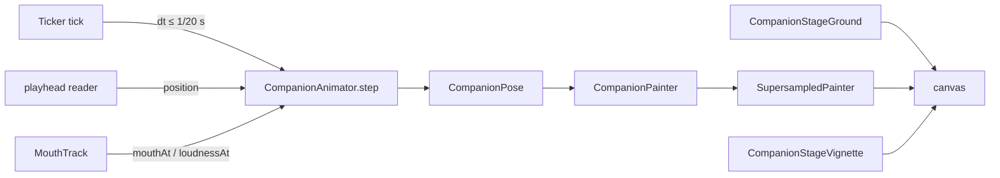
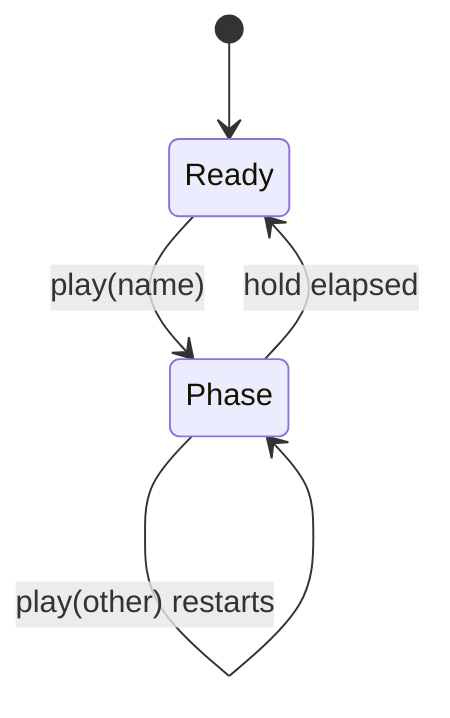
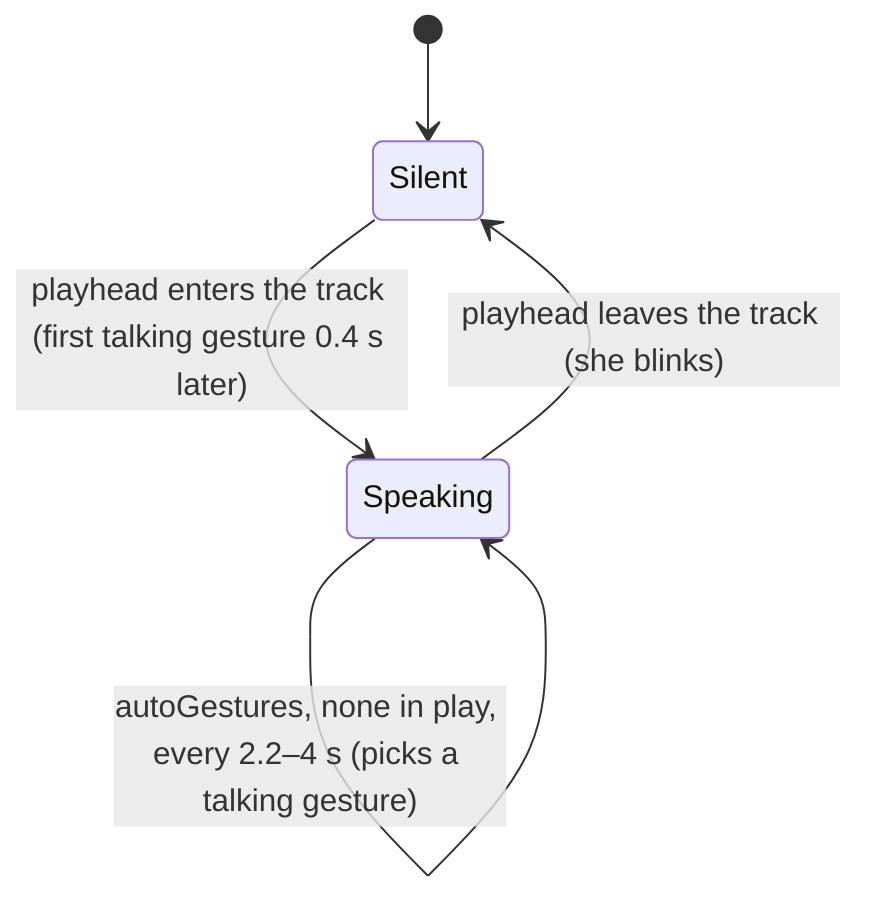

# Companion

A drawn character, alive in a widget. Only the widgetbook mounts it today
(`lib/widgetbook.dart`); nothing in the app shell does. Its
[README](../../lib/features/companion/README.md) covers what she looks like
and how to try her; this concept is how a frame of her is made.

# The frame loop

`CompanionView` owns a `Ticker`. Each tick advances one `CompanionAnimator`
by the frame's `dt` — capped at 1/20 s, so a stall moves her one short step,
not a jump — and repaints with the returned `CompanionPose`. The pose is the
only per-frame value; look, mood, framing and the speech track arrive as
widget parameters.

**Only her edges are supersampled.** `SupersampledPainter` records the figure
at `factor` × the device pixels and halves it back down with `toImageSync`.
That costs a large texture per frame, and it exists for one case: Impeller on
a GL driver without multisampling (a Linux VM), which draws paths without
anti-aliasing. So `CompanionView.platformSupersample` is 4 on Linux and 1
everywhere else, an explicit `supersample` overrides it, and with `stage: true`
the ground and vignette are painted by their own painters around her layer,
not inside the supersampled pass — gradients have no edges to alias. Her
layer sits in its own `RepaintBoundary`, so the stage does not repaint per
frame. `CompanionPainter.stage` only casts her floor shadow.

# The animator

Gestures set targets; damped springs (`Spring` in `rig/rig_math.dart`) chase
them, which gives the ease-in, the overshoot and the settle. Independent
timed layers run on top: breathing, a sway, glances, blinks, the ear flick
and the tail. Every random choice comes from one generator seeded by
`CompanionView.seed`, so a test run is reproducible.

A gesture is a `CompanionGesture` reached by `GestureName`: arm targets plus
the face and body attitude, a `hold`, and `then` — later phases by the
seconds after the start at which they take over. `play` replaces whatever is
in play.

Speech drives a second machine, on whether the playhead is inside the track:

While speaking, a rise of the voice's loudness through 0.55 — at most every
0.75 s — kicks a nod and a hand beat. Blinks (0.2 s) and ear flicks (0.35 s)
are timed pulses, scheduled by mood-scaled random intervals; `blink()` fires
one now.

`CompanionController` is the owner's handle: `play`, `blink` and `time`
reach the attached view's animator, and are no-ops while detached. Swapping
controllers in `didUpdateWidget` detaches the old one.

# Mouth tracks

The mouth is timed by the **playhead**, never by a clock of its own: each
frame asks the `MouthTrack` for the shape and loudness at the player's
position, so a stall or a seek cannot desync the lips from the voice.

| Track | Shapes from | Loudness from |
|-------|-------------|---------------|
| `TextLipSync` | the text, letter by letter, into nine Rhubarb visemes at a fixed rate | how open the mouth is |
| `SpeechEnvelope` | the loudness (no words) | a WAV's per-frame RMS |
| `VoicedTextTrack` | the text | a WAV's envelope, which also gates the shapes |

`VoicedTextTrack` stretches the text's **spoken** span — up to
`TextLipSync.spokenLength`, the start of the closing rest every line ends
on — over the voiced part of the clip, first sound to last. Stretching the
full `length` instead would squeeze the words into the front of the voice and
close the lips early.

# Gotchas

- `CompanionPose` is rebuilt field by field in `_withTrail` to add the hair
  and hem lag; a new pose field must be carried there too.
- `SpeechEnvelope.fromWav` takes 16-bit PCM only.
- The illustration colours are deliberately not design-system tokens; the
  [design system](design_system/) governs interface colour, not a drawing's.
