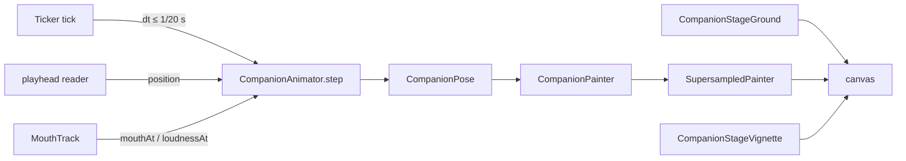
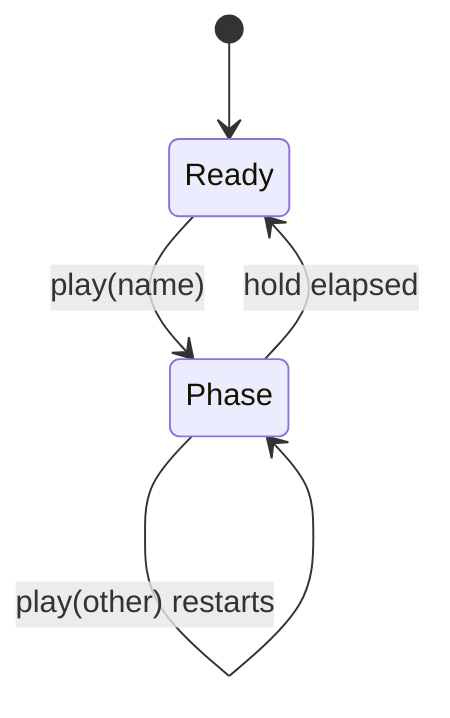
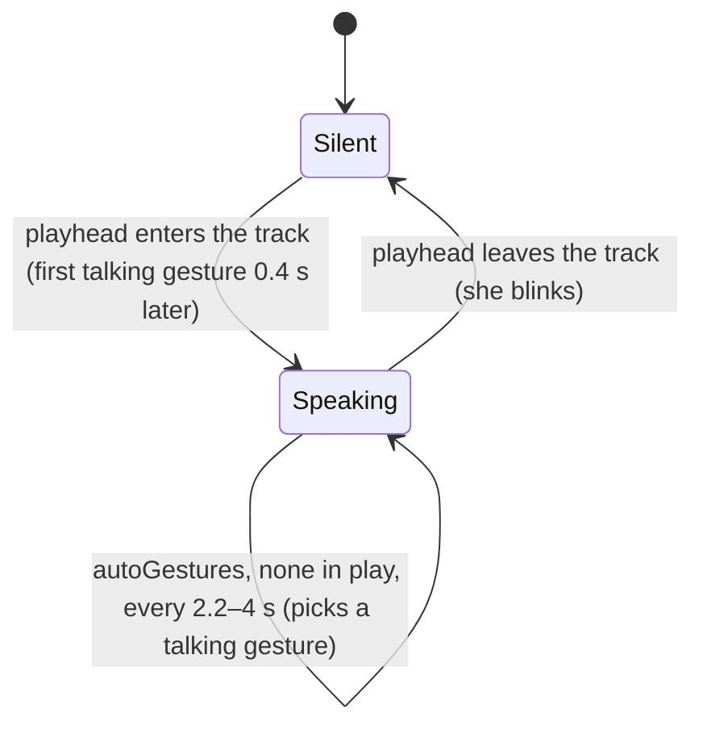
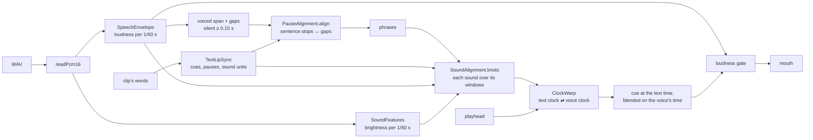
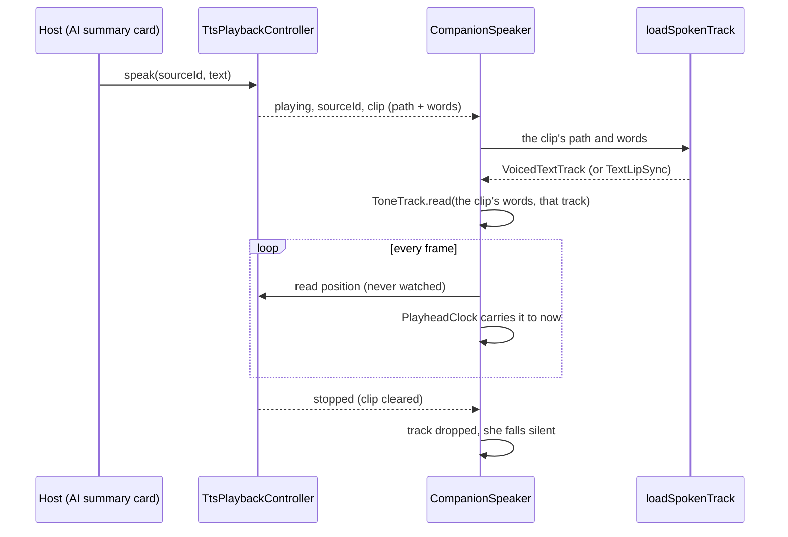
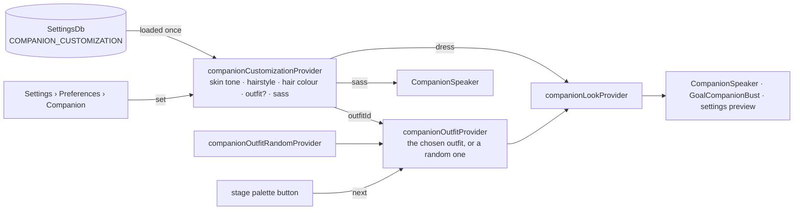
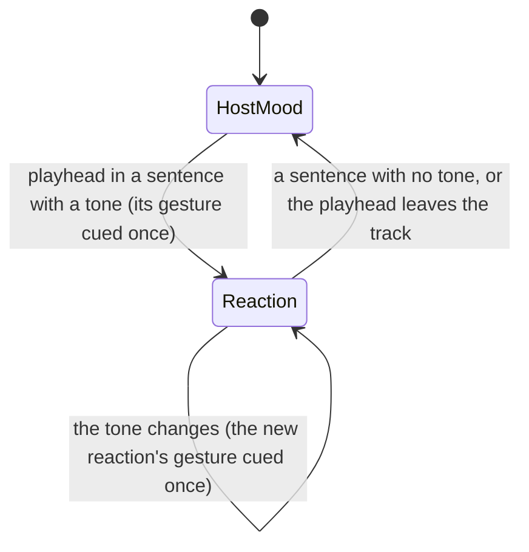
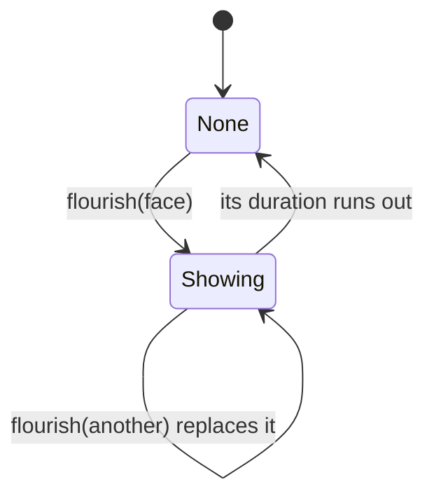
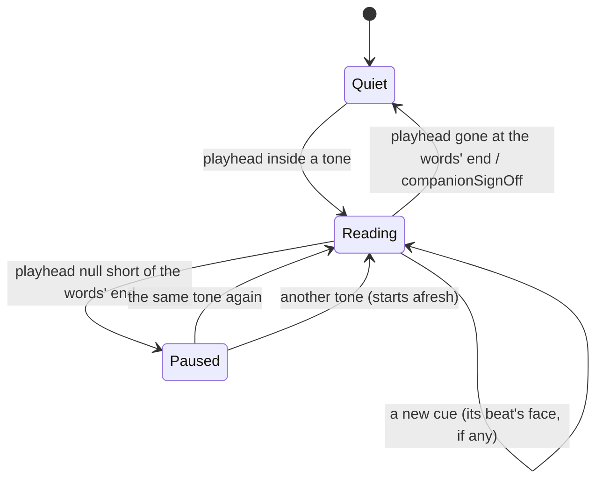
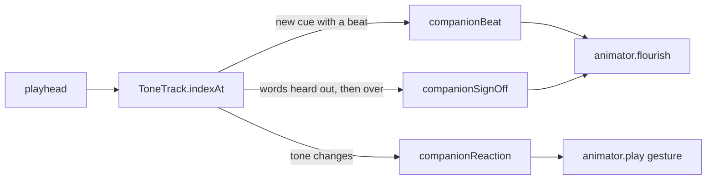

# Companion

A drawn character, alive in a widget. In the app she stands beside the task
agent's AI summary, behind `enable_companion` (seeded off), and speaks it with
the on-device voice ([agents UI surfaces](agents/ui-surfaces.md)); the
widgetbook (`lib/widgetbook.dart`) shows all of her. Her
[README](../../lib/features/companion/README.md) covers what she looks like
and how to try her; this concept is how a frame of her is made, and how she
speaks.

She ranks just above `tts` in the layer order
(`tool/architecture/layer_guard.dart`): she imports the voice and the design
system, and every surface that shows her ranks above her. So the words she
says are always the host's — the task agent's summary, the day's plan —
and she never reaches up for data.

# The frame loop

`CompanionView` owns a `Ticker`. Each tick advances one `CompanionAnimator`
by the frame's `dt` — capped at 1/20 s, so a stall moves her one short step,
not a jump — and repaints with the returned `CompanionPose`. The pose is the
only per-frame value; look, mood, framing and the speech track arrive as
widget parameters. Under reduced motion (`MediaQuery.disableAnimations`) the
ticker does not run: she holds the pose she stands in, and moves again once
the platform allows it.



**Only her edges are supersampled.** `SupersampledPainter` records the figure
at `factor` × the device pixels and halves it back down with `toImageSync`.
That costs a large texture per frame, and it exists for one case: Impeller on
a GL driver without multisampling (a Linux VM), which draws paths without
anti-aliasing. So `CompanionView.platformSupersample` is 4 on Linux and 1
everywhere else, an explicit `supersample` overrides it, and with `stage: true`
the ground and vignette are painted by their own painters around her layer,
not inside the supersampled pass — gradients have no edges to alias. Her
layer sits in its own `RepaintBoundary`, so the stage does not repaint per
frame. `CompanionPainter.stage` only casts her floor shadow.

# The animator

Gestures set targets; damped springs (`Spring` in `rig/rig_math.dart`) chase
them, which gives the ease-in, the overshoot and the settle. Independent
timed layers run on top: breathing, a sway, glances, blinks, the ear flick
and the tail. Every random choice comes from one generator seeded by
`CompanionView.seed`, so a test run is reproducible.

A gesture is a `CompanionGesture` reached by `GestureName`: arm targets plus
the face and body attitude, a `hold`, and `then` — later phases by the
seconds after the start at which they take over. `play` replaces whatever is
in play.



Speech drives a second machine, on whether the playhead is inside the track:



While speaking, a rise of the voice's loudness through 0.55 — at most every
0.75 s — kicks a nod and a hand beat. Blinks (0.2 s) and ear flicks (0.35 s)
are timed pulses, scheduled by mood-scaled random intervals; `blink()` fires
one now.

**Her face can be lopsided.** `browSkew` and `smileSkew` lift her right
brow or mouth corner (screen right) and lower the left by as much, on top of
the symmetric `browRaise` and `smile`; the mood's and the gesture's add. The
smile runs from -1 to 1, so below zero the corners turn down. A gesture's
`lids` adds to the mood's resting lids, which is how a facepalm shuts her
eyes and an eye roll half-closes them.

**An elbow may be asked for.** The arm solver keeps the most relaxed elbow
it is allowed, which hangs; hands on the hips need it out. A `GestureArm`'s
`elbow` names the direction the upper arm would rather take, and the solver
weighs its choices against that instead of the hang, inside the same rules.

**A bounce of joy is in her upper body; her legs stay still.** A gesture's
and a mood's `bounce` add (a praise reaction such as `delighted` with
`celebrate` reaches 5) and become `CompanionPose.lift`, smoothly
`(1 − cos)/2` three times a second; an `|sin|` bob jolted at every landing.
The lift raises the torso frame by its height above the hem (`RigFrame`'s
lifted torso): her shoulders, arms, neck and head by all of it, her dress
by less the lower it reaches, the hem not at all. Her hips, knees and feet
hang from the pelvis itself and never move with it. A bob through the
pelvis, with the feet planted, had to go through the legs: solved afresh
each frame near full extension (153 units of leg, 146 of reach) it swung
the knees 14 units sideways, and with the knees held in place it squashed
and stretched the legs three times a second instead — both read as wrong.
`RigFrame.knee` still keeps each knee where the standing leg's solved knee
sits, as far down the hip-to-ankle line and as far out from it, so her slow
sway leans the legs without bending them. `rig_frame_test` gates it frame by
frame, as the dancing_cats rig gates its joints: through a celebration her
head bobs and her knees stay put.

`CompanionController` is the owner's handle: `play`, `blink` and `time`
reach the attached view's animator, and are no-ops while detached. Swapping
controllers in `didUpdateWidget` detaches the old one.

# Mouth tracks

The mouth is timed by the **playhead**, never by a clock of its own: each
frame asks the `MouthTrack` for the shape and loudness at the player's
position, so a stall or a seek cannot desync the lips from the voice.

| Track | Shapes from | Loudness from |
|-------|-------------|---------------|
| `TextLipSync` | the text, letter by letter, into the eight Rhubarb speaking shapes and the rest, at a fixed rate | how open the mouth is |
| `SpeechEnvelope` | the loudness (no words): rest, B, C, D only | a WAV's per-frame RMS |
| `VoicedTextTrack` | the text, pinned to the voice's sentences and then to each of its sounds | a WAV's envelope, which also gates the shapes |

**The eight shapes and the rest** (`Viseme`, the Rhubarb convention) are all
reached from the text: A closed lips (m, b, p); B teeth together (every other
consonant, "ee", "ck", "ng"); C open (e, i, u, y); D wide (a); E rounded (o,
r, "sh", "ch"); F puckered (w, q, "oo", "ou", "ow", "wh"); G the bite (f, v,
"ph"); H the tongue up (l, "th"); X rest at punctuation. A word's silent final
e ("have", "time"), the e of a final "-es" or "-ed" where English drops it
("dives", "walked", but not "faces" or "wanted"), and the second of a doubled
consonant ("waddle") take no shape and no time. Spelling is not sound; this is
a stand-in for Rhubarb, a native binary the app cannot ship on every
platform.

`TextLipSync` also keeps every sound in order as a `SoundUnit` with a broad
`SoundClass` — vowel, fricative (a hiss: f, v, s, z, x, j, "sh", "ch",
"ph"), stop (a closure), nasal (m, n, "ng"), approximant (l, r, w, "wh", and
"th", which is mostly the dark, voiced sound of "the") or pause — which is
what a recorded voice's sound is matched against.

Every track also answers `timeOf(offset)`: when the character at that offset
of its words is spoken, on the same clock as its shapes — `TextLipSync`
records the time it reaches each character, and `VoicedTextTrack` carries
that onto the voice as it does the shapes. A voice alone (`SpeechEnvelope`)
has no words and answers null. This is how her face is timed to the words.

## Pinning the words to the voice

The letters' fixed durations know the order of the shapes, not their timing.
A single stretch of the text over the voice spread the guess's error over the
clip: on a measured cloud voice the lips ran 0.3 s behind by the first comma.
`VoicedTextTrack` pins the words in two passes, both on the clip's own WAV
read once (`readPcm16`) into two per-window readings: loudness
(`SpeechEnvelope`) and brightness (`SoundFeatures`).



**Pass one: the pauses** (`PauseAlignment`).

- **Both clocks are squeezed to speech.** The text's pauses (punctuation, a
  run of stops and the spaces after them as one) and the voice's gaps
  (silences of at least `VoicedTextTrack.minGapSeconds` inside the voiced
  span; a stop consonant's closure is shorter) are taken out, so each side
  is a clock of speech alone.
- **Pauses are matched to gaps in order**, at the lowest total cost: a
  stretch between two pins costs how far its voice length strays from its
  text length at the clip's overall pace; a pause left unpinned costs its
  weight (a comma 0.5, a full stop 1.2, a line break 1.5); a gap left
  unpinned costs more the longer it is. The search is windowed (a stretch
  passes at most twelve pauses or gaps) and banded (a pin's two positions
  within 30% of the speech of each other), and the end is always reachable.
- **Given the sound, only sentences pin** (`minWeight` is
  `SoundAlignment.minPinWeight`, a full stop's weight). A voice often runs
  through a comma and breathes a word later; pinning the comma to that breath
  dragged a phrase half a second late. Commas, semicolons and colons are left
  for pass two. Without the sound (a track built from an envelope alone),
  every pause may pin.
- The pins split the clip into `phrases`, each with its span on both clocks.

**Pass two: the sounds** (`SoundAlignment`), inside each phrase.

- **Brightness** is the voice's root-mean-square frequency, read without a
  Fourier transform from the energy of the differenced signal over the
  signal's own (`4·sin²(πf/rate)` for a tone): an s reads 5–9 kHz, a vowel
  below 1 kHz, a hummed m lower still, true silence 0. It is the same at any
  sample rate and on every platform.
- **Each window is scored against each `SoundClass`** (`frameCost`) by its
  loudness and brightness: a vowel loud and dark, a fricative bright, a stop
  quiet, a nasal a darker hum, a pause silent.
- **The phrase's sounds are laid over its windows in order**, each over a
  run of windows, at the lowest total cost — a segmental search, as forced
  alignment does. A sound's run may stray from the length its letters give
  it, at `durationWeight` times the squared log-ratio. Every word break, and
  every unpinned comma, is a **free silence**: it may take no window or up to
  `maxSilenceSeconds`, at no price for its length, so a breath the text gave
  no comma for is a silence rather than a stretched word.
- The result is a knot at the start of every sound and silence; `ClockWarp`
  maps between the clocks through them, both ways. A phrase with more sounds
  than windows, or too large to search (`maxSearchCells`, about a minute
  without a sentence's end), keeps pass one's timing.
- **Shapes blend on the voice's clock.** The shape still comes from the
  letter, but a cue's 60 ms blend is measured in the voice's time since the
  cue began (`TextLipSync.cueAtSeconds`); measured in text time, a stretched
  hiss stayed half-blended from the vowel before it.

Measured on six Voxtral clips against word timestamps from a transcription
(rounded to 0.1 s), with two clips held out of the tuning, the mean error of a
word's start fell from 159 ms to 65 ms and the 90th percentile from 430 ms to
100 ms on the held-out words.

Both passes run in `loadSpokenTrack`'s `Isolate.run` (`VoicedTextTrack.fromWav`),
never on the UI isolate — a dozen seconds of voice take tens of milliseconds —
and the per-frame lookups are binary searches.

# Speaking with the on-device voice

`CompanionSpeaker` is `CompanionView` bound to the app-wide voice. The host
asks the voice to speak, exactly as it would without her
(`TtsPlaybackController.speak(sourceId:, text:)`), and gives her the same
`sourceId`. The voice knows nothing about her: she reads
`TtsPlaybackState`, whose `clip` carries the WAV and the words it was made
from.



- **Only the start and end of an utterance pass through Riverpod.** She
  listens to one selected value — the clip while *her* source plays,
  null otherwise — so the voice's position ticks never rebuild her. Another
  source playing leaves her silent.
- **The clip is read once, off the UI isolate.** `loadSpokenTrack` reads the
  WAV and computes its loudness in `Isolate.run`, because a long summary is
  minutes of samples. A clip already deleted (the utterance ended first) or
  not 16-bit PCM falls back to `TextLipSync` on the words: the voice still
  plays, so she still talks, less exactly in time.
- **Her words are the clip's, not the screen's.** The host's text can change
  while the voice is still synthesizing — the summary card expands, or a new
  report lands — so she never takes words from the host: the clip carries the
  text it was synthesized from.
- **A late load never lands.** Each utterance start or end bumps a counter;
  a load that finishes for an utterance that is over is dropped.
- **The playhead is carried between reports.** The player reports its
  position in coarse steps. `PlayheadClock` carries the latest report forward
  by the time since it arrived, times the playback speed, and starts again
  from every report — at most `maxLead` (250 ms) past it, so a stalled player
  stops her mouth instead of letting it run on through the words. Each
  utterance gets a fresh clock: two clips both open at zero, and a clock that
  still held the first one's zero would start the second at its full lead.

She has five hosts, each with its own framing:

| Host | Framing | Box | Utterance (`sourceId`) |
|---|---|---|---|
| AI summary card (`agents/ui/ai_summary_card.dart`, placed by `agents/ui/ai_summary_card/companion_report_layout.dart`) | `full` beside the summary on a card body at least `CompanionPlacement.besideMinWidth` wide; `bust` in the header's badge tile below that | `ControlSizes.companionCard` high in a `CompanionSlot` as wide as the `bust` window, the rest of the `full` frame overhanging into the gutters; the badge tile at `ControlSizes.avatar`, whose tap opens her `full` framing on the stage, full screen (`agents/ui/ai_summary_card/companion_stage_page.dart`) | the task id |
| Day page header ([Daily OS](daily_os_next/ui-surfaces.md#the-day-briefing)) | `bust` | `ControlSizes.avatar` square | `day-briefing:<yyyy-MM-dd>` |
| Onboarding welcome and first task ([onboarding](onboarding.md#the-companion)) | `full` in the welcome hero, `bust` on the first task | the hero frame's height; `ControlSizes.avatarHero` square | `onboarding-companion` |
| Goal card on the Goals list (`goals/ui/unified/unified_goal_card.dart`, via `goals/ui/unified/goal_companion.dart`) | `bust`, silent `CompanionView` | `ControlSizes.avatarCompact` tile on the goal's status wash, in place of the persona monogram | none — goals have no read-aloud |
| Goal agent's read card (`goals/ui/pages/goal_agent_detail_page_cards_part.dart`, placed by the shared `CompanionReportScaffold`) | as the AI summary card: `full` beside the read on a wide card, `bust` in the header's badge tile below that, in the goal's pose | as the AI summary card; the bust's tap opens her full-screen stage | `goal-report:<agentId>` (`goalReportSpeechSourceId`) |

On the goal card and the goal agent's read card her pose carries the
goal's `GoalTrackStatus`
(`goalCompanionPose`), on the warm end of the [reaction
scale](#reactions): a held gesture for the verdict at a glance and a mood
for the face, because at 40 pixels the moods alone are a few pixels apart.
Doing well is a raised thumb (`celebrate` once achieved), on the way back a
clap, at risk a hand to the cheek, off track palms down — it is all right,
never a scold — and no data a hand at her ear, listening for news. Until
the health resolves she stands calm and at ready.

**What she wears.** Every host shows her as `companionLookProvider` draws
her, in `companion/state/`; `CompanionSpeaker` and the goal card's silent
bust both watch it, and no host passes a look. It is two things together:



- **The outfit** (`companionOutfitProvider`): the one chosen in her
  customization, or, with none chosen, one of `companionOutfits` (the
  grandmother's looks) drawn by `companionOutfitRandomProvider`, which a test
  or a capture pins. It is not auto-disposed, so the draw holds until the app
  closes. The stage's palette control calls `next`, stepping through the
  outfits and wrapping, for the session only; a new choice in settings
  starts over from that choice.
- **The customization** (`companionCustomizationProvider`): her skin tone,
  hairstyle, hair colour, outfit, sass (default `cheeky`) and whether she
  answers a spoken question aloud (`speaksReplies`, default on; only an
  explicit false mutes her). `loaded` says whether that is known yet — the
  stored value read (nothing stored counts) or set. It stays false while the
  read is out, and after it failed unless a change made meanwhile was then
  stored; her voice never guesses at a mute. A change made while the read is
  out shows at once and is kept apart, with every part any change touched; once
  the read lands only those parts are laid over what it found
  (`CompanionCustomization.adopting`), so a stored part never touched — a
  mute — survives, and a part switched and switched back still counts. A
  reload sync asks for meanwhile waits until then. Stored as JSON
  under
  `COMPANION_CUSTOMIZATION` in `SettingsDb` (the keys are in
  `lib/utils/companion_settings_keys.dart`, which sync reads too). It starts at
  the default — Lotti as the videos draw her — and refines when the load
  lands; a change made before that wins. A part a newer version wrote, or an
  outfit that no longer exists, reads as the default — but a change is laid
  over the stored JSON (`CompanionCustomization.toJsonOver`), so a part it
  leaves alone keeps what the newer version wrote, and sync never carries an
  older build's defaults over a newer device's choice.
- **It syncs** as the Daily OS greeting name does, last write wins:

  ```mermaid
  sequenceDiagram
    participant Page as Settings page
    participant C as Customization controller
    participant DB as SettingsDb
    participant Out as Outbox
    participant Peer as Other device
    Page->>C: set(customization)
    C->>DB: saveLocalSettingsGroup(JSON, stamp)
    C->>Out: SyncMessage.companionCustomization (debounced 250 ms)
    C->>DB: SYNCED_AT = stamp
    Out-->>Peer: message
    Peer->>Peer: saveSettingsItemsIfNewer (value, stamp, SYNCED_AT)
    Peer->>Peer: settingsNotification, controller reloads, never sends back
  ```

  A customization stored but never published — while the outbox failed — is
  published once on the next load. A reload that a `settingsNotification`
  triggers while a local save is still committing waits for the save, so the
  page never shows the value the save is replacing. "Send settings" re-sends
  it with the other preferences.
- **Dressing** (`CompanionCustomization.dress`) lays the skin tone and hair
  colour over the outfit's palette and sets its hairstyle; the outfit keeps
  its clothes and props. A deeper tone deepens plain lips, never lipstick an
  outfit paints (the rock look's red).

Every part combines with every other, and none is named after a people:
skin tones are numbered, light to deep, and a screen reader says "Skin tone
3". Five hairstyles share one dispatch, `hair_styles_painter.dart`: each has
a back layer (behind the head and body), a front layer over the forehead
whose outline also shades it, and hanging parts that trail the head's motion
by the hair lag — the locs and the bob's ends; the bun keeps its painter,
`hair_painter.dart`.

`full` is head to toe, wide enough that both wrists stay inside it with room
for the hand in every gesture (a test walks each gesture through its phases).
`bust` is head, shoulders and raised hands, square, for small sizes.

A host cues her through `CompanionController.play` (a gesture once) or keeps a
gesture up with `CompanionView.holding`, which her ticker replays whenever it
relaxes — no timer. `CompanionController.gesture` reads the gesture in play;
`CompanionController.flourish` pulls a face and `flourishing` reads it (see
[flourishes](#flourishes-and-beats)).

# Reactions

`companionReaction(approval, sass:)` is how a host says how a piece of work
went: approval from `minApproval` (-3) to `maxApproval` (+3), sass `warm`,
`cheeky` or `sassy`. Each cell is a `CompanionCue` — a mood and a gesture to
hold. Warm is encouraging whatever happened; sassy is hands on hips, slow
claps and eye rolls. Two rules hold across the table, and its tests keep
them: her smile never falls as approval rises, and warm uses none of the
sassy faces or gestures. Disapproval stops at sass: no reaction is hurt or
sad, and none is ever tied to a notification.

The sass is the person's: Settings › Preferences › Companion stores it in her
customization (`CompanionCustomization.sass`, default `cheeky`), and
`CompanionSpeaker` hands it to her view, so every read — the AI summary, the
Day briefing, onboarding — reacts with it. Picking a level in settings has
the preview take a slip that way, so the difference shows before a read. The
goal card does not read it: it uses the table's warm end by design.

# Her face on the words

While she speaks, her face follows how the words land, not only the host's
mood. `readTones` reads the clip's text — Markdown and all — into cues, one
at the first character of each line and each sentence in it, with an
approval on the reaction scale or null where the words read neither way:

- A sentence's own words decide its tone: a short English and German list
  of word beginnings and phrases ("finish", "well done", "overdue",
  "blocked", "erledigt", "überfällig"), plus emoji that read the same in any
  language (✅ 🎉 ⚠️ ❌). Praise denied ("not done") counts as a concern,
  trouble denied ("no blockers") as good news; the sum is clamped to the
  scale.
- A sentence that reads neither way takes its **section's** tone, set by the
  heading above it, so every line under "⚠️ Risks" keeps her concerned.
- A report in another language reads neither way except by its emoji; the
  agent marking tone in its own report is the later step (plan 2026-10-12,
  "Revision").

`ToneTrack.read` times each cue with the mouth's `timeOf`, so a tone starts
when the voice reaches its sentence. `CompanionSpeaker` builds it with the
mouth, from the same clip, so the two never belong to different clips, and
drops both when the utterance ends.

`CompanionView` asks the tone for the approval at the playhead each frame,
as it asks the mouth for its shape:



In a reaction her mood is `companionReaction(approval, sass:).mood`; the
gesture is played once when the tone changes, not held, so her talking
gestures resume after it. `sass` is warm unless the view is given another;
`CompanionSpeaker` gives the person's.

# Flourishes and beats

A reaction changes her face only when the tone changes, so a run of praise
would get one thumbs up and then nothing. On top of it runs a second,
face-only layer.

**Flourishes** (`CompanionFlourish`) are faces she pulls for a moment: a
brow pop, one brow up, the side-eye, the look over the glasses (chin down,
eyes up), a wink, a smirk, narrowed eyes, a head tilt. Each is a handful of
face and head offsets with an envelope — a quick rise, a hold, a fade over
its last third — that `CompanionAnimator.flourish` adds to the mood's and
the gesture's targets, pulling her gaze towards its own unless `lookAt` fixes
it. It never touches the arms, so it lands in the middle of a talking
gesture or a held reaction. The wink is the one that needs the pose:
`CompanionPose.wink` shuts one eye on top of `blink`, and both head painters
draw each eye at `blinkOf(side)`; it is applied unsprung, so it stays quick.



**Beats** (`SassBeat`) are what a sentence turns on, read by `readTones`
alongside its tone: a question, an exclamation, a turn ("but", "however",
"aber"), the same thing again ("again", "still", "immer noch") and the wait
over ("finally", "at last", "endlich"). Words outrank the stop, so "Is it
finally done?" is a "finally". A cue with a beat is kept even in the same
tone. A word's beat gets a cue of its own at the word, so the side-eye lands
on the "but", not on the sentence's first word; a question or an exclamation
is cued at the sentence's start. `companionBeat(beat, approval, sass:)` maps each to a flourish: warm
only tilts her head or pops her brows; cheeky and sassy add the side-eye on a
turn, narrowed eyes or the look over the glasses on a slip said again, and a
smirk or a wink on praise exclaimed. Good news said "again" or "still" is
never scolded.

**Her last word** (`companionSignOff(approvals, sass:)`): when a read ends,
the view looks at every approval it held and pulls one more face — a wink
for all good news (a smirk, sassy), for only trouble a head tilt, a raised
brow or the look over the glasses, and for both the side-eye at full sass.
Words that read neither way leave her quiet. The speaker's playhead goes
null for a pause and for a stop alike (`TtsPlaybackStatus.stopped` covers a
finish and a user stop), so the view tells a read heard out by how far the
voice got: within a quarter second of `ToneTrack.end`, when the last word is
spoken (the clip's end for a track built without one). A read cut short
has no last word and keeps its place, so a resume does not pull the current
beat's face again.





# Gotchas

- Hair has to fit the `bust` window: it leaves about 106 head units above
  the face's centre, and the bun tops out at 90. The afro is drawn wider
  than tall so its curls stop near 99; a taller style would be cut off on
  every bust (`hair_styles_painter_test.dart` measures the silhouettes).

- `CompanionPose` is rebuilt field by field in `_withTrail` to add the hair
  and hem lag; a new pose field must be carried there too.
- `SpeechEnvelope.fromWav` takes 16-bit PCM only.
- Her ticker runs for as long as she is mounted, so a widget test of any
  surface showing her pumps frames by hand; `pumpAndSettle` never settles.
- The illustration colours are deliberately not design-system tokens; the
  [design system](design_system/) governs interface colour, not a drawing's.
