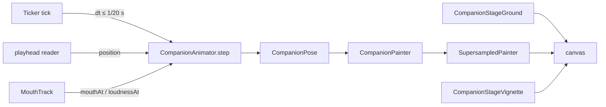
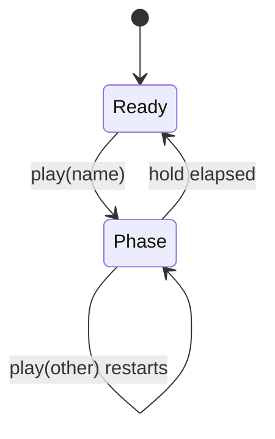
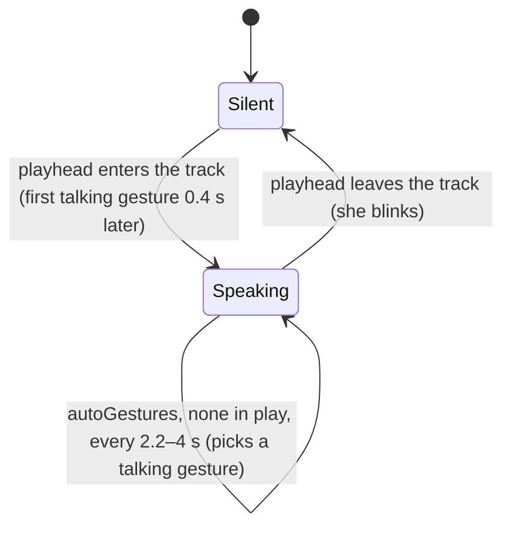
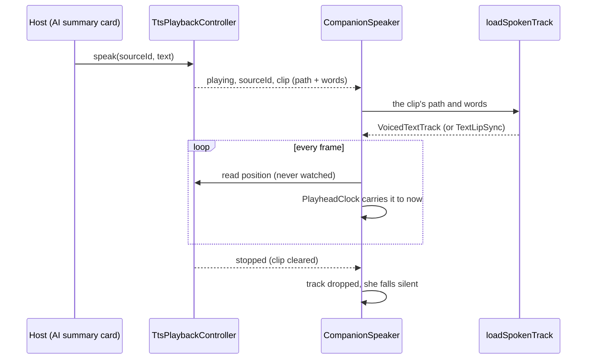

# Companion

A drawn character, alive in a widget. In the app she stands beside the task
agent's AI summary, behind `enable_companion` (seeded off), and speaks it with
the on-device voice ([agents UI surfaces](agents/ui-surfaces.md)); the
widgetbook (`lib/widgetbook.dart`) shows all of her. Her
[README](../../lib/features/companion/README.md) covers what she looks like
and how to try her; this concept is how a frame of her is made, and how she
speaks.

She ranks just above `tts` in the layer order
(`tool/architecture/layer_guard.dart`): she imports the voice and the design
system, and every surface that shows her ranks above her. So the words she
says are always the host's — the task agent's summary, the day's plan —
and she never reaches up for data.

# The frame loop

`CompanionView` owns a `Ticker`. Each tick advances one `CompanionAnimator`
by the frame's `dt` — capped at 1/20 s, so a stall moves her one short step,
not a jump — and repaints with the returned `CompanionPose`. The pose is the
only per-frame value; look, mood, framing and the speech track arrive as
widget parameters.

**Only her edges are supersampled.** `SupersampledPainter` records the figure
at `factor` × the device pixels and halves it back down with `toImageSync`.
That costs a large texture per frame, and it exists for one case: Impeller on
a GL driver without multisampling (a Linux VM), which draws paths without
anti-aliasing. So `CompanionView.platformSupersample` is 4 on Linux and 1
everywhere else, an explicit `supersample` overrides it, and with `stage: true`
the ground and vignette are painted by their own painters around her layer,
not inside the supersampled pass — gradients have no edges to alias. Her
layer sits in its own `RepaintBoundary`, so the stage does not repaint per
frame. `CompanionPainter.stage` only casts her floor shadow.

# The animator

Gestures set targets; damped springs (`Spring` in `rig/rig_math.dart`) chase
them, which gives the ease-in, the overshoot and the settle. Independent
timed layers run on top: breathing, a sway, glances, blinks, the ear flick
and the tail. Every random choice comes from one generator seeded by
`CompanionView.seed`, so a test run is reproducible.

A gesture is a `CompanionGesture` reached by `GestureName`: arm targets plus
the face and body attitude, a `hold`, and `then` — later phases by the
seconds after the start at which they take over. `play` replaces whatever is
in play.

Speech drives a second machine, on whether the playhead is inside the track:

While speaking, a rise of the voice's loudness through 0.55 — at most every
0.75 s — kicks a nod and a hand beat. Blinks (0.2 s) and ear flicks (0.35 s)
are timed pulses, scheduled by mood-scaled random intervals; `blink()` fires
one now.

`CompanionController` is the owner's handle: `play`, `blink` and `time`
reach the attached view's animator, and are no-ops while detached. Swapping
controllers in `didUpdateWidget` detaches the old one.

# Mouth tracks

The mouth is timed by the **playhead**, never by a clock of its own: each
frame asks the `MouthTrack` for the shape and loudness at the player's
position, so a stall or a seek cannot desync the lips from the voice.

| Track | Shapes from | Loudness from |
|-------|-------------|---------------|
| `TextLipSync` | the text, letter by letter, into nine Rhubarb visemes at a fixed rate | how open the mouth is |
| `SpeechEnvelope` | the loudness (no words) | a WAV's per-frame RMS |
| `VoicedTextTrack` | the text | a WAV's envelope, which also gates the shapes |

`VoicedTextTrack` stretches the text's **spoken** span — up to
`TextLipSync.spokenLength`, the start of the closing rest every line ends
on — over the voiced part of the clip, first sound to last. Stretching the
full `length` instead would squeeze the words into the front of the voice and
close the lips early.

# Speaking with the on-device voice

`CompanionSpeaker` is `CompanionView` bound to the app-wide voice. The host
asks the voice to speak, exactly as it would without her
(`TtsPlaybackController.speak(sourceId:, text:)`), and gives her the same
`sourceId`. The voice knows nothing about her: she reads
`TtsPlaybackState`, whose `clip` carries the WAV and the words it was made
from.

- **Only the start and end of an utterance pass through Riverpod.** She
  listens to one selected value — the clip while *her* source plays,
  null otherwise — so the voice's position ticks never rebuild her. Another
  source playing leaves her silent.
- **The clip is read once, off the UI isolate.** `loadSpokenTrack` reads the
  WAV and computes its loudness in `Isolate.run`, because a long summary is
  minutes of samples. A clip already deleted (the utterance ended first) or
  not 16-bit PCM falls back to `TextLipSync` on the words: the voice still
  plays, so she still talks, less exactly in time.
- **Her words are the clip's, not the screen's.** The host's text can change
  while the voice is still synthesizing — the summary card expands, or a new
  report lands — so she never takes words from the host: the clip carries the
  text it was synthesized from.
- **A late load never lands.** Each utterance start or end bumps a counter;
  a load that finishes for an utterance that is over is dropped.
- **The playhead is carried between reports.** The player reports its
  position in coarse steps. `PlayheadClock` carries the latest report forward
  by the time since it arrived, times the playback speed, and starts again
  from every report — at most `maxLead` (250 ms) past it, so a stalled player
  stops her mouth instead of letting it run on through the words. Each
  utterance gets a fresh clock: two clips both open at zero, and a clock that
  still held the first one's zero would start the second at its full lead.

She has two hosts, each with its own framing:

| Host | Framing | Box | Utterance (`sourceId`) |
|---|---|---|---|
| AI summary card (`agents/ui/ai_summary_card.dart`) | `full` | `ControlSizes.companionCard` high, width from `CompanionFraming.aspectRatio` | the task id |
| Day page header ([Daily OS](daily_os_next/ui-surfaces.md#the-day-briefing)) | `bust` | `ControlSizes.avatar` square | `day-briefing:<yyyy-MM-dd>` |

`full` is head to toe, wide enough that both wrists stay inside it with room
for the hand in every gesture (a test walks each gesture through its phases).
`bust` is head, shoulders and raised hands, square, for small sizes.

# Gotchas

- `CompanionPose` is rebuilt field by field in `_withTrail` to add the hair
  and hem lag; a new pose field must be carried there too.
- `SpeechEnvelope.fromWav` takes 16-bit PCM only.
- Her ticker runs for as long as she is mounted, so a widget test of any
  surface showing her pumps frames by hand; `pumpAndSettle` never settles.
- The illustration colours are deliberately not design-system tokens; the
  [design system](design_system/) governs interface colour, not a drawing's.
