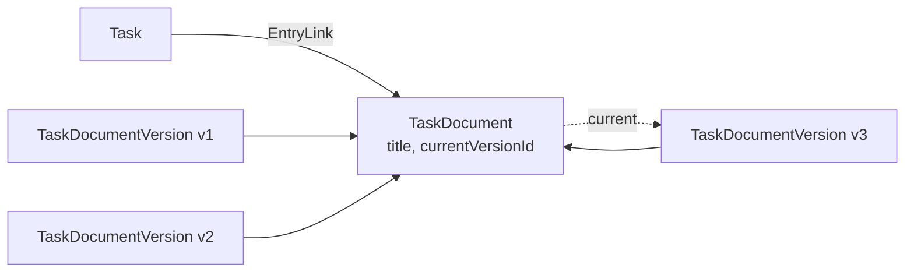
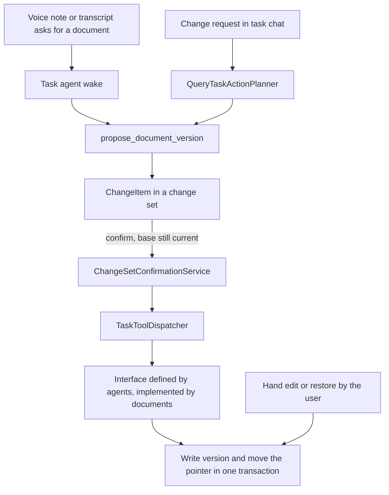
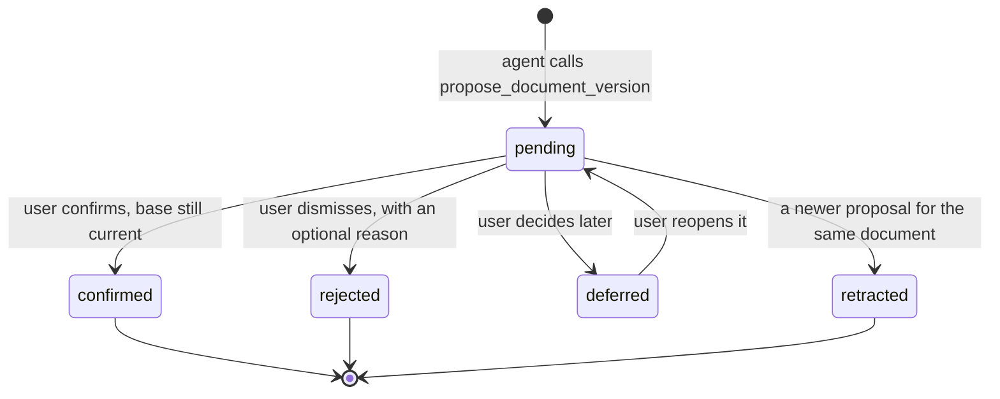

# Task documents

> **Not built yet.** This concept describes the design agreed in
> [ADR 0166](../../docs/adr/0166-task-documents-are-journal-entries-revised-by-proposal.md).
> None of the classes it names under `documents` exist. Each implementation
> step rewrites the part it lands so that this page describes what runs, and
> the page moves to `stable` when the last part does.

A task can hold several markdown documents, such as a client one-pager, a
meeting summary or a follow-up email. The task agent drafts and revises them
from what the task already holds, and only when asked. Each agent version is
a proposal the user confirms or dismisses. The user can also edit by hand,
and copies the markdown out.

## Entities

Both are new `JournalEntity` variants
([`journal_entities.dart`](../../lib/classes/journal_entities.dart)),
modelled on the soul document's version and head in
[`agent_domain_entity.dart`](../../lib/classes/agents/agent_domain_entity.dart).

- **`TaskDocument`** is the only mutable row: its title and the id of its
  current version. It is linked to exactly one task.
- **`TaskDocumentVersion`** is written once and never changed: document id,
  version number, markdown, author (agent or user) and provenance (the
  change item it was confirmed from, or the edit it came from).
- How a version is found from its document is still open (see the end of
  this page).
- Neither entity appears in the task's history list. The filter that already
  hides pull request entries hides them too.

## How a version is made

- **The agent proposes only when asked.** A voice note, text entry or chat
  message has to ask for a document or name one. New material on the task
  does not revise documents by itself.
- **What the agent reads.** Every wake gets a directory of the task's
  documents (id, title, current version, one line). Full text comes only
  through the local read tool `read_document(id)`. This is a deliberate
  exception to the task agent omitting its prior report's prose (see
  [Task agents](agents/task-agents.md)), and the ADR gives the reason.
- **The proposal** carries `documentId` (or `newTitle` for a first draft),
  the full `markdown`, a `changeSummary`, and `baseVersionId`, the version
  it was drafted against.
- **The write.** [`TaskToolDispatcher`](../../lib/features/agents/workflow/task_tool_dispatcher.dart)
  reaches the documents feature through an interface `agents` defines,
  the same pattern as
  [`PullRequestLinkSource`](../../lib/features/agents/model/pull_request_link_source.dart).
- **Hand edits** are the user's own writes and skip the proposal.

## Proposal lifecycle

A document proposal uses the `ChangeItemStatus` states every proposal
already has
([`agent_enums.dart`](../../lib/classes/agents/agent_enums.dart)). Being
stale is not a status. It is derived each time the proposal is shown, by
comparing `baseVersionId` with the document's current version.

- **A stale proposal cannot be confirmed.** If the current version moved on
  after the agent drafted, the UI offers "Ask the agent to redo" instead of
  Confirm. Dismiss stays available. The redo produces a new proposal, which
  retracts the stale one.
- **A dismiss reason is feedback.** It reaches the next draft the way
  rejection reasons already reach the task agent.

## Merging across devices

Versions never conflict because they are never edited. Two concurrent
versions of a `TaskDocument` (say a rename on the phone and a confirm on the
desktop) are merged in
[`database_entity_ops.dart`](../../lib/database/database_entity_ops.dart)
without a user-facing conflict, like the pull request pair already is:

- the pointer goes to the newer of the two versions
- the title is last-writer-wins
- both versions stay in history

A device on an older build skips both variants as undeserializable.

## Where it shows

- **Task section.** A "Documents" band in
  [`task_form.dart`](../../lib/features/tasks/ui/task_form.dart), after
  linked tasks and pull requests. It shows once the user adds it from the
  task's "+" sheet or the task holds a document, the same rule the pull
  request section follows. Each row shows the title, version, author and
  time, a marker when a proposal is waiting, and a Copy action.
- **Document page.** The current version at the prose measure, with a
  provenance line, any waiting proposal above the text, Edit (a plain
  markdown text box), History, and "Ask for changes", which opens the
  task's chat with the document in context.
- **Chat card.** In task chat, a proposed version is a short card (title,
  change summary, Open, dismiss, confirm). Chat never shows the full text.

### Side-by-side review (desktop)

Reviewing a proposal is a mode of the document page. The current version is
on the left and the proposed one on the right, aligned block by block
(headings, paragraphs, whole lists, code). Unchanged blocks are muted.
Added, removed and rewritten blocks use the diff colour tokens and carry a
＋ / − / ~ mark, so colour is not the only signal. A bar at the bottom holds
Ask for changes, Dismiss and Confirm.

- **The gate is measured.** Two columns need `2 × kReviewColumnMinWidth +
  step6` of document width. Below that the page shows the single-column
  view, so a docked chat or a dragged divider switches it live.
- **The width comes from the panes stepping aside.** While review is open,
  the task list and day column are hidden the way they already are for task
  chat: [`tasks_root_page.dart`](../../lib/features/tasks/ui/pages/tasks_root_page.dart)
  folds a temporary term into the list's visibility, and
  [`beamer_app_layout_part.dart`](../../lib/beamer/beamer_app_layout_part.dart)
  puts the day column offstage. Both are derived. The stored pane settings
  are never written, so closing review restores the user's layout exactly.
- **Chat takes the width back.** [`QueryCompanion`](../../lib/features/agents/ui/query/query_companion.dart)
  docks chat as a column, so opening chat from review usually drops it to
  one column.
- **The rows stay put.** Review pins the pair it opened with. A sync, a
  wake or a newer proposal never swaps rows under the reader. A newer
  proposal shows a quiet "Newer proposal available" link instead.

## Invariants

- A document belongs to exactly one task.
- Agent text reaches a document only through a confirmed proposal.
- A version is never edited after it is written.
- A stale proposal is never confirmed.
- Every place a proposal can be decided calls the same confirmation service.
- Review never writes the user's pane settings.
- `agents` never imports `documents`. It reaches it only through the
  interface it defines, and the layer order lives in
  [`layer_guard.dart`](../../tool/architecture/layer_guard.dart).

## Open

- How a version is found from its document: an `EntryLink`, or an indexed
  column in [`conversions.dart`](../../lib/database/conversions.dart).
- Whether deleting a document deletes its versions.
- Copy as plain markdown only, or also as rich text for email.
- Whether a document follows the task's language or the request's.
- `DESIGN.md` says agent chat is an overlay that never reflows the page,
  while the code docks it. Review relies on docking, so `DESIGN.md` changes
  before review ships.
