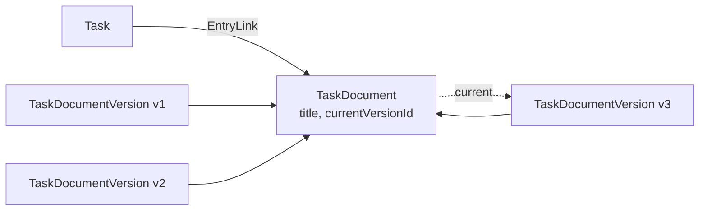
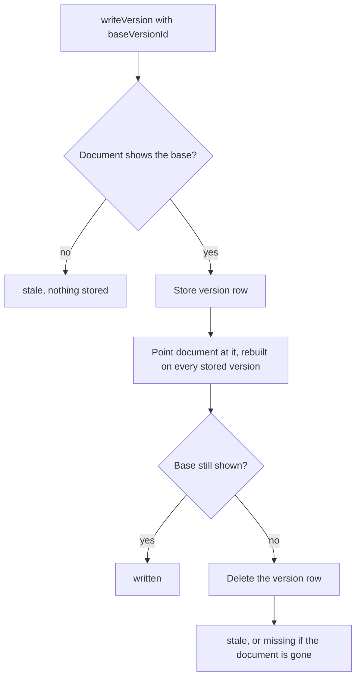
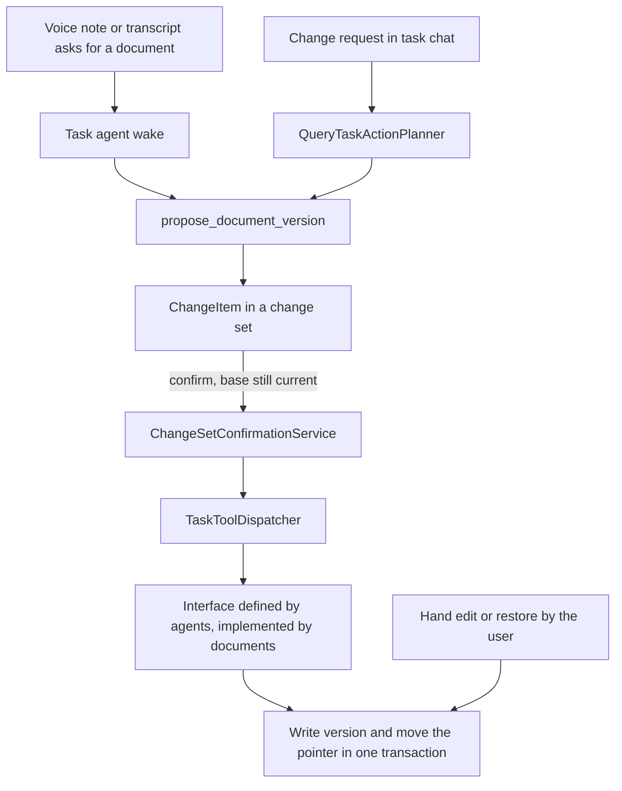
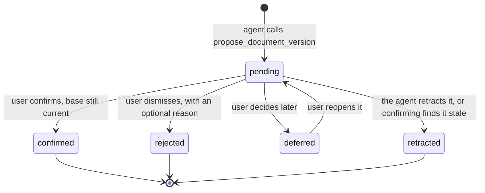
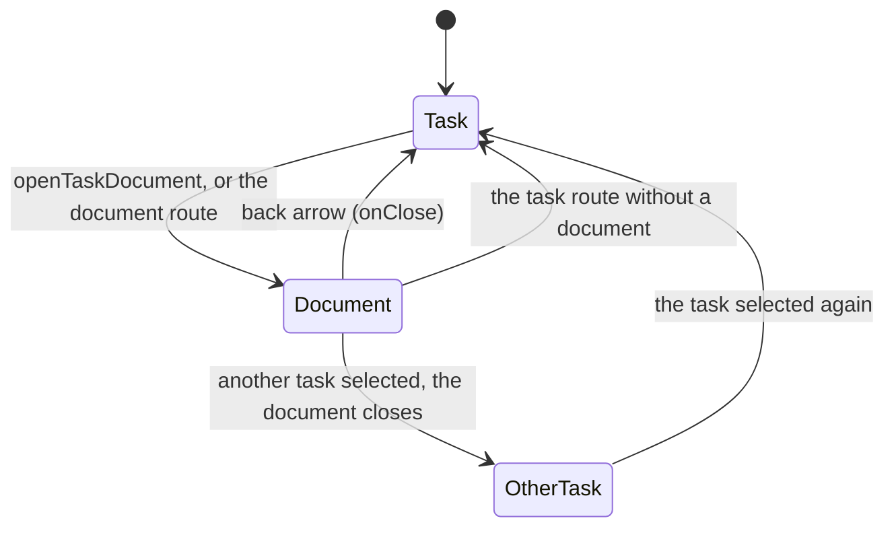

# Task documents

> **Partly built.** This concept describes the design agreed in
> [ADR 0166](../../docs/adr/0166-task-documents-are-journal-entries-revised-by-proposal.md).
> What runs today: the two journal variants, their merge, the repository,
> the user's side of the UI — the Documents section, the Add sheet row, the
> editor, and the document page with history, restore and delete — and the
> task agent's side: it lists the task's documents, reads one on request,
> proposes versions when asked, and a confirmed proposal is written
> ([How a version is made](#how-a-version-is-made),
> [Applying a confirmed proposal](#applying-a-confirmed-proposal)). The chat
> path and the side-by-side review are not built yet. Each implementation
> step rewrites the part it lands, and the page moves to `stable` when the
> last part does.

A task can hold several markdown documents, such as a client one-pager, a
meeting summary or a follow-up email. The task agent drafts and revises them
from what the task already holds, and only when asked. Each agent version is
a proposal the user confirms or dismisses. The user can also edit by hand,
and copies the markdown out.

## Entities

Both are `JournalEntity` variants
([`journal_entities.dart`](../../lib/classes/journal_entities.dart)) with
payloads in [`task_document_data.dart`](../../lib/classes/task_document_data.dart),
modelled on the soul document's version and head in
[`agent_domain_entity.dart`](../../lib/classes/agents/agent_domain_entity.dart).

- **`TaskDocumentEntry`** is the only mutable row: its `title` and
  `current`, a `TaskDocumentVersionRef` naming the version it shows (null
  until the first one). The ref repeats the version's `number` and
  `createdAt` so the merge never has to read version rows. The document is
  linked to exactly one task.
- **`TaskDocumentVersionEntry`** is written once and never changed:
  `documentId`, `number`, `markdown`, `author` (`user` or `agent`; an author
  a newer build added reads as `user`), and provenance: `baseVersionId`,
  `changeSummary`, `changeEffectKey` (the change item's effect key) for a confirmed agent
  version, `restoredFromVersionId` for a restore.
- **A document's versions are an indexed lookup.**
  [`toDbEntity`](../../lib/database/conversions.dart) writes a version's
  `documentId` into the `subtype` column (the goal snapshot precedent), and
  types the rows `TaskDocument` and `TaskDocumentVersion`.
- **Writing a version notifies its document.** A version's `affectedIds`
  include its `documentId` as well as `taskDocumentNotification`, so a
  watcher of the document refreshes when a version lands.
- **Search finds a document by its title.** Versions contribute nothing to
  the index, so search never lists every revision.
- Neither entity is meant for the journal list: the entry-type filter does
  not offer them, and the journal card renders them only so its switch stays
  exhaustive. A document is kept out of the task's history list by
  `JournalEntity.hasOwnTaskSection`, the check the history shares with
  tasks and pull requests. A version is never linked from the task, so the
  history never sees one.

## The repository

[`TaskDocumentRepository`](../../lib/features/documents/repository/task_document_repository.dart)
is the only writer. Every write in it is the user's own or one the user
confirmed.

- **`create`** stores a document with no version yet, linked from its task
  (`createDbEntity` with `linkedId`), in the task's category and with its
  private flag. **`forTask`** lists a task's live documents oldest first, so
  a new one joins the end and none moves.
- **`writeVersion`** is the compare-and-set. It refuses a write whose
  `baseVersionId` is not the version the document shows, before anything is
  stored, so nothing syncs. Otherwise it stores the version row (number one
  past the base, the document's category and private flag), then points the
  document at it through `writeOnStored`, which rebuilds on every version
  stored meanwhile and checks the base again each time. If the document
  moved on in that window, the version row is deleted and the write comes
  back `stale`. If it was deleted, the result is `missing`.
- **`restore`** writes an older version's text as the next version, by the
  user, with `restoredFromVersionId`.
- **`rename`** is built on the stored row, so a version confirmed meanwhile
  is kept.
- **`delete`** deletes the document and every version of it, like the pull
  request feature deletes an entry's summaries: nothing reaches a version
  once its document is gone.
- **`versions`** reads
  [`getTaskDocumentVersions`](../../lib/database/database_task_document_queries.dart),
  newest first in the merge's own order.

## How a version is made

- **The agent proposes only when asked.** A voice note, text entry or chat
  message has to ask for a document or name one. New material on the task
  does not revise documents by itself. The system prompt's `## Documents`
  rules and the tool description carry this; nothing in code can tell a
  request from other text, so the proposal step is the backstop: nothing
  reaches the document unconfirmed.
- **What the agent reads.** Every wake gets a directory of the task's
  documents (id, quoted title, version). Full text comes only
  through the local read tool `read_document(id)`. This is a deliberate
  exception to the task agent omitting its prior report's prose (see
  [Task agents](agents/task-agents.md)), and the ADR gives the reason.
- **The proposal** carries `documentId` (or `newTitle` for a first draft),
  the full `markdown`, a `changeSummary`, and `baseVersionId`, the version
  it was drafted against — filled in from the wake's listing, never taken
  from the model — plus the document's `title` for the review row. One
  version per document waits for the user at a time; the agent is told to
  retract a pending one before proposing its replacement. The tools, their
  gating and the validation are in
  [Task agents](agents/task-agents.md#task-documents).
- **The write** is [Applying a confirmed proposal](#applying-a-confirmed-proposal),
  below.
- **Hand edits** are the user's own writes and skip the proposal.

## Applying a confirmed proposal

`agents` ranks below `documents`, so the task agent depends on a port,
[`TaskDocumentSource`](../../lib/features/agents/model/task_document_source.dart),
the pattern
[`PullRequestLinkSource`](../../lib/features/agents/model/pull_request_link_source.dart)
set. The documents feature implements it in
[`TaskDocumentAgentSource`](../../lib/features/documents/service/task_document_agent_source.dart),
over the repository, and `app_bootstrap.dart` wires it into
`taskDocumentSourceProvider`. Unwired, the provider is null and the
dispatcher answers that the tool is not configured.

On confirmation, `ChangeSetConfirmationService` dispatches the item with its
`ChangeEffect`, and `TaskToolDispatcher` hands the arguments to
[`applyDocumentProposal`](../../lib/features/agents/workflow/task_document_tool_handler.dart):

- **Once, however often it applies** (ADR 0075). The document and the
  version take ids derived from the effect (`entityInput('task-document')`,
  `entityInput('task-document-version')`). `create` and `writeVersion`
  given a `uuidV5Input` first look for the entity that id names: a version
  already there is the effect having happened — on this device, or synced
  from one that confirmed too — and comes back `written` with nothing
  written. A new document deleted since is not brought back.
- **Over its base.** The version is written with the repository's
  compare-and-set, as the agent's (`author: agent`), with the proposal's
  `changeSummary` and the effect key as `changeEffectKey`. A new document
  (`newTitle`) is created first and written over what it shows.
- **Refused for good, or for now.** A stale base, a deleted document or one
  not on the task is `TaskDocumentApplyRefused(permanent: true)`, which the
  dispatcher returns `nonRetryable`, so the item is withdrawn. A failed write
  is not permanent: the item goes back to pending, to confirm again.

## Proposal lifecycle

A document proposal uses the `ChangeItemStatus` states every proposal
already has
([`agent_enums.dart`](../../lib/classes/agents/agent_enums.dart)). Being
stale is not a status. It is derived each time the proposal is shown, by
comparing `baseVersionId` with the document's current version.

- **A stale proposal cannot be confirmed.** Today the apply refuses it for
  good: the dispatch fails `nonRetryable`, and the confirmation service
  records that as a retraction, so it leaves the open list instead of
  failing again on every tap. The side-by-side review (not built yet) is to
  catch it before that, offering "Ask the agent to redo" instead of Confirm.
- **A dismiss reason is feedback.** It reaches the next draft the way
  rejection reasons already reach the task agent.

## Merging across devices

Versions never conflict because they are never edited. Two concurrent
versions of a `TaskDocumentEntry` (say a rename on the phone and a confirm
on the desktop) are merged in
[`database_entity_ops.dart`](../../lib/database/database_entity_ops.dart)
without a user-facing conflict, like the pull request pair already is, by
[`mergeConcurrentTaskDocumentVersions`](../../lib/classes/task_document_merge.dart):

- **`current`** goes to the newer ref by `compareTaskDocumentVersionRefs`:
  number, then `createdAt`, then id. Two devices writing over the same
  version both produce the same number, and the id still picks one on every
  device. The other version keeps its row and stays in history.
- **The title and the rest of the row** come from the later edit by
  `meta.updatedAt`, ties broken by the clock's canonical key.
- **A deletion on either side survives.** Against a purge's tombstone the
  deletion wins under the joined clock, as for pull requests.
- **The clock** is the join of both. Either argument order gives the same
  row, which a property test checks.

A device on an older build skips both variants as undeserializable.

## Where it shows

- **Task section.**
  [`TaskDocumentsSection`](../../lib/features/documents/ui/task_documents_section.dart)
  is the last band of
  [`task_form.dart`](../../lib/features/tasks/ui/task_form.dart), after
  linked tasks and pull requests. It shows only while the task holds a
  document (`taskDocumentsProvider`, the task's live linked entries, oldest
  first), so it never stands empty and needs no opt-in flag. Each row shows
  the title, then `v3 · 2 h ago` or "No text yet"; Copy puts the current
  version's markdown on the clipboard and is offered only once there is
  one; tapping the row opens the document page. The header's + opens the
  editor for a new document.
- **Add sheet.** `NewDocumentItem`, wired into
  `JournalDetailSlots.taskCreateActions` ahead of pull request tracking, is
  always offered on a task. It closes the sheet and opens the editor.
- **Editor.**
  [`TaskDocumentEditor`](../../lib/features/documents/ui/task_document_editor.dart),
  a modal with the title and a plain markdown text box. It opens on the
  current version, read again rather than taken from the row. Save writes
  only what changed: a new title renames, new text is `writeVersion` over
  the version it opened on, by the user. A `stale` result keeps the modal
  open with the typed text and says the document changed meanwhile. A new
  document is created on the first save (a version only when there is
  text), publishes `TaskFocusTarget.documents` so the page scrolls to the
  band, and a retry after a failed text write never creates it twice.
- **Document page.**
  [`TaskDocumentPage`](../../lib/features/documents/ui/task_document_page.dart):
  the title, a provenance line ("v2 · Drafted by the agent, confirmed by you
  · 2 h ago"), Edit, Copy, History and Delete, then the text rendered by
  `AgentMarkdownView` at `kProseMeasureWidth`. It reads
  `taskDocumentCurrentVersionProvider`, which re-reads only when the
  document moves to another version (a rename reads nothing) and keeps the
  version on show while the next loads, so the text is replaced in place.
  A document deleted while open says so. Delete asks first, then deletes
  the document with its versions and leaves the page. The delete button is
  neutral ink, not teal.
- **History.**
  [`TaskDocumentHistory`](../../lib/features/documents/ui/task_document_history.dart)
  lists the versions newest first, the current one marked. Opening one shows
  its text; an older one offers Restore, which writes its text as the next
  version over the one on show (`restore` with that `baseVersionId`). A
  refused restore says a newer version arrived; a written one closes the
  version view and the new version joins the list.
- **Chat card** (not built yet). In task chat, a proposed version is a short card (title,
  change summary, Open, dismiss, confirm). Chat never shows the full text.

### How the page opens

[`openTaskDocument`](../../lib/features/documents/ui/task_document_navigation.dart)
follows the rule `openLinkedTaskDetail` follows for a linked task:

- **Desktop**, from the detail pane: `NavService.desktopTaskDocument` names
  the document, and `TasksRootPage` shows it over its task. The task page
  stays mounted beneath — offstage, tickers paused, focus excluded — so
  closing returns to it with its scroll position. The task stack is not
  touched: it still names the task, which the list highlight and the chat
  scope read.
- **Phone**, or from a pushed page: the page is pushed; back pops it.
- **Deep link** `/tasks/:taskId/documents/:documentId`
  ([`tasks_location.dart`](../../lib/beamer/locations/tasks_location.dart)):
  on a phone the document page is stacked over the task page; on desktop the
  pane opens it over the task, and a URL naming only the task returns the
  pane to the task. History records it as a visit to the task.

### Side-by-side review (desktop, not built yet)

Reviewing a proposal is a mode of the document page. The current version is
on the left and the proposed one on the right, aligned block by block
(headings, paragraphs, whole lists, code). Unchanged blocks are muted.
Added, removed and rewritten blocks use the diff colour tokens and carry a
＋ / − / ~ mark, so colour is not the only signal. A bar at the bottom holds
Ask for changes, Dismiss and Confirm.

- **The gate is measured.** Two columns need `2 × kReviewColumnMinWidth +
  step6` of document width. Below that the page shows the single-column
  view, so a docked chat or a dragged divider switches it live.
- **The width comes from the panes stepping aside.** While review is open,
  the task list and day column are hidden the way they already are for task
  chat: [`tasks_root_page.dart`](../../lib/features/tasks/ui/pages/tasks_root_page.dart)
  folds a temporary term into the list's visibility, and
  [`beamer_app_layout_part.dart`](../../lib/beamer/beamer_app_layout_part.dart)
  puts the day column offstage. Both are derived. The stored pane settings
  are never written, so closing review restores the user's layout exactly.
- **Chat takes the width back.** [`QueryCompanion`](../../lib/features/agents/ui/query/query_companion.dart)
  docks chat as a column, so opening chat from review usually drops it to
  one column.
- **The rows stay put.** Review pins the pair it opened with. A sync, a
  wake or a newer proposal never swaps rows under the reader. A newer
  proposal shows a quiet "Newer proposal available" link instead.

## Invariants

- A document belongs to exactly one task.
- Agent text reaches a document only through a confirmed proposal.
- A version is never edited after it is written.
- A stale proposal is never confirmed.
- Every place a proposal can be decided calls the same confirmation service.
- Review never writes the user's pane settings.
- `agents` never imports `documents`. It reaches it only through the
  interface it defines, and the layer order lives in
  [`layer_guard.dart`](../../tool/architecture/layer_guard.dart).

## Open

- Copy as plain markdown only, or also as rich text for email.
- Whether a document follows the task's language or the request's.
- `DESIGN.md` says agent chat is an overlay that never reflows the page,
  while the code docks it. Review relies on docking, so `DESIGN.md` changes
  before review ships.
