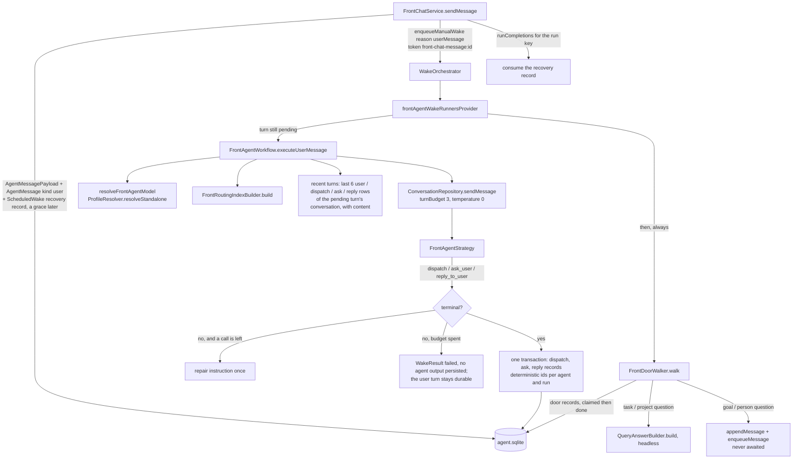
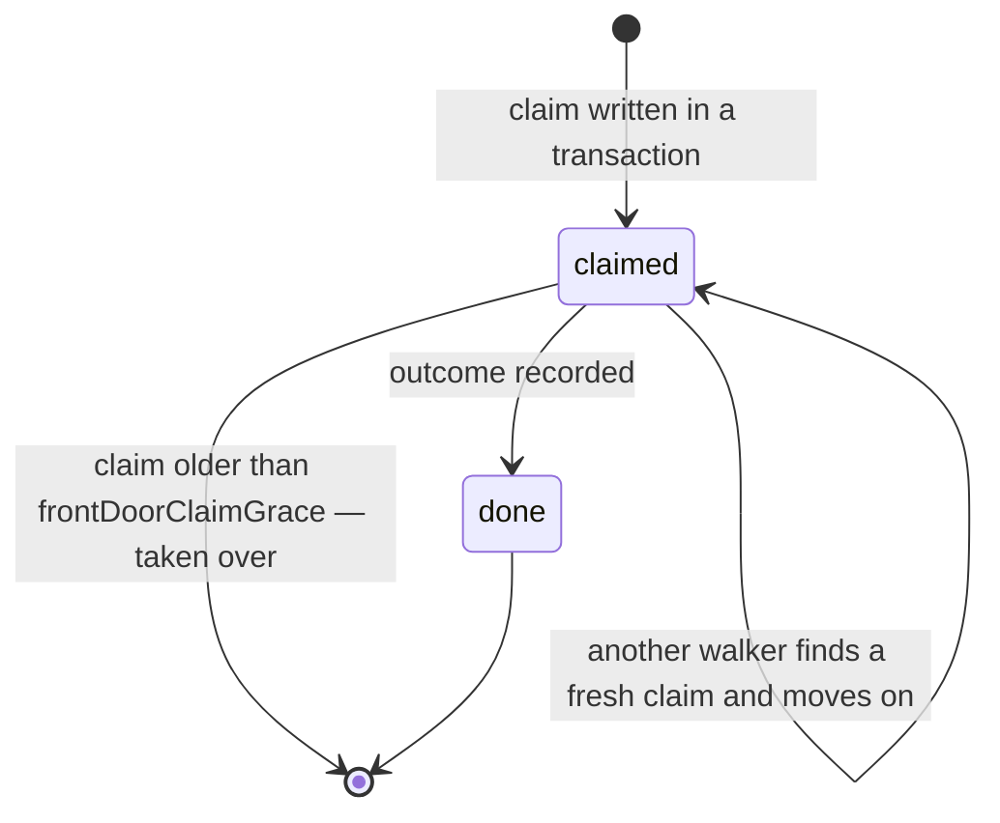
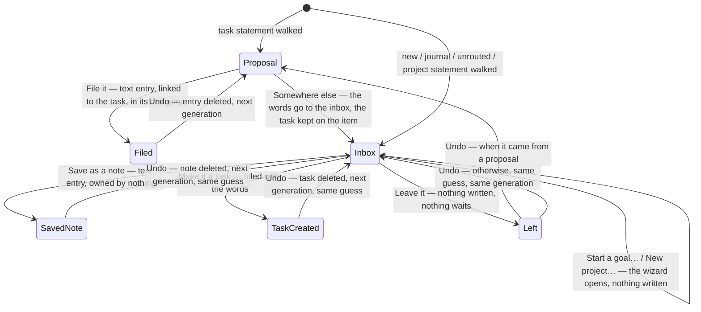
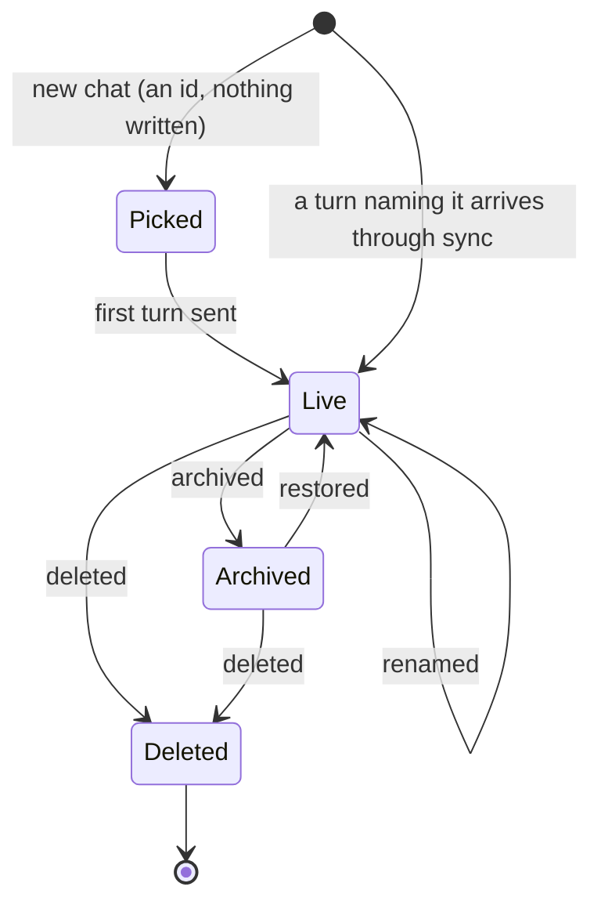
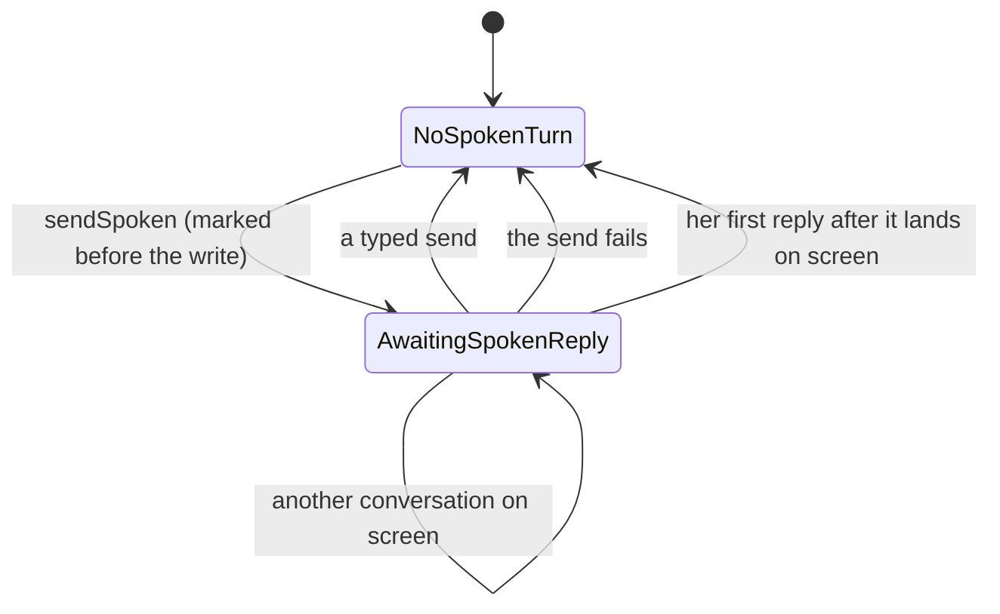

# What it is

The front agent is the one agent the user talks to in one place. It owns no
record and answers for no owner: it reads a bounded index of what exists and
decides where each part of what the user said belongs. A question about the
user's records that no single owner holds is hers to answer, from the journal
(ADR 0153). Its one artifact is a **dispatch**. After the dispatch, the **door walker** takes each segment to
its owner and the **chat surface** shows what came back, under the owner's
name. A statement is never filed by the agent: it becomes a **proposal**
under the user's turn, and only the user's tap writes — the user's own
words, verbatim (decision 1). What nothing owns waits in the **inbox**,
which is every **conversation** filtered (ADR 0154). The product decisions
behind it are in the plans, not here.

# One turn

**The turn path is the goal-chat pattern, with recovery.**
`FrontChatService.sendMessage` is `appendMessage` then `retryMessage`.
`appendMessage` persists the payload and a `user` message whose `threadId`
is its own id, notifies the UI (`notifyUiOnly`, never `notify`, which would
re-wake the agent), and arms a lease-elected `ScheduledWakeEntity` under
`frontChatRecoveryRecordId` for `frontChatRecoveryGrace` (30 min) later —
the ADR 0069 record, whose workspace `front-chat:<id>` the lease predicate in
`agent_providers.dart` recognises. A recovery record that fails to write
does not cost the turn. `retryMessage` then `enqueueManualWake(reason:
userMessage, supersede: false)` with the token `front-chat-message:<id>`,
awaits `runCompletions` for that run key, and **consumes the record only
after the run — routing and doors — completed**. A runtime that shuts down
first ends the completion stream, which the service turns into a
`FrontChatTurnException` so a composer never waits forever; the record stays
pending. An append whose transaction committed but whose outbox flush failed
is reconciled by re-reading the deterministic id, not retried into a
duplicate.

**The wake runner routes a still-unrouted turn, then always walks.** Only a
chat token enters the model; any other token — creation, a subscription —
returns a successful no-op. `FrontChatHistoryService` keeps two sets apart:
the **unrouted** turns (no `dispatch`, `ask_user` or `reply_to_user` row
names them) are what the runner takes through the model, so a recovery wake
arriving after the author's own run routes nothing; the **pending** turns —
the unrouted ones plus any routed turn whose newest dispatch still has a
segment without a `done` door — are what maintenance re-arms. The scheduled
wake manager consumes a recovery record when it *enqueues* the wake, before
the doors finish, so a walk that died after the dispatch was written stays
eligible for the next pass, which walks the doors without routing again;
the claims below make that idempotent. A failed routing walks nothing:
there is no dispatch to walk and the record stays pending.

**Recovery runs on every device.** `FrontRuntimeMaintenance` implements all
three runtime hooks and calls `restoreOldestPendingMessage`: a pending turn
with no record (or a tombstone) gets one carrying the tombstone's clock; a
consumed record that did not answer is re-armed for when its lease lapses,
else a grace past its deadline; a pending record is left alone. Failures are
contained and logged under `FrontRuntimeMaintenance`.

# The routing index

`FrontRoutingIndexBuilder.build` reads, with no model call and no raw entry:

| Kind | Rows | Source | What the row's `id` is |
|------|------|--------|------------------------|
| tasks | ≤200, the corpus order | `readOpenTaskCorpus` (shared with the day agent) + `getLatestTaskReportsForTaskIds` | the task's journal id |
| projects | ≤50, newest first | `getVisibleProjects` + the primary `agent_project` link's report | the project's journal id |
| goals | ≤50, newest first | active `goal_agent` identities, the spec head's version for the statement, the agent's report | **the goal agent's id** |
| people | ≤50, newest first, only when `FrontRoutingScope.includePeople` | `getRelationships` | the relationship entry's id; names only |

Tasks, projects and people are filtered through `FrontRoutingScope.categoryIds`
(the identity's `allowedCategoryIds`; empty is unrestricted, the
`categoryAllowed` convention). Goals carry no category and are listed
whenever `includeGoals`.

The rendered block is **byte-stable**: rows sorted by id within each kind,
one fixed format (`kind:id | title | status | due | one-liner`), a truncated
kind announced in its heading. That is what lets a provider's prefix cache
pay across turns. One-liners are rendered; TL;DRs are held on the row for
`read_tldr` and never rendered. At every cap the block is roughly 7.5k
tokens.

# The contract

Five tools, never fewer (a single tool makes DeepSeek rewrite
`tool_choice`), in a fixed order:

| Tool | Ends the turn | Cap | Over the cap |
|------|---------------|-----|--------------|
| `dispatch` | yes | once | refused |
| `read_tldr(ids ≤ 5)` | no | 1 per turn | `frontTldrExhaustedAnswer` — the tool stays listed |
| `match_to_corpus(phrase)` | no | 1 per turn | `frontCorpusMatchExhaustedAnswer`; unavailable when no FTS index is wired |
| `ask_user(question, options ≤ 3)` | yes | once | refused |
| `reply_to_user(text)` | yes | once | refused |

Lookups are capped by **count-and-refuse**, not by removing the tool:
removing it changes the request prefix and voids the cache. Rows a
`match_to_corpus` returns become valid destinations for the rest of the turn.

`ask_user` and `dispatch` refuse each other, and so do `ask_user` and
`reply_to_user`. A reply may accompany an accepted dispatch; when a batch
rejects a dispatch and accepts neither a dispatch nor a question, a reply
in that batch is dropped, so the turn stays open for the repair round
instead of ending on a sentence about a routing that never happened.

## What `validateFrontDispatch` enforces

In code, not prompt: at most `frontMaxSegments` (8) segments; spans by offset,
**ordered and non-overlapping**, with `text` equal to the input slice, so a
repeated or overlapping phrase can never stand in for words the model
skipped; a `task` / `project` / `goal` / `person` destination needs an id
the index or a lookup listed, at confidence ≥ `frontLowConfidence` (0.5);
`new` needs a `newKind`; `day`, `journal` and `unrouted` need neither. The
spans and the gaps between them partition the input and the gaps are never
dropped: a gap holding ≥20 % of the input's non-whitespace characters
becomes an `unrouted` segment, and when the gaps together hold ≥20 % every
gap containing a word becomes one. The thresholds are the day agent's
(`≥0.75` strong, `0.5–0.75` low, `<0.5` none).

Her **manner** follows the contract in the system prompt:
`frontAgentPersonality(sass)` — warm, cheeky or sassy, the companion's
`CompanionSass` read at each wake through the workflow's `sass` getter —
shapes only her own words (`reply_to_user`, `ask_user`), never routing, ids
or an owner's answer, and asks for short spoken-friendly sentences. Appended
after the contract, so a sass change leaves the cached prefix as it is.
# The budget and the repair round

`frontProviderCallsPerTurn` is 3, passed as `turnBudget`. The common turn is
one completion. A turn that ends without a terminal call gets
`frontDispatchRepairInstruction` once, with whatever is left of the three.
A turn still without a terminal call after that **fails closed**: the wake
returns a failed `WakeResult` and persists **no agent output** — no
dispatch, no question, no invented reply. What `FrontChatService` wrote
before the wake — the user payload and the user message — stays durable,
which is what makes the turn retryable rather than lost.

# What a turn leaves behind

Everything the model read back is written in one transaction under
deterministic ids per agent and run (`frontAgentDispatchMessageId`,
`frontAgentAskMessageId`, `frontAgentReplyMessageId`), each an
`AgentMessageEntity` of kind `action` whose `operationId` is the source
message id and whose payload holds the content — the dispatch record also
holds the `input` the spans index into. The dispatch record is the audit
trail of the routing decision. A transaction that committed and then failed
its deferred outbox flush is recognised by re-reading every carrier the turn
produced (`_outputsCommitted`), so a turn the user already received is not
re-run into a duplicate.

The strategy's own tool-call log (`AgentMessageRecording`) writes `action`
rows with the same tool names but no `operationId`; that is what keeps them
out of the recent-turns tail, which renders only the persisted records —
with their content: the user's words, the reply's text, a question with its
option labels, a dispatch as its destinations.

# The doors

`FrontDoorWalker.walk(messageId)` finds the newest dispatch keyed to the
turn and takes every segment through a door, one record per segment under
`frontDoorRecordId(dispatchId, index)` — an `action` row with tool name
`front_door`, the dispatch's run key and the turn's `operationId`, its
payload a `FrontDoorRecord`.

A claim is a lease: a second walker — a retry, a recovery wake, another
device — skips a segment that is `done` or freshly `claimed`, and takes over
one whose claim is older than `frontDoorClaimGrace` (30 min), because that
walker died. Outcomes:

| Segment | Door | Outcome |
|---------|------|---------|
| `task` / `project` question with an active agent | the owner's query pipeline, headless: `QueryAnswerBuilder.build` over an in-memory `QueryChatHistory` whose one event is the segment, chat id the source message id | `FrontDoorAnswer(text, summaryBased, incomplete, ownerIds)` — the answer is the record's, attributed to the owner, never reworded |
| `goal` / `person`, question or statement, with an active agent | that agent's own chat: `appendMessage` then `enqueueMessage`, **never awaited** | `FrontDoorChatTurn(specialistAgentId, specialistMessageId)`; the reply lands in the specialist's thread with the turn as its `operationId` |
| `task` statement or instruction | none — the walker writes nothing | `FrontDoorProposal(ownerId)`: waits for the user's tap |
| `project` statement | none (decision 5: no project door) | `FrontDoorInbox()` |
| `journal` question | the journal answer engine, headless: `QueryAnswerBuilder.build` over `QueryScope.journalIn(her allowedCategoryIds)` (empty = every visible category), agent id `front_agent`, the Settings default profile | `FrontDoorAnswer(fromJournal: true, evidence, dependencies, private)` — her own answer, with the passages it cites |
| `new`, `journal` statement, `unrouted` | none | `FrontDoorInbox(newKind?)` — what the router thought it would become leads the chips |
| `day` | none yet (slice 4) | `FrontDoorSkipped(noDoor)` |
| no agent, or a retired one | — | `FrontDoorSkipped(noAgent)` |
| owner without a usable inference setup | — | `FrontDoorSkipped(inferenceUnavailable)` |
| a door that throws | — | `FrontDoorFailed(errorType)` — the type, never the text |

**Her journal answers.** A `journal` question runs the query pipeline over
the journal scope (see
[scoped query conversations](agents/query-chat.md#journal-wide-questions)):
the plan step names one to three searches, each run by meaning beside the
keyword terms, and may name categories the question limits itself to — only
names within her allow-list are offered, so a named category narrows
(one she cannot see narrows to nothing) and
never widens. The door record keeps the answer's evidence and dependencies.
`frontJournalAccessProvider` rereads their visibility whenever an entry, a
category, a config flag or lockdown changes, and `FrontDoorCard` shows the
answer — attributed "From your journal", with its numbered sources that open
on a tap — only while every dependency is still visible, and hides it until
that is known.

The walker never awaits a specialist's wake: the goal and person chat
services' `sendMessage` awaits its own completion and at concurrency 1 that
would deadlock inside the front wake, so the walker uses their
`appendMessage` / `enqueueMessage` split and the reply arrives later.

# The tap: filing and the inbox

`FrontFilingService` is the one place the front agent's surface changes the
record, and every action is the user's tap under a door. Each action reads
the door's payload, requires the outcome it applies to (else
`FrontDoorStateException` — the door was acted on elsewhere, or twice), and
rewrites the record **under the same ids** with the new outcome, so the
dispatch keeps its pointer to what was written and the inbox count follows
from the records alone. The sync service pings nobody, so the service pings
the front agent itself (`notifyUiOnly`), which re-projects the thread.

The entry a tap writes goes through the persistence logic — a text entry
with the task's `categoryId` and `linkedId`, a task through
`createTaskEntry` — so a filed entry wakes the task agent through its
subscription exactly as dictation into the task does, and a made task is a
task like any other. **Every write is idempotent per door**: the entry or
task is created under a deterministic id (`frontDoorEntryId`,
`frontDoorNoteId`, `frontDoorTaskId` — a UUID v5 of the door id and the
door's *generation*, how often it was written and taken back; generation
zero keeps the ids from before generations were counted), and the adapters
in `front_agent_providers.dart` read the write's own verdict: a rejected
write (`createDbEntity` never overwrites an existing id) is the retry after
an interrupted tap and files the row already there, while a failed write,
or a rejected one with no live row behind it, stores nothing and leaves the
door waiting. Under a task the entry counts only once its link is live —
the task agent reads its entries through the link — so the writer checks
`JournalDb.linksBetween` after the write, writes a missing link once more,
and stores nothing when it is still missing. **Take back** (`takeBack`) deletes what the door wrote — the
filed entry, the note or the task — through
`JournalRepository.deleteJournalEntity`, refuses when the thing is still
there undeleted, counts one already gone from the journal as taken back,
and puts the door back where it waited, one generation on: a filed entry's
door is a proposal again, a note's or a task's an inbox item again leading
with the same chip (the receipt kept the inbox item's `newKind`), so a
re-file or a re-save gets a fresh row rather than the soft-deleted one.
**Somewhere else** and **Leave it** are one action (`decline`): a proposal's
words go to the inbox, the task they were proposed under kept on the item
(`FrontDoorInbox.ownerId`, which turns its line into *Where should this go
instead?*), so a wrong guess costs one more tap, not a retype; an inbox
item left where it is settles (`FrontDoorDeclined`, which keeps the
proposal's owner and generation or the item's guess), nothing written and
nothing waiting. **Undo** (`undoDecline`) makes a left door what it was —
the proposal, when it came from one, else the inbox item; a refusal from
before that was kept falls back on a task door's destination — with
nothing written in between.
The goal and project wizards take no prefill today: their chips open them
as they are, the words stay in the thread, and the door keeps waiting
until a chip that writes takes it.

A turn with a door still waiting on the user never leaves the projection:
`FrontChatThreadBuilder` keeps it beside the newest fifty messages of its
conversation however old it is, so the inbox cannot scroll out of existence — and keeps the
message right after it too, her reply that carries its doors (or the next
user turn, which says no reply followed), so the doors never ride an
unrelated reply the window happens to show next.

The **inbox** is no entity: `FrontChatThread.inboxMessageIds` is every user
turn with a door whose outcome is a `FrontDoorProposal` or a
`FrontDoorInbox` (`frontDoorAwaitsUser`), `inboxCount` the doors, and
`frontInboxFilterProvider` the switch the list's *Inbox* row turns on — an
auto-disposed notifier, so the filter is off every time the sheet opens, and
Back (or Escape) leaves it before closing the sheet. While something waits,
a warning-tone badge counts it right after the word on the header's *Chats*
button (a tap on either opens the list) and the *Inbox* row counts it with a
badge of the same tone.
The count and the filtered view come from `frontAllChatsThreadProvider`,
the thread of every conversation not deleted, so what waits in one
conversation is not lost by opening another.

# Conversations

A **conversation** is the user turns whose payload names it
(`frontConversationKey`, read by `frontConversationOf`); everything a run
wrote for a turn — her reply, her question, the doors — belongs to the
turn's conversation through the `operationId` it carries. There is no
creation record: a conversation exists once it holds a turn. Turns written
before conversations name none and form one fixed conversation,
`earlierConversationId` (`front-chat:earlier`), which every device derives
alike, so nothing was migrated (ADR 0154).

`FrontConversationService.load` folds the index: the user turns, grouped by
conversation, give each its title (the first line of its first question)
and its last activity; query chat's synced `renamed`, `archived` and
`deleted` events, written under the front agent's id with the conversation
as the chat, give the rest. A conversation has no `created` event, so query
chat's projection never lists one, and the headless journal questions the
door walker writes there (chat id = the turn's message id, no lifecycle
event) are never taken for a conversation. A deleted conversation leaves
the index (`deletedIds`) and its turns leave every view, the inbox
included; its messages are not erased.

Which one shows: `frontPickedConversationProvider` holds the one the user
picked (keep-alive, like the composer), `frontActiveConversationProvider`
resolves it — the picked one while it was picked today, else the newest not
archived while it moved today (`FrontConversationIndex.latest`), else an id
minted once per session (`frontFreshConversationIdProvider`), so opening the
sheet on a new day starts a new subject — and a send lands in the active one
and pins it, so a conversation arriving from another device does not take
the surface out from under the reply. Archiving or deleting the open one
moves to a fresh conversation, its draft parked so an undo finds it; each
conversation keeps its own draft, and talking in an archived one restores
it. The routing prompt's recent turns come from the
pending turn's conversation only (`FrontAgentWorkflow._recentTurns`): another
conversation is another subject.

The header's *Chats* button — the word as well as the glyph, with a new
conversation beside it — opens the list (`frontConversationListOpenProvider`),
a page over the conversation with its own back, *Chats* and close.
`FrontConversationList` leads with *New chat*, *Inbox* while something waits,
and *Search chats*, which opens in place; then the history grouped by
recency — *Today*, *Yesterday*, *Previous 7 days*, *Older* — flat: each
group's day a caption in the accent, snug over its dense rows, no card and no
hairlines. The accent splits the days while the rows stay neutral, so the open
row's rounded fill is still the one strong surface in the list.
A row is the title on the full width (two lines before it is cut) over one
line of her last answer (`FrontConversation.preview`, the first line of her
latest `reply_to_user` or `ask_user` in it, read by
`FrontConversationService`), fading out before the time it last moved (the
clock today and yesterday, the weekday within a week, else the date). The
times share one column as wide as the list's widest, in tabular figures, so
every preview ends on the same line. On the open row's fill the second line
is as bright as the title. A row's rename, archive and delete (its ⋯ in the
time's place) show on hover and focus, at rest on the open row too unless
the list sits beside the conversation (`FrontConversationList.beside`), whose
header carries the same menu; a long press offers them on any row. Archived
ones fold away at the end; a search looks through them too.

# The chat surface

`FrontChatThreadBuilder.build` projects the front thread for the shared
`AgentChatView`: user turns, `reply_to_user` rows and `ask_user` rows (shown
as her turn, with the options parsed from the record) are the messages,
newest fifty of one conversation (`build(conversationId:)`), or of every
conversation but the deleted (`build(excluded:)`); a dispatch is never shown — its door records hang off the user
turn they answer, in segment order, and for a `FrontDoorChatTurn` the
specialist's reply is read from that agent's thread by the recorded message
id. `frontChatThreadProvider` is the active conversation, or every
conversation while the inbox filter is on, and reloads on the front agent's
update pings,
whenever a specialist a door handed a turn to finishes a wake here
(`runCompletions`, by agent id — the sync service pings nobody), and on
each such specialist's own update pings, which is how a reply written on
another device arrives through sync.
`FrontChatController` sends through the chat service (creating the identity
on first use) and invalidates the thread when the awaited turn completes; a
failed turn keeps its durable id so the retry re-wakes the same turn.

`FrontChatPane` is the thread on `AgentChatView` with day dividers
(`dividerBuilder`), the door cards under a routed turn, the option chips
under her **latest** question only (an older question's chips would answer
a question nobody is asking), and a per-turn cost that tails her bubble's
footer line — `Companion · 8:30 AM · 9.8K tokens`, one meta row — through
the chat view's `footerTrailingBuilder`, read by the reply row's run key
(`agentRunConsumptionTotalsProvider`, consumption schema v5's
`idx_consumption_agent_run`). A send clears the inbox filter: the new turn
lands in its conversation, shown whole.

A turn is the user's bubble, her reply, and under her reply the **door
cards** (`FrontDoorCard`) — her answer, part by part. The doors are keyed
by the user turn in the thread but *carried* by her reply right after it
(`FrontChatThread.carrierOf` / `doorsCarriedBy`), so the cards sit under
her bubble; until she has replied, or when no reply followed, they sit
under the user's. One card per segment on one surface, hairlines between,
and every card the same shape: a compact tinted tile with the kind's glyph
(task, goal, project, person, day, inbox; the done glyph in the success
ink once something was written, the warning in the error ink when the
door failed), the user's words in full in body type — or, for an answer,
the owner's text — one status caption (the proposal's question naming the
task, *Where should this go?* or *… go instead?* after a proposal was sent
there, *Filed under …*, *Made into a task*, an answer's attribution and
caveats, a door still being walked, a reason it went nowhere), at most one
filled action, and an overflow menu (`DesignSystemContextMenuButton`)
holding every other way out. The filled action is always a tap that
writes — *File it*, *Make it a task* — or, on a settled card, a secondary
*Open*; the overflow holds *Somewhere else* on a proposal, *Start a goal…*
/ *New project…* (the ellipsis says a wizard opens), *Save as a note* and
*Leave it* on an inbox item with the router's guess first, and *Undo* on
anything settled. A busy card's action shows it loading; a failed one's
status says so in the error ink and the tap reads *Try again*
(`FrontChatComposerState.busyDoorIds` / `failedDoorIds`). *Open* leaves
the sheet for the entry's or the task's page. The inbox filter keeps a
waiting turn's words and the reply that carries its cards together.

She leads the conversation (`FrontChatHero`): her bust at hero size — the
spark when `enable_companion` is off — and under it the conversation's title,
scrolling in above the first message as `AgentChatView`'s `leading`, and
opening an empty conversation with her invitation. Once the thread
(`AgentChatView.onThreadScrolled`) is past her bust, `frontHeroScrolledProvider`
puts her and the title in a line in the header's control row — reset when
another conversation opens or the list opens or closes, so a thread that
comes back at its top has her there. Otherwise the control row holds only
the *Chats* button and a new conversation on the left, an overflow (her
internals, where the thread's cost is accounted, then this conversation's
rename, archive and delete) and close on the right. The thread is `conversational` and `voiceFirst` (see
[chat input](agents/chat-input-and-reasoning.md)): her replies as prose with
their cost as a quiet line under them, one talk disc, and what she was told
by voice sent as said.
`showFrontChat` opens her surface over the app, as History opens: a dialog
behind the shared scrim, the whole screen below the page breakpoint, else a
panel up to `kDetailContentMaxWidth` inset by `step6`. On a desktop-width
window (`isDesktopLayout`) the list sits beside the conversation, 38% of
the panel (`FrontChatSurface.listShare`), and the header leaves out the way
to the list and a new conversation, which the list carries. Escape goes
through `ModalEscapeScope` to the pane's back chain — the list, then the
inbox — before it closes her. It opens from the desktop rail's utility row
above Settings, the phone launcher's utility button beside the menu, or the
`openFrontChat` keyboard command (Cmd/Ctrl+L), all gated by
`enable_front_agent` and all closed under lockdown: her thread spans every
category.

**Category chips** (`FrontCategoryChips`) sit at the top of a
conversation's composer (`AgentChatView.composerHeader`) — not in the inbox —
after an *Answers from* label that stays put while they scroll, when there
are two categories or more to choose from. *All* leads and clears the
choice; every chip is outlined and neutral, and a chosen one (*All* by
default) takes the neutral pressed fill and a check
(`DesignSystemChip.quietSelection`), never the accent the talk disc
carries. The options are the active categories she may see
(`frontCategoryOptionsProvider`: her allow-list, or every visible category
when it is empty; `categoriesStreamProvider` is lockdown-scoped). The choice
is kept per conversation for the session
(`frontConversationCategoriesProvider`) and travels with each turn: the
controller passes it to `sendMessage`, which writes it sorted under
`categoryIds` (`frontCategoriesKey`) in the turn's payload. The journal door
reads it back from the source turn and narrows her allow-list by it, never
widening it: with no allow-list the chips are the scope, and chips that fall
outside the allow-list leave it as it is — an empty scope would be the whole
journal. A category named in the question narrows further, as before.

Leaving a conversation — another one, or the list — while it records or
transcribes cancels the recording (`ChatRecorderController.cancel`), so what
was said never lands in a conversation it was not said to; a recording
already running when the pane first resolves its conversation is kept.

# Her voice

A question the user **spoke** is answered aloud; a typed one only in
writing (the voice-first plan's decision 3). `AgentChatView` hands a
transcript it sends by itself to `onSendSpoken`, which the pane wires to
`FrontChatController.sendSpoken`; that marks `frontSpokenTurnProvider` with
the landing conversation and the moment, *before* the turn is written, since
her reply can land before the send returns. A typed send, or a send that
fails, clears it.

`FrontVoice.listenForSpokenReply`, called from the pane's build, watches the
thread: when her first message after the spoken turn is on screen in that
conversation it settles the turn and — with `enable_companion` and
`enable_ai_summary_tts` on and a voice available (her profile's cloud voice
in the app's language, else the on-device engine) — speaks it under
`front-chat:<conversation>` (`frontVoiceSourceId`), stopping whatever else
was speaking first. It keeps those flags and her resolved setup watched, so
they are known the moment the reply lands. A voice that fails surfaces the
shared playback toast.

She speaks only while her customization lets her
(`CompanionCustomization.speaksReplies`, Settings › Preferences ›
Companion › Her voice, synced): muted, a spoken question is answered in
writing like a typed one.

Her bust is a `CompanionSpeaker` on that source, so her lips follow only her
own words in the conversation on screen. She holds `listen` while the user
records and `think` while a send is in flight or a spoken answer is owed
(`FrontVoice.holdingOf`); a tap on her while she speaks stops her
(`FrontChatHeroKeys.stop`). Starting to record stops any voice before the
microphone opens (`ChatRecorderController.start`), so she never records
herself.

# Where it plugs in

`frontAgentWakeRunnersProvider` and `resolveFrontAgentSetup` are merged in
`app_bootstrap.dart` into `agentWakeRunnersProvider` and
`agentResolvedSetupResolversProvider` (see [the agents overview](agents/overview.md)),
pinned by `test/app_bootstrap_test.dart`. Model resolution is the agent's
own: explicit setup, then its profile, then the Settings default, then the
built-in cheap model (DeepSeek V4.1 Flash on Melious, else on Mistral —
`frontAgentBuiltInModelIds`) — never a category's, because the front agent spans
categories. The full-text index reaches the builder through
`fts5DbProvider`, overridden from the composition root, null on a host
without one.

# Gotchas

- **Never await a specialist from inside the front wake.** The goal and
  person chat services' `sendMessage` awaits their own wake's completion; at
  concurrency 1 that would deadlock. The walker runs inside the front wake
  but only appends and enqueues; the reply is mirrored when it lands.
- A door record is written twice under one id — the claim, then the
  outcome — and again on every tap. Anything counting rows per door must
  count by id.
- A proposal is still a *pending* turn for recovery purposes only until its
  door record is `done`; the walker marks it done with the proposal as its
  outcome, so waiting for the user's tap never re-arms a recovery wake.
- Her per-turn cost is the routing calls of her wake only. The owners'
  answers cost on the owners' agents, where their internals show them.
- The index must stay byte-stable: do not add a field that changes between
  wakes without the record changing.
- `match_to_corpus` returns open tasks only; a closed task is not a
  destination, and the prompt says so.
