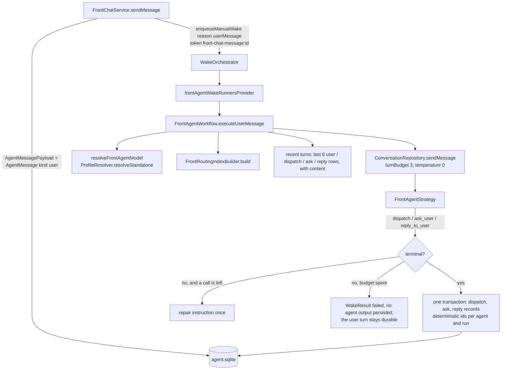

# What it is

The front agent is the one agent the user talks to in one place. It owns no
record and answers for nobody: it reads a bounded index of what exists and
decides where each part of what the user said belongs. Its one artifact is a
**dispatch**. Slice 0 (this concept) stops there — no UI, no flag, and no
door is walked yet; the plan's later slices add the chat surface and the
walker. The product decisions behind it are in the plan, not here.

# One turn

**The turn path is the goal-chat pattern.** `FrontChatService.sendMessage`
persists the payload and a `user` message whose `threadId` is its own id,
notifies the UI (`notifyUiOnly`, never `notify`, which would re-wake the
agent), then `enqueueManualWake(reason: userMessage, supersede: false)` with
the token `front-chat-message:<id>` and awaits `runCompletions` for that run
key. A runtime that shuts down first ends the completion stream, which the
service turns into a `FrontChatTurnException` so a composer never waits
forever. An append whose transaction committed but whose outbox flush failed
is reconciled by re-reading the deterministic id, not retried into a
duplicate.

**The wake runner routes only a chat token.** Any other token — creation, a
subscription — returns a successful no-op: the front agent has no scheduled
or subscription wakes.

# The routing index

`FrontRoutingIndexBuilder.build` reads, with no model call and no raw entry:

| Kind | Rows | Source | What the row's `id` is |
|------|------|--------|------------------------|
| tasks | ≤200, the corpus order | `readOpenTaskCorpus` (shared with the day agent) + `getLatestTaskReportsForTaskIds` | the task's journal id |
| projects | ≤50, newest first | `getVisibleProjects` + the primary `agent_project` link's report | the project's journal id |
| goals | ≤50, newest first | active `goal_agent` identities, the spec head's version for the statement, the agent's report | **the goal agent's id** |
| people | ≤50, newest first, only when `FrontRoutingScope.includePeople` | `getRelationships` | the relationship entry's id; names only |

Tasks, projects and people are filtered through `FrontRoutingScope.categoryIds`
(the identity's `allowedCategoryIds`; empty is unrestricted, the
`categoryAllowed` convention). Goals carry no category and are listed
whenever `includeGoals`.

The rendered block is **byte-stable**: rows sorted by id within each kind,
one fixed format (`kind:id | title | status | due | one-liner`), a truncated
kind announced in its heading. That is what lets a provider's prefix cache
pay across turns. One-liners are rendered; TL;DRs are held on the row for
`read_tldr` and never rendered. At every cap the block is roughly 7.5k
tokens.

# The contract

Five tools, never fewer (a single tool makes DeepSeek rewrite
`tool_choice`), in a fixed order:

| Tool | Ends the turn | Cap | Over the cap |
|------|---------------|-----|--------------|
| `dispatch` | yes | once | refused |
| `read_tldr(ids ≤ 5)` | no | 1 per turn | `frontTldrExhaustedAnswer` — the tool stays listed |
| `match_to_corpus(phrase)` | no | 1 per turn | `frontCorpusMatchExhaustedAnswer`; unavailable when no FTS index is wired |
| `ask_user(question, options ≤ 3)` | yes | once | refused |
| `reply_to_user(text)` | yes | once | refused |

Lookups are capped by **count-and-refuse**, not by removing the tool:
removing it changes the request prefix and voids the cache. Rows a
`match_to_corpus` returns become valid destinations for the rest of the turn.

`ask_user` and `dispatch` refuse each other, and so do `ask_user` and
`reply_to_user`. A reply may accompany an accepted dispatch; when a batch
rejects a dispatch and accepts neither a dispatch nor a question, a reply
in that batch is dropped, so the turn stays open for the repair round
instead of ending on a sentence about a routing that never happened.

## What `validateFrontDispatch` enforces

In code, not prompt: at most `frontMaxSegments` (8) segments; spans by offset,
**ordered and non-overlapping**, with `text` equal to the input slice, so a
repeated or overlapping phrase can never stand in for words the model
skipped; a `task` / `project` / `goal` / `person` destination needs an id
the index or a lookup listed, at confidence ≥ `frontLowConfidence` (0.5);
`new` needs a `newKind`; `day`, `journal` and `unrouted` need neither. The
spans and the gaps between them partition the input and the gaps are never
dropped: a gap holding ≥20 % of the input's non-whitespace characters
becomes an `unrouted` segment, and when the gaps together hold ≥20 % every
gap containing a word becomes one. The thresholds are the day agent's
(`≥0.75` strong, `0.5–0.75` low, `<0.5` none).

# The budget and the repair round

`frontProviderCallsPerTurn` is 3, passed as `turnBudget`. The common turn is
one completion. A turn that ends without a terminal call gets
`frontDispatchRepairInstruction` once, with whatever is left of the three.
A turn still without a terminal call after that **fails closed**: the wake
returns a failed `WakeResult` and persists **no agent output** — no
dispatch, no question, no invented reply. What `FrontChatService` wrote
before the wake — the user payload and the user message — stays durable,
which is what makes the turn retryable rather than lost.

# What a turn leaves behind

Everything the model read back is written in one transaction under
deterministic ids per agent and run (`frontAgentDispatchMessageId`,
`frontAgentAskMessageId`, `frontAgentReplyMessageId`), each an
`AgentMessageEntity` of kind `action` whose `operationId` is the source
message id and whose payload holds the content — the dispatch record also
holds the `input` the spans index into. The dispatch record is the audit
trail of the routing decision. A transaction that committed and then failed
its deferred outbox flush is recognised by re-reading every carrier the turn
produced (`_outputsCommitted`), so a turn the user already received is not
re-run into a duplicate.

The strategy's own tool-call log (`AgentMessageRecording`) writes `action`
rows with the same tool names but no `operationId`; that is what keeps them
out of the recent-turns tail, which renders only the persisted records —
with their content: the user's words, the reply's text, a question with its
option labels, a dispatch as its destinations.

# Where it plugs in

`frontAgentWakeRunnersProvider` and `resolveFrontAgentSetup` are merged in
`app_bootstrap.dart` into `agentWakeRunnersProvider` and
`agentResolvedSetupResolversProvider` (see [the agents overview](agents/overview.md)),
pinned by `test/app_bootstrap_test.dart`. Model resolution is the agent's
own: explicit setup, then its profile, then the Settings default, then the
built-in cheap model — never a category's, because the front agent spans
categories. The full-text index reaches the builder through
`fts5DbProvider`, overridden from the composition root, null on a host
without one.

# Gotchas

- **Never wake a specialist from inside the front wake.** The goal and
  person chat services await their own wake's completion; at concurrency 1
  that would deadlock. Doors are walked by the service after
  `runCompletions`, in slice 1.
- The index must stay byte-stable: do not add a field that changes between
  wakes without the record changing.
- `match_to_corpus` returns open tasks only; a closed task is not a
  destination, and the prompt says so.
