# What it is

The front agent is the one agent the user talks to in one place. It owns no
record and answers for no owner: it reads a bounded index of what exists and
decides where each part of what the user said belongs. A question about the
user's records that no single owner holds is hers to answer, from the journal
(ADR 0153). Its one artifact is a **dispatch**. After the dispatch, the **door walker** takes each segment to
its owner and the **chat surface** shows what came back, under the owner's
name. A statement is never filed by the agent: it becomes a **proposal**
under the user's turn, and only the user's tap writes — the user's own
words, verbatim (decision 1). What nothing owns waits in the **inbox**,
which is every **conversation** filtered (ADR 0154). The product decisions
behind it are in the plans, not here.

# One turn

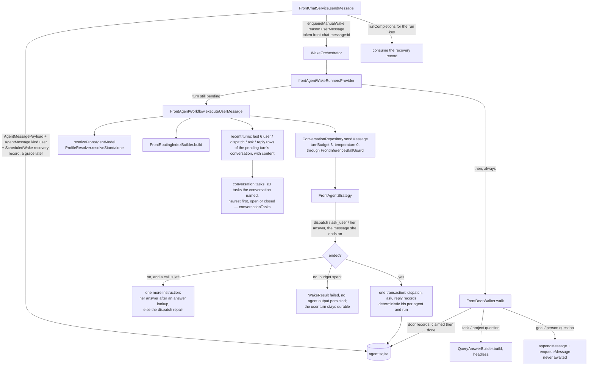

**The turn path is the goal-chat pattern, with recovery.**
`FrontChatService.sendMessage` is `appendMessage` then `retryMessage`.
`appendMessage` persists the payload and a `user` message whose `threadId`
is its own id, notifies the UI (`notifyUiOnly`, never `notify`, which would
re-wake the agent), and arms a lease-elected `ScheduledWakeEntity` under
`frontChatRecoveryRecordId` for `frontChatRecoveryGrace` (30 min) later —
the ADR 0069 record, whose workspace `front-chat:<id>` the lease predicate in
`agent_providers.dart` recognises. A recovery record that fails to write
does not cost the turn. `retryMessage` then `enqueueManualWake(reason:
userMessage, supersede: false)` with the token `front-chat-message:<id>`,
awaits `runCompletions` for that run key, and **consumes the record only
after the run — routing and doors — completed**. A runtime that shuts down
first ends the completion stream, which the service turns into a
`FrontChatTurnException` so a composer never waits forever; the record stays
pending. An append whose transaction committed but whose outbox flush failed
is reconciled by re-reading the deterministic id, not retried into a
duplicate.

**The wake runner routes a still-unrouted turn, then always walks.** Only a
chat token enters the model; any other token — creation, a subscription —
returns a successful no-op. `FrontChatHistoryService` keeps two sets apart:
the **unrouted** turns (no `dispatch`, `ask_user` or `reply_to_user` row
names them) are what the runner takes through the model, so a recovery wake
arriving after the author's own run routes nothing; the **pending** turns —
the unrouted ones plus any routed turn whose newest dispatch still has a
segment without a `done` door — are what maintenance re-arms. The scheduled
wake manager consumes a recovery record when it *enqueues* the wake, before
the doors finish, so a walk that died after the dispatch was written stays
eligible for the next pass, which walks the doors without routing again;
the claims below make that idempotent. A failed routing walks nothing:
there is no dispatch to walk and the record stays pending.

**Recovery runs on every device.** `FrontRuntimeMaintenance` implements all
three runtime hooks and calls `restoreOldestPendingMessage`: a pending turn
with no record (or a tombstone) gets one carrying the tombstone's clock; a
consumed record that did not answer is re-armed for when its lease lapses,
else a grace past its deadline; a pending record is left alone. Failures are
contained and logged under `FrontRuntimeMaintenance`.

# The routing index

`FrontRoutingIndexBuilder.build` reads, with no model call and no raw entry:

| Kind | Rows | Source | What the row's `id` is |
|------|------|--------|------------------------|
| tasks | ≤200, the corpus order | `readOpenTaskCorpus` (shared with the day agent) + `getLatestTaskReportsForTaskIds` | the task's journal id |
| projects | ≤50, newest first | `getVisibleProjects` + the primary `agent_project` link's report | the project's journal id |
| goals | ≤50, newest first | active `goal_agent` identities, the spec head's version for the statement, the agent's report | **the goal agent's id** |
| people | ≤50, newest first, only when `FrontRoutingScope.includePeople` | `getRelationships` | the relationship entry's id; names only |

Tasks, projects and people are filtered through `FrontRoutingScope.categoryIds`:
the identity's `allowedCategoryIds` narrowed by any categories the turn's
payload carries — the conversation's category, picked in the composer (see
[the category scope](#the-category-scope)); `frontCategoriesOf` on the user
turn's payload, read in `executeUserMessage` — never widened — `frontNarrowedCategories`, the same
rule the journal door applies; empty is unrestricted, the `categoryAllowed`
convention. Goals carry no category and are listed whenever `includeGoals`.

The block opens with **`## Categories`**: every active category her
allow-list lets her see (`JournalDb.getAllCategories`, the privacy-gated read
the task queries share), `category:id | name`, by name, the ones the turn's
payload narrowed it to marked `chosen`. That is what a category the user *names* resolves
against; a category is never a destination.

The rendered block is **byte-stable**: rows sorted by id within each kind,
one fixed format (`kind:id | title | status | due | one-liner`), a truncated
kind announced in its heading. That is what lets a provider's prefix cache
pay across turns. One-liners are rendered; TL;DRs are held on the row for
`read_tldr` and never rendered. At every cap the block is roughly 7.5k
tokens.

**The tasks the conversation named** follow `<recent_turns>` as a
`<conversation_tasks>` block in the same row format plus each task's
`category:id` (`renderRow(withCategory: true)`), most recently named
first — what "that one", "it" or "the previous task" means, and which
category the conversation has been working in. The index rows leave the
category out: a few tokens on every row of every wake. It sits after
the turns, not inside the index, because it changes with every turn and the
index must not. `frontConversationTaskIds` scans the whole visible
conversation, newest message first, not just the six-turn tail and its
400-character clip: a `lotti://task/<id>` link in her reply, question or the
user's words, every task her reply's closed-task cards show (`closedTasks`,
the one closed last first, since her words no longer link them), a `task`
option she offered, a dispatch routed to a task or
naming the task a follow-up follows, and the door records — a segment filed
into a task, and a task the user's tap made (`FrontDoorTaskCreated`), which
no link names anywhere else. A mention dates from its message, a made task
from the tap (`FrontDoorTaskCreated.at`): the door record keeps the time it
was walked, and an old inbox item tapped now is the newest thing named. At
most `frontConversationTasksMax` (8), each once. `FrontRoutingIndexBuilder.conversationTasks` resolves them through
`getJournalEntitiesForIds` — so the privacy toggle holds — and drops a
deleted task, a non-task, one in a private category while private entries
are hidden (the logged-time reader's rule) and one outside the scope; a
**closed** task stays,
because a follow-up is most often to finished work. It is not a destination
for that: the strategy accepts a listed conversation task only as a
follow-up's `followsUpTaskId` and as an `ask_user` option.

**The pull requests the conversation showed** follow as
`<conversation_pull_requests>`, one line each (`FrontFoundPullRequest.render`:
`owner/repo#n | title | opened | merged | task:<id> (title) | one-liner`),
most recently shown first — what "that PR" or "who reviewed it" means.
`frontConversationPullRequests` reads them from the `PullRequestCards` of
her stored surfaces, at most `frontConversationPullRequestsMax` (5), each
once; the task each card names counts as a task the conversation named.
`FrontPullRequestFinding.pullRequestsOf` resolves them now, through
`conversationTasks` for the privacy and scope rules and the task's linked
entries for the pull request: one the task no longer holds is left out.

# The contract

Ten tools, never fewer (a single tool makes DeepSeek rewrite
`tool_choice`), in a fixed order:

| Tool | Ends the turn | Cap | Over the cap |
|------|---------------|-----|--------------|
| `dispatch` | yes | once | refused |
| `read_tldr(ids ≤ 5)` | no | 1 per turn | `frontTldrExhaustedAnswer` — the tool stays listed |
| `match_to_corpus(phrase)` | no | 1 per turn | `frontCorpusMatchExhaustedAnswer`; unavailable when no FTS index is wired |
| `list_due_tasks(which, daysAhead 0–7, categoryIds)` | no | 1 per turn | `frontDueListExhaustedAnswer`; unavailable when no lister is wired |
| `summarize_logged_time(period \| pastDays \| from+through, categoryIds?, tasks?, projectId?, taskId?)` | no | 1 per turn | `frontTimeSummaryExhaustedAnswer`; unavailable when no summarizer is wired |
| `list_closed_tasks(period \| pastDays \| from+through, categoryIds?)` | no | 1 per turn | `frontClosedListExhaustedAnswer`; unavailable when no lister is wired |
| `summarize_pull_requests(period \| pastDays \| from+through)` | no | 1 per turn | `frontPullRequestSummaryExhaustedAnswer`; unavailable when no summarizer is wired |
| `find_pull_requests(topic, period \| pastDays \| from+through)` | no | 1 per turn | `frontPullRequestFindExhaustedAnswer`; unavailable without a pull request repository |
| `read_pull_requests(ids ≤ 3)` | no | 1 per turn | `frontPullRequestReadExhaustedAnswer`; only keys `<conversation_pull_requests>` lists or this turn found |
| `ask_user(question, options ≤ 3)` | yes | once | refused |

Lookups are capped by **count-and-refuse**, not by removing the tool:
removing it changes the request prefix and voids the cache. Rows a
`match_to_corpus`, `list_due_tasks`, `summarize_logged_time` or
`list_closed_tasks` returns become valid destinations
for the rest of the turn — and names her words may link. So do the tasks
holding the pull requests `find_pull_requests` kept or
`read_pull_requests` read.

`ask_user` and `dispatch` refuse each other.

**Her answer is not a tool: it is the message she writes** (ADR 0164). After each
send the workflow hands the last assistant message to
`FrontAgentStrategy.acceptAnswer` (`frontTakeAnswer`), which takes it as
her answer when it has prose (see *Her reply is an A2UI surface*). A
question already asked, or an answer already taken, is never replaced. A
message beside tool calls is her line with an accepted dispatch and is
taken only then: beside a lookup, or a dispatch that was rejected, it is
left, so the turn stays open instead of ending on a sentence about a
routing that never happened. The stored row keeps the record name
`reply_to_user`, which is what the thread, the inbox and `<recent_turns>`
read.

## What `validateFrontDispatch` enforces

In code, not prompt: at most `frontMaxSegments` (8) segments; spans by offset,
**ordered and non-overlapping**, with `text` equal to the input slice, so a
repeated or overlapping phrase can never stand in for words the model
skipped. Offsets that miscount are not a failure when the words are right:
a segment whose `text` is found verbatim after the previous segment is
placed there, its first occurrence (a model copies words far better than it
counts characters — Mistral Large 4 put a 63-character message at
`[0, 54)`, then at `[0, 64)`, and every turn failed). Offsets that agree with
the words are kept, so a phrase said twice is the one the model meant; a `task` / `project` / `goal` / `person` destination needs an id
the index or a lookup listed, at confidence ≥ `frontLowConfidence` (0.5);
`new` needs a `newKind`, and a `new` task may carry a `task` object, read
leniently ([a task from her words](#a-task-from-her-words)); `day`,
`journal` and `unrouted` need neither. The
spans and the gaps between them partition the input and the gaps are never
dropped: a gap holding ≥20 % of the input's non-whitespace characters
becomes an `unrouted` segment, and when the gaps together hold ≥20 % every
gap containing a word becomes one. The thresholds are the day agent's
(`≥0.75` strong, `0.5–0.75` low, `<0.5` none).


Her **manner** follows the contract in the system prompt:
`frontAgentPersonality(sass)` — warm, cheeky or sassy, the companion's
`CompanionSass` read at each wake through the workflow's `sass` getter —
shapes only her own words (her answer, `ask_user`), never routing, ids
or an owner's answer, and asks for short spoken-friendly sentences.
`frontAgentSystemMessage` puts it last — after the contract and the
*Writing UI* section — so a sass change leaves the cached prefix as it is.
## Her own answers: what is due, logged time, what was closed, and naming things

A question about which tasks are due — *what is due today?*, *anything
overdue?*, *what's due this week?* — no single owner holds, so it is hers,
like a journal question; but she answers it from the record, not the
journal. The prompt's rule 8 sends it to `list_due_tasks` and then her
answer alone; rule 7 keeps `day` for changes to today's plan, so a
due question no longer lands on the day door, whose question outcome is
`FrontDoorSkipped(noDoor)`.

**Only what was asked comes back.** `which` names one `FrontDueWindow`, split
at local midnight as the task list's *Due today* and *Overdue* views split
it:

| `which` | Holds | Never |
|---------|-------|-------|
| `today` | due on today's local day | overdue |
| `overdue` | due on an earlier day | due today |
| `upcoming` | due from today through `daysAhead` days past it | overdue |
| `all` | both, only when both are asked for | — |

`FrontRoutingIndexBuilder.dueTaskLister` reads
`JournalDb.getTasksDueOnOrBefore` — the read the Daily OS and those views
share — and checks both ends of the window itself, inside the turn's scope
(her allow-list, narrowed by any categories the turn's payload carries), soonest due first, at most
`frontDueTaskLimit` (30). A category the user names (*overdue in Work*) is
passed as its id from `## Categories` in `categoryIds` and narrows it
further, never widens it: the strategy refuses an id the index does not
list, and — in a turn whose payload narrowed it — one outside that,
telling her to say it is outside. So naming a category is how the user
filters the list. `FrontDueTasks.render` is what the model
reads: the window and any named category in its heading, one row per task in
the index's shape plus its category's name, an overdue one marked only in
`all`, or a plain *None*.

**How much time was logged** — *how much did I log yesterday?*, *what did
I work on in the past seven days?*, *time in Work this week?* — is hers too.
Rule 9 sends it to
`summarize_logged_time` and then her answer alone; it is never
dispatched. Its window is exactly one of a `period`, `pastDays` (the past N
days ending today) or `from` and `through` (`YYYY-MM-DD`, both included),
read by the same `frontPullRequestQuery` as `list_closed_tasks` and
`summarize_pull_requests` but up to `frontLoggedTimeMaxDays` (366, so a
leap year fits) instead of a month. A window that runs backwards, names a
day the month lacks, is longer than that or is given twice is refused with
the forms it takes, and the model asks again; nothing falls back to a
default. "The past 14 days" is `pastDays: 14`; "June 1st to June 5th" is
`from`/`through`, a day without a year its latest one not after today. A
`period` is resolved in code against the local day the question was asked
on (`FrontTimePeriod.rangeOn`), never by the model:

| `period` | Local days |
|----------|------------|
| `today`, `yesterday` | that one day |
| `this_week` | the week's first day through today; weeks start on the device region's first weekday (`firstDayOfWeekIndexProvider`), as the Insights page starts them |
| `past_7_days`, `past_30_days` | the N days ending with today |
| `this_month` | the 1st through today |
| `last_month` | the previous calendar month, whole |

The prompt maps "last month" to `last_month` and "the past month" to
`past_30_days`; a window longer than `frontLoggedTimeMaxDays` is answered by
saying how far back she can sum. A spelled-out window's summary names its
days alone (`Time logged 2026-06-01 through 2026-06-05: …`), a period's its
name and days. `FrontRoutingIndexBuilder.loggedTimeSummarizer` sums what
`readFrontLoggedTime` (`service/front_logged_time_reader.dart`) reads — the
Insights page's own query (`JournalDb.insightsTimeRows`, read directly so
each row keeps its entry id), bucketed with its `bucketize` — ranked with its
`rankedCategoryTotals`, so her numbers are that page's: private entries only
while they are shown, a task's time in the task's category, overlapping
entries in one category counted once, an entry across midnight split. Rows
outside the turn's scope are dropped before bucketing, so time in no
category is left out whenever the scope is narrowed. So is time in a
private category while private entries are hidden — a category
`getAllCategoriesIncludingPrivate` lists but `getAllCategories` does not —
since an entry need not be private itself to sit in one; time in a deleted
category stays, unnamed.

**A named category is the only one named.** When the user names categories
listed under ## Categories, the model passes their ids as `categoryIds`,
validated exactly as `list_due_tasks` validates its own (one shared
`_namedCategories` in the strategy: listed, and among the chips when some
are chosen). Unlike the due list, naming does not narrow the sum:
`readFrontLoggedTime` keys every other category's time — and time in none —
`kInsightsOtherCategoryKey`, per entry before bucketing, so the summary
reads the named categories by name and the rest as one
`FrontLoggedTime.otherCategories` line, and the heading tells her never to
break it down. Overlapping entries in two unnamed categories count once in
that slice, as they would in one category. The prompt has her call it
"other categories"; nothing she reads holds another category's name.

**Summary first, tasks on request.** Her answer may be read aloud, so the
default is a summary that takes under thirty seconds to say: rule 9 has her
write three or four short sentences of prose — the total, the categories
largest first, the biggest projects, one sentence on the days — name no
task, and offer to break the tasks down. Without `tasks` the summary she
reads does not hold them, only how many there are (`N tasks had time; not
listed.`), so she cannot recite them. She passes `tasks: true` only when the
user asks for the tasks themselves — listed, broken down, in detail, for a
project or a day — or for one task's time, which is how a *yes, break it
down* after her offer (read from `<recent_turns>`) gets the list. *What did
I work on?* alone gets the summary. With `tasks`, each task comes with its
project and last day logged, so she orders the list as the user asks: by
time, by last day, or grouped by project; a day's tasks come from querying
that day. A project the user names goes in `projectId`, one task in
`taskId`; `FrontLoggedTime.listed` picks those before the cap, so a small
project's tasks are never crowded out by 30 bigger ones elsewhere. Whether to list is the model's call from the user's words, not a
keyword match in code, since the message may be dictated and in any
language.

**The tasks the time went to.** The same call reads them. `_loggedTasks`
takes the summed entries — in the
named categories only, when some are — reads their links
(`JournalDb.basicLinksForEntryIds`, hidden and deleted links dropped) and
the linking tasks (`getJournalEntitiesForIdsUnordered`, which leaves out
deleted tasks and private ones while private entries are hidden), and
credits an entry linked to several tasks to the one the Insights query
takes its category from — the latest started of those with a category, then
the lower id — so the task listed is the one whose category the time is
summed in; only when none has a category, the latest started. Re-keyed by
task id, the entries
go through the same `bucketize` and `rankedCategoryTotals`, so a task's time
is clipped to the days and merged like a category's. `FrontLoggedTime.tasks`
keeps every one; the model reads at most `frontLoggedTaskLimit` (30) of
those `listed` picks, the rest counted, and only those it reads become
lookup rows, so her reply may link one by title alone and a list of them is
drawn as task rows. Each task carries its project's id and title —
`JournalDb.getProjectIdMapForTasks`, kept only when the project is among
`getVisibleProjects` inside the turn's scope, as the index lists projects —
and its last day with time, from the same per-task daily buckets.
`FrontLoggedTime.byProject` re-keys the same credited entries by project and
buckets them once more, largest first, so overlapping entries on two tasks
of one project count once, as they do in their category, and a project
never sums past the total; time on tasks in no project, and on no task, is
in none. `FrontLoggedTime.daily` is each day's total, the buckets the chart
stacks.

`FrontLoggedTime.render` is what the model reads — the period, its
`YYYY-MM-DD` days and the total, any named categories, each category's hours
and minutes, largest first, each project's, and for more than one day a
line with the days that had time, weekdays against weekends (Saturday and
Sunday) and the busiest day with its weekday; then, `withTasks`, the tasks
with status, project, last day logged and time, else only their count — or
a plain *None*.

**Her answer carries a chart.** The model still reads only that text, and
her words stay the answer; the prompt and the tool description tell her a
chart is drawn under her reply, so she never describes one. When a summary
found time, the strategy keeps its `FrontLoggedTimeChart` — the days summed
(`InsightsRange`), the turn's category scope and the categories the user
named (`namedCategoryIds`, absent from older replies, read back as none),
never the figures — and
the workflow writes it into the data model of her reply's surface, at
`/loggedTime` (below). The chart component is bound to that path,
and the chart reads the numbers again when drawn
(`frontLoggedTimeChartProvider`, through the same `readFrontLoggedTime`
and the Insights page's `buildChartData`), so time in a private category
shows only while private entries do, at any age of the reply. While shown
it reads again on the notifications the Insights page refetches on — an
entry, a task or a link changing, and `privateToggleNotification` —
unthrottled up to 31 days, so hiding private entries takes their time off a
chart already on screen at once. A longer chart re-reads as many days as
the Insights page does, so it takes that page's trailing-edge
`insightsRefetchThrottleProvider`, the private toggle included. Past
`kInsightsWeeklyThresholdDays` (120) its bars are weeks, by the same
`buildChartData`.

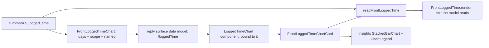

**What was completed or rejected** — *what did I complete today?*, *what
was closed in @Lotti this weekend?* — is hers as well. Rule 13 sends it to
`list_closed_tasks` and then her answer alone, never a door. Its window
is exactly one of a `FrontTimePeriod`, `pastDays` or `from` and `through`
(both included, at most `frontPullRequestMaxDays`), read by the same
`frontPullRequestQuery` as `summarize_pull_requests`: a weekend names no
period, so the prompt has her spell out its Saturday and Sunday, read off
the weekday the turn's `<current_local_time>` names beside the date
(`renderFrontTurn`). It narrows by a named category as `list_due_tasks`
does. A task is *closed* when it is DONE or REJECTED (`isClosedTask`);
Lotti has no separate CLOSED status, so the prompt reads "closed" as asking
for both.

When a task closed is read from its **status history**, never from its
creation date, and not from its current status alone. `TaskData.status`'s
`createdAt` — what the task agent is shown as `statusSince` — is only the
history's last entry, so a task completed inside the window and touched
again since would lose that completion. Every status write appends to
`statusHistory` (`withStatus`) and a conflict joins both sides' histories in
time order (`withHistoryOf`), so the history is the authority; the current
status is joined in by id only for a task from before the history was kept.
`FrontRoutingIndexBuilder.closedTaskLister` counts **any** DONE or REJECTED
set inside the window — from its first local midnight, included, to the
midnight after its last day, excluded, compared as instants — and reports
the latest such:

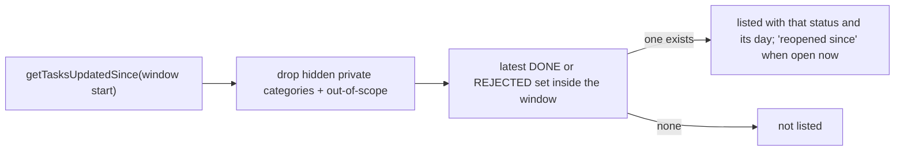

So a task reopened and completed again reports its latest completion in the
window; one completed and reopened since is still listed — the user did
complete it then — marked *reopened since* on its line and its card; one
completed yesterday and again today counts on each day for that day's
question. This departs from Daily OS Shutdown, which reads a day by the
last status set before it ends (`getTasksClosedSince`): a recap of what was
finished must not lose a completion to a later reopen. The candidates come
from `JournalDb.getTasksUpdatedSince`: tasks of any status whose row changed
since the window began (a status change moves `updated_at`, which only
moves forward), private entries only while shown, through
`idx_journal_task_status_private`. `FrontClosedTasks` keeps **every** task
found — nothing is truncated. `render` is what the model reads: the window,
any category it was narrowed to, how many were completed and how many
rejected, then each task as `task:<id> | title | completed|rejected
YYYY-MM-DD | [reopened since |] category`, oldest first, at most
`frontClosedTaskLimit` lines with the rest counted — or a plain *None*.
`FrontClosedTasks.cards` is every task as a `FrontClosedTaskCard`, which the
workflow writes into the data model of her reply's surface, at
`/closedTasks`; the `ClosedTasks` component is bound to it, and the
surface draws them as cards under her words (below) — or where she
places the component — so the list never hinges on how she phrased it. The prompt therefore has her say only how
many were completed and rejected, never list or link the tasks herself.

**How many pull requests the user opened, and what they shipped** — *how
many PRs did I create in the past 14 days?*, *what did I ship in the last
two weeks?* — is hers too. Rule 14 sends it to `summarize_pull_requests`
and then her answer alone. Its window is exactly one of a
`FrontTimePeriod`, `pastDays` (the past N days ending today) or `from` and
`through` (`YYYY-MM-DD`, both included — how "this weekend" is asked), at
most `frontPullRequestMaxDays` (31) days so every bar stays one day;
`frontPullRequestQuery` refuses anything else. The answer is read from the
pull request entries the device already stores
([GitHub pull requests](github.md)) — GitHub is never asked at question
time, so it works offline and leaves nothing on the wire.
`JournalDb.pullRequestStatRows` reads, once per live task holding each live
entry, only the snapshot fields counted — `createdAt`, `mergedAt`,
`additions`, `deletions`, `authorLogin`, the title — never the description,
with a private task's entries held out while private entries are hidden.
`readFrontPullRequests` then counts a pull request once, by key, when one
of its holders is inside her scope and not in a hidden private category;
when the device holds the user's GitHub login (`GitHubTokenStorage`), only
the pull requests they opened count, and one not yet refreshed (no author)
counts too. One never refreshed has no opening date and is reported apart
as *undated*, not guessed.

*Opened* is by `createdAt`, its lines with it on that day; *shipped* is
merged inside the window by `mergedAt`, whenever opened. `FrontPullRequests.render`
is what the model reads: the window, the opened and merged counts with their
lines, then each pull request (`owner/repo#n | title | opened | merged |
+a -d`), newest opened first, at most `frontPullRequestListLimit`.

When some were opened, the strategy keeps the `FrontPullRequestChart` — the
days, the scope and the login, never the figures — and the workflow stores
it into the data model of her reply's surface, at `/pullRequests`, which
the `PullRequestChart` component is bound to.
`frontPullRequestChartProvider` reads the same rows again when drawn, on
the pull request, task, link and private-toggle notifications, and
`frontPullRequestDays` sums them per local day.

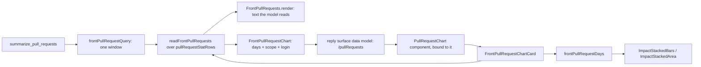

**Which task some work was in** — *what was the task where I worked on
the A2UI notation in the past two weeks?* — is answered from pull requests
too, without putting a month of them into her conversation (ADR 0165).
Rule 15 sends it to `find_pull_requests` with a `topic` and the same
window as `summarize_pull_requests` (the past 31 days when none is named).
`pullRequestFinder` reads the window's pull requests as
`readFrontPullRequests` counts them — the user's own, through the tasks her
scope sees — and, for each, its task row and the one-liner of its stored
summary, at most `frontPullRequestFilterMaxCandidates` (300). All of them
go to `frontPullRequestFilter`: a conversation of its own on her model,
with `frontPullRequestFilterSystemMessage`, no tools, one call, billed to
her wake and deleted after. It answers with keys, most relevant first;
`parseFrontPullRequestFilter` keeps the candidates' keys it names, at most
`frontPullRequestsFoundMax` (5). Only those come back to her, each as one
line with its task, and their tasks become rows her words may link. A
failed filter call refuses the lookup and is logged by error type; the
turn goes on and she says the search failed.

The pull requests it kept are drawn as `PullRequestCards` — where she
places them, or after her words when she does not (`readFrontReply`), each
once. A card stores the key and the holding task (`FrontPullRequestCard`),
never a title. A follow-up about one (rule 16) calls `read_pull_requests`
with keys from `<conversation_pull_requests>` or this turn's find;
`pullRequestDetails` renders each from the stored snapshot with
`renderPullRequestContext` for the `companion` audience: in full, merged or
not, labelled with when it was observed. No diff, file list or reviewer
names are stored, so she says what is: size, files, commits, the review
decision, and that the card's menu opens it on GitHub.

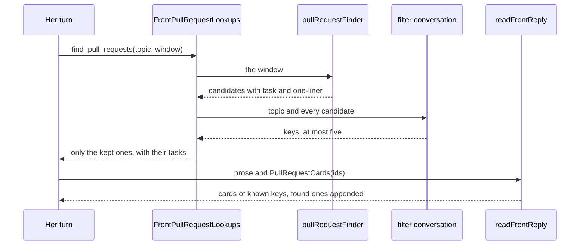

Her own words name a task or a project as a Markdown link titled as listed:
`[title](lotti://task/<id>)`, `lotti://project/<id>` (`frontReferenceUrl`).
The prompt asks for that; `linkFrontReferences` is the guard the strategy
runs over her answer's prose and every `ask_user` question before it is
accepted, so a recited id never reaches the user: `task:<id>`, or a bare id
with a digit (every UUID has one, so no word is mistaken for an id), in
backticks or not, becomes the link, and `Title (task:<id>)` folds into one
link over the title. A link she wrote with the id as its url —
`[title](task:<id>)`, the form the tools list rows in, or the bare id —
gets the row's `lotti://` url: as written it neither opens nor is drawn as
a task row. Only rows the turn could see — the index and its
lookups — are linked; goals and people have no link. A row a lookup returned
(`list_due_tasks`, `match_to_corpus`) is linked by its title too, its whole
title ignoring case, between non-letters of any script, outside any link already there: a list of overdue tasks
names them by title alone, and each must still open. A title two rows share
stays text, and the index's rows are linked by id only, so a short task
title in ordinary prose is never taken for a reference. The shared
`internalRouteFromMarkdownUrl` reads the singular `lotti://task/` and
`lotti://project/` as `/tasks/` and `/projects/`.

**Dates and names.** She writes a date as her tools give it, `YYYY-MM-DD`,
never "17 Mar": the pane shows each in her reply with `deviceDateLabel`, the
device's own date format a due date has everywhere else, and her voice says
it as `DateFormat.yMMMMd` in the app's language ("March 17, 2026") — both
through `replaceIsoDays`, which leaves any URL (a link's target, an autolink, a bare one) and a day that does
not exist alone. The user's own words are shown as typed. The prompt also
tells her that dictation can mishear a name: a word that sounds like a
listed category, task, project, goal or person is that one, written as
listed. The words reach her after transcription, though, so the spelling is
fixed where they are heard: every dictation's vocabulary hint carries the
category names (see [batch transcription](ai/batch-transcription.md#the-speech-dictionary)),
with no correction pass that would keep her waiting.

# The budget and the repair round

`frontProviderCallsPerTurn` is 3, passed as `turnBudget`. The common turn is
one completion. A turn that has not ended — no dispatch, no question, no
answer — gets one more instruction (`frontContinuationInstruction`: her
answer after an answer lookup, otherwise `frontDispatchRepairInstruction`),
with whatever is left of the three. A turn that has still not ended after
that **fails closed**: the wake
returns a failed `WakeResult` and persists **no agent output** — no
dispatch, no question, no invented reply. What `FrontChatService` wrote
before the wake — the user payload and the user message — stays durable,
which is what makes the turn retryable rather than lost.

# Latency and failures

A lookup answer — pull requests, logged time, what was closed, what is due —
is two provider calls: the lookup, then her answer over its result.
Live on Mistral (2026-11-09, DeepSeek V4.1 Flash, a 15.6k-token turn) each
call took 0.6–4 s with no reasoning tokens, and now and then far longer: one
call sat 19 s before its first chunk and took 44 s in all.

**One cache key.** Her calls carry `promptCacheKey: agentId` through
`CloudInferenceWrapper` — the system prompt, the tools and, until the record
changes, the index are the same prefix every turn. Warm, the two calls took
about half as long as without the key, whose cache hits were luck.

**A stalled call is sent once more.** `FrontInferenceStallGuard` wraps her
inference repository: a call that sends no chunk for
`frontInferenceStallTimeout` (15 s) is cancelled and sent again — safe,
since nothing of it was read. A second stall, or a gap after the first chunk,
fails the turn with a `TimeoutException`. Dropping the stalled call waits at
most `frontInferenceCancelBound` (1 s): a provider generator suspended in its
HTTP send cannot be cancelled until the send returns, so the abandoned
request may finish in the background, its answer discarded. The wake's
ten-minute run cap is
the only bound otherwise, and the Mistral repository sets no timeout of its
own on a chat stream.

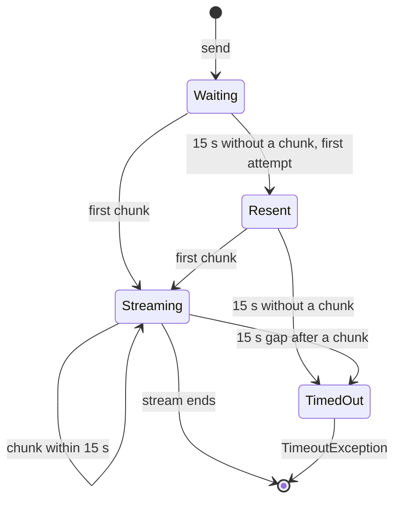

**Why a turn failed crosses the wake as a code.** A wake reports an exception
by type only (`WakeResult.failed`), so the chat could never tell a rate limit
from a timeout. The workflow classifies its own failure into a
`FrontTurnFailure` — `rateLimit`, `timeout`, `network`, `authentication`,
`outOfCredit` (an empty prepaid balance or a spend limit), `provider` (other
4xx/5xx), `noModel`, `noAnswer` (no terminal call in the budget), `unknown`
— and returns `failure.wakeError(error)`
(`front turn failed: rateLimit (MistralInferenceException)`: the cause and
the exception's type, never its message). Only a failure while the provider
is being called goes through `AiErrorUtils.categorizeError`; a database
failure around it is `unknown`. `FrontChatService` reads the code back off
the run's `WakeFailedException` (`FrontTurnFailure.fromWakeError`; the run
cap's `TimeoutException('timeout')` is a timeout, a user's stop is not) onto
`FrontChatTurnException.failure`, the composer keeps it with the failed
turn, and `FrontChatPane` passes `AgentChatView.failedTurnLabel` — a
`frontChatFailed*` line ("Your AI provider is limiting requests right now.
Wait a moment, then try again.") beside *Try again*. `unknown` keeps the
shared "That didn't send."

**The provider's own words travel in memory.** The workflow also returns the
caught exception as `WakeResult.cause`, which the wake wiring carries on
`WakeFailedException.cause` — left out of its `toString`, which the PII-safe
error log records. `wakeFailureCause(completion.error)` hands it to
`FrontChatTurnException.cause` and the composer's `failureCause`; for
`outOfCredit` and `provider`, `agentTurnFailureLabel` relays
`AiErrorUtils.providerMessage` ("Your AI provider account is out of credit:
Insufficient credits. Add more using …"), so the user learns which account
and where to top up. The goal and relationship chats and the goal read card
relay the same cause.

**Two log lines time every turn.** The workflow logs, under `frontAgent`,
the elapsed milliseconds at the end of each phase:
`front turn timings: model=… index=… history=… inference(calls=N)=…
persist=… total=…`, with `failed=<cause>` when it failed. The chat service
logs, under `frontChat`, `front turn <status>: queued=… run=… total=…` —
`queued` is the wait for a wake slot. The wake queue is FIFO under the
global concurrency cap (`defaultAgentWakeConcurrency`, 3), with no
preference for a user waiting on her: a large `queued` means her turn sat
behind other agents' wakes.

# What a turn leaves behind

Everything the model read back is written in one transaction under
deterministic ids per agent and run (`frontAgentDispatchMessageId`,
`frontAgentAskMessageId`, `frontAgentReplyMessageId`), each an
`AgentMessageEntity` of kind `action` whose `operationId` is the source
message id and whose payload holds the content — the dispatch record also
holds the `input` the spans index into. The dispatch record is the audit
trail of the routing decision. A transaction that committed and then failed
its deferred outbox flush is recognised by re-reading every carrier the turn
produced (`_outputsCommitted`), so a turn the user already received is not
re-run into a duplicate.

The strategy's own tool-call log (`AgentMessageRecording`) writes `action`
rows with the same tool names but no `operationId`; that is what keeps them
out of the recent-turns tail, which renders only the persisted records —
with their content: the user's words, the reply's text, a question with its
option labels, a dispatch as its destinations.

# The doors

`FrontDoorWalker.walk(messageId)` finds the newest dispatch keyed to the
turn and takes every segment through a door, one record per segment under
`frontDoorRecordId(dispatchId, index)` — an `action` row with tool name
`front_door`, the dispatch's run key and the turn's `operationId`, its
payload a `FrontDoorRecord`.

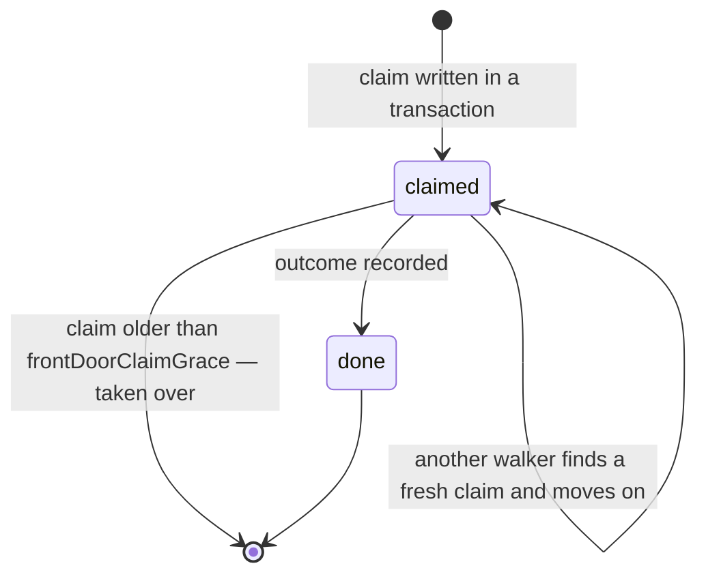

A claim is a lease: a second walker — a retry, a recovery wake, another
device — skips a segment that is `done` or freshly `claimed`, and takes over
one whose claim is older than `frontDoorClaimGrace` (30 min), because that
walker died. Outcomes:

| Segment | Door | Outcome |
|---------|------|---------|
| `task` / `project` question with an active agent | the owner's query pipeline, headless: `QueryAnswerBuilder.build` over an in-memory `QueryChatHistory` whose one event is the segment, chat id the source message id | `FrontDoorAnswer(text, summaryBased, incomplete, ownerIds)` — the answer is the record's, attributed to the owner, never reworded |
| `goal` / `person`, question or statement, with an active agent | that agent's own chat: `appendMessage` then `enqueueMessage`, **never awaited** | `FrontDoorChatTurn(specialistAgentId, specialistMessageId)`; the reply lands in the specialist's thread with the turn as its `operationId` |
| `task` or `project` statement or instruction | none — the walker writes nothing | `FrontDoorProposal(ownerId)`: waits for the user's tap |
| `journal` question | the journal answer engine, headless: `QueryAnswerBuilder.build` over `QueryScope.journalIn(allowedCategoryIds)` narrowed by any categories the turn's payload carries (`frontNarrowedCategories`) (empty = every visible category), agent id `front_agent`, the Settings default profile | `FrontDoorAnswer(fromJournal: true, evidence, dependencies, private)` — her own answer, with the passages it cites |
| `new`, `journal` statement, `unrouted` | none | `FrontDoorInbox(newKind?)` — what the router thought it would become leads the chips; a `new` task's draft rides the record for the tap ([a task from her words](#a-task-from-her-words)) |
| `day` statement or instruction, while `enable_daily_os_page` is on | none — the walker writes nothing | `FrontDoorDay()`: waits for the user's tap |
| `day` question, or anything about the day while the Daily OS is off | — | `FrontDoorSkipped(noDoor)` |
| no agent, or a retired one | — | `FrontDoorSkipped(noAgent)` |
| owner without a usable inference setup | — | `FrontDoorSkipped(inferenceUnavailable)` |
| a door that throws | — | `FrontDoorFailed(errorType)` — the type, never the text |

**Her journal answers.** A `journal` question runs the query pipeline over
the journal scope (see
[scoped query conversations](agents/query-chat.md#journal-wide-questions)):
the plan step names one to three searches, each run by meaning beside the
keyword terms, and may name categories the question limits itself to — only
names within her allow-list are offered, so a named category narrows
(one she cannot see narrows to nothing) and
never widens. The door record keeps the answer's evidence and dependencies.
`frontJournalAccessProvider` rereads their visibility whenever an entry, a
category, a config flag or lockdown changes, and `FrontDoorCard` shows the
answer — attributed "From your journal", with its numbered sources that open
on a tap — only while every dependency is still visible, and hides it until
that is known.

The walker never awaits a specialist's wake: the goal and person chat
services' `sendMessage` awaits its own completion and at concurrency 1 that
would deadlock inside the front wake, so the walker uses their
`appendMessage` / `enqueueMessage` split and the reply arrives later.

# A task from her words

ADR 0160. When the user dictates a task, she reads its fields from the
words; the user's *Make it a task* tap opens the card's setup, where the
status, priority and due day she read can be changed, and *Create task* —
the confirmation, as for every write — makes it as set up, and started only
when they said so.

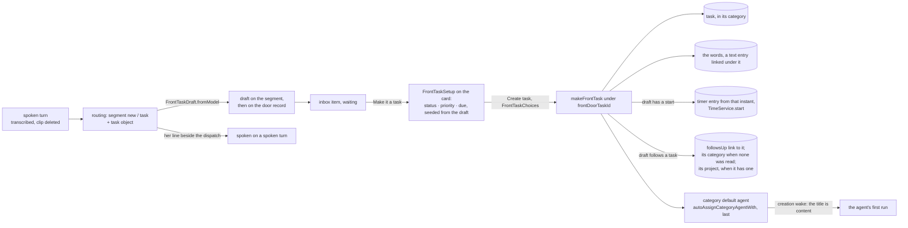

| Field | Who fills it | From |
|-------|--------------|------|
| title | agent | the words, short |
| body | agent | `instructions`: what to do and how, without the turn's other topics |
| category | agent | the category the user names, else her judgment from the work, the categories of `<conversation_tasks>` and what `<recent_turns>` were about — a task asked for in a conversation spent on one category's work, or its logged time, goes there, and her reply names it; left out only when the evidence points two ways or nowhere; dropped unless listed (and chosen, when the conversation is narrowed). Live eval scenarios `category_from_conversation` / `category_nowhere` |
| priority, due day | agent, only when said; then the user, on the card | `P0`–`P3`, `YYYY-MM-DD`; the setup starts at what she read — medium and none when she read nothing — and the user's choice wins |
| estimate | agent, only when said | minutes (≤ `frontTaskMaxEstimateMinutes`) |
| status | agent, only when said; then the user, on the card | `inProgress`: *in progress*, and nothing more — "make it in progress" is a status, never a start. The setup offers open, groomed and in progress (`FrontTaskStart`); blocked and on hold ask a reason, so they stay on the task page |
| timer | agent, only when a timer is asked for or a start is said | `startedMinutesAgo` (0–`frontTaskMaxStartedMinutesAgo`): *in progress*, and a timer entry linked under the task from that instant, running |
| follows up on | agent, only for a follow-up | `followsUpTaskId`: a task in the index, a lookup this turn or `<conversation_tasks>`; anything else is dropped. Linked `followsUp` from the new task to it, and filed under its project |
| task agent | category default | the category's `defaultTemplateId`; none without one |
| provenance | always | the segment's verbatim words, a text entry linked under the task (`frontTaskWordsId`) |
| project (but a follow-up's), checklist, labels, anything else | user | the task page, or the agent's proposals there |

The draft is read leniently (`FrontTaskDraft.fromModel`): no title, no
draft; any other field that does not parse is left out, so a misheard date
never loses the task. The start is an instant resolved when the dispatch is
validated, against the clock the turn's `<current_local_time>` showed — the
workflow's `now`, handed to the strategy — so neither a slow inference nor a
tap hours later moves when the user said the work began; a start after now
runs from now. **Nothing is made without the tap**, asked for or only
mentioned: the item waits in the inbox with its draft, and *Make it a task*
asks how before anything is made. Its status line, action and overflow give
way to `FrontTaskSetup`: one line in her voice and three chips — status,
priority, due day — each opening a short menu where it sits (today,
tomorrow, a day on the calendar, or none for the due day), so the setup is
the conversation asking, never a form to leave it for. The chips start at
`FrontTaskChoices.of(draft)`, so *Create task* alone makes the task as she
read it; *Cancel* gives the card back as it was. Her line says what she heard
only when the words set something (`FrontTaskDraft.namesChoices`), else it
just asks; the headline turns to the draft's title — the one the task is made
with — until the setup is left. Status and priority wear the task list's own
glyphs, and the due chip warns for today and turns late for a past day, as the
task will. *Cancel* and *Create task* share the chips' line where it fits and
drop below it, at the end, where it does not; there *Create task* keeps the
overflow's slot, so it ends where *Make it a task* does. The step takes focus
as it opens: Enter creates and Escape leaves while it holds that focus itself,
never once a chip or button in it does. A menu over the buttons closes on an
outside tap without pressing them. Create hands the choices
through `FrontVoice.makeTask` → `FrontChatController.makeTask` →
`FrontFilingService.makeTask`, which makes `draft.withChoices(choices)`
under `frontDoorTaskId`. A retry — the task made, its door record not — that
finds the task already there brings its status, priority and due day in line
with the choices it was retried with, rather than keeping the first, and its
dictated timer too, from the timer as it is rather than the status before:
asked to run when the task is in progress (a no-op for the one already
running), asked to stop otherwise (only if it is the one running), so a retry
after a timer step that failed asks again. An update that does not go through
fails the retry, so the setup offers it again. The timer is best effort: an
entry that could not be written is logged, and the task stands without it. Without a stated start no timer runs; a dictated
start keeps its timer only while the task is set up in progress — one set up
open or groomed is not being worked on. The setup is the card's own state,
one item at a time: opening another leaves the first, so Enter can only make
the one just opened, and while one is open the others' *Make it a task* steps
back to the secondary look, its *Create task* the card's one filled button. A
reload keeps it open; an item that waits again after *Undo*, or leaves the
card and comes back, offers *Make it a task* afresh.
Everything the user says about the task they ask for — its due day,
priority, status, a timer — belongs to its one segment even as a sentence
of its own (rule 10), so a trailing "make it due today and urgent" never
becomes a second inbox item. *Undo* deletes the task and the copy of the
words under it, and stops the timer running on it; the timer entry stays,
as logged time does on any deleted task.

**Duplicates.** Rule 11 of the prompt has her compare a new task with the
listed open tasks — `match_to_corpus` only when the index says more exist
than it shows, so a new task costs no extra round-trip — and one that
looks like the same work is an `ask_user` with those tasks as the
options, not a second task.

**Follow-ups.** ADR 0161. "Create a follow-up to that one" is rule 12: a
`new` task whose draft carries `followsUpTaskId`, read against
`<conversation_tasks>` — "that one" is its first row, a description the row
of it or the index that fits — and an `ask_user` with the candidates when
two fit or none does. Rule 11's duplicate check does not hold against the
task it follows. Without a category of its own the follow-up takes its
task's at the tap, so its category's agent is the one assigned. The link is
the ADR 0042 `followsUp` edge (`ensureLink`, the agent tool's path), so the
task page's relationship sections show it as on any linked pair. Right
after the link the follow-up is filed under its task's project
(`ProjectRepository.inheritProjectFromTask`, as `createTask` and the agent's
follow-up tool do): none when that task has none, and none when a category
the words named differs from the project's, which the project link rejects.
It is a separate write — the project link reserves its own vector clock and
transaction — and best effort: a failure is logged and the task stands
without one. Both are written **before** the agent: `createTaskAgent` enqueues the creation wake
at once, and the content gate lets it run — a non-empty title counts as
content — so the first run sees the link, the project, the words and the timer.

**What she says** is the line she writes beside the dispatch, spoken
as every reply to a spoken turn is ([her voice](#her-voice)): the task is
ready to confirm, and the timer when one will start. It names the task by
its title, never as a link — the task has no id yet (the live eval caught
her linking an invented `lotti://task/task-new`) — and never says it was
created; the card's *Made into a task* is the receipt.

**After the tap she says it is made** (ADR 0162). The setup's *Create
task* runs `FrontVoice.makeTask`: `FrontChatController.makeTask` answers
whether the task was written, and only then she says
`frontTaskCreatedSpoken` ("Hey, dear, I created that task.") through
`FrontVoice.speak` in the conversation on screen, so her mute, read-aloud
being off and her voice choice hold as for any answer. A failed tap, or one
on a door already busy, says nothing.

**No audio is linked.** Her recorder transcribes and deletes the clip
(`chat_recorder_controller.dart`); the verbatim words under the task are
the provenance. The extras after the task run only when the task is first
written: a retry that finds the task adds nothing twice, and a crash between
them leaves a task without them.

# The tap: filing and the inbox

`FrontFilingService` is the one place the front agent's surface changes the
record, and every action is the user's tap under a door. Each action reads
the door's payload, requires the outcome it applies to (else
`FrontDoorStateException` — the door was acted on elsewhere, or twice), and
rewrites the record **under the same ids** with the new outcome, so the
dispatch keeps its pointer to what was written and the inbox count follows
from the records alone. The sync service pings nobody, so the service pings
the front agent itself (`notifyUiOnly`), which re-projects the thread.

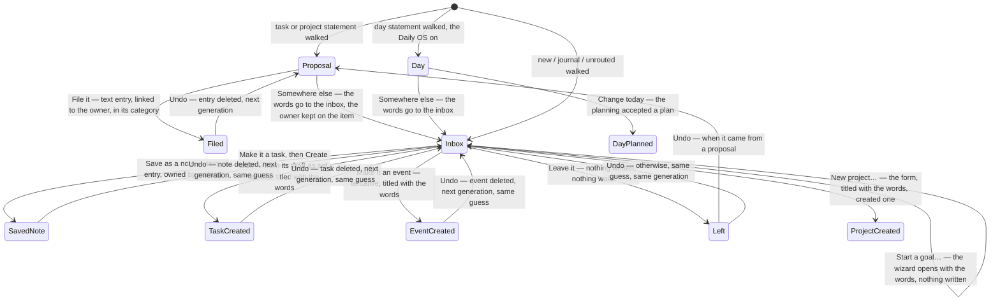

The entry a tap writes goes through the persistence logic — a text entry
with the owner's `categoryId` and `linkedId`, a task through
`createTaskEntry`, an event (`writeFrontEvent`) tentative, starred and dated at the
tap as the Events page starts one — so an entry filed under a task wakes the task agent
through its subscription exactly as dictation into the task does, one filed
under a project shows in the project's timeline (`ProjectTimelineSection`)
and lands in that project agent's log at its next scheduled
update (a linked entry marks the report stale; it never wakes the agent
itself), and a made task is a task like any other. **Every write is idempotent per door**: the entry or
task is created under a deterministic id (`frontDoorEntryId`,
`frontDoorNoteId`, `frontDoorTaskId`, `frontDoorEventId` — a UUID v5 of the door id and the
door's *generation*, how often it was written and taken back; generation
zero keeps the ids from before generations were counted), and the adapters
in `front_agent_providers.dart` read the write's own verdict: a rejected
write (`createDbEntity` never overwrites an existing id) is the retry after
an interrupted tap and files the row already there, while a failed write,
or a rejected one with no live row behind it, stores nothing and leaves the
door waiting. Under a task the entry counts only once its link is live —
the task agent reads its entries through the link — so the writer checks
`JournalDb.linksBetween` after the write, writes a missing link once more,
and stores nothing when it is still missing. **Take back** (`takeBack`) deletes what the door wrote — the
filed entry, the note or the task — through
`JournalRepository.deleteJournalEntity`, refuses when the thing is still
there undeleted, counts one already gone from the journal as taken back,
and puts the door back where it waited, one generation on: a filed entry's
door is a proposal again, a note's or a task's an inbox item again leading
with the same chip (the receipt kept the inbox item's `newKind`), so a
re-file or a re-save gets a fresh row rather than the soft-deleted one.
**Somewhere else** and **Leave it** are one action (`decline`): a proposal's
words go to the inbox, the task they were proposed under kept on the item
(`FrontDoorInbox.ownerId`, which turns its line into *Where should this go
instead?*), so a wrong guess costs one more tap, not a retype; an inbox
item left where it is settles (`FrontDoorDeclined`, which keeps the
proposal's owner and generation or the item's guess), nothing written and
nothing waiting. **Undo** (`undoDecline`) makes a left door what it was —
the proposal, when it came from one, else the inbox item; a refusal from
before that was kept falls back on a task door's destination — with
nothing written in between.
**Change today** (`FrontDoorDay`) is a tap that hands the words over
rather than writing them: the pane calls `frontDayPlannerProvider`
(`front_door_wizards.dart`), which opens the Daily OS planning
(`showDayPlanningModal`) over her — `DayPlanningAdapt` with the words sent
at once when today has a plan, `DayPlanningCreate` with them typed into the
capture when it has none. The plan changes only when the user accepts its
proposed changes there; a planning that ends in a plan settles the door
on that day (`FrontChatController.planDay` → `markDayPlanned` →
`FrontDoorDayPlanned(day)`, whose *Open* selects that day on the Daily OS
surface before going there), and one closed leaves it waiting. The door is
busy from the tap until the planning closes, so a second tap opens no
second planning; *New project…* (`newProject`) is held the same way. Undoing it is the Daily OS's own revert.
**New project…** opens the project form titled with the words
(`frontNewProjectProvider`); a project it creates settles the item
(`markProjectCreated` → `FrontDoorProjectCreated`, *Open* goes to the
project), and removing it is the project's own business. **Start a goal…**
opens the goal wizard with the words as its intention
(`goalCreatePathWith`); a page tells nobody what came of it, so the item
keeps waiting until the user leaves it.

A turn with a door still waiting on the user never leaves the projection:
`FrontChatThreadBuilder` keeps it beside the newest fifty messages of its
conversation however old it is, so the inbox cannot scroll out of existence — and keeps the
message right after it too, her reply that carries its doors (or the next
user turn, which says no reply followed), so the doors never ride an
unrelated reply the window happens to show next.

The **inbox** is no entity: `FrontChatThread.inboxMessageIds` is every user
turn with a door whose outcome is a `FrontDoorProposal` or a
`FrontDoorInbox` (`frontDoorAwaitsUser`), `inboxCount` the doors, and
`frontInboxFilterProvider` the switch the list's *Inbox* row turns on — an
auto-disposed notifier, so the filter is off every time the sheet opens, and
Back (or Escape) leaves it before closing the sheet. While something waits,
a warning-tone dot sits on the header's drawer toggle — no number in the
header; to a screen reader it says the count, and a tap on it is the
toggle's — and the drawer's *Inbox* row counts it with a badge of the same
tone, so how many is read where it is acted on.
The count and the filtered view come from `frontAllChatsThreadProvider`,
the thread of every conversation not deleted, so what waits in one
conversation is not lost by opening another.

# Conversations

A **conversation** is the user turns whose payload names it
(`frontConversationKey`, read by `frontConversationOf`); everything a run
wrote for a turn — her reply, her question, the doors — belongs to the
turn's conversation through the `operationId` it carries. There is no
creation record: a conversation exists once it holds a turn. Turns written
before conversations name none and form one fixed conversation,
`earlierConversationId` (`front-chat:earlier`), which every device derives
alike, so nothing was migrated (ADR 0154).

`FrontConversationService.load` folds the index: the user turns, grouped by
conversation, give each its title (the first line of its first question)
and its last activity; query chat's synced `renamed`, `archived` and
`deleted` events, written under the front agent's id with the conversation
as the chat, give the rest. A conversation has no `created` event, so query
chat's projection never lists one, and the headless journal questions the
door walker writes there (chat id = the turn's message id, no lifecycle
event) are never taken for a conversation. A deleted conversation leaves
the index (`deletedIds`) and its turns leave every view, the inbox
included; its messages are not erased.

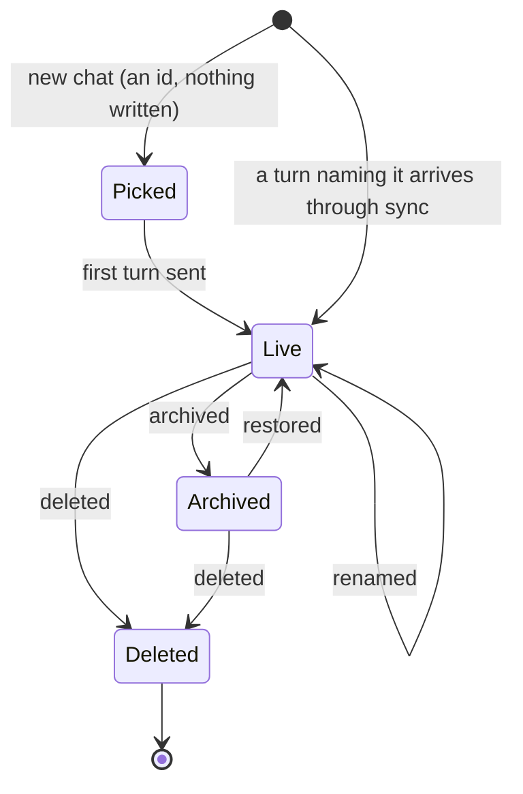

Which one shows: `frontPickedConversationProvider` holds the one the user
picked (keep-alive, like the composer), `frontActiveConversationProvider`
resolves it — the picked one while it was picked today, else the newest not
archived while it moved today (`FrontConversationIndex.latest`), else an id
minted once per session (`frontFreshConversationIdProvider`), so opening the
sheet on a new day starts a new subject — and a send lands in the active one
and pins it, so a conversation arriving from another device does not take
the surface out from under the reply. Archiving or deleting the open one
moves to a fresh conversation, its draft parked so an undo finds it; each
conversation keeps its own draft, and talking in an archived one restores
it. The routing prompt's recent turns come from the
pending turn's conversation only (`FrontAgentWorkflow._recentTurns`): another
conversation is another subject.

The conversations live in her **drawer** (`FrontChatDrawer`), as a Claude
or ChatGPT window keeps them: a top row as tall as her header — the search
(always there; what is typed narrows the list as `FrontConversationList.query`)
and, over a phone's thread, a chevron back to the conversation (the cross
stays her surface's own close) — then a
*New chat* row in the accent, the drawer's one action, then the list, then
her settings (`FrontChatDrawerFooter`, [below](#the-chat-surface)), which
step aside while the keyboard is up so a short screen keeps room for what
the search finds. Whether it is up is read by `FrontChatSurface`, above the
`Dialog` — which pads by the keyboard and removes the inset from everything
it holds — and handed down as `keyboardUp`. On a phone
or a narrow window the header's toggle opens it over the thread
(`frontConversationListOpenProvider`, off every time the sheet opens): it
slides in from the leading edge over the shared modal scrim
(`ModalUtils.getModalBarrierColor`), as wide as the list is beside a full
panel's thread (`kDetailContentMaxWidth × FrontChatPane.listShare`) and
never so wide that a tap target of scrim does not stay beside it. **The
thread stays mounted under it** — the same `State`, never rebuilt — so
opening the drawer takes nothing off the screen. A tap on the scrim, the
drawer's own glyph, Back and Escape close it; so do picking a conversation,
the inbox or a new chat. While it is open it is a named modal region
(`Semantics.scopesRoute`, *Chats*), focus moves into it and the thread under
it is out of focus's reach (`ExcludeFocus`) and assistive technology's
(`BlockSemantics`); closing it hands focus back to the toggle (the header's
`drawerFocusNode`). Under reduced motion it is there at once. It is built only
while it shows, so it opens each time on the whole list. On a desktop-width
window the drawer sits beside the conversation instead, always open, on
`background.level02`, a step off the conversation's ground; its top row and
her header share `frontBandPadding` around a tap target, so their hairlines
run across the sheet as one.

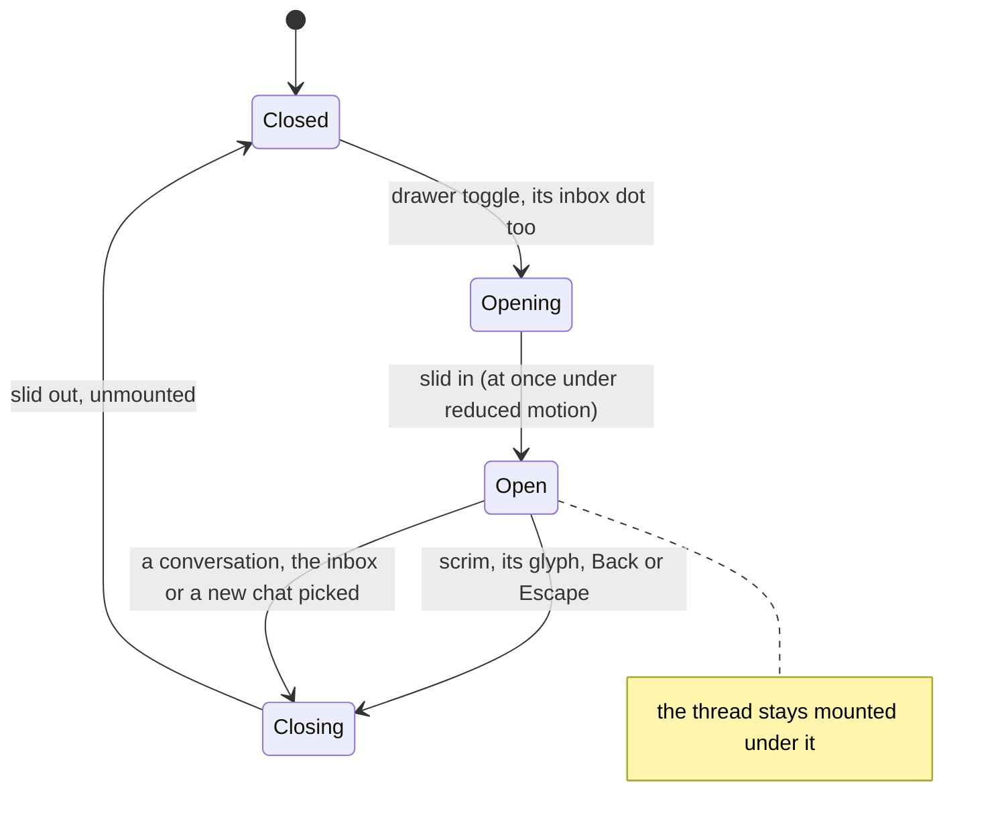

`FrontConversationList` leads with *Inbox* while
something waits; then one row of filter chips (`DesignSystemChip`, scrolling
sideways when they outrun the drawer), every category she may see that a
conversation is in, by name, each with its colour — a filter, not a section
of places to go, so the history starts right under it. A tap narrows the
history to that category (with the search, if any), tints the chip, gives
it a cross and moves it to the head of the row; a second tap shows
everything again, and a filter on a category she can no
longer see holds nothing back. Over a search the chips go, so what matched
sits right under the field — but for the one that is on, which stays, still
seen and a tap from off. Then the history
grouped by recency — *Today*, *Yesterday*, *Previous 7 days*, *Older* —
flat: each group's day a neutral medium-emphasis caption, snug over its
dense rows, no card and no hairlines. The
accent means "press", so a day never wears it; the open row's rounded fill
(`surface.hover`, a step brighter than a hovered row's `surface.enabled`)
is the one strong surface in the list.
A row is one line of title over one line of her last answer on the row's
whole width (`FrontConversation.preview`, the first line of her latest
`reply_to_user` or `ask_user` in it, read by `FrontConversationService`),
each cut with an ellipsis. With no answer yet the title takes that second
line itself, centred in the row with its swatch and its menu. Room for the
menu at the title's end is kept on every row beside the conversation, where
a hover shows it, and over a phone's thread only on the row that shows one.
Titles are
set in the drawer's label style (`frontDrawerLabelStyle`), the open row
alone heavier, so weight means "here"; her settings in the footer wear the
same style at medium emphasis, at the drawer's row size on every layout. A
row leads with its
category's colour (`FrontCategorySwatch`), an outline for none or for one she
may no longer see — an archived row the archive glyph instead — and names
the category to assistive technology, so colour never stands alone. A row says no time of its
own: its recency section (Today, Yesterday, Previous 7 days, Older) says
when, as the Claude and ChatGPT lists have it. On the open row's fill the
second line is a step brighter, medium emphasis rather than low. A row's rename, archive and delete (its ⋯ at the
end of the title's first line, in room every title leaves it so nothing
reflows when it shows, its whole tap target inside the row) show on hover
and focus, at rest on the open row too unless
the drawer sits beside the conversation (`FrontConversationList.beside`); a
long press opens that menu under any row.
The ⋯ is `FrontMenuButton`, on the menu every agent page opens
(`AgentSurfaceMenuButton`): rounded, raised on the card surface over the
shared modal scrim, placed inside the window's safe area, closed without
acting by a tap on the scrim or Escape — never a bare popover over the rows.
Delete is set off in a group of its own at the bottom, and a row's menu
names its chat in a quiet heading above the rows, so it is plain which one
Delete deletes. Archived
ones fold away at the end; a search looks through them too.

# The chat surface

`FrontChatThreadBuilder.build` projects the front thread for the shared
`AgentChatView`: user turns, `reply_to_user` rows and `ask_user` rows (shown
as her turn, with the options parsed from the record) are the messages,
newest fifty of one conversation (`build(conversationId:)`), or of every
conversation but the deleted (`build(excluded:)`); a dispatch is never shown — its door records hang off the user
turn they answer, in segment order, and for a `FrontDoorChatTurn` the
specialist's reply is read from that agent's thread by the recorded message
id. `frontChatThreadProvider` is the active conversation, or every
conversation while the inbox filter is on, and reloads on the front agent's
update pings,
whenever a specialist a door handed a turn to finishes a wake here
(`runCompletions`, by agent id — the sync service pings nobody), and on
each such specialist's own update pings, which is how a reply written on
another device arrives through sync.
`FrontChatController` sends through the chat service (creating the identity
on first use) and invalidates the thread when the awaited turn completes; a
failed turn keeps its durable id so the retry re-wakes the same turn.

`FrontChatPane` is the thread on `AgentChatView` with day dividers
(`dividerBuilder`), the door cards under a routed turn, the options —
neutral outlined buttons (`FrontAskOptionsRow`), pressable at a glance and
never a filled twin of the user's own bubble —
under her **latest** question only (an older question's options would answer
a question nobody is asking). The thread shows only what was said: no cost
line under her words — what the open conversation has cost is the drawer's
*Agent internals* row to say (`frontConversationCostProvider`, every run
of hers in the conversation — `FrontChatThread.runKeys`, gathered before the
thread's fifty-message window, so the total never shrinks as it moves —
summed from `agentRunConsumptionTotalsProvider`,
consumption schema v5's `idx_consumption_agent_run`, a run still loading
counted once it arrives; null in the inbox, so no run of the conversations
it gathers is read). A reload keeps the thread on screen, but another
conversation picked is a change of subject: `FrontChatThreadView` remembers
what its shown thread was loaded for (the inbox, or which conversation) and
shows the loading shell, or the new one's error, until the one picked has
loaded — the composer already sends there. A send clears the inbox filter: the new turn lands
in its conversation, shown whole.

A turn is the user's bubble, her reply, and under her reply the **door
cards** (`FrontDoorCard`) — her answer, part by part. The doors are keyed
by the user turn in the thread but *carried* by her reply right after it
(`FrontChatThread.carrierOf` / `doorsCarriedBy`), so the cards sit under
her bubble; until she has replied, or when no reply followed, they sit
under the user's. One card per segment on one surface, hairlines between,
and every card the same shape: a compact tinted tile with the kind's glyph
(task, goal, project, person, day, inbox; the done glyph in the success
ink once something was written, the warning in the error ink when the
door failed), the user's words in full in body type — or, for an answer,
the owner's text, a journal answer or a specialist's mirrored reply rendered
as the Markdown it is (`AgentMarkdownView`, its links through
`FrontDoorActions.onOpenLink`; the user's words stay plain text) — one
status caption (the proposal's question naming the
task, *Where should this go?* or *… go instead?* after a proposal was sent
there, *Filed under …*, *Made into a task*, an answer's attribution and
caveats, a door still being walked, a reason it went nowhere), at most one
filled action, and an overflow menu (`DesignSystemContextMenuButton`)
holding every other way out. The filled action is always a tap that
writes — *File it*, *Make it a task* — or, on a settled card, a secondary
*Open*; the overflow holds *Somewhere else* on a proposal, *Start a goal…*
/ *New project…* (the ellipsis says a wizard opens), *Make it an event*
(only while `enable_events` is on — an event made where it is off would
have no page to be found on), *Save as a note* and *Leave it* on an inbox item with the router's guess
first, and *Undo* on
anything settled. A busy card's action shows it loading; a failed one's
status says so in the error ink and the tap reads *Try again*
(`FrontChatComposerState.busyDoorIds` / `failedDoorIds`). *Open* leaves
the sheet for the entry's, the task's or the event's page. The inbox filter keeps a
waiting turn's words and the reply that carries its cards together.

The header (`FrontChatHeader`) is **one row**: the drawer toggle — a menu
glyph named *Chats* by its tooltip, a dot on it while the inbox holds
something (its count is the drawer's) — her face
in a rounded tile at `ControlSizes.avatarCompact` (the spark when
`enable_companion` is off), a title, *New chat* and close. The title says
where the user is: over a phone's or a tablet's thread, where the drawer
that lists the conversations is shut, it is the open conversation's title, a
step under her name in size and on up to two lines; her own name stays for a conversation not begun, for the inbox —
every conversation at once — and beside the drawer, which marks the open row
itself. Over a thread on its own the row keeps the thread's measure
(`kProseMeasureWidth`), centred, so on a wide panel its controls sit on the
column they act on. *New chat* and close are the last two
stepping aside, their room kept, while the drawer is slid over the row, so
its cross is never read beside the drawer's way back. A tap on her
face shows her glass card over the thread, in place (see
[her voice](#her-voice)); to a screen reader it is a button named *Show
companion*. While the card is out the face slides away (fading as it
narrows), since she is already on screen, and her name takes its room. There
is no title line and no overflow: the conversation's title is its row in the
drawer, and everything else — her voice, her profile, her internals, a
conversation's own rename, archive and delete — is the drawer's. *New chat*
has nothing to start in a conversation not begun, except from the inbox,
which it leaves. Beside the drawer the row is her face, her name and close.
The band is a tap target plus `frontBandPadding` tall whatever it holds, and
the row fits a 360 dp phone with every control showing.

The drawer's foot (`FrontChatDrawerFooter`) holds her settings as rows that
say their value: *Spoken answers* (`FrontVoiceSwitch`) while the companion is
on, with the way to have her say her latest answer again
(`FrontVoiceButton`) beside the switch — none in the inbox, which is no one
conversation; *Reading speed* (`FrontVoiceSpeedRow`) under it while she
answers aloud, a tap stepping to the next speed; *AI profile*, once she exists and the profiles are loaded,
naming the profile she has of her own, else the Settings default she follows
(`FrontProfileChoice`); and *Agent internals*, with what the open
conversation has cost (none in the inbox), opening `AgentInternalsPanel`.

A conversation not begun opens on her bust at hero size (`FrontChatHero`)
and her invitation, centred where the thread will be, with a first move
under it: three starter questions (`FrontStarterPrompts`) as the outlined
buttons her clarifying questions offer, a tap sending one in its own words.
Once it has begun the thread is the conversation's alone. The thread is `conversational` and
`voiceFirst` (see [chat input](agents/chat-input-and-reasoning.md)): her
replies as prose, the user's words in a neutral bubble a step off the ground
(`background.level02`), one pill field — on the thread's own side gutter,
so its edges are the bubbles', its hint saying what the conversation is
narrowed to (*Ask about Colony…*; *Ask anything…* when it is not) — with
the mic at its end and the
conversation's category chip at the start of its controls row
(`composerLeading`), and what she was told by voice sent as said.
`showFrontChat` opens her surface over the app, as History opens: a dialog
behind the shared scrim, the whole screen below the page breakpoint, else a
panel up to `kDetailContentMaxWidth` inset by `step6`. The dialog opens with
`useSafeArea: false`: full screen, her ground runs under the status bar and
the home indicator and a `SafeArea` inside the Scaffold keeps her header and
composer clear of them (the route's own `SafeArea` left a strip of scrim at
either edge); a panel adds the window's padding to its inset. On a desktop-width
window (`isDesktopLayout`) the drawer sits beside the conversation, 38% of
the panel (`FrontChatPane.listShare`), and the header leaves out the drawer
toggle and a new conversation, which the drawer carries. Escape goes
through `ModalEscapeScope` to the pane's back chain — the drawer, then the
inbox — before it closes her. It opens from the desktop rail's utility row
above Settings, the phone launcher's utility button beside the menu, or the
`openFrontChat` keyboard command (Cmd/Ctrl+L), all gated by
`enable_front_agent` and all closed under lockdown: her thread spans every
category.

## The category scope

**A conversation's category is picked where the words are typed.** The
composer's chip (`FrontCategoryChip`) shows the open conversation's category
— its colour, its name, a chevron, on a `DesignSystemChip` with a full tap
target — or *Everything*; a tap opens
`FrontCategorySheet`, *Everything* — the default — then one row per category
she may see,
the current one checked, by word and tick with no band behind it; the rows
run edge to edge at the drawer's density, each swatch in a glyph-sized slot
(`FrontCategorySwatch.inSlot`, as in the drawer) so names share one edge. Every turn sent from then on carries it: the
controller writes it, as a set of one, under `frontCategoriesKey` in the
turn's payload (`FrontChatService.appendMessage`; *Everything* writes no
key), and her workflow narrows her allow-list by it, never widening it
(`frontNarrowedCategories`): with no allow-list the category is the scope,
and one that falls outside the allow-list leaves it as it is, since an empty
scope would be the whole journal. An older build ignores the key, so a turn
written here is answered there unscoped, and nothing breaks.

There is no new record: a conversation's category is the scope of its
newest user turn (`FrontConversation.categoryIds`, read by
`FrontConversationService`). What the user picks since is held beside the
draft (`frontChatCategoryPickProvider`, keep-alive, so a chat not begun keeps
its pick until its first turn carries it), keyed by the conversation it was
picked in and dropped on every switch. `frontChatCategoryOf` resolves the
two for both the chip and the send, so what is shown is what goes out; it
only ever answers with a category `@` offers (`frontMentionCategoriesProvider`
— lockdown and her allow-list), so a stored one she may no longer see reads
as *Everything* — while the categories are still loading a send carries the
scope unchecked (`frontChatCategoryIdOf`) rather than dropping it. Once the
index has reloaded after a send, the pick it went out with is dropped
(unless a newer one was made meanwhile), so the stored scope speaks again:
that turn's, or a newer turn's from another device, in whatever category it
was sent. The controller listens before it invalidates the index, with no
await between, so the first index it sees settled was read after the turn
was written. A failed turn keeps the scope it was typed under
(`failedCategoryIds`) and its retry carries that, whatever is picked since.

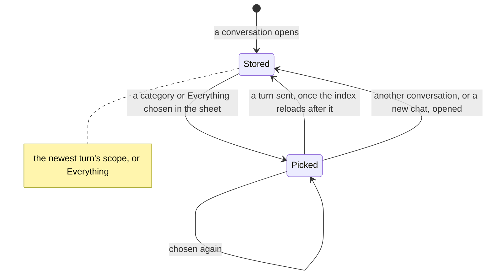

`@` still names a category for one question: naming one in the words
narrows that answer, as `list_due_tasks`' `categoryIds` and the journal
door's scope show, and sets nothing standing — the sheet says so.

**Her reply is an A2UI surface she composes from a catalog.** Her answer
is one message: any UI first, then her prose. The UI is written in A2UI
Express notation, the `a2ui_agent` library's default — a block per
surface, a component a call by position:

```text
<a2ui>
surface("reply")
root = TaskCards("Due today", ["task:t-ice", "task:t-seal"])
</a2ui>
Two things are due today, and the ice survey is the one that cannot wait.
```

`front_reply_stream.dart` owns that side. `frontReplyAuthoringCatalog` is
what she may write — `Reply` (children, top to bottom), `Text` (a short
label between parts), `TaskCards(caption, ids, notes?)`,
`PullRequestCards(caption, ids)`, `ClosedTasks(caption)`, `LoggedTimeChart(caption)`,
`PullRequestChart(caption)` and `QuickReplies(options)` — flat, with no
data in it: **she never passes data to a component**. A card names a task
or project by id and reads it live; a lookup's component only places what
the app wrote from that lookup. `frontReplyPromptSnippet` is the library's
description of that catalog and two examples in the exact format, which
`frontAgentSystemMessage` appends under *Writing UI*. `frontReplyFormat`
allows `createSurface` alone. `parseFrontReplyStream` runs her message
through the library's processor and returns her prose, the components in
the order she laid them out, and an error per block it could not read.

**Speech and display are separate channels.** Her prose is the only thing
spoken and the only thing kept in `<recent_turns>`; it leads what is drawn.
A `Text` is a label, shown and never spoken; a `caption` is a component's
accessibility label (`Semantics`), never drawn and never read aloud by
her voice. So her prompt has her say what matters about the cards in her
prose, the screen top to bottom.

`readFrontReply` checks the components before anything is stored: a card
must be a task or project the turn could see — `<routing_index>` or a
lookup's rows, by `kind:id`, a bare id meaning a task — and a lookup's
component must have a lookup behind it this turn. One that fails is
**dropped, never a reason to lose her answer**, and so is a block the
parser could not read: `acceptAnswer` logs a `front reply format:` warning
with the counts (never her words), which is how a model that keeps writing
what cannot be drawn shows up. Only a message without prose is not an
answer: the turn stays open for the one instruction the budget still
allows, and UI without prose is logged the same way. **Cards never hinge
on her remembering the component**: a list in her prose whose lines each
hold one link to a task or project the turn saw is drawn as `TaskCards`,
what else the line says kept as the card's note (a project line that says
more stays her words, since only a task's card shows a note; so does a
line that says a sentence, longer than `frontCardNoteMax`). The tasks a
`list_due_tasks` found that she listed nowhere follow as one more list,
and a lookup's component she did not place follows in catalog order. A
task is listed once, and never when a closed-task card shows it.

**A turn that looked something up to answer with is asked for its
answer.** The send loop stops after a lookup batch, so a lookup answer is
always a second call. `frontContinuationInstruction` picks what that call
is told: `frontAnswerInstruction` when the turn ran a lookup made for an
answer (`answerLookupCalls`: due or closed tasks, logged time, pull
requests) and rejected no dispatch, otherwise
`frontDispatchRepairInstruction`. A TLDR read or a corpus match serves
routing as much as answering and keeps the repair wording; so does a turn
whose dispatch was rejected, which meant to route something and would lose
that action if told not to dispatch. Leading with *dispatch* after a due lookup had a model route, now
and then, the question it had just looked up
(`test/features/ai/eval/front_agent_answer_eval_live_test.dart` runs the
production strategy, prompt and parser against live models).

The workflow stores the reply as **one A2UI v1.0 `createSurface` message**
(`FrontReplySurface.compose`, the payload's `surface`), named for the
reply: a root `Reply` listing her components by id, and a `dataModel` the
app fills — `/due`, `/closedTasks`, `/loggedTime`, `/pullRequests`. A
lookup's component is bound to its path (`{"@path": …}`) and left out when
the turn has no such data; the due window labels the reply's cards only
when it has exactly one list. The thread builder reads it into
`surfacesByMessageId`; a reply stored before replies had surfaces gets one
composed from her words and the `closedTasks`, `loggedTime` and
`pullRequests` it carried. `<conversation_tasks>` and the stage's pointing
read the surface (`taskIds`, `hasVisual`).

**The surface is drawn by `a2ui_flutter`.** `FrontReplySurfaces` holds one
`MessageProcessor` of `frontReplyCatalog` for the conversation and feeds it
each reply's stored message: a new reply is created, one whose surface
changed is updated in place (`updateDataModel`, then `updateComponents`,
so what it already shows stays mounted while her answer grows; delete and
create only when the processor refuses the update), one that left the
thread is deleted, and a reply of
words alone gets none. A stored message the processor refuses is logged
(its code only) and left out, so the reply falls back to her words. The
pane hands `AgentChatView.replyBodyBuilder` an `A2uiSurface` inside a
`FrontReplyScope` for any reply with a live surface. Each catalog component
is built on the chat's own widgets: `Text` through the view's Markdown
(with the device's dates), `TaskCards` as a `FrontEntityPreviewList` — a
task as `FrontEntityPreviewCompactCard`, a project as
`FrontEntityPreviewProjectCard` (both below) — `PullRequestCards` as
`FrontPullRequestCards`, one task page pull request card per holding task:
the task as its header, which opens it, over that task's own
`PullRequestRow`s read live, a pull request the task no longer holds left
out — the lookups' components as
the closed-task card and the charts, and `QuickReplies` as design-system
chips. What a tap does comes from the scope (a task opens on top of her, a
project after closing her), so the catalog itself is static; a card a
door's preview already shows is left out of her lists. A tapped quick
reply goes out as an A2UI action (`quick_reply`) on the surface, arrives
on the processor's `onAction`, and is sent as the user's next turn in its
own words — only under her latest reply, not while a turn is in flight,
and not in the inbox, which gathers every conversation. What the doors made follows the surface as preview cards.

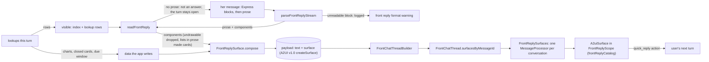

**Her answer is on screen while she writes it.** Most of a lookup
answer's wait is not her writing: it is the lookup call, then the wait for
the second call's first token. Live (2026-11-12, the three models she runs
on), her first word came 0.1–0.5 s before the turn ended — but what the
lookup found was known a third to a half of the way in. So two things are
shown early, both through one in-memory value, `FrontLiveAnswer`:

- **What a lookup found, as soon as it returns.** After the call that
  looked something up, `FrontAgentStrategy.showLookups` reads an empty
  message through `readFrontReply` — which appends the due tasks and the
  lookup components nobody placed — and the cards or the chart are drawn
  while the next call writes about them.
- **Her message as it streams.** `ConversationRepository.sendMessage`
  tells the strategy what the model has written so far
  (`ConversationStrategy.onContent`, a no-op by default). The front
  strategy strips reasoning blocks, reads the unfinished message
  (`parseFrontReplyStream(complete: false)`: an open block is not an error
  yet, and text that could start a tag is held back) and reports what it
  says and draws so far — read exactly as `acceptAnswer` will read it, but
  taking nothing.

The workflow composes each report into the reply's surface under
`frontAgentReplyMessageId`, the id the stored reply will have, and hands it
to `frontLiveAnswerProvider`. The pane adds it to the thread as its last
message (`frontThreadWithLive`) when the thread ends on the turn it answers
and the stored reply is not in it yet. **Because the two share an id, the
stored reply takes the live one's place** — same row, same surface key, no
loading shell and no jump (stay while reload). The line that says she is
thinking stays until she has written a word. A live answer is taken down
only when it turns out to be none: a remark beside a lookup that found
nothing to draw, or a turn that failed. It is never in the inbox, which
shows turns that wait on the user.

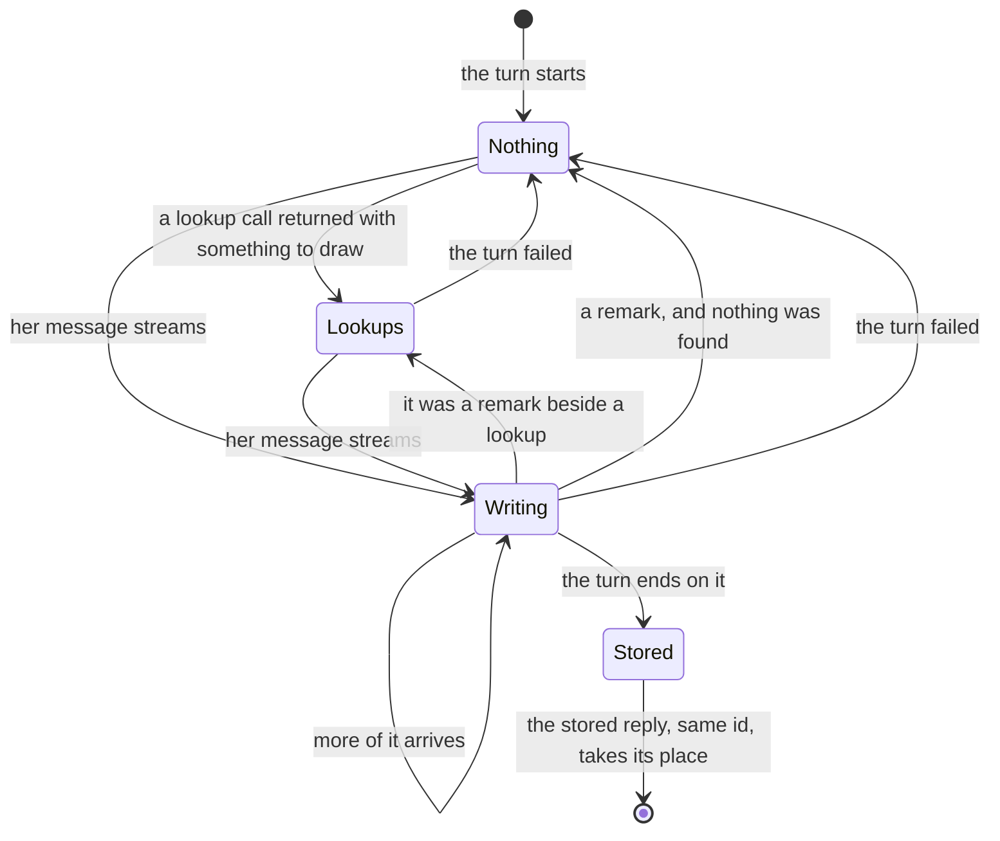

Her voice is unchanged by this: a spoken turn is still spoken once, from
the stored reply.

**An answer about what is due says which window, quietly.** Her prompt has
no headings — her words may be read aloud — so the label over a due list
never comes from her prose. The strategy keeps the window a
`list_due_tasks` that found tasks read (`FrontDueSection`: the window, the
day it was asked, the last day it reaches); the workflow writes it into
the surface's data model at `/due`, and the reply's `TaskCards` is bound
to it. `FrontDueSectionLabel` draws it in the caption's low ink
over a reply's one list: *Due today* and *Overdue* (the Tasks due view's own
labels), *Due through* a day for the days ahead, *Overdue and due through*
a day — or *today* for a window that ends on the day it was asked. When she
gives overdue and due as two lists, her `Text` above each names it and
no label is drawn.

**Her answer about what was closed is cards under her words.** A reply
whose surface has a `ClosedTasks` component gets `FrontClosedTaskList`: one
card, a `FrontClosedTaskRow` per task found — all of them — with the Done
or Rejected `StatusGlyph` and label it closed with and the day, then its
category's colour swatch (`ColorIcon`) and name; a task reopened since
reads `Done → In Progress`, its status now from `taskPreviewProvider`. A
tap opens the task on top of her. A task her own lists also name is drawn
once, on the closed-task card.

**What her turn made is a preview card under her words.** When a door's
outcome is `FrontDoorTaskCreated`, `FrontDoorEventCreated`,
`FrontDoorProjectCreated` or `FrontDoorDayPlanned` — or it handed a person
door's words to that person's agent (`FrontDoorChatTurn`, the person named
by the door's `destinationId`) — the thread builder adds a
`FrontEntityReference`: its `FrontEntityKind` (task, event, project, person
or day plan: a set of its own, so an event never becomes a routing
destination), its id (a day's is its date, `frontDayPlanId`), and as its
title the user's words it was made of, or a person's name as the walker
recorded it. It goes to `entityPreviewsByMessageId` under the reply that carries the door
(`carrierOf`), once per entity, in segment order. A turn she has not
answered draws no card: its door card already says *Made into a task* or
*Made into an event*. The thread stores only the reference, never the
preview: each card reads `frontEntityPreviewProvider` — keyed by
`(kind, id)`; a task's built on `taskPreviewProvider`, an event's the
`JournalEvent` as stored, both re-read when a notification names the
entity; a project's the project and its tasks' counts, re-read when it or
any of its tasks is named; a person's the person and their newest check-in,
re-read when they are named (a check-in names them); a day's its plan from
`currentDraftPlanProvider` — through
`.value`, so a change after the turn shows on the card and
a reload keeps the card as it was until the new preview lands.
`FrontEntityPreviewList` stacks the cards between her words and her door
cards, a task as `FrontEntityPreviewCompactCard`, an event as
`FrontEntityPreviewRichCard`, a project as `FrontEntityPreviewProjectCard`,
a person as `FrontEntityPreviewPersonCard`, a day as
`FrontEntityPreviewDayCard`.

The compact card is one `DesignSystemListItem` on the card surface
(`dsCardSurface`, `radii.m`, a 0.5 hairline in `decorative.level01`): the
task's cover (`CoverArtThumbnail`, `ControlSizes.iconChip`) or else its
`StatusGlyph`, its live title, the one-liner in the AI ink, then status,
category swatch and name, `DueDateText` and the estimate
(`formatRangeDuration`, a timer glyph) — neither of those two once it is
done or rejected — and, while it is still to do, its priority beside the
chevron, out of the subtitle so no truncation takes it
(`TaskShowcasePriorityGlyph` and `P0`–`P3`, also in its semantics label).
A tap opens the task on top of her; a long press — a secondary click on
desktop, the long-press action to a screen reader — opens a
`DesignSystemContextMenuAnchor` at the press with *Change status…*,
*Reschedule…* and *Move to project…* (only for a task with a category, as on
its page), each reading the task as stored now and opening the picker its
own page opens (`TaskMetaPickers`), so an action here writes exactly what it
would there. A task a card shows
is taken out of her words' task rows, as the closed-task cards are, and a
list left empty is not drawn. The rich card is `LinkedEventCard` — the
`EventSummaryCard` the app draws wherever an event is linked, resolved
from the event and its links as its page resolves them: cover, title and
rating, category and date, a status pill, the summary and the photo and
task counts. Its `onTap` is the chat's: she closes, then the event's page
opens, as *Open* on its door does — `/events` is not a root her links may
reach. The day card says the day, then its blocks in the order they run —
buffers and dropped blocks left out — each with when it starts and ends
(tabular figures) and its title, a completed one ticked, at most
`FrontEntityPreviewDayCard.maxBlocks` (5) and how many more; a tap opens
the Daily OS day surface on that day, as *Open* on the day's door does.
The project card is the Projects list's own `ProjectRow` — its title, its
tasks' progress counted done-only as its page counts them, its status — and
a tap opens the project, closing her. The person card is the People list's
own `PeopleListRow` — their face, name and newest check-in — and a tap
closes her and opens their page (`/people/<id>`).
Every card, until it loads or once the entity is gone (a day with no plan
left), is the title it was made with alone on the card surface under its
kind's glyph, still opening it.

**Her answer about logged time is a chart under her words.** A reply
whose surface has a `LoggedTimeChart` component draws
`FrontLoggedTimeChartCard` where she placed it: the Insights page's
`StackedBarChart` — one bar per day, per hour for a single day — each split
into the categories' colours (one category is one colour), an empty day a
bar of zero, a tap on a bar reading out every category and its time; under
it the Insights `ChartLegend` when more than one category shows, and an
expand action (`DesignSystemIconAction`) opening the Insights
`InsightsChartCard`, with its per-day and running-total views, in the
shared modal over the conversation, titled with the days — with their
years unless every day is in the current one. The card holds
its height while it reads, and draws nothing once the time it charted is
gone. A chart of named categories draws them and one `Other` bar segment
(the resolver's `insightsOtherCategories` label): `buildChartData` counts
time a caller already keyed `kInsightsOtherCategoryKey` into its Other
series, never a second one. That slice takes none of the category slots
(six named categories keep six series), sits last on the stack as the
rollup does, and its `+N` rollup count counts only real categories folded
in, so the legend gives no count of what the slice holds.

**Her answer about pull requests is a chart under her words.** A reply
whose surface has a `PullRequestChart` component draws
`FrontPullRequestChartCard` where she placed it:
a toggle between pull requests opened, lines added and lines deleted, the
AI consumption dashboard's `ImpactStackedBars` — one bar per day — and,
once two days have begun, a *Per day* / *Running total* toggle that swaps in
its `ImpactStackedArea` of the running sum. One series per metric, keyed by
its label so a tapped bar reads it out, each in its own palette colour; no
legend. The card holds its height while it reads and draws nothing once no
pull request it counted is left.

A link in her bubble or in a card's answer goes through the pane's one
handler, as *Open* and a cited source do. A task (`/tasks/<id>`) opens **on
top of her**: `pushTaskDetailPage` pushes `TaskDetailsPage` onto the root
navigator above her dialog, so its back — `BackWidget` on a phone, the
`TaskDetailDesktopLeading` arrow on a desktop, both popping a pushed page
(`isPushedPage`) — returns to the conversation the user left, list or inbox
as it was. That is a deliberate exception to [opening a task by
beaming](../architecture/navigation.md#a-pageless-push-is-invisible-to-the-router):
a beam would have to close her first. Any other route in the app
(`internalRouteFromMarkdownUrl`) closes her surface and then goes there;
anything else is the shared `handleMarkdownLinkTap`. Every way out to a page
other than a task — a project, a journal source, *Start a goal…* — closes her
through the surface's own close (the pane's `onClose`, a `pop`), never
through back (`maybePop`): while the list or the inbox is open, back is
theirs, so the page would open behind her.

**What she hears.** Dictation into her composer is transcribed on the
Settings default profile's transcription slot
(`settingsDefaultDictationTargetProvider`, resolved when a take stops),
and the words come back as the engine heard them: no correction model
follows, only the speech dictionary's local pass inside
`AudioTranscriptionService`, whose hint carries the category names, so
"overdue in Lotti" is heard as named. Without that explicit target the recorder fell
back on `AudioTranscriptionService.discoverTarget`, which ranks an
installed on-device (sherpa / ONNX) model first — a short question took
10–15 s instead of the second Voxtral needs. A default that cannot
transcribe fails the take as "no audio model", never a discovered engine.
Unlike a goal's or a person's chat, no category owns her, so there is no
category tier and no dictionary category: the dictionary's global entries
and every category's name reach her.

Leaving a conversation — another one, or the list — while it records or
transcribes cancels the recording (`ChatRecorderController.cancel`), so what
was said never lands in a conversation it was not said to; a recording
already running when the pane first resolves its conversation is kept.

# Her voice

A question the user **spoke** is answered aloud; a typed one only in
writing (the voice-first plan's decision 3). `AgentChatView` hands a
transcript it sends by itself to `onSendSpoken`, which the pane wires to
`FrontChatController.sendSpoken`; that marks `frontSpokenTurnProvider` with
the landing conversation and the moment, *before* the turn is written, since
her reply can land before the send returns. A typed send, or a send that
fails, clears it.

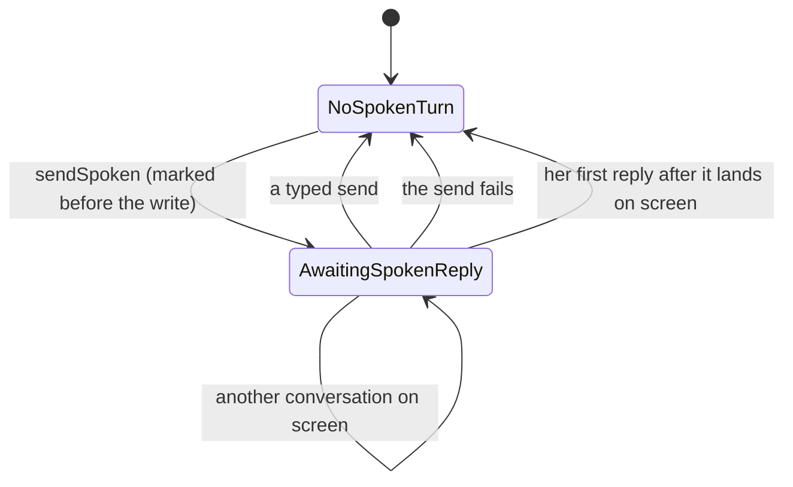

`FrontVoice.listenForSpokenReply`, called from the pane's build, watches the
thread: once the spoken turn's answer has landed in that conversation it
settles the turn and — with `enable_companion` and
`enable_ai_summary_tts` on and a voice available (her profile's cloud voice
in the app's language, else the on-device engine) — speaks it under
`front-chat:<conversation>` (`frontVoiceSourceId`), stopping whatever else
was speaking first. It keeps those flags and her resolved setup watched, so
they are known the moment the reply lands. A voice that fails surfaces the
shared playback toast.

**She is heard a fraction of a second after her answer lands.** With her
profile's Voxtral or ElevenLabs voice the answer is one streamed synthesis, played while
it is still arriving ([a cloud voice that can stream](tts.md#preparation-and-cancellation)):
about half a second to her first word on Voxtral, under that on
ElevenLabs v4 Turbo, where a whole clip took two and a half, in one voice
throughout. She is still spoken from her stored answer:
her first word streams in only a fraction of a second before the turn
ends, so speaking from that stream would gain little and would have to
decide about her doors' answers before they exist.

Besides answers to spoken turns she says one line of her own: the
confirmation after *Make it a task* made a task
([a task from her words](#a-task-from-her-words)), spoken or typed turn
alike, under the same mute.

**What she says** is `frontSpokenAnswer`: her first reply after the turn,
then the answer of each of the turn's doors — a journal or owner answer, a
specialist's mirrored reply — in segment order, citation numbers left out
and Markdown said as its words (`withoutMarkdown` in the read-aloud's
`speech_text.dart`: a linked task is said by its title, never its url).
A journal question usually ends with a dispatch alone, no reply of hers, so
speaking only a reply left the answer in its door unspoken and her pose on
*think*. The answer has landed once the turn holds a reply or a door,
every door is walked, and every goal or person a door handed the words to has
replied (that door is done at the hand-over, its reply mirrored later); it is
read only after the send settles, because the doors are walked inside the
wake the send waits on, and only from a thread that is not reloading, whose
held value may be the reply without its doors' answers. A turn that landed with nothing to say still settles.
An answer shown only while private entries are is never said aloud, and a
journal answer is said only while `frontJournalAccessProvider` lets its door
card show it (`QueryAccessSnapshot.allowsContent`): the listener waits until
that visibility is read, and tries again when it arrives.

**Which voice is hers.** Her cloud voice is the read-aloud model of the
profile her own setup resolves to ([where it plugs in](#where-it-plugs-in)).
Her built-in fallback is a bare model with no read-aloud slot, so without a
profile of her own or a Settings default she speaks with the on-device
voice, however many other profiles name Voxtral TTS. The drawer's footer
offers *AI profile* once she exists (`FrontProfileChoice`). The picker leads
with a *Settings default* row, named after that profile and marked while she
has no profile of her own (or her own is gone), then lists every profile. A
pick is written onto her identity as a user-configured setup
(`FrontAgentService.chooseProfile`, synced with the identity); the default
row clears it. The identity's update stream re-resolves her setup, on this
device and on one the choice syncs to. Her routing then thinks with that
profile's thinking model, and its read-aloud model is her voice. Her resolver
also watches the Settings default, so changing it re-resolves her while her
surface is open. A chosen profile that no longer resolves — deleted here or
through sync — counts as no choice (`resolveFrontAgentModel`): she follows
the Settings default rather than falling silent. A disabled setup still
resolves to nothing.

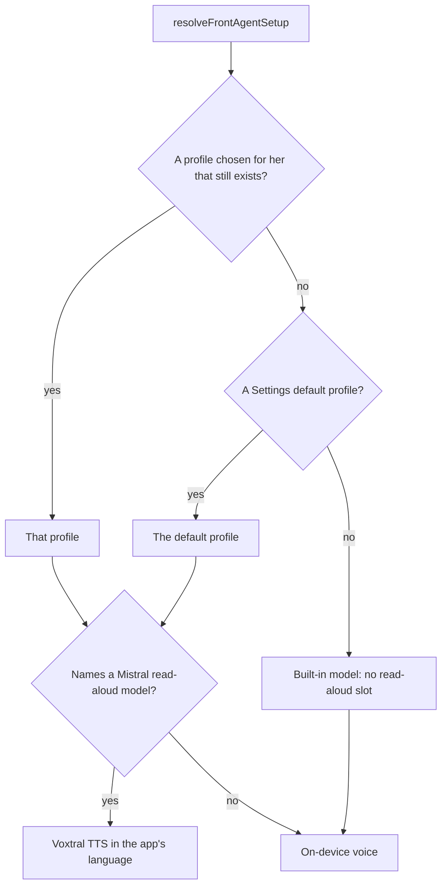

She speaks only while her customization lets her
(`CompanionCustomization.speaksReplies`, Settings › Preferences ›
Companion › Her voice, synced) and only once that is known
(`CompanionCustomizationController.loaded`): muted, a spoken question is
answered in writing like a typed one. The check is made again as playback
starts (`canPlay`), and a mute while she speaks stops whichever of her
sources is playing (`isFrontVoiceSourceId`) — never another voice.

Her bust is a `CompanionSpeaker` on that source, so her lips follow only her
own words in the conversation on screen. She holds `listen` while the user
records and `think` while a send is in flight or a spoken answer is owed
(`FrontVoice.holdingOf`). Starting to record stops any voice before the
microphone opens (`ChatRecorderController.start`), so she never records
herself.

**Her voice's controls and her card** (`front_voice_controls.dart`,
`front_voice_switch.dart`) are the drawer's *Spoken answers* row while the
companion is on; her card is the header's. `FrontVoiceSwitch` mutes her: it writes the companion customization's
`speaksReplies`, the same setting as the companion settings' switch, so a
mute here holds everywhere and stops her mid-sentence; it is shown only
once that setting has loaded, since a mute is never guessed at.
`FrontVoiceSpeedRow`, under it while she answers aloud, says the read-aloud
speed (`TtsSettings.speed`, the same setting as Settings → Speech) and a tap
moves it a step through `kTtsSpeedSequence`, from 2x back to 0.5x; the clip
she is speaking changes speed at once.
`FrontVoiceButton` is
the shared `TtsSourcePlayButton` on her source: while she speaks it stops
her — shown then even if she was muted meanwhile, so a stop is always in
reach — and once she has stopped, *Say it again* speaks her answer to the
latest turn from the start (`frontLatestAnswer`, the same words
`frontSpokenAnswer` gives a spoken turn) through `FrontVoice.speak`, so the
mute and the take-over hold as for a spoken reply — the
mute read at playback start from the app's container, so closing her surface
mid-synthesis does not cut her off. **An answer said again keeps its
voice:** `FrontVoice.speak` records, per conversation, the answer it said
and the cloud route it said it with (`frontSaidProvider`), and the same
answer said again takes that route rather than the one her profile resolves
to at the tap — a profile still resolving there would otherwise hand it to
the on-device voice, and any other voice would key a new clip. With the same
route the read-aloud's kept clip matches (see [read-aloud](tts.md)), so the
answer plays at once, with no synthesis spinner — after she finished it, and
after she was stopped mid-sentence too. It is gone while she may not speak, in
the inbox, for a conversation other than the one on screen, while a send is
in flight or a spoken reply is still owed, while the thread or its journal
access is being read, and before that answer has landed.
A tap on her face in the header shows her card — **in place, never a page of
its own**: `frontCompanionCardShownProvider` flips, and the pane's own
`FrontChatThreadView` lays `FrontCompanionCard` over its thread, fading it in
and out (`AnimatedSwitcher`, `MotionDurations.short4`), still speaking on her
source. The thread, its field, the header and the list stay where they are,
so typing, `@` mentions, the microphone and Enter to send go on as before.
Beside the list (a desktop window wide enough for `FrontChatPane.listWidth`)
nothing floats over the thread (`FrontChatThreadView.cardDocked`): the card
is docked at the foot of the sidebar, under the conversations and her
settings, as wide as they are (`CompanionCardForm.docked`, see below), so it
covers nothing of the conversation. A tap on the card does nothing; it is
put away only by *Hide* last in its menu (`CompanionFloatingCard.onHide`,
also reached with Enter or Space), and the face comes back to the header at
the top.
Whether she is shown is kept in SettingsDb (`FRONT_COMPANION_CARD_SHOWN`,
device-local, like her placement): she is out until the user hides her, and
stays hidden after a restart once they have. Until that value is read she is
hidden, so a user who put her away never sees her flash in; a value that
cannot be read counts as shown, and a tap made while it is read wins over
it. She shows only while the companion is on, a conversation is open and the
inbox is off.

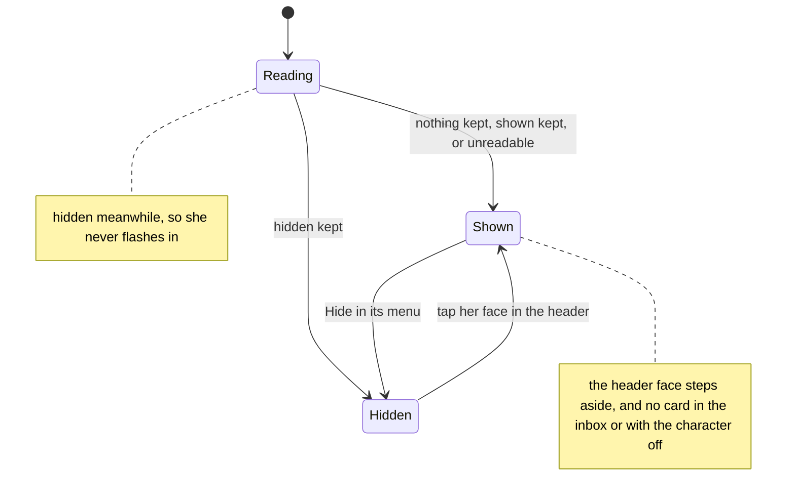

She stands head to toe in a `CompanionFloatingCard`
(`companion/ui/companion_floating_card.dart`): a glass card
(`DsGlassChipSurface`'s shadow with its lighter `cardBlurSigma`, over
`dsGlassCardFill` — far more see-through than a chip's fill, so the text
scrolling under her shows through as frosted shapes), handed to `AgentChatView` as its `threadOverlay`, so it
floats over the thread's area only — never over the header, the notch above
it or the field — and takes touches only where it paints; the thread scrolls
everywhere else, and a plain mouse wheel over the card still scrolls the
thread (`AgentChatView` forwards any wheel event the overlay leaves
unclaimed). Its edge takes the interactive accent
while she speaks. It opens small in the bottom-right corner; a drag that
starts on it moves it, a double tap switches Small ⇄ Large, a pinch sizes it
anywhere between, and a long press — a right-click on a desktop — opens its
menu (Small, Large, Demo size, Customize — which closes her surface and
opens her settings page, `/settings/companion` —, Reset position and size,
and Hide when its host gives `onHide`); so do Enter or Space on the focused
card. A single tap does nothing. A desktop
adds a grip on the corner facing the open screen, on hover, and Ctrl/⌘ +
scroll. Wherever it sits, the card stays a margin (`spacing.step5`) inside
the thread's area, and never taller or wider than that area allows. The
thread gets `threadBottomInset` — the card's height and the margin — after
its last message, so the end of an answer scrolls clear of her. It is kept
wherever the card sits: room that came and went with the card's half would
shift the thread under a drag. `AgentChatView` caps that inset at half the thread's
height, so a card capped by a small window or a phone keyboard never pushes
the last message out of view. The cap trades clearance for that: a card
taller than half the thread (a Large card over a short one) can still cover
the end of a reply, and moving it up or making it smaller uncovers it.

Where the user leaves it is kept per form factor
(`CompanionCardForm.phone` / `.desktop`) by `companionCardControllerProvider`
in SettingsDb (`COMPANION_CARD_PHONE`, `COMPANION_CARD_DESKTOP`; device-local,
not synced), as shares of the room it travels in plus a height, so a card in
a corner stays in it when the window resizes or the phone turns. Demo size
is never saved: it fills the area until its "Usual size" button, a double
tap, or the card is hidden.

Docked (`CompanionCardForm.docked`, kept under `COMPANION_CARD_DOCKED`) the
card never moves and has no grip, Ctrl/⌘ + scroll or Demo size: it is
collapsed by default — her bust (`CompanionFraming.bust`) in a short strip
— and expanded shows all of her. A button on its corner (Expand / Collapse),
a double tap, or Small / Large in its menu switch between the two
(`_DockedCompanion` in `front_chat_pane.dart`, animated by `AnimatedSize`).
The drawer above always keeps `FrontChatPane.drawerKeptHeight` — its search,
new chat and four settings rows and three conversations, a tap target each —
so an expanded card stops short of that; a window too short to keep it with
even the collapsed card floats her over the thread instead, as a narrower
one does. Docked, the thread is always to her right, so
she points at what she lists whenever she speaks it.

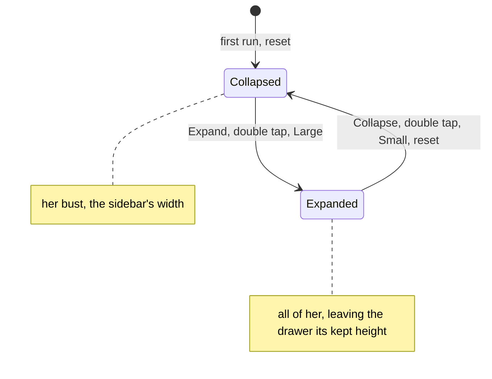

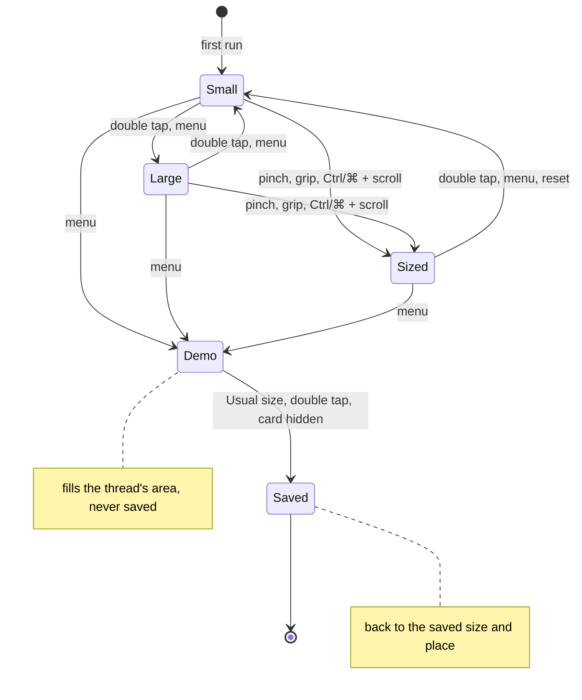

While her voice plays in the conversation and her latest reply lists tasks
or charts logged time (`frontStagePointsProvider` over
`frontLatestReplyHasVisual`, in `state/front_stage_pointing.dart`), she
holds `GestureName.pointRight` at the task rows or the chart as she says
them — only while her card is in the left half, or docked, the conversation
to her right — and lets her arm down when she stops. Otherwise she holds the turn's
pose as her bust does (`FrontVoice.holdingOf`). The bust keeps one tree
whatever she does, so her animator lives through a start and a stop.


# Where it plugs in

`frontAgentWakeRunnersProvider` and `resolveFrontAgentSetup` are merged in
`app_bootstrap.dart` into `agentWakeRunnersProvider` and
`agentResolvedSetupResolversProvider` (see [the agents overview](agents/overview.md)),
pinned by `test/app_bootstrap_test.dart`. Model resolution is the agent's
own: explicit setup (the profile chosen for her from the header, see
[her voice](#her-voice); one whose profile is gone counts as no choice), then
its profile, then the Settings default, then the
built-in cheap model (DeepSeek V4.1 Flash on Melious, else on Mistral —
`frontAgentBuiltInModelIds`) — never a category's, because the front agent spans
categories. The full-text index reaches the builder through
`fts5DbProvider`, overridden from the composition root, null on a host
without one.

# Gotchas

- **Never await a specialist from inside the front wake.** The goal and
  person chat services' `sendMessage` awaits their own wake's completion; at
  concurrency 1 that would deadlock. The walker runs inside the front wake
  but only appends and enqueues; the reply is mirrored when it lands.
- A door record is written twice under one id — the claim, then the
  outcome — and again on every tap. Anything counting rows per door must
  count by id.
- A proposal is still a *pending* turn for recovery purposes only until its
  door record is `done`; the walker marks it done with the proposal as its
  outcome, so waiting for the user's tap never re-arms a recovery wake.
- Her per-turn cost is the routing calls of her wake only. The owners'
  answers cost on the owners' agents, where their internals show them.
- The index must stay byte-stable: do not add a field that changes between
  wakes without the record changing.
- `match_to_corpus` returns open tasks only; a closed task is not a
  destination, and the prompt says so.
- A due question is hers, not the day's: routed to `day` it would end on
  *Nowhere to take this yet*. Keep rule 7 about changing today's plan and
  rule 8 about what is due.
