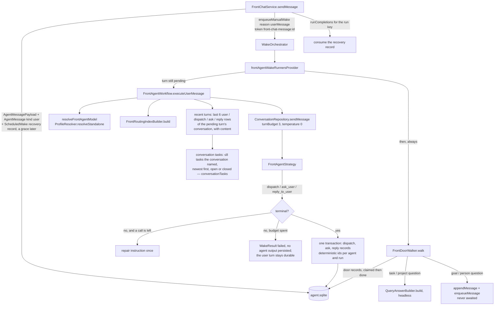
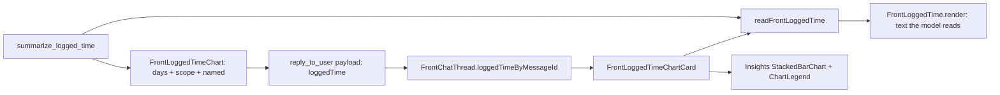
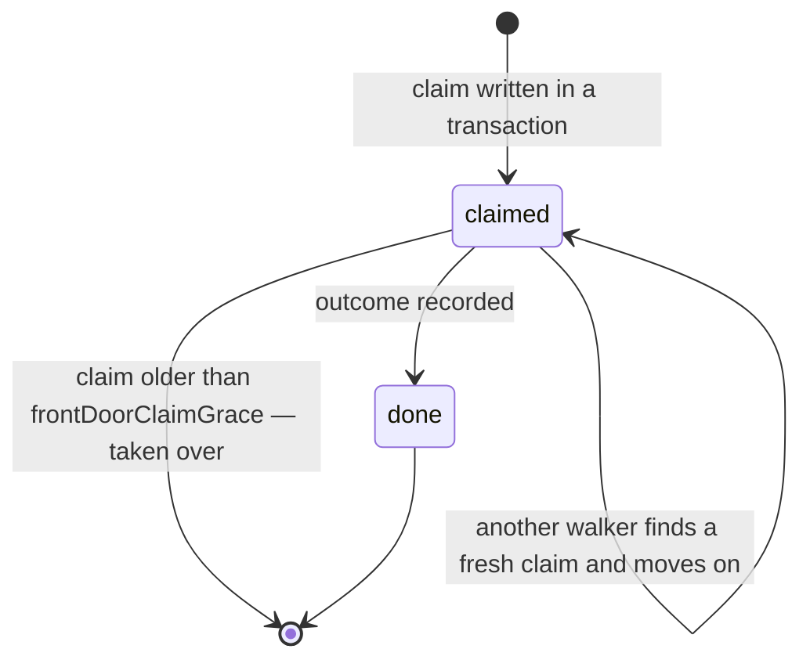
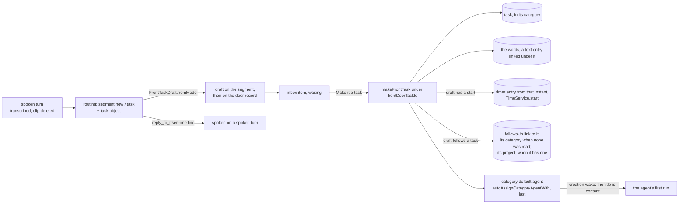
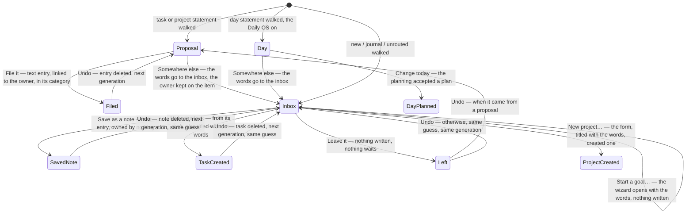
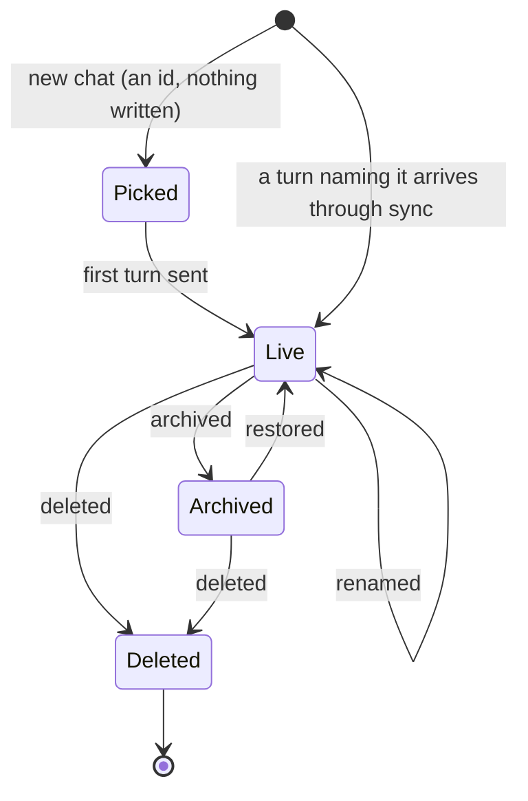
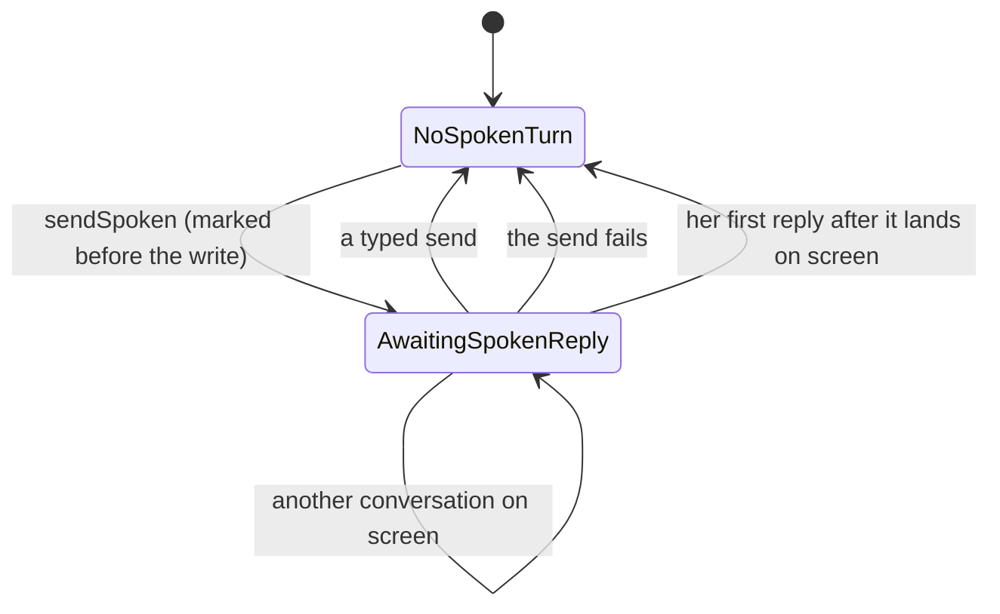
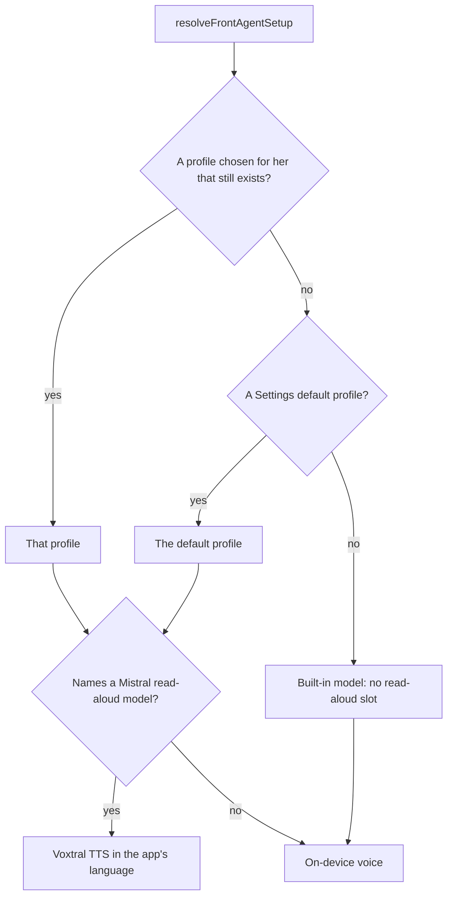
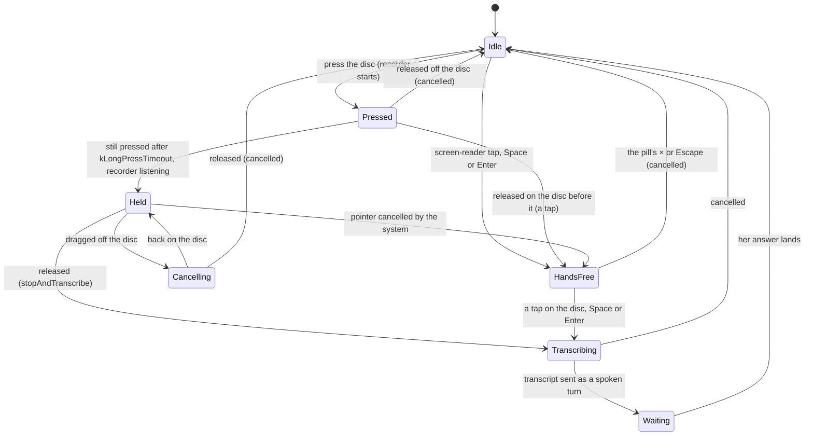

# What it is

The front agent is the one agent the user talks to in one place. It owns no
record and answers for no owner: it reads a bounded index of what exists and
decides where each part of what the user said belongs. A question about the
user's records that no single owner holds is hers to answer, from the journal
(ADR 0153). Its one artifact is a **dispatch**. After the dispatch, the **door walker** takes each segment to
its owner and the **chat surface** shows what came back, under the owner's
name. A statement is never filed by the agent: it becomes a **proposal**
under the user's turn, and only the user's tap writes — the user's own
words, verbatim (decision 1). What nothing owns waits in the **inbox**,
which is every **conversation** filtered (ADR 0154). The product decisions
behind it are in the plans, not here.

# One turn

**The turn path is the goal-chat pattern, with recovery.**
`FrontChatService.sendMessage` is `appendMessage` then `retryMessage`.
`appendMessage` persists the payload and a `user` message whose `threadId`
is its own id, notifies the UI (`notifyUiOnly`, never `notify`, which would
re-wake the agent), and arms a lease-elected `ScheduledWakeEntity` under
`frontChatRecoveryRecordId` for `frontChatRecoveryGrace` (30 min) later —
the ADR 0069 record, whose workspace `front-chat:<id>` the lease predicate in
`agent_providers.dart` recognises. A recovery record that fails to write
does not cost the turn. `retryMessage` then `enqueueManualWake(reason:
userMessage, supersede: false)` with the token `front-chat-message:<id>`,
awaits `runCompletions` for that run key, and **consumes the record only
after the run — routing and doors — completed**. A runtime that shuts down
first ends the completion stream, which the service turns into a
`FrontChatTurnException` so a composer never waits forever; the record stays
pending. An append whose transaction committed but whose outbox flush failed
is reconciled by re-reading the deterministic id, not retried into a
duplicate.

**The wake runner routes a still-unrouted turn, then always walks.** Only a
chat token enters the model; any other token — creation, a subscription —
returns a successful no-op. `FrontChatHistoryService` keeps two sets apart:
the **unrouted** turns (no `dispatch`, `ask_user` or `reply_to_user` row
names them) are what the runner takes through the model, so a recovery wake
arriving after the author's own run routes nothing; the **pending** turns —
the unrouted ones plus any routed turn whose newest dispatch still has a
segment without a `done` door — are what maintenance re-arms. The scheduled
wake manager consumes a recovery record when it *enqueues* the wake, before
the doors finish, so a walk that died after the dispatch was written stays
eligible for the next pass, which walks the doors without routing again;
the claims below make that idempotent. A failed routing walks nothing:
there is no dispatch to walk and the record stays pending.

**Recovery runs on every device.** `FrontRuntimeMaintenance` implements all
three runtime hooks and calls `restoreOldestPendingMessage`: a pending turn
with no record (or a tombstone) gets one carrying the tombstone's clock; a
consumed record that did not answer is re-armed for when its lease lapses,
else a grace past its deadline; a pending record is left alone. Failures are
contained and logged under `FrontRuntimeMaintenance`.

# The routing index

`FrontRoutingIndexBuilder.build` reads, with no model call and no raw entry:

| Kind | Rows | Source | What the row's `id` is |
|------|------|--------|------------------------|
| tasks | ≤200, the corpus order | `readOpenTaskCorpus` (shared with the day agent) + `getLatestTaskReportsForTaskIds` | the task's journal id |
| projects | ≤50, newest first | `getVisibleProjects` + the primary `agent_project` link's report | the project's journal id |
| goals | ≤50, newest first | active `goal_agent` identities, the spec head's version for the statement, the agent's report | **the goal agent's id** |
| people | ≤50, newest first, only when `FrontRoutingScope.includePeople` | `getRelationships` | the relationship entry's id; names only |

Tasks, projects and people are filtered through `FrontRoutingScope.categoryIds`:
the identity's `allowedCategoryIds` narrowed by any categories the turn's
payload carries — written by builds that had category chips; new turns carry
none (`frontCategoriesOf` on the user turn's payload, read in
`executeUserMessage`), never widened — `frontNarrowedCategories`, the same
rule the journal door applies; empty is unrestricted, the `categoryAllowed`
convention. Goals carry no category and are listed whenever `includeGoals`.

The block opens with **`## Categories`**: every active category her
allow-list lets her see (`JournalDb.getAllCategories`, the privacy-gated read
the task queries share), `category:id | name`, by name, the ones the turn's
payload narrowed it to marked `chosen`. That is what a category the user *names* resolves
against; a category is never a destination.

The rendered block is **byte-stable**: rows sorted by id within each kind,
one fixed format (`kind:id | title | status | due | one-liner`), a truncated
kind announced in its heading. That is what lets a provider's prefix cache
pay across turns. One-liners are rendered; TL;DRs are held on the row for
`read_tldr` and never rendered. At every cap the block is roughly 7.5k
tokens.

**The tasks the conversation named** follow `<recent_turns>` as a
`<conversation_tasks>` block in the same row format plus each task's
`category:id` (`renderRow(withCategory: true)`), most recently named
first — what "that one", "it" or "the previous task" means, and which
category the conversation has been working in. The index rows leave the
category out: a few tokens on every row of every wake. It sits after
the turns, not inside the index, because it changes with every turn and the
index must not. `frontConversationTaskIds` scans the whole visible
conversation, newest message first, not just the six-turn tail and its
400-character clip: a `lotti://task/<id>` link in her reply, question or the
user's words, a `task` option she offered, a dispatch routed to a task or
naming the task a follow-up follows, and the door records — a segment filed
into a task, and a task the user's tap made (`FrontDoorTaskCreated`), which
no link names anywhere else. A mention dates from its message, a made task
from the tap (`FrontDoorTaskCreated.at`): the door record keeps the time it
was walked, and an old inbox item tapped now is the newest thing named. At
most `frontConversationTasksMax` (8), each once. `FrontRoutingIndexBuilder.conversationTasks` resolves them through
`getJournalEntitiesForIds` — so the privacy toggle holds — and drops a
deleted task, a non-task, one in a private category while private entries
are hidden (the logged-time reader's rule) and one outside the scope; a
**closed** task stays,
because a follow-up is most often to finished work. It is not a destination
for that: the strategy accepts a listed conversation task only as a
follow-up's `followsUpTaskId` and as an `ask_user` option.

# The contract

Seven tools, never fewer (a single tool makes DeepSeek rewrite
`tool_choice`), in a fixed order:

| Tool | Ends the turn | Cap | Over the cap |
|------|---------------|-----|--------------|
| `dispatch` | yes | once | refused |
| `read_tldr(ids ≤ 5)` | no | 1 per turn | `frontTldrExhaustedAnswer` — the tool stays listed |
| `match_to_corpus(phrase)` | no | 1 per turn | `frontCorpusMatchExhaustedAnswer`; unavailable when no FTS index is wired |
| `list_due_tasks(which, daysAhead 0–7, categoryIds)` | no | 1 per turn | `frontDueListExhaustedAnswer`; unavailable when no lister is wired |
| `summarize_logged_time(period, categoryIds?)` | no | 1 per turn | `frontTimeSummaryExhaustedAnswer`; unavailable when no summarizer is wired |
| `ask_user(question, options ≤ 3)` | yes | once | refused |
| `reply_to_user(text)` | yes | once | refused |

Lookups are capped by **count-and-refuse**, not by removing the tool:
removing it changes the request prefix and voids the cache. Rows a
`match_to_corpus` or a `list_due_tasks` returns become valid destinations
for the rest of the turn — and names her words may link.

`ask_user` and `dispatch` refuse each other, and so do `ask_user` and
`reply_to_user`. A reply may accompany an accepted dispatch; when a batch
rejects a dispatch and accepts neither a dispatch nor a question, a reply
in that batch is dropped, so the turn stays open for the repair round
instead of ending on a sentence about a routing that never happened.

## What `validateFrontDispatch` enforces

In code, not prompt: at most `frontMaxSegments` (8) segments; spans by offset,
**ordered and non-overlapping**, with `text` equal to the input slice, so a
repeated or overlapping phrase can never stand in for words the model
skipped. Offsets that miscount are not a failure when the words are right:
a segment whose `text` is found verbatim after the previous segment is
placed there, its first occurrence (a model copies words far better than it
counts characters — Mistral Large 4 put a 63-character message at
`[0, 54)`, then at `[0, 64)`, and every turn failed). Offsets that agree with
the words are kept, so a phrase said twice is the one the model meant; a `task` / `project` / `goal` / `person` destination needs an id
the index or a lookup listed, at confidence ≥ `frontLowConfidence` (0.5);
`new` needs a `newKind`, and a `new` task may carry a `task` object, read
leniently ([a task from her words](#a-task-from-her-words)); `day`,
`journal` and `unrouted` need neither. The
spans and the gaps between them partition the input and the gaps are never
dropped: a gap holding ≥20 % of the input's non-whitespace characters
becomes an `unrouted` segment, and when the gaps together hold ≥20 % every
gap containing a word becomes one. The thresholds are the day agent's
(`≥0.75` strong, `0.5–0.75` low, `<0.5` none).

Her **manner** follows the contract in the system prompt:
`frontAgentPersonality(sass)` — warm, cheeky or sassy, the companion's
`CompanionSass` read at each wake through the workflow's `sass` getter —
shapes only her own words (`reply_to_user`, `ask_user`), never routing, ids
or an owner's answer, and asks for short spoken-friendly sentences. Appended
after the contract, so a sass change leaves the cached prefix as it is.
## Her own answers: what is due, logged time, and naming things

A question about which tasks are due — *what is due today?*, *anything
overdue?*, *what's due this week?* — no single owner holds, so it is hers,
like a journal question; but she answers it from the record, not the
journal. The prompt's rule 8 sends it to `list_due_tasks` and then
`reply_to_user` alone; rule 7 keeps `day` for changes to today's plan, so a
due question no longer lands on the day door, whose question outcome is
`FrontDoorSkipped(noDoor)`.

**Only what was asked comes back.** `which` names one `FrontDueWindow`, split
at local midnight as the task list's *Due today* and *Overdue* views split
it:

| `which` | Holds | Never |
|---------|-------|-------|
| `today` | due on today's local day | overdue |
| `overdue` | due on an earlier day | due today |
| `upcoming` | due from today through `daysAhead` days past it | overdue |
| `all` | both, only when both are asked for | — |

`FrontRoutingIndexBuilder.dueTaskLister` reads
`JournalDb.getTasksDueOnOrBefore` — the read the Daily OS and those views
share — and checks both ends of the window itself, inside the turn's scope
(her allow-list, narrowed by any categories the turn's payload carries), soonest due first, at most
`frontDueTaskLimit` (30). A category the user names (*overdue in Work*) is
passed as its id from `## Categories` in `categoryIds` and narrows it
further, never widens it: the strategy refuses an id the index does not
list, and — in a turn whose payload narrowed it — one outside that,
telling her to say it is outside. So naming a category is how the user
filters the list. `FrontDueTasks.render` is what the model
reads: the window and any named category in its heading, one row per task in
the index's shape plus its category's name, an overdue one marked only in
`all`, or a plain *None*.

**How much time was logged** — *how much did I log yesterday?*, *what did
I work on in the past seven days?*, *time in Work this week?* — is hers too.
Rule 9 sends it to
`summarize_logged_time` and then `reply_to_user` alone; it is never
dispatched. `period` names one `FrontTimePeriod`, resolved in code against
the local day the question was asked on (`FrontTimePeriod.rangeOn`), never
by the model:

| `period` | Local days |
|----------|------------|
| `today`, `yesterday` | that one day |
| `this_week` | the week's first day through today; weeks start on the device region's first weekday (`firstDayOfWeekIndexProvider`), as the Insights page starts them |
| `past_7_days`, `past_30_days` | the N days ending with today |
| `this_month` | the 1st through today |
| `last_month` | the previous calendar month, whole |

The prompt maps "last month" to `last_month` and "the past month" to
`past_30_days`; a period the enum lacks is answered by naming the ones she
can sum. `FrontRoutingIndexBuilder.loggedTimeSummarizer` sums what
`readFrontLoggedTime` (`service/front_logged_time_reader.dart`) reads — the
Insights page's own query (`JournalDb.insightsTimeRows`, read directly so
each row keeps its entry id), bucketed with its `bucketize` — ranked with its
`rankedCategoryTotals`, so her numbers are that page's: private entries only
while they are shown, a task's time in the task's category, overlapping
entries in one category counted once, an entry across midnight split. Rows
outside the turn's scope are dropped before bucketing, so time in no
category is left out whenever the scope is narrowed. So is time in a
private category while private entries are hidden — a category
`getAllCategoriesIncludingPrivate` lists but `getAllCategories` does not —
since an entry need not be private itself to sit in one; time in a deleted
category stays, unnamed.

**A named category is the only one named.** When the user names categories
listed under ## Categories, the model passes their ids as `categoryIds`,
validated exactly as `list_due_tasks` validates its own (one shared
`_namedCategories` in the strategy: listed, and among the chips when some
are chosen). Unlike the due list, naming does not narrow the sum:
`readFrontLoggedTime` keys every other category's time — and time in none —
`kInsightsOtherCategoryKey`, per entry before bucketing, so the summary
reads the named categories by name and the rest as one
`FrontLoggedTime.otherCategories` line, and the heading tells her never to
break it down. Overlapping entries in two unnamed categories count once in
that slice, as they would in one category. The prompt has her call it
"other categories"; nothing she reads holds another category's name.

**The tasks the time went to.** The same call lists them, so *what did I
work on* is one lookup. `_loggedTasks` takes the summed entries — in the
named categories only, when some are — reads their links
(`JournalDb.basicLinksForEntryIds`, hidden and deleted links dropped) and
the linking tasks (`getJournalEntitiesForIdsUnordered`, which leaves out
deleted tasks and private ones while private entries are hidden), and
credits an entry linked to several tasks to the one the Insights query
takes its category from — the latest started of those with a category, then
the lower id — so the task listed is the one whose category the time is
summed in; only when none has a category, the latest started. Re-keyed by
task id, the entries
go through the same `bucketize` and `rankedCategoryTotals`, so a task's time
is clipped to the days and merged like a category's. At most
`frontLoggedTaskLimit` (30) are listed, the rest counted; each becomes a
lookup row, so her reply may link one by title alone and a list of them is
drawn as task rows. Rule 9 asks her to list every one when the question is
what was worked on, and, for `this_week` or `past_7_days`, to close with
one sentence naming the category most of the time went to.

`FrontLoggedTime.render` is what the model reads — the period, its
`YYYY-MM-DD` days and the total, any named categories, each category's hours
and minutes, largest first, then the tasks with their status and time — or a
plain *None*.

**Her answer carries a chart.** The model still reads only that text, and
her words stay the answer; the prompt and the tool description tell her a
chart is drawn under her reply, so she never describes one. When a summary
found time, the strategy keeps its `FrontLoggedTimeChart` — the days summed
(`InsightsRange`), the turn's category scope and the categories the user
named (`namedCategoryIds`, absent from older replies, read back as none),
never the figures — and
the workflow stores it on her `reply_to_user` payload as `loggedTime`. The
thread builder reads it back into `FrontChatThread.loggedTimeByMessageId`,
and the chart reads the numbers again when drawn
(`frontLoggedTimeChartProvider`, through the same `readFrontLoggedTime`
and the Insights page's `buildChartData`), so time in a private category
shows only while private entries do, at any age of the reply. While shown
it reads again on the notifications the Insights page refetches on — an
entry, a task or a link changing, and `privateToggleNotification` —
unthrottled, so hiding private entries takes their time off a chart
already on screen at once.

Her own words name a task or a project as a Markdown link titled as listed:
`[title](lotti://task/<id>)`, `lotti://project/<id>` (`frontReferenceUrl`).
The prompt asks for that; `linkFrontReferences` is the guard the strategy
runs over every `reply_to_user` and `ask_user` question before it is
accepted, so a recited id never reaches the user: `task:<id>`, or a bare id
with a digit (every UUID has one, so no word is mistaken for an id), in
backticks or not, becomes the link, and `Title (task:<id>)` folds into one
link over the title. Only rows the turn could see — the index and its
lookups — are linked; goals and people have no link. A row a lookup returned
(`list_due_tasks`, `match_to_corpus`) is linked by its title too, its whole
title ignoring case, between non-letters of any script, outside any link already there: a list of overdue tasks
names them by title alone, and each must still open. A title two rows share
stays text, and the index's rows are linked by id only, so a short task
title in ordinary prose is never taken for a reference. The shared
`internalRouteFromMarkdownUrl` reads the singular `lotti://task/` and
`lotti://project/` as `/tasks/` and `/projects/`.

**Dates and names.** She writes a date as her tools give it, `YYYY-MM-DD`,
never "17 Mar": the pane shows each in her reply with `deviceDateLabel`, the
device's own date format a due date has everywhere else, and her voice says
it as `DateFormat.yMMMMd` in the app's language ("March 17, 2026") — both
through `replaceIsoDays`, which leaves any URL (a link's target, an autolink, a bare one) and a day that does
not exist alone. The user's own words are shown as typed. The prompt also
tells her that dictation can mishear a name: a word that sounds like a
listed category, task, project, goal or person is that one, written as
listed. The words reach her after transcription, though, so the spelling is
fixed where they are heard: every dictation's vocabulary hint carries the
category names (see [batch transcription](ai/batch-transcription.md#the-speech-dictionary)),
with no correction pass that would keep her waiting.

# The budget and the repair round

`frontProviderCallsPerTurn` is 3, passed as `turnBudget`. The common turn is
one completion. A turn that ends without a terminal call gets
`frontDispatchRepairInstruction` once, with whatever is left of the three.
A turn still without a terminal call after that **fails closed**: the wake
returns a failed `WakeResult` and persists **no agent output** — no
dispatch, no question, no invented reply. What `FrontChatService` wrote
before the wake — the user payload and the user message — stays durable,
which is what makes the turn retryable rather than lost.

# What a turn leaves behind

Everything the model read back is written in one transaction under
deterministic ids per agent and run (`frontAgentDispatchMessageId`,
`frontAgentAskMessageId`, `frontAgentReplyMessageId`), each an
`AgentMessageEntity` of kind `action` whose `operationId` is the source
message id and whose payload holds the content — the dispatch record also
holds the `input` the spans index into. The dispatch record is the audit
trail of the routing decision. A transaction that committed and then failed
its deferred outbox flush is recognised by re-reading every carrier the turn
produced (`_outputsCommitted`), so a turn the user already received is not
re-run into a duplicate.

The strategy's own tool-call log (`AgentMessageRecording`) writes `action`
rows with the same tool names but no `operationId`; that is what keeps them
out of the recent-turns tail, which renders only the persisted records —
with their content: the user's words, the reply's text, a question with its
option labels, a dispatch as its destinations.

# The doors

`FrontDoorWalker.walk(messageId)` finds the newest dispatch keyed to the
turn and takes every segment through a door, one record per segment under
`frontDoorRecordId(dispatchId, index)` — an `action` row with tool name
`front_door`, the dispatch's run key and the turn's `operationId`, its
payload a `FrontDoorRecord`.

A claim is a lease: a second walker — a retry, a recovery wake, another
device — skips a segment that is `done` or freshly `claimed`, and takes over
one whose claim is older than `frontDoorClaimGrace` (30 min), because that
walker died. Outcomes:

| Segment | Door | Outcome |
|---------|------|---------|
| `task` / `project` question with an active agent | the owner's query pipeline, headless: `QueryAnswerBuilder.build` over an in-memory `QueryChatHistory` whose one event is the segment, chat id the source message id | `FrontDoorAnswer(text, summaryBased, incomplete, ownerIds)` — the answer is the record's, attributed to the owner, never reworded |
| `goal` / `person`, question or statement, with an active agent | that agent's own chat: `appendMessage` then `enqueueMessage`, **never awaited** | `FrontDoorChatTurn(specialistAgentId, specialistMessageId)`; the reply lands in the specialist's thread with the turn as its `operationId` |
| `task` or `project` statement or instruction | none — the walker writes nothing | `FrontDoorProposal(ownerId)`: waits for the user's tap |
| `journal` question | the journal answer engine, headless: `QueryAnswerBuilder.build` over `QueryScope.journalIn(allowedCategoryIds)` narrowed by any categories the turn's payload carries (`frontNarrowedCategories`) (empty = every visible category), agent id `front_agent`, the Settings default profile | `FrontDoorAnswer(fromJournal: true, evidence, dependencies, private)` — her own answer, with the passages it cites |
| `new`, `journal` statement, `unrouted` | none | `FrontDoorInbox(newKind?)` — what the router thought it would become leads the chips; a `new` task's draft rides the record for the tap ([a task from her words](#a-task-from-her-words)) |
| `day` statement or instruction, while `enable_daily_os_page` is on | none — the walker writes nothing | `FrontDoorDay()`: waits for the user's tap |
| `day` question, or anything about the day while the Daily OS is off | — | `FrontDoorSkipped(noDoor)` |
| no agent, or a retired one | — | `FrontDoorSkipped(noAgent)` |
| owner without a usable inference setup | — | `FrontDoorSkipped(inferenceUnavailable)` |
| a door that throws | — | `FrontDoorFailed(errorType)` — the type, never the text |

**Her journal answers.** A `journal` question runs the query pipeline over
the journal scope (see
[scoped query conversations](agents/query-chat.md#journal-wide-questions)):
the plan step names one to three searches, each run by meaning beside the
keyword terms, and may name categories the question limits itself to — only
names within her allow-list are offered, so a named category narrows
(one she cannot see narrows to nothing) and
never widens. The door record keeps the answer's evidence and dependencies.
`frontJournalAccessProvider` rereads their visibility whenever an entry, a
category, a config flag or lockdown changes, and `FrontDoorCard` shows the
answer — attributed "From your journal", with its numbered sources that open
on a tap — only while every dependency is still visible, and hides it until
that is known.

The walker never awaits a specialist's wake: the goal and person chat
services' `sendMessage` awaits its own completion and at concurrency 1 that
would deadlock inside the front wake, so the walker uses their
`appendMessage` / `enqueueMessage` split and the reply arrives later.

# A task from her words

ADR 0160. When the user dictates a task, she reads its fields from the
words; the user's *Make it a task* tap — the confirmation, as for every
write — makes it filled in, and started only when they said so.

| Field | Who fills it | From |
|-------|--------------|------|
| title | agent | the words, short |
| body | agent | `instructions`: what to do and how, without the turn's other topics |
| category | agent | the category the user names, else her judgment from the work, the categories of `<conversation_tasks>` and what `<recent_turns>` were about — a task asked for in a conversation spent on one category's work, or its logged time, goes there, and her reply names it; left out only when the evidence points two ways or nowhere; dropped unless listed (and chosen, when the conversation is narrowed). Live eval scenarios `category_from_conversation` / `category_nowhere` |
| priority, due day, estimate | agent, only when said | `P0`–`P3`, `YYYY-MM-DD`, minutes (≤ `frontTaskMaxEstimateMinutes`) |
| status and timer | agent, only when said | `startedMinutesAgo` (0–`frontTaskMaxStartedMinutesAgo`): *in progress*, and a timer entry linked under the task from that instant, running |
| follows up on | agent, only for a follow-up | `followsUpTaskId`: a task in the index, a lookup this turn or `<conversation_tasks>`; anything else is dropped. Linked `followsUp` from the new task to it, and filed under its project |
| task agent | category default | the category's `defaultTemplateId`; none without one |
| provenance | always | the segment's verbatim words, a text entry linked under the task (`frontTaskWordsId`) |
| project (but a follow-up's), checklist, labels, anything else | user | the task page, or the agent's proposals there |

The draft is read leniently (`FrontTaskDraft.fromModel`): no title, no
draft; any other field that does not parse is left out, so a misheard date
never loses the task. The start is an instant resolved when the dispatch is
validated, against the clock the turn's `<current_local_time>` showed — the
workflow's `now`, handed to the strategy — so neither a slow inference nor a
tap hours later moves when the user said the work began; a start after now
runs from now. **Nothing is made without the tap**, asked for or only
mentioned: the item waits in the inbox with its draft, and *Make it a task*
makes the filled task under `frontDoorTaskId`. Without a stated start the
task is open and no timer runs. *Undo* deletes the task and the copy of the
words under it, and stops the timer running on it; the timer entry stays,
as logged time does on any deleted task.

**Duplicates.** Rule 11 of the prompt has her compare a new task with the
listed open tasks — `match_to_corpus` only when the index says more exist
than it shows, so a new task costs no extra round-trip — and one that
looks like the same work is an `ask_user` with those tasks as the
options, not a second task.

**Follow-ups.** ADR 0161. "Create a follow-up to that one" is rule 12: a
`new` task whose draft carries `followsUpTaskId`, read against
`<conversation_tasks>` — "that one" is its first row, a description the row
of it or the index that fits — and an `ask_user` with the candidates when
two fit or none does. Rule 11's duplicate check does not hold against the
task it follows. Without a category of its own the follow-up takes its
task's at the tap, so its category's agent is the one assigned. The link is
the ADR 0042 `followsUp` edge (`ensureLink`, the agent tool's path), so the
task page's relationship sections show it as on any linked pair. Right
after the link the follow-up is filed under its task's project
(`ProjectRepository.inheritProjectFromTask`, as `createTask` and the agent's
follow-up tool do): none when that task has none, and none when a category
the words named differs from the project's, which the project link rejects.
It is a separate write — the project link reserves its own vector clock and
transaction — and best effort: a failure is logged and the task stands
without one. Both are written **before** the agent: `createTaskAgent` enqueues the creation wake
at once, and the content gate lets it run — a non-empty title counts as
content — so the first run sees the link, the project, the words and the timer.

**What she says** is her `reply_to_user` line with the dispatch, spoken
as every reply to a spoken turn is ([her voice](#her-voice)): the task is
ready to confirm, and the timer when one will start. It names the task by
its title, never as a link — the task has no id yet (the live eval caught
her linking an invented `lotti://task/task-new`) — and never says it was
created; the card's *Made into a task* is the receipt.

**No audio is linked.** Her recorder transcribes and deletes the clip
(`chat_recorder_controller.dart`); the verbatim words under the task are
the provenance. The extras after the task run only when the task is first
written: a retry that finds the task adds nothing twice, and a crash between
them leaves a task without them.

# The tap: filing and the inbox

`FrontFilingService` is the one place the front agent's surface changes the
record, and every action is the user's tap under a door. Each action reads
the door's payload, requires the outcome it applies to (else
`FrontDoorStateException` — the door was acted on elsewhere, or twice), and
rewrites the record **under the same ids** with the new outcome, so the
dispatch keeps its pointer to what was written and the inbox count follows
from the records alone. The sync service pings nobody, so the service pings
the front agent itself (`notifyUiOnly`), which re-projects the thread.

The entry a tap writes goes through the persistence logic — a text entry
with the owner's `categoryId` and `linkedId`, a task through
`createTaskEntry` — so an entry filed under a task wakes the task agent
through its subscription exactly as dictation into the task does, one filed
under a project shows in the project's timeline (`ProjectTimelineSection`)
and lands in that project agent's log at its next scheduled
update (a linked entry marks the report stale; it never wakes the agent
itself), and a made task is a task like any other. **Every write is idempotent per door**: the entry or
task is created under a deterministic id (`frontDoorEntryId`,
`frontDoorNoteId`, `frontDoorTaskId` — a UUID v5 of the door id and the
door's *generation*, how often it was written and taken back; generation
zero keeps the ids from before generations were counted), and the adapters
in `front_agent_providers.dart` read the write's own verdict: a rejected
write (`createDbEntity` never overwrites an existing id) is the retry after
an interrupted tap and files the row already there, while a failed write,
or a rejected one with no live row behind it, stores nothing and leaves the
door waiting. Under a task the entry counts only once its link is live —
the task agent reads its entries through the link — so the writer checks
`JournalDb.linksBetween` after the write, writes a missing link once more,
and stores nothing when it is still missing. **Take back** (`takeBack`) deletes what the door wrote — the
filed entry, the note or the task — through
`JournalRepository.deleteJournalEntity`, refuses when the thing is still
there undeleted, counts one already gone from the journal as taken back,
and puts the door back where it waited, one generation on: a filed entry's
door is a proposal again, a note's or a task's an inbox item again leading
with the same chip (the receipt kept the inbox item's `newKind`), so a
re-file or a re-save gets a fresh row rather than the soft-deleted one.
**Somewhere else** and **Leave it** are one action (`decline`): a proposal's
words go to the inbox, the task they were proposed under kept on the item
(`FrontDoorInbox.ownerId`, which turns its line into *Where should this go
instead?*), so a wrong guess costs one more tap, not a retype; an inbox
item left where it is settles (`FrontDoorDeclined`, which keeps the
proposal's owner and generation or the item's guess), nothing written and
nothing waiting. **Undo** (`undoDecline`) makes a left door what it was —
the proposal, when it came from one, else the inbox item; a refusal from
before that was kept falls back on a task door's destination — with
nothing written in between.
**Change today** (`FrontDoorDay`) is a tap that hands the words over
rather than writing them: the pane calls `frontDayPlannerProvider`
(`front_door_wizards.dart`), which opens the Daily OS planning
(`showDayPlanningModal`) over her — `DayPlanningAdapt` with the words sent
at once when today has a plan, `DayPlanningCreate` with them typed into the
capture when it has none. The plan changes only when the user accepts its
proposed changes there; a planning that ends in a plan settles the door
on that day (`FrontChatController.planDay` → `markDayPlanned` →
`FrontDoorDayPlanned(day)`, whose *Open* selects that day on the Daily OS
surface before going there), and one closed leaves it waiting. The door is
busy from the tap until the planning closes, so a second tap opens no
second planning; *New project…* (`newProject`) is held the same way. Undoing it is the Daily OS's own revert.
**New project…** opens the project form titled with the words
(`frontNewProjectProvider`); a project it creates settles the item
(`markProjectCreated` → `FrontDoorProjectCreated`, *Open* goes to the
project), and removing it is the project's own business. **Start a goal…**
opens the goal wizard with the words as its intention
(`goalCreatePathWith`); a page tells nobody what came of it, so the item
keeps waiting until the user leaves it.

A turn with a door still waiting on the user never leaves the projection:
`FrontChatThreadBuilder` keeps it beside the newest fifty messages of its
conversation however old it is, so the inbox cannot scroll out of existence — and keeps the
message right after it too, her reply that carries its doors (or the next
user turn, which says no reply followed), so the doors never ride an
unrelated reply the window happens to show next.

The **inbox** is no entity: `FrontChatThread.inboxMessageIds` is every user
turn with a door whose outcome is a `FrontDoorProposal` or a
`FrontDoorInbox` (`frontDoorAwaitsUser`), `inboxCount` the doors, and
`frontInboxFilterProvider` the switch the list's *Inbox* row turns on — an
auto-disposed notifier, so the filter is off every time the sheet opens, and
Back (or Escape) leaves it before closing the sheet. While something waits,
a warning-tone badge counts it right after the header's *Chats* glyph (a
tap on either opens the list) and the *Inbox* row counts it with a
badge of the same tone.
The count and the filtered view come from `frontAllChatsThreadProvider`,
the thread of every conversation not deleted, so what waits in one
conversation is not lost by opening another.

# Conversations

A **conversation** is the user turns whose payload names it
(`frontConversationKey`, read by `frontConversationOf`); everything a run
wrote for a turn — her reply, her question, the doors — belongs to the
turn's conversation through the `operationId` it carries. There is no
creation record: a conversation exists once it holds a turn. Turns written
before conversations name none and form one fixed conversation,
`earlierConversationId` (`front-chat:earlier`), which every device derives
alike, so nothing was migrated (ADR 0154).

`FrontConversationService.load` folds the index: the user turns, grouped by
conversation, give each its title (the first line of its first question)
and its last activity; query chat's synced `renamed`, `archived` and
`deleted` events, written under the front agent's id with the conversation
as the chat, give the rest. A conversation has no `created` event, so query
chat's projection never lists one, and the headless journal questions the
door walker writes there (chat id = the turn's message id, no lifecycle
event) are never taken for a conversation. A deleted conversation leaves
the index (`deletedIds`) and its turns leave every view, the inbox
included; its messages are not erased.

Which one shows: `frontPickedConversationProvider` holds the one the user
picked (keep-alive, like the composer), `frontActiveConversationProvider`
resolves it — the picked one while it was picked today, else the newest not
archived while it moved today (`FrontConversationIndex.latest`), else an id
minted once per session (`frontFreshConversationIdProvider`), so opening the
sheet on a new day starts a new subject — and a send lands in the active one
and pins it, so a conversation arriving from another device does not take
the surface out from under the reply. Archiving or deleting the open one
moves to a fresh conversation, its draft parked so an undo finds it; each
conversation keeps its own draft, and talking in an archived one restores
it. The routing prompt's recent turns come from the
pending turn's conversation only (`FrontAgentWorkflow._recentTurns`): another
conversation is another subject.

The header's *Chats* control — a menu glyph named by its tooltip, so the
conversation's title keeps its room on a phone — opens the list (`frontConversationListOpenProvider`),
a page over the conversation with its own back, *Chats* and close.
`FrontConversationList` leads with *New chat*, *Inbox* while something waits,
and *Search chats*, which opens in place; then the history grouped by
recency — *Today*, *Yesterday*, *Previous 7 days*, *Older* — flat: each
group's day a caption in the accent, snug over its dense rows, no card and no
hairlines. The accent splits the days while the rows stay neutral, so the open
row's rounded fill is still the one strong surface in the list.
A row is the title (two lines before it is cut) over one line of her last
answer on the row's whole width (`FrontConversation.preview`, the first line
of her latest `reply_to_user` or `ask_user` in it, read by
`FrontConversationService`), fading out at its end — left out when there is
none. A row says no time of its own: its recency section (Today, Yesterday,
Previous 7 days, Older) says when, as the Claude and ChatGPT lists have it,
and the title has its line to itself. On the open row's fill the second line
is as bright as the title. A row's rename, archive and delete (its ⋯ at the
end of the title's first line, in room every title leaves it so nothing
reflows when it shows, its whole tap target inside the row) show on hover
and focus, at rest on the open row too unless
the list sits beside the conversation (`FrontConversationList.beside`), whose
header carries the same menu; a long press opens that menu under any row.
The ⋯ is `FrontMenuButton`, on the menu every agent page opens
(`AgentSurfaceMenuButton`): rounded, raised on the card surface over the
shared modal scrim, placed inside the window's safe area, closed without
acting by a tap on the scrim or Escape — never a bare popover over the rows.
Delete is set off in a group of its own at the bottom, and a row's menu
names its chat in a quiet heading above the rows, so it is plain which one
Delete deletes. Archived
ones fold away at the end; a search looks through them too.

# The chat surface

`FrontChatThreadBuilder.build` projects the front thread for the shared
`AgentChatView`: user turns, `reply_to_user` rows and `ask_user` rows (shown
as her turn, with the options parsed from the record) are the messages,
newest fifty of one conversation (`build(conversationId:)`), or of every
conversation but the deleted (`build(excluded:)`); a dispatch is never shown — its door records hang off the user
turn they answer, in segment order, and for a `FrontDoorChatTurn` the
specialist's reply is read from that agent's thread by the recorded message
id. `frontChatThreadProvider` is the active conversation, or every
conversation while the inbox filter is on, and reloads on the front agent's
update pings,
whenever a specialist a door handed a turn to finishes a wake here
(`runCompletions`, by agent id — the sync service pings nobody), and on
each such specialist's own update pings, which is how a reply written on
another device arrives through sync.
`FrontChatController` sends through the chat service (creating the identity
on first use) and invalidates the thread when the awaited turn completes; a
failed turn keeps its durable id so the retry re-wakes the same turn.

`FrontChatPane` is the thread on `AgentChatView` with day dividers
(`dividerBuilder`), the door cards under a routed turn, the option chips
under her **latest** question only (an older question's chips would answer
a question nobody is asking), and a per-turn cost that tails her bubble's
footer line — `Companion · 8:30 AM · 9.8K tokens`, one meta row — through
the chat view's `footerTrailingBuilder`, read by the reply row's run key
(`agentRunConsumptionTotalsProvider`, consumption schema v5's
`idx_consumption_agent_run`). A send clears the inbox filter: the new turn
lands in its conversation, shown whole.

A turn is the user's bubble, her reply, and under her reply the **door
cards** (`FrontDoorCard`) — her answer, part by part. The doors are keyed
by the user turn in the thread but *carried* by her reply right after it
(`FrontChatThread.carrierOf` / `doorsCarriedBy`), so the cards sit under
her bubble; until she has replied, or when no reply followed, they sit
under the user's. One card per segment on one surface, hairlines between,
and every card the same shape: a compact tinted tile with the kind's glyph
(task, goal, project, person, day, inbox; the done glyph in the success
ink once something was written, the warning in the error ink when the
door failed), the user's words in full in body type — or, for an answer,
the owner's text, a journal answer or a specialist's mirrored reply rendered
as the Markdown it is (`AgentMarkdownView`, its links through
`FrontDoorActions.onOpenLink`; the user's words stay plain text) — one
status caption (the proposal's question naming the
task, *Where should this go?* or *… go instead?* after a proposal was sent
there, *Filed under …*, *Made into a task*, an answer's attribution and
caveats, a door still being walked, a reason it went nowhere), at most one
filled action, and an overflow menu (`DesignSystemContextMenuButton`)
holding every other way out. The filled action is always a tap that
writes — *File it*, *Make it a task* — or, on a settled card, a secondary
*Open*; the overflow holds *Somewhere else* on a proposal, *Start a goal…*
/ *New project…* (the ellipsis says a wizard opens), *Save as a note* and
*Leave it* on an inbox item with the router's guess first, and *Undo* on
anything settled. A busy card's action shows it loading; a failed one's
status says so in the error ink and the tap reads *Try again*
(`FrontChatComposerState.busyDoorIds` / `failedDoorIds`). *Open* leaves
the sheet for the entry's or the task's page. The inbox filter keeps a
waiting turn's words and the reply that carries its cards together.

The header (`FrontChatHeader`) says who the conversation is with and what
about, in one row: her face at `ControlSizes.avatarCompact` — the spark when
`enable_companion` is off — her name, and under it the open conversation's
title (the inbox's name while that view is on; her name alone for a
conversation not begun), an archived conversation marked before its title.
Then her voice while the companion is on: `FrontVoiceButton`, the
`FrontVoiceSwitch` that mutes her, and her stage; then an overflow and close.
Where the list is a page over the conversation (a phone, a narrow window) the
row opens with the *Chats* glyph and the inbox count, and the overflow
leads with a new conversation, her stage and the switch that mutes her as a
checked row (`frontVoiceMenuItem`), so the row fits a 360 dp phone with every
control showing. Beside the list the switch sits on the row under the word
*Voice* and the stage has its own control. The overflow then
holds her AI profile once she exists, her internals, where the thread's cost
is accounted, and this conversation's rename, archive and delete as a group
of their own — the same `FrontMenuButton` the list's rows have. A
conversation not begun opens on her bust at hero size (`FrontChatHero`) and
her invitation, centred where the thread will be; once it has begun the
thread is the conversation's alone. The thread is `conversational` and `voiceFirst` (see
[chat input](agents/chat-input-and-reasoning.md)): her replies as prose with
their cost as a quiet line under them, one pill field with the mic at its
end, and what she was told by voice sent as said.
`showFrontChat` opens her surface over the app, as History opens: a dialog
behind the shared scrim, the whole screen below the page breakpoint, else a
panel up to `kDetailContentMaxWidth` inset by `step6`. The dialog opens with
`useSafeArea: false`: full screen, her ground runs under the status bar and
the home indicator and a `SafeArea` inside the Scaffold keeps her header and
composer clear of them (the route's own `SafeArea` left a strip of scrim at
either edge); a panel adds the window's padding to its inset. On a desktop-width
window (`isDesktopLayout`) the list sits beside the conversation, 38% of
the panel (`FrontChatSurface.listShare`), and the header leaves out the way
to the list and a new conversation, which the list carries. Escape goes
through `ModalEscapeScope` to the pane's back chain — the list, then the
inbox — before it closes her. It opens from the desktop rail's utility row
above Settings, the phone launcher's utility button beside the menu, or the
`openFrontChat` keyboard command (Cmd/Ctrl+L), all gated by
`enable_front_agent` and all closed under lockdown: her thread spans every
category.

**Narrowing to a category is said, not picked.** There are no category
chips: a category named in the question (she knows them by name) narrows
the answer, as `list_due_tasks`' `categoryIds` and the journal door's scope
show. A turn's payload can still carry `categoryIds` (`frontCategoriesKey`)
— turns written while conversations had chips, synced from another device —
and the journal door reads it back and narrows her allow-list by it, never
widening it (`frontNarrowedCategories`): with no allow-list those categories
are the scope, and ones that fall outside the allow-list leave it as it is,
since an empty scope would be the whole journal. New turns carry none.

**Her lists of tasks are task rows.** The prompt asks her to write two
tasks or projects or more — due tasks, what a search found, overdue and due
together as one list — as a Markdown list, one link per line. How she
phrases a line still varies from turn to turn, so the list does not hinge on
it. The pane hands `AgentChatView.replyBodyBuilder` a body for any reply
that holds such a list: `frontReplyParts` cuts the reply into her words and
the runs of consecutive list lines that **lead** with a task or project link
(`lotti://task/` or `lotti://project/`, plural paths too, emphasised or
not); blank lines between them stay inside the run, and whatever follows the
link on the line — a due date, `(overdue)`, a status, a few words — is
dropped, since the row shows the task as it is now. The runs are drawn once
the reply's list lines name `frontTaskListMinimum` (2) distinct records
between them, so an answer split under *Overdue* and *Due today* headings,
one task each, is rows under each heading. Each run is drawn as
`FrontTaskList` — one card of rows, between her words as she wrote them
(rendered by the view's own Markdown, so links and style are unchanged). A
`FrontTaskRow` reads the task through `taskPreviewProvider` (through
`.value`, so a reload keeps the row; it refreshes on every notification
naming the task): its `StatusGlyph`, its title, its agent's one-liner (caption, in the `aiCard.accent` ink the tasks list gives it), its
status and category, and — while it is not done or rejected — its
priority as the tasks list shows it, beside the chevron and out of the subtitle so no truncation takes it (`TaskShowcasePriorityGlyph` and `P0`–`P3`,
also in the row's semantics label) and the tasks list's own `DueDateText`. Until it loads, or if it is gone, the title she
gave it stands alone. A project is a row of its title and a folder glyph.
A tap opens either through the pane's link handler — a task on top of her
(below), where its TL;DR is; a project closes her. A reply naming a single
task leaves it a link in her words. The parts are cut from her reply as
written, before `replaceIsoDays` turns its days into the device's format,
and her words between the lists get the device's dates after the cut.

**Her answer about logged time is a chart under her words.** A reply in
`loggedTimeByMessageId` gets the same `replyBodyBuilder` body, her words
first, then `FrontLoggedTimeChartCard`: the Insights page's
`StackedBarChart` — one bar per day, per hour for a single day — each split
into the categories' colours (one category is one colour), an empty day a
bar of zero, a tap on a bar reading out every category and its time; under
it the Insights `ChartLegend` when more than one category shows, and an
expand action (`DesignSystemIconAction`) opening the Insights
`InsightsChartCard`, with its per-day and running-total views, in the
shared modal over the conversation, titled with the days. The card holds
its height while it reads, and draws nothing once the time it charted is
gone. A chart of named categories draws them and one `Other` bar segment
(the resolver's `insightsOtherCategories` label): `buildChartData` counts
time a caller already keyed `kInsightsOtherCategoryKey` into its Other
series, never a second one. That slice takes none of the category slots
(six named categories keep six series), sits last on the stack as the
rollup does, and its `+N` rollup count counts only real categories folded
in, so the legend gives no count of what the slice holds.

A link in her bubble or in a card's answer goes through the pane's one
handler, as *Open* and a cited source do. A task (`/tasks/<id>`) opens **on
top of her**: `pushTaskDetailPage` pushes `TaskDetailsPage` onto the root
navigator above her dialog, so its back — `BackWidget` on a phone, the
`TaskDetailDesktopLeading` arrow on a desktop, both popping a pushed page
(`isPushedPage`) — returns to the conversation the user left, list or inbox
as it was. That is a deliberate exception to [opening a task by
beaming](../architecture/navigation.md#a-pageless-push-is-invisible-to-the-router):
a beam would have to close her first. Any other route in the app
(`internalRouteFromMarkdownUrl`) closes her surface and then goes there;
anything else is the shared `handleMarkdownLinkTap`. Every way out to a page
other than a task — a project, a journal source, *Start a goal…* — closes her
through the surface's own close (the pane's `onClose`, a `pop`), never
through back (`maybePop`): while the list or the inbox is open, back is
theirs, so the page would open behind her.

**What she hears.** Dictation into her composer is transcribed on the
Settings default profile's transcription slot
(`settingsDefaultDictationTargetProvider`, resolved when a take stops),
and the words come back as the engine heard them: no correction model
follows, only the speech dictionary's local pass inside
`AudioTranscriptionService`, whose hint carries the category names, so
"overdue in Lotti" is heard as named. Without that explicit target the recorder fell
back on `AudioTranscriptionService.discoverTarget`, which ranks an
installed on-device (sherpa / ONNX) model first — a short question took
10–15 s instead of the second Voxtral needs. A default that cannot
transcribe fails the take as "no audio model", never a discovered engine.
Unlike a goal's or a person's chat, no category owns her, so there is no
category tier and no dictionary category: the dictionary's global entries
and every category's name reach her.

Leaving a conversation — another one, or the list — while it records or
transcribes cancels the recording (`ChatRecorderController.cancel`), so what
was said never lands in a conversation it was not said to; a recording
already running when the pane first resolves its conversation is kept.

# Her voice

A question the user **spoke** is answered aloud; a typed one only in
writing (the voice-first plan's decision 3). `AgentChatView` hands a
transcript it sends by itself to `onSendSpoken`, which the pane wires to
`FrontChatController.sendSpoken`; that marks `frontSpokenTurnProvider` with
the landing conversation and the moment, *before* the turn is written, since
her reply can land before the send returns. A typed send, or a send that
fails, clears it.

`FrontVoice.listenForSpokenReply`, called from the pane's build, watches the
thread: once the spoken turn's answer has landed in that conversation it
settles the turn and — with `enable_companion` and
`enable_ai_summary_tts` on and a voice available (her profile's cloud voice
in the app's language, else the on-device engine) — speaks it under
`front-chat:<conversation>` (`frontVoiceSourceId`), stopping whatever else
was speaking first. It keeps those flags and her resolved setup watched, so
they are known the moment the reply lands. A voice that fails surfaces the
shared playback toast.

**What she says** is `frontSpokenAnswer`: her first reply after the turn,
then the answer of each of the turn's doors — a journal or owner answer, a
specialist's mirrored reply — in segment order, citation numbers left out
and Markdown said as its words (`withoutMarkdown` in the read-aloud's
`speech_text.dart`: a linked task is said by its title, never its url).
A journal question usually ends with a dispatch alone, no reply of hers, so
speaking only a reply left the answer in its door unspoken and her pose on
*think*. The answer has landed once the turn holds a reply or a door,
every door is walked, and every goal or person a door handed the words to has
replied (that door is done at the hand-over, its reply mirrored later); it is
read only after the send settles, because the doors are walked inside the
wake the send waits on, and only from a thread that is not reloading, whose
held value may be the reply without its doors' answers. A turn that landed with nothing to say still settles.
An answer shown only while private entries are is never said aloud, and a
journal answer is said only while `frontJournalAccessProvider` lets its door
card show it (`QueryAccessSnapshot.allowsContent`): the listener waits until
that visibility is read, and tries again when it arrives.

**Which voice is hers.** Her cloud voice is the read-aloud model of the
profile her own setup resolves to ([where it plugs in](#where-it-plugs-in)).
Her built-in fallback is a bare model with no read-aloud slot, so without a
profile of her own or a Settings default she speaks with the on-device
voice, however many other profiles name Voxtral TTS. The header's overflow
offers *AI profile* once she exists (`FrontProfileChoice`). The picker leads
with a *Settings default* row, named after that profile and marked while she
has no profile of her own (or her own is gone), then lists every profile. A
pick is written onto her identity as a user-configured setup
(`FrontAgentService.chooseProfile`, synced with the identity); the default
row clears it. The identity's update stream re-resolves her setup, on this
device and on one the choice syncs to. Her routing then thinks with that
profile's thinking model, and its read-aloud model is her voice. Her resolver
also watches the Settings default, so changing it re-resolves her while her
surface is open. A chosen profile that no longer resolves — deleted here or
through sync — counts as no choice (`resolveFrontAgentModel`): she follows
the Settings default rather than falling silent. A disabled setup still
resolves to nothing.

She speaks only while her customization lets her
(`CompanionCustomization.speaksReplies`, Settings › Preferences ›
Companion › Her voice, synced) and only once that is known
(`CompanionCustomizationController.loaded`): muted, a spoken question is
answered in writing like a typed one. The check is made again as playback
starts (`canPlay`), and a mute while she speaks stops whichever of her
sources is playing (`isFrontVoiceSourceId`) — never another voice.

Her bust is a `CompanionSpeaker` on that source, so her lips follow only her
own words in the conversation on screen. She holds `listen` while the user
records and `think` while a send is in flight or a spoken answer is owed
(`FrontVoice.holdingOf`). Starting to record stops any voice before the
microphone opens (`ChatRecorderController.start`), so she never records
herself.

**Her voice's controls and her stage** (`front_voice_controls.dart`,
`front_voice_switch.dart`) ride the header while the companion is on.
`FrontVoiceSwitch` mutes her: it writes the companion customization's
`speaksReplies`, the same setting as the companion settings' switch, so a
mute here holds everywhere and stops her mid-sentence; it is shown only
once that setting has loaded, since a mute is never guessed at.
`FrontVoiceButton` is
the shared `TtsSourcePlayButton` on her source: while she speaks it stops
her — shown then even if she was muted meanwhile, so a stop is always in
reach — and once she has stopped, *Say it again* speaks her answer to the
latest turn from the start (`frontLatestAnswer`, the same words
`frontSpokenAnswer` gives a spoken turn) through `FrontVoice.speak`, so the
mute and the take-over hold as for a spoken reply — the
mute read at playback start from the app's container, so closing the stage
mid-synthesis does not cut her off. **An answer said again keeps its
voice:** `FrontVoice.speak` records, per conversation, the answer it said
and the cloud route it said it with (`frontSaidProvider`), and the same
answer said again takes that route rather than the one her profile resolves
to at the tap — a profile still resolving there would otherwise hand it to
the on-device voice, and any other voice would key a new clip. With the same
route the read-aloud's kept clip matches (see [read-aloud](tts.md)), so the
answer plays at once, with no synthesis spinner — after she finished it, and
after she was stopped mid-sentence too. It is gone while she may not speak, in
the inbox, for a conversation other than the one on screen, while a send is
in flight or a spoken reply is still owed, while the thread or its journal
access is being read, and before that answer has landed.
The header's stage control — or its overflow entry, and a tap on her
face — opens `openFrontStage`: the shared full-screen `CompanionStagePage`,
head to toe, on a phone and on a desktop window alike, still speaking on
her source, with `FrontStageControls` at her feet in place of a summary's
read-aloud control (the page's `controls`). On a desktop window
(`isDesktopLayout`) the page's `sidePanel` stands beside her, two fifths of
the width (`CompanionStagePage.sidePanelFlex` to `figureFlex`):
`FrontStageTranscript`, the conversation's thread (`FrontChatThreadView`,
the same one the pane shows), read only — `composerEnabled: false` — since
the disc at her feet is the way to answer her there; the pane under the
stage, which stays mounted, is the one view that sends what was said. Its
ways out to a page close the stage and her surface both. While her voice
plays in the conversation and her latest reply lists tasks or charts logged
time (`frontStagePointsProvider` over `frontLatestReplyHasVisual`, in
`state/front_stage_pointing.dart`), the page's `pointsAtSidePanel` has her
hold `GestureName.pointRight` at the panel — at the task rows or the chart
as she says them — and let her arm down when she stops. On a phone she keeps the
screen, and never points; a `DsAiDiscButton` (`LottiIcons.chat`) beside the
stage's close opens the same `FrontStageTranscript` in
`ModalUtils.showSinglePageModal`, titled with the host's `sidePanelLabel`
(*Conversation*), `CompanionStagePage.sidePanelSheetHeightFactor` of the
screen tall. It is read only there too, and its ways out pop to the first
route, which closes the sheet with the stage. The bust keeps one tree whatever she does,
so her animator lives through a start and a stop.

**Her stage is never a dead end.** Whatever has been said, `FrontStageControls`
offers a way to answer her, in a band of its own below her figure (the
stage page lays her out above its `controls`, on her stage's floor colour,
so nothing is drawn on her). One teal disc (`spacing.step10` across) is the
stage's one control to talk with, in every state, its caption saying what it
does — at rest *Tap or hold to talk*, teaching both ways; an instruction for
the moment (*Release to send*, *Tap to send*) at full strength, the hint and
the waits quieter; the disc keeps its full teal while held, and a ring shows
when it has the keyboard; `FrontVoiceButton` stands beside it once there is an answer to say
again. Pressing the disc starts the shared recorder on the Settings
default's transcription slot, the same ears as the conversation's composer.
Held past `kLongPressTimeout` — a hold counts once the recorder is really
listening, however late the microphone opened (a first permission prompt, a
slow device), and a refused one never promises a send — its glyph turns
to the send arrow (*Release to send*), and letting go sends. Dragged more
than `spacing.step6` off the disc it turns red with a × (*Release to
cancel*), and letting go there discards; back on, it sends again. A quick
tap — and a screen reader's tap, Space or Enter — leaves her listening hands
free, the disc the send arrow (*Tap to send*). While she listens the chats'
own recording pill (`ChatRecordingPill`, `showEndControl: false`, so the
disc stays the one send) shows the time and the voice above it, its × letting
it go; the band keeps the pill's height whether it shows or not, so nothing
moves under a finger. While the words are written down, and while her answer
is on its way (a send in flight or a spoken reply owed), the disc is a quiet
spinner captioned *Transcribing…* or her *Finding who knows…*, and presses do
nothing. A press the system takes away (a pointer cancel) carries on hands
free, so nothing said is lost to it. The stage sends nothing itself: the conversation's
`AgentChatView`, which the stage only covers, receives the transcript from
the shared recorder and sends it as a spoken turn, so her answer is spoken
on the stage.

# Where it plugs in

`frontAgentWakeRunnersProvider` and `resolveFrontAgentSetup` are merged in
`app_bootstrap.dart` into `agentWakeRunnersProvider` and
`agentResolvedSetupResolversProvider` (see [the agents overview](agents/overview.md)),
pinned by `test/app_bootstrap_test.dart`. Model resolution is the agent's
own: explicit setup (the profile chosen for her from the header, see
[her voice](#her-voice); one whose profile is gone counts as no choice), then
its profile, then the Settings default, then the
built-in cheap model (DeepSeek V4.1 Flash on Melious, else on Mistral —
`frontAgentBuiltInModelIds`) — never a category's, because the front agent spans
categories. The full-text index reaches the builder through
`fts5DbProvider`, overridden from the composition root, null on a host
without one.

# Gotchas

- **Never await a specialist from inside the front wake.** The goal and
  person chat services' `sendMessage` awaits their own wake's completion; at
  concurrency 1 that would deadlock. The walker runs inside the front wake
  but only appends and enqueues; the reply is mirrored when it lands.
- A door record is written twice under one id — the claim, then the
  outcome — and again on every tap. Anything counting rows per door must
  count by id.
- A proposal is still a *pending* turn for recovery purposes only until its
  door record is `done`; the walker marks it done with the proposal as its
  outcome, so waiting for the user's tap never re-arms a recovery wake.
- Her per-turn cost is the routing calls of her wake only. The owners'
  answers cost on the owners' agents, where their internals show them.
- The index must stay byte-stable: do not add a field that changes between
  wakes without the record changing.
- `match_to_corpus` returns open tasks only; a closed task is not a
  destination, and the prompt says so.
- A due question is hers, not the day's: routed to `day` it would end on
  *Nowhere to take this yet*. Keep rule 7 about changing today's plan and
  rule 8 about what is due.
