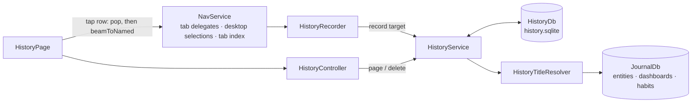
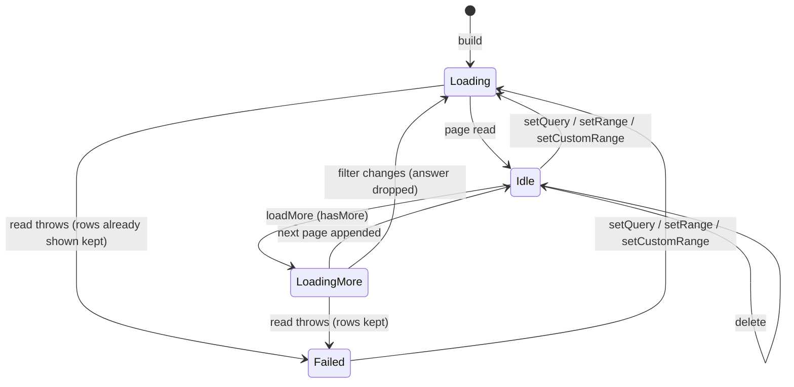

History is a log of **visits**: one row per entity the user brought on screen,
saying what it was (`kind`, `entity_id`), where it was shown (`route`) and when
(`visited_at`). It stores **no titles**. Rows are only ever appended, or deleted
outright by the user — the file is never synced, so there is nothing to
tombstone for.

# What counts as a visit

`historyTargetForRoute` maps a route to the entity it shows, or to nothing.
Task, entry, project, event, person, dashboard and habit detail routes are
entities; lists, create forms, settings, Daily OS days and goal pages are not.
A sub-page — a person's chat or check-in, a project's edit form — counts as a
visit to the entity itself and is **recorded at the entity's main route**, so
going back from history lands on the entity, not on a form.

`HistoryRecorder` listens to three things on `NavService`:

- **the tab delegates** of the entity-bearing tabs — a change is recorded only
  when that delegate's tab is the one in front;
- **the tab index stream** — bringing a tab forward records the entity it is
  already standing on. The stream is a seeded `BehaviorSubject`, so whatever
  the app restored onto at launch is recorded at once;
- **the desktop detail selections** (`desktopSelectedTaskId` and its siblings)
  — the wide layout opens a linked task or entry in the detail pane without
  moving the URL.

**The route can name the wrong task on desktop.** Linked tasks are pushed onto
`desktopTaskDetailStack` without moving the URL, so a tab standing on
`/tasks/A` may be showing linked task B. When the route is the stack's
**base**, the recorder records the stack's top instead; a route that is not
the base is believed, because `TasksLocation` resets the stack to it only
after the delegate's listeners have run.

**A background tab is ignored.** Every tab stays mounted, and one can move on
its own — the logbook's newest-entry auto-selection beams within its tab — while
the user looks at something else.

`HistoryService.record` skips a target whose entity is the **newest row's
entity**: re-opening what is on screen, reaching it through another route, or
the route and the selection both reporting one task in the same frame are one
visit. Records are queued on one future chain so two reports in one frame
compare against each other rather than both against the same older row; a
failed write is reported to its caller and does not wedge the chain.

# Titles are read live

A row shows the entity's title **as it reads now**. `HistoryTitleResolver` reads
a page's journal-backed entities in one `getJournalEntitiesForIds` batch and
dashboards and habits one by one. That lookup applies the private-entry gate,
so a private entry reads as gone while private entries are hidden, exactly as
it would everywhere else. A missing or soft-deleted entity has no title; the
row says *No longer available* and is not tappable, but can still be deleted.

`historyTitleOf` uses an entity's own title field where it has one and the
first non-blank line of its text otherwise; an empty result shows *Untitled*.

# Paging and search

`HistoryDb.entriesPage` pages **by row id** (`id < beforeId ORDER BY id DESC`),
so a row deleted or appended between two pages neither repeats nor skips one.
The time window is a `[from, to)` bound on `visited_at`; the "last N days"
presets count today as one of the N and start at a local midnight, and a custom
range includes both of its days.

**Search matches current titles**, which live in another database, so it cannot
be a `WHERE` clause. With a query set, `HistoryService.page` reads the window in
batches of `searchBatchSize` rows, resolves their titles, keeps the matches,
and stops once it has a page (`pageSize`, 20) or the log runs out. Its cursor is
the last row it *examined*, not the last it kept, so the next page resumes
exactly where this one stopped. Every query term must occur in the title, in any
order, case-folded in Dart (not SQLite's ASCII-only `lower`).

# The page's load states

`HistoryController` is scoped to the open page (auto-dispose), so each opening
starts at the newest visit with an empty search. Every filter change bumps a
generation; an answer for an older generation is dropped, so a slow read for
"bu" cannot overwrite the list for "bug". While a new filter loads, the previous
rows stay listed — and they stay when that read **fails**, too: the error shell
shows only when nothing has loaded yet. The list keys each row by its visit and
gives `ListView.builder` a `findChildIndexCallback`, so a delete or a narrower
search moves rows instead of rebuilding them.

The list asks for the next page from its item builder once a row within five of
the end is built, after the frame; the controller ignores the request while a
page is loading or none is left.

# Opening it

The `openHistory` command is in the [keyboard catalog](keyboard.md) with a
**per-platform binding**: ⌘Y on macOS, where ⌘H is the system's Hide, and
Ctrl+H on Linux and Windows. The app root handles it with `showHistoryModal`,
pushed on the router navigator behind `ModalUtils.getModalBarrierColor` — the
same dimmed scrim as every other modal. The command is enabled only where
`historyAvailableProvider` holds, i.e. where a `HistoryDb` is bound; a bare test
host binds none, records nothing and offers no History.

Tapping a row pops the dialog, then beams to the visit's route. Reopening a
task that is the base of a deeper desktop stack first pops the linked tasks
above it: `resetDesktopTaskDetail` keeps pushes on an unchanged base, so the
beam alone would leave the linked task on screen.

# Storage and lifecycle

`history.sqlite` is a per-profile store like the others: registered in
`get_it.dart`, closed by `ServiceDisposer`, bound into Riverpod by
`buildProviderOverrides`, opened by the restore check, listed in the
[backup catalog](backup-and-restore.md) as an optional, personal store, and
versioned in [persistence](../architecture/persistence.md). Its schema
migrations follow the other single-purpose databases.
