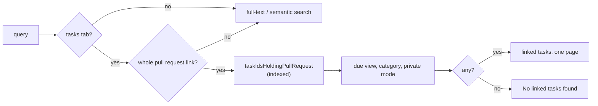
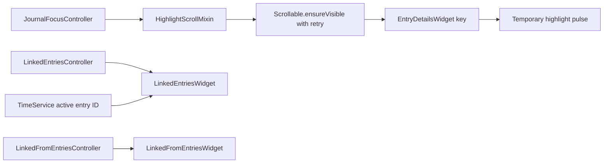
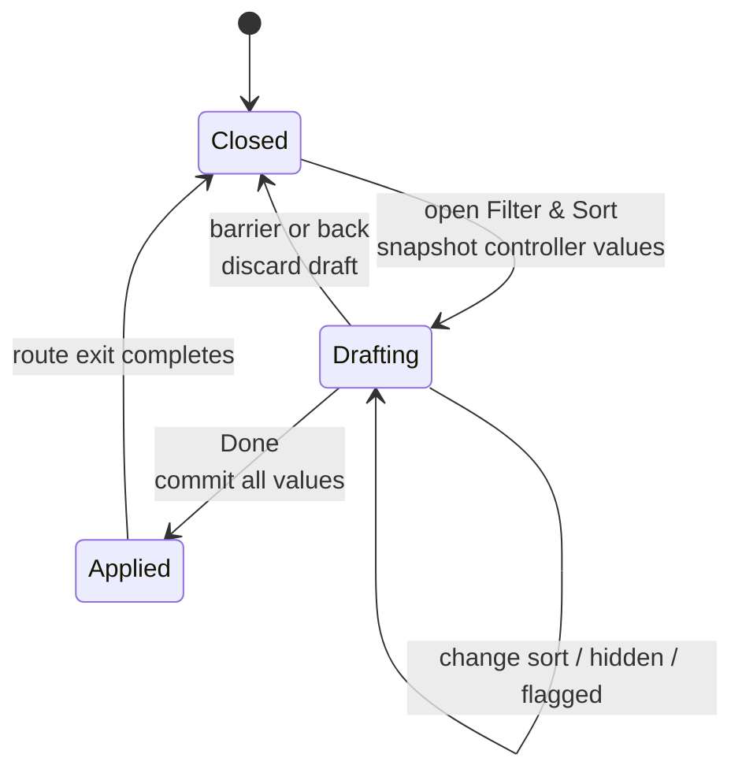

# One controller, two tabs

`InfiniteJournalPage` is hardcoded to `journalPageControllerProvider(false)` and
wired only into the journal route. The tasks tab has its **own page widget**,
`TasksTabPage`, watching `journalPageControllerProvider(true)`.

**What is shared between the tabs is the controller — keyed by `showTasks` — not
the page widget.**

The journal page body is a column: the shared `TabSectionHeader` (the same titled
header Tasks and Projects use), an optional `LogbookSearchModeRow` when the
vector-search flag is on, and the paged feed in an expanded scroll view. The
filter icon opens a two-page Wolt modal. **There is no sliver app bar on this page
any more.**

The controller owns the `PagingController`, filter state, search mode, and
feature-flag gating for entry types and vector search.

## What it persists

Selected entry types, category filters, task status filters, project filters,
label filters, priority filters, task sort option, visual toggles (creation date,
due date, cover art, projects header, vector distances), and the
agent-assignment filter.

**Tasks filter persistence is tab-aware**: `TASKS_CATEGORY_FILTERS` for the tasks
tab, `JOURNAL_CATEGORY_FILTERS` for the journal tab.

**A type added to `entryTypes` joins saved selections once, when it is
offered** (ADR 0064). The selection (`SELECTED_ENTRY_TYPES`) is stored
explicitly, so a type the filter gains later would otherwise stay hidden for
everyone who ever touched the filter. `ENTRY_TYPES_RECONCILED` records the
types a selection was made with: every save adds the types the filter offered
at that moment (`saveEntryTypes(offered:)`); a selection saved before the
record existed counts as made with
`JournalFilterPersistence.legacyReconciledEntryTypes`, the list before
`CheckIn`. The rest are **pending**
(`JournalFilterPersistence.loadPendingEntryTypes`): the controller adds a
pending type to the selection only while the feature flags allow it —
on load, or when a flag turns it on (`_adoptPendingEntryTypes`) — and the save
that follows records it, so a later deselection sticks. A type behind a flag
that is off stays pending instead of being added, stripped by the flag gating
and consumed unseen. An unchanged launch writes nothing.

# Two search modes

`fullText` and `vector`. **Vector mode is feature-gated**, and if the flag is
disabled while the controller is in vector mode it **falls back to full-text
rather than leaving the UI in a dead state.**

Full-text mode asks the search index (`JournalQueryRunner.fts5Search`) for
the best matches **the page can list**: the tasks tab asks for tasks only, the
journal tab for the entry types it shows, both in the selected categories and
with private entities only while private mode shows them, so the index's
limit keeps matches the page can show. `taskFullTextMatches` is that request
for tasks, shared with the due-view counts. The ids then ride the paged
query's `ids` restriction, which applies the remaining clauses and the page's
own sort. What the index holds, how a query is built from what was typed and
how matches rank is the [search index](../search/full-text-index.md).

Vector search behaves differently from normal paging:

- It **bypasses the DB paging pipeline**.
- It **only runs on the first page**.
- It stores elapsed time, result count and per-entry distance values in
  `JournalPageState`.

# A pasted pull request link is a lookup

On the tasks tab, a query that is a whole pasted GitHub pull request link —
`https://github.com/{owner}/{repo}/pull/{number}`, with or without the scheme,
`www.` or anything after the number, or the `api.github.com` twin — is not
searched at all, in either mode. `pullRequestSearchRef` decides; the
`owner/repo#12` shorthand, a link with other words around it, an issue or
repository link and a GitLab merge request link stay ordinary searches (linked
pull requests are GitHub's only, so a GitLab link would never find a task).
The journal tab searches every query as text.

`JournalQueryRunner.runPullRequestSearch` reads the holders through
`JournalDb.taskIdsHoldingPullRequest` — the `pullRequestAssignments` query that
linking already uses, indexed end to end (`idx_journal_type_subtype` on the
pull request row's `PullRequest` type and lower-cased `owner/repo#number`
subtype, then `idx_linked_entries_to_id_type`, then the task's primary key), so
no JSON is searched and no table is scanned, and nothing leaves the device.
Like a semantic result, the tasks come back **whole, on the first page**,
newest first, through the private-filtered id read. The category selection
(and lockdown with it) and the due view still scope them; the **status
selection does not** — a merged pull request's task is usually done, and the
default selection hides done tasks. One task or several, every live holder is
listed; when none is, the empty state says "No linked tasks found for this
pull request." instead of the no-results message.

# Post-filter pagination

Two filters are **not** pushed into the main task query: selected projects, and
the agent-assignment filter.

When either is active, the controller fetches raw task pages from `JournalDb`,
filters them **in memory**, and tracks a **separate raw offset** so pagination
does not repeat or skip rows.

A small implementation detail with a large bug-prevention payoff.

# Due-date sorting happens in SQL

- The v41 migration backfilled a denormalized `due_at` column for every task with
  a non-null `data.due`, **regardless of status**.
- The partial `idx_journal_tasks_due_open` index covers the open-task subset;
  closed tasks stream from the priority/date task indexes.
- `JournalQueryRunner` routes `TaskSortOption.byDueDate` to
  `JournalDb.getTasksSortedByDueDate` — raw SQL ordering by
  `CASE WHEN due_at IS NULL THEN 1 ELSE 0 END, due_at ASC, date_from DESC` with
  `LIMIT`/`OFFSET`.

Because the ordering happens in the database against the indexed column,
**results are globally stable across page boundaries**. There is no separate
in-memory due-date comparator to drift from the live query path.

# Linked entries, focus and highlighting

The journal feature owns the **generic** linked-entry machinery used in detail
pages.

Runtime details that matter:

- Outgoing links are fetched from `JournalRepository.getLinksFromId(...)`, and
  hidden links can be included or excluded without changing the rest of the page.
- **Hiding or collapsing a link changes the link as stored, never the card's
  copy** (`JournalRepository.changeLink`). A card can render a link that has
  since been removed, here or on another device; written from the copy, the
  toggle was the link's newest version and brought it back everywhere. A
  removed link is now left alone, and a flag another device set in between is
  kept (`specs/tla/EntryLinkIdentity.tla`, `EditOnStored`).
- The Filter & Sort modal can narrow the outgoing list to **flagged entries only**
  (`meta.flag == EntryFlag.import`). The check runs **per row** against the
  watched entry, so flagging or unflagging updates the filtered list reactively.
- Linked AI responses stay collapsed under their source entry; the generic
  outgoing list does not expose a second, unused visibility toggle for them.
- **Outgoing links are ordered by the linked entity's editable `dateFrom`, not by
  link creation time**, with a user-selectable direction via
  `LinkedEntriesSortController`. Links whose target has not resolved yet fall back
  to `link.createdAt`.
- **`LinkedEntriesWithTimer` only reacts to active-timer entry-id changes, not
  every timer tick.**
- **`HighlightScrollMixin` retries scroll-to-entry until the target widget is
  actually mounted**, then applies a temporary highlight pulse.

## The Filter & Sort draft

The modal snapshots sort, hidden and flagged state into **one route-local draft**.
Done commits all three together; barrier or back dismissal discards it. **The
notifier lives until Wolt removes the route subtree**, so its exit fade cannot
observe disposed state.

The sort trigger includes a visible count when Hidden or Flagged-only is active,
while its semantics name enumerates the active filters.

## Pill treatment

The activity and sort controls reuse the same 28 px bordered `DsPill` shell as the
task header, including its bounded hover treatment. Active activity pills apply
their Timer, Audio, Images or Code accent to **both** icon and outline; inactive
pills return to the quiet `decorative.level02` outline, while the sort trigger
always keeps that neutral border. Labels stay at medium text emphasis.

**The Code pill only exists when at least one linked entry contains a coding
prompt.** Pills wrap as compact units rather than expanding into full-width rows.
