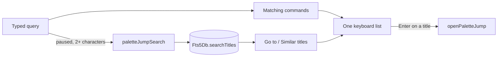
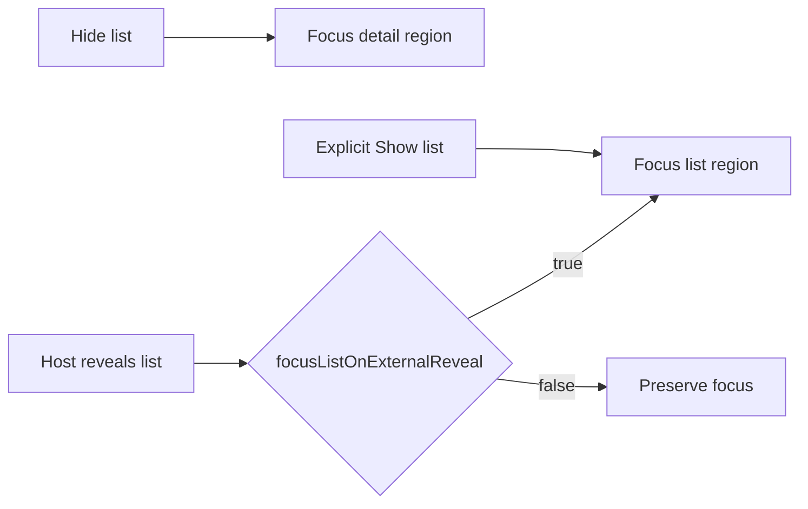

The keyboard feature is Lotti's **desktop command layer**. It turns platform key
combinations into typed `AppCommandId` values, resolves those commands against
**the focused feature scope**, and exposes the same command metadata to Flutter
shortcuts, the macOS menu bar, the command palette, and localized help.

**It deliberately does not provide OS-global hotkeys.** Commands exist only while
Lotti is active, and feature handlers exist only while their widgets are mounted.

# One catalog, four consumers

The value of a typed catalog is that a command's binding, label and enabled
predicate are declared **once**. The shortcut handler, the menu-bar item, the
palette row and the help sheet all read the same entry — so a command cannot show
in the palette with one binding and fire with another, and a disabled command
renders disabled everywhere.

# The palette jumps to things too

Typed into, the command palette also lists the tasks, journal entries,
projects, events and people whose **title** matches, under *Go to*, below the
matching commands; arrow keys and Enter run through both as one list. The
search waits for typing to pause (`CommandCatalogView.jumpSearchDebounce`),
starts at two characters, keeps the last results listed until the new ones
arrive and drops an answer to an older query. When no title holds every word,
the nearest titles to a misspelling are listed under *Similar titles*.

The keyboard feature ranks below the features it opens, so the app root wires
the search (`paletteJumpSearch`: the index, private mode, and lockdown's
categories while lockdown is on) and the opening (`openPaletteJump`, through
`NavService` — a task by its id, everything else by route). Goals are left
out: their route is keyed by their agent, not their entity. How titles match
and rank is the [search index](search/full-text-index.md#title-search).

# Bindings can differ by platform

A binding resolves the product-level *Primary* modifier per platform — ⌘ on
macOS, Ctrl elsewhere. When the conventional **key** differs too, a binding
names the platforms it exists on (`AppShortcutBinding.primaryKey(…,
platforms: {…})`) and the definition lists one binding per group. History is
the case in point: ⌘Y on macOS, where ⌘H is the system's Hide, and Ctrl+H on
Linux and Windows. The macOS menu shows the first binding that resolves on
macOS, and help lists only the bindings of the running platform.

# Scopes are mounted, not registered globally

A feature contributes commands through an `AppCommandScope` that lives with its
widgets. When the task list has focus its scope is live; when focus moves to the
detail pane, that scope's commands take over. **Nothing has to deregister on
navigation, because nothing was globally registered.**

Examples live with their features: the
[task list's commands](tasks/filtering.md), the
[entry editor's save](journal/detail-and-saving.md), and the settings detail
scaffold's save. Global navigation and task creation are owned by the app shell.

The original command-system rationale is recorded in
[ADR 0030](../../docs/adr/0030-desktop-keyboard-command-system.md). The catalog's
deliberately lean metadata contract is recorded in
[ADR 0047](../../docs/adr/0047-lean-keyboard-command-catalog-metadata.md).

# List and detail focus

`ListDetailFocusTraversal` keeps hidden list content mounted and moves focus
into details when hiding the list. Hosts can disable `focusListOnExternalReveal`
when a layout-driven reveal must preserve a companion's return focus. The
controller's explicit Show list action still transfers focus into the list.

