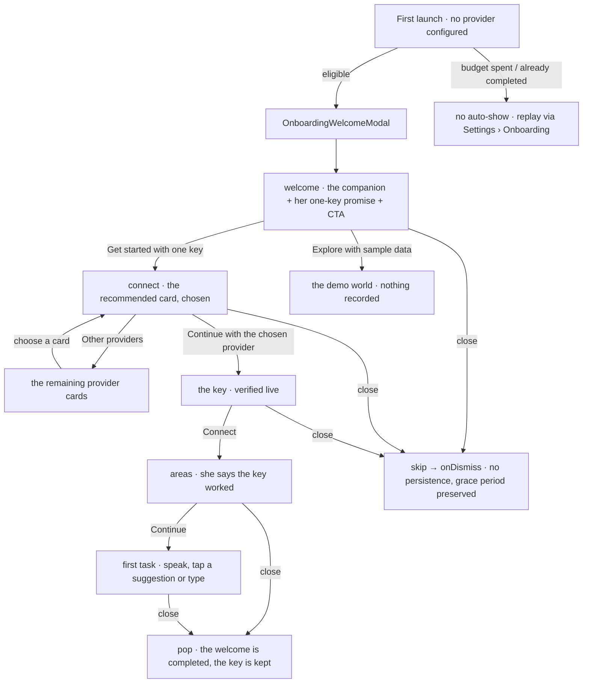

Onboarding guides a brand-new user to the core moment — **speak a thought, watch
it become a structured task** — and measures whether that landed.

**Status:** the measurement substrate, the welcome and connect-your-brain front
door, the live voice→task moment, the auto-show trigger and re-show cadence, and
the Settings → Onboarding replay entry are implemented. The D1 return loop is
not.

**The welcome has no config flag** — it is released to everyone, with cadence and
completion state as its only gates. It is the **sole** first-run setup path; the
pre-FTUE provider-selection modal and setup-prompt service have been deleted.

The separate [Daily OS walkthrough](daily_os_next/ui-surfaces.md) remains in a
dark launch behind its own flag.

# The flow

**Five panels, each asking for one thing.** Nothing optional stands between
the welcome and the key, and no panel exists only to be tapped away: a
connected key opens the areas directly, and that step's bubble is where the
connection is confirmed. Her look and her voices are settings (Settings ›
Companion, Settings › Speech), not steps of the first run.

**Skipping preserves the grace period** — it records no completion, so the
welcome remains eligible to reappear within its cadence budget.

It is not, however, storage-neutral: the modal records a `welcomeSkipped` event,
and the auto-show path has already written the shown count and first-shown
timestamp *before* opening. What closing it costs you is a slot in the
cadence budget, not the offer itself.

# One stage for every step

Every step is built on one layout, `OnboardingStage`
(`ui/widgets/onboarding_stage.dart`), so that nothing moves between steps but
what the step is about. From the top:

- **A bar**: the way back, the progress, and the close button. Both buttons
  are in place on every step past the welcome, disabled — not removed — where
  a step cannot use them: back from the areas (a connected key is not undone
  here) and from the first task once something is being said, close while
  the key is being set up or the areas written (`showBack`, `showClose`). The
  progress
  (`OnboardingProgress`) is three segments, one per thing asked for — the key,
  the areas, the first task — filled when done and part filled while in
  progress, in a neutral ink: the accent is the main button's. The welcome
  shows none, since nothing is started and its tray lists the three things.
- **The companion**, standing full length at one height on every step of a
  screen: full size only on a tall one (`OnboardingStage.fullFrom`), a size
  down on most phones and small on a short screen or window
  (`compactBelow`) — the tray, where each step's content is, needs the room
  more than she does.
- **Her speech bubble**, outlined on the panel's own surface so it reads as
  her speaking and not as one more raised block, with the step's headline and
  a second line on every step and phase.
- **A tray** holding the step's own content under an optional caption
  (`OnboardingTrayCaption`, a size below the labels it names) with a helper
  line under it, then the foot: one link a size below the main button, when
  the step has one, and the main button. The button is pinned at the tray's
  foot, so it is at one height either way, and a step without a link gives
  that room to its content.

**The bubble is one height on every step**: a headline over three lines on a
phone and two in the wider dialog (`OnboardingStage.bubbleHeight`), measured
from the very styles and text scale it is drawn in, its words from the top.
Every step's words are written to fit it, so the headline and the tray start
at the same height throughout; longer words or larger text grow it.

The host sets how tall a step is (`OnboardingStageHeight`): on a phone the
screen below the status bar, in a window what the window allows up to a
phone's height. **The tray takes exactly what is left**, its foot pinned and
only what is over it scrolling, under a fade where it runs into the foot — so
a list that opens never pushes the main button away, and she and her bubble
never move. Content starts at the top of the tray, at the same height on
every step; only the recorder and the thinking pulse, the one thing on their
frames, sit in its middle (`centered`).
Where no host sets a height the tray is its content's height or its least,
whichever is more.

**The tray takes the rest by its own layout** (`RenderStageColumn`). A column
cannot: under the modal's scroll view its height is unbounded, so nothing in
it can be told to take what is left.

**On a phone the panel is the whole screen**, so there is no dimmed app
around it to tap, and the close button in the bar is the way out on every
step. In a window the panel is a dialog, and a tap outside it closes the flow
on the welcome only: past it, one stray click must not throw away a key or a
recording.

**Choices look one way.** Every choice is made on one
`OnboardingSelectableSurface`: a quiet outlined surface, the chosen one
marked by the accent on its outline and a check — never a solid fill, which
is the main button's alone. The provider cards (`OnboardingProviderCard`)
and the chips (`OnboardingChoiceChip`: an area, the area a task lands in, a
starter suggestion, "Add your own") are built on it, with one label style and
one corner radius. An action rather than a choice ends in its own icon: the
starter suggestions, which make the task at once, end in an arrow.

**System back and Escape do what the bar does.** On a step that shows the
back arrow they go back with it, or do nothing while it is disabled, instead
of closing the flow; on the welcome, which has none, they close it. The stage
catches them itself (a `PopScope` in `OnboardingStage`), so no step can opt
out; during a crossfade only the arriving step answers, so one press never
goes back twice.

**The keyboard does not resize the route.** The room it takes is added below
the panel instead, so the key field can be scrolled clear of it.

# The one key

The connect step (`OnboardingConnectPanel`) is built around one message: a
single API key is all it takes. It leads with one card,
`onboardingRecommendedProvider` (Mistral), under the tray's *Recommended*
caption and already chosen, with what its key covers in place of a tagline —
the seeded Mistral profile names a thinking, a transcription and a read-aloud
model. Every other provider (`onboardingOtherProviders`) waits behind the
*Other providers* disclosure. **A card chooses; only the main button goes
on**, and it names the provider chosen ("Continue with Mistral"), so no tap
on a card is a surprise. The cards wear no brand colour, so nothing but the
chosen one reads as chosen. The key step shows the same card under "Your
provider", with the state of its connection inside it in place of a check of
its own; once the key checks out she says so, and the button reads
"Continue with …" there too. The demo AI sheet reuses the panel without her, and states the
recommendation as a plain subtitle instead.

# The companion

The [companion](companion.md) leads onboarding
(`ui/widgets/onboarding_companion.dart`) **whatever her own flag,
`enable_companion`, says**; the flag keeps gating her everywhere else in the
app. Her lines sit in speech bubbles (`OnboardingSpeechBubble`) whose tail
points at her.

She stands on the stage on every step, at the same size, and the bubble under
her is that step's headline.

- **The welcome.** Her bubble is her greeting, then the one key she needs
  (`onboardingCompanionWelcomeLine`). The tray lists the three things in
  order; the main button starts on the first, the demo is the link above it.
  `OnboardingHeroPanel` keeps its `heroStyle` artwork and its own promise only
  where a host passes no companion — the animation gallery.
- **The connect step.** She recommends the one key in her bubble.
- **The key step.** She is built for the key check as the user sees it
  (`OnboardingCompanionBeat.ofKeyCheck`): waiting while the field is empty,
  thinking while the key is checked and while the provider is set up after
  Connect, a thumbs-up when it is verified, a shrug when it is turned down.
  Her bubble asks for the key and says how to get one, but she says nothing
  aloud there; the status line under the field carries the answer.
- **The areas, and her first words.** The key step leads straight here, so
  this is where she says it worked: she celebrates over a bubble
  (`OnboardingCategoryView.companion`) that opens with her first words and
  goes on to explain the areas — one line, said as one. The provider's seeded
  profile is resolved (`onboardingFirstWords`, `resolveByProfileId`) and,
  where its read-aloud slot names a cloud voice — Mistral's does, Voxtral —
  the bubble opens "There, now you can hear me too!" and she says the whole
  line in that voice, in the app's language (`OnboardingCompanion.cloudVoice`).
  That line is spoken **whatever the read-aloud flag says**: it is fixed text,
  sent to the provider the user has just connected, and the flag is off by
  default, so otherwise no new user would ever hear her. Without such a voice,
  or when the profile does not resolve, the bubble opens with her being ready
  instead, and she speaks only by the rules every other line follows. While
  the profile is still being resolved the bubble shows that same line but she
  does not say it: said that early, it would start in the voice on hand and
  start over in the cloud voice a moment later. A lookup that fails is final
  (`onboardingConnectedProfileProvider` does not retry), for the same reason.
- **The first-task step.** Her bubble is the frame's headline
  (`OnboardingFirstTaskView.companion`) with a second line on every frame:
  the guidance at the prompt, the live caption while she listens, that
  nothing is final while she thinks, and where the task landed once it has;
  the view stays free of providers and the step builds her for the frame. At
  the prompt the tray holds where the task will land, then the starter
  suggestions, and the main button opens the mic; back returns to the areas,
  which reuse what they created. The recorder — the voice orb over its
  level bars — stands in the tray only once the mic is open; "Done", with a check, then ends the recording, and the link
  is "Start over", which drops the take and opens the prompt again —
  "Rather type?" is not offered while the mic is open. The landed task is a
  preview on the shared surface, marked done with its check, its area under
  its title, under the caption "Your task"; "Open task" opens it.

Each moment is an `OnboardingCompanionBeat`:

| Beat | When | She |
|---|---|---|
| `welcome` | the welcome panel | waves once |
| `key` · `keyChecking` · `keyVerified` · `keyRejected` | the key step, by its check | waits · holds `think` · thumbs up · shrugs |
| `areas` | the area step, reached as the key works | celebrates once, saying her first words |
| `recommend` | the connect step | presents the recommended card once |
| `prompt` | the first-task prompt | waves once |
| `listening` | the mic is open | holds `listen` |
| `thinking` | the words are structured | holds `think` |
| `created` | the task landed | celebrates once |

A held gesture is `CompanionView.holding`: replayed whenever it relaxes, for as
long as the beat lasts.

**Her lines are the captions on screen.** Each beat's line is the headline the
surface already shows. She speaks it only where the voice is on hand —
`enable_ai_summary_tts` on, a device voice, and its model **already
installed** — and never starts the model download: on a true first run she is
silent and the caption carries the words, the areas' line in a connected
provider's cloud voice excepted. The line is `null` while the mic is
open, which stops her, so she never talks into the recording. Turning
read-aloud off, here or by sync from another device, silences her at once —
again except the areas' line in a cloud voice, which the flag neither starts
nor stops. The welcome's
promise is said once per modal: back on the welcome from the connect step, she
waves but stays quiet.

**Each step speaks under its own source id**
(`OnboardingCompanionBeat.sourceId`: `onboarding-companion-` plus the step).
The steps crossfade, so the outgoing step is disposed after the incoming one
has started speaking; with one shared id, its `dispose` would stop the new
line. A new line instead stops whichever onboarding line is still playing, and
leaving a step ends only its own. She is dressed for one subject on every step
(`OnboardingCompanion.dressedFor`), so her outfit does not change between them.

**Her writes to the voice run after the frame.** A line changes in
`didUpdateWidget`, and leaving ends it in `dispose`; both run while the tree
builds or tears down, when Riverpod refuses a provider write. Written there, the
voice's `stop` threw before reaching the player and was swallowed, and she
talked on over the recording; `_sayLater` defers each to a microtask.

# A dedicated measurement store

Onboarding metrics live in their **own** database (`onboarding_metrics.sqlite`),
not in the journal. The separation is deliberate: activation measurement is
device-local, never synced, and must not entangle itself with user content.

**The first-seen signal is recorded at startup**, not when the welcome shows —
that way users upgrading into the build are tagged as the baseline cohort even if
they never trigger the welcome, which is essential for a clean before/after
retention comparison. The write is fire-and-forget with its own try/catch so a
metrics failure cannot surface as an uncaught startup error.

**Two funnel derivations are partitioned by event vocabulary**, so Daily OS
walkthrough events never shift the general FTUE active-day or activation metrics
even though both reuse the same store.

# Cadence

Auto-show is bounded: a small number of shows within a fixed window, persisted
under a private settings key prefix, and **retired entirely on completion**. The
Daily OS walkthrough mirrors the same cadence shape with its own prefix, so the
two never spend each other's budget.

Eligibility for the Daily OS walkthrough additionally requires a **real
readiness check** — the exact planner template, model/profile and provider chain
must resolve a thinking route — evaluated **read-only**, never creating the
planner. See
[Daily OS onboarding](daily_os_next/ui-surfaces.md).

# Where the consent flag is written

Onboarding sets a category's `automaticInferenceEnabled` to `true` at the moment
it creates the areas: having just connected a provider and picked those areas *is*
the consent. It is written **before** the first capture, not because of it —
otherwise the flow would teach "speak and it transcribes" while the app stopped
doing so the next day.

It is not the only writer — the category settings form carries a switch for the
same flag — but it is the only place the flag is set *without* the user touching
one, which is why the consent has to be established by the step itself.

**Reused categories are the exception**: an existing `false` is the user having
switched automation off, so onboarding only fills in a `null`. See
[categories](categories.md).
