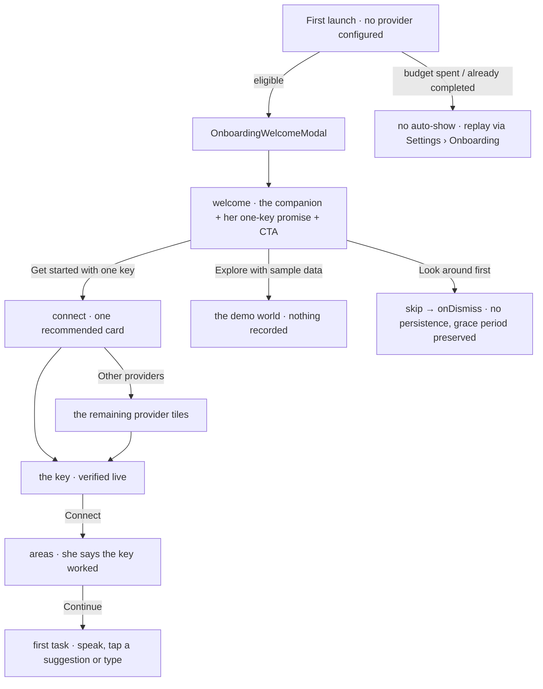

Onboarding guides a brand-new user to the core moment — **speak a thought, watch
it become a structured task** — and measures whether that landed.

**Status:** the measurement substrate, the welcome and connect-your-brain front
door, the live voice→task moment, the auto-show trigger and re-show cadence, and
the Settings → Onboarding replay entry are implemented. The D1 return loop is
not.

**The welcome has no config flag** — it is released to everyone, with cadence and
completion state as its only gates. It is the **sole** first-run setup path; the
pre-FTUE provider-selection modal and setup-prompt service have been deleted.

The separate [Daily OS walkthrough](daily_os_next/ui-surfaces.md) remains in a
dark launch behind its own flag.

# The flow

**Five panels, each asking for one thing.** Nothing optional stands between
the welcome and the key, and no panel exists only to be tapped away: a
connected key opens the areas directly, and that step's bubble is where the
connection is confirmed. Her look and her voices are settings (Settings ›
Companion, Settings › Speech), not steps of the first run.

**Skipping preserves the grace period** — it records no completion, so the
welcome remains eligible to reappear within its cadence budget.

It is not, however, storage-neutral: the modal records a `welcomeSkipped` event,
and the auto-show path has already written the shown count and first-shown
timestamp *before* opening. What "look around first" costs you is a slot in the
cadence budget, not the offer itself.

# The one key

The connect step (`OnboardingConnectPanel`) is built around one message: a
single API key is all it takes. It leads with one card,
`onboardingRecommendedProvider` (Mistral), badged *Recommended*, with what its
key covers in place of a tagline — the seeded Mistral profile names a thinking,
a transcription and a read-aloud model. Every other provider
(`onboardingOtherProviders`) waits behind the *Other providers* disclosure. The
demo AI sheet reuses the panel without her, and states the recommendation as a
plain subtitle instead.

# The companion

The [companion](companion.md) leads onboarding
(`ui/widgets/onboarding_companion.dart`) **whatever her own flag,
`enable_companion`, says**; the flag keeps gating her everywhere else in the
app. Her lines sit in speech bubbles (`OnboardingSpeechBubble`) whose tail
points at her.

- **The welcome hero.** She stands, full length, in the welcome's hero frame in
  place of the `heroStyle` artwork (`OnboardingHeroPanel.companion`), at the
  frame's own height. The promise below her is her bubble: her greeting, then
  the one key she needs (`onboardingCompanionWelcomeLine`). The panel keeps its
  artwork and its own promise only where a host passes no companion — the
  animation gallery.
- **The connect step.** A bust, `ControlSizes.avatarHero` square, beside a
  bubble in which she recommends the one key.
- **The key step.** A bust at the end of the title row
  (`OnboardingApiKeyPanel.companion`), built for the key check as the user
  sees it (`OnboardingCompanionBeat.ofKeyCheck`): waiting while the field is
  empty, thinking while the key is checked and while the provider is set up
  after Connect, a thumbs-up when it is verified, a shrug when it is turned
  down. She says nothing there; the status line carries the words.
- **The areas, and her first words.** The key step leads straight here, so
  this is where she says it worked: a bust celebrating beside a bubble
  (`OnboardingCategoryView.companion`) that opens with her first words and
  goes on to explain the areas — one line, said as one. The provider's seeded
  profile is resolved (`onboardingFirstWords`, `resolveByProfileId`) and,
  where its read-aloud slot names a cloud voice — Mistral's does, Voxtral —
  the bubble opens "There, now you can hear me too!" and she says the whole
  line in that voice, in the app's language (`OnboardingCompanion.cloudVoice`).
  That line is spoken **whatever the read-aloud flag says**: it is fixed text,
  sent to the provider the user has just connected, and the flag is off by
  default, so otherwise no new user would ever hear her. Without such a voice,
  or when the profile does not resolve, the bubble opens with her being ready
  instead, and she speaks only by the rules every other line follows. While
  the profile is still being resolved the bubble shows that same line but she
  does not say it: said that early, it would start in the voice on hand and
  start over in the cloud voice a moment later. A lookup that fails is final
  (`onboardingConnectedProfileProvider` does not retry), for the same reason.
- **The first-task step.** A bust, `ControlSizes.avatarHero` square, above the
  headline (`OnboardingFirstTaskView.companion`), whose headline — and, at
  the prompt, its guidance — is her bubble; the view stays free of providers
  and the step builds her for the frame.

Each moment is an `OnboardingCompanionBeat`:

| Beat | When | She |
|---|---|---|
| `welcome` | the welcome panel | waves once |
| `key` · `keyChecking` · `keyVerified` · `keyRejected` | the key step, by its check | waits · holds `think` · thumbs up · shrugs |
| `areas` | the area step, reached as the key works | celebrates once, saying her first words |
| `recommend` | the connect step | presents the recommended card once |
| `prompt` | the first-task prompt | waves once |
| `listening` | the mic is open | holds `listen` |
| `thinking` | the words are structured | holds `think` |
| `created` | the task landed | celebrates once |

A held gesture is `CompanionView.holding`: replayed whenever it relaxes, for as
long as the beat lasts.

**Her lines are the captions on screen.** Each beat's line is the headline the
surface already shows. She speaks it only where the voice is on hand —
`enable_ai_summary_tts` on, a device voice, and its model **already
installed** — and never starts the model download: on a true first run she is
silent and the caption carries the words, the areas' line in a connected
provider's cloud voice excepted. The line is `null` while the mic is
open, which stops her, so she never talks into the recording. Turning
read-aloud off, here or by sync from another device, silences her at once. The welcome's
promise is said once per modal: back on the welcome from the connect step, she
waves but stays quiet.

**Each step speaks under its own source id**
(`OnboardingCompanionBeat.sourceId`: `onboarding-companion-` plus the step).
The steps crossfade, so the outgoing step is disposed after the incoming one
has started speaking; with one shared id, its `dispose` would stop the new
line. A new line instead stops whichever onboarding line is still playing, and
leaving a step ends only its own. She is dressed for one subject on every step
(`OnboardingCompanion.dressedFor`), so her outfit does not change between them.

**Her writes to the voice run after the frame.** A line changes in
`didUpdateWidget`, and leaving ends it in `dispose`; both run while the tree
builds or tears down, when Riverpod refuses a provider write. Written there, the
voice's `stop` threw before reaching the player and was swallowed, and she
talked on over the recording; `_sayLater` defers each to a microtask.

# A dedicated measurement store

Onboarding metrics live in their **own** database (`onboarding_metrics.sqlite`),
not in the journal. The separation is deliberate: activation measurement is
device-local, never synced, and must not entangle itself with user content.

**The first-seen signal is recorded at startup**, not when the welcome shows —
that way users upgrading into the build are tagged as the baseline cohort even if
they never trigger the welcome, which is essential for a clean before/after
retention comparison. The write is fire-and-forget with its own try/catch so a
metrics failure cannot surface as an uncaught startup error.

**Two funnel derivations are partitioned by event vocabulary**, so Daily OS
walkthrough events never shift the general FTUE active-day or activation metrics
even though both reuse the same store.

# Cadence

Auto-show is bounded: a small number of shows within a fixed window, persisted
under a private settings key prefix, and **retired entirely on completion**. The
Daily OS walkthrough mirrors the same cadence shape with its own prefix, so the
two never spend each other's budget.

Eligibility for the Daily OS walkthrough additionally requires a **real
readiness check** — the exact planner template, model/profile and provider chain
must resolve a thinking route — evaluated **read-only**, never creating the
planner. See
[Daily OS onboarding](daily_os_next/ui-surfaces.md).

# Where the consent flag is written

Onboarding sets a category's `automaticInferenceEnabled` to `true` at the moment
it creates the areas: having just connected a provider and picked those areas *is*
the consent. It is written **before** the first capture, not because of it —
otherwise the flow would teach "speak and it transcribes" while the app stopped
doing so the next day.

It is not the only writer — the category settings form carries a switch for the
same flag — but it is the only place the flag is set *without* the user touching
one, which is why the consent has to be established by the step itself.

**Reused categories are the exception**: an existing `false` is the user having
switched automation off, so onboarding only fills in a `null`. See
[categories](categories.md).
