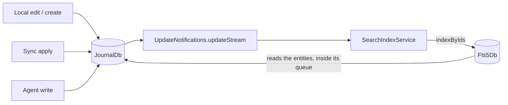
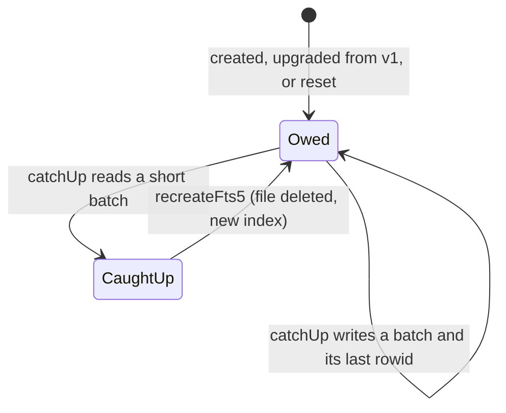

# What it is

`Fts5Db` (`fts5_db.sqlite`) is a **derived copy of the journal's text**,
rebuildable at any time from `JournalDb` and never synced: every device builds
its own, from whatever its journal holds. It lives in its own database file
so that indexing never takes the journal's write lock. Embeddings are a second,
separate index ([embeddings and search](../ai/embeddings-and-search.md)).

Two tables carry it:

| Table | Holds |
|-------|-------|
| `search_doc` | One row per indexed entity: its id, journal `type`, category (`''` for none), `private` flag and `date_from` — the filters a search applies before ranking — and the integer key of its text |
| `search_fts` | FTS5 over `title`, `body` and `extra`, keyed by `search_doc.id`; `unicode61 remove_diacritics 2` tokenizer, two- and three-character prefix indexes, text stored so a result can show a snippet |

`search_index_state` holds one value: the journal rowid a pending rebuild
continues after.

# What an entity contributes

`searchDocumentFor` decides, per entity kind, what goes in each column:

| Column | Ranked | Holds |
|--------|--------|-------|
| `title` | ×10 | A task's, project's, goal's, event's, checklist's or checklist item's title; a pull request's title; an AI response's one-liner; a survey's identifier; a check-in's topics and next-time notes ([ADR 0139](../../../docs/adr/0139-check-ins-are-searchable.md)) |
| `body` | ×1 | The entry text; a recording's edited text, else its last transcript; an AI response's text; a goal's statement; a pull request's description |
| `extra` | ×2 | A measurement's name and value label (resolved through its definition), a survey's scores, a health reading's value, unit and name, a pull request's `owner/repo#number` |

An entity whose three columns are blank, a deleted one, and a goal's spec
snapshot (its goal is found instead) have no row.

# How every write reaches it

Every journal write announces its ids on `UpdateNotifications.updateStream` —
local, synced and agent writes alike — and `SearchIndexService` hands each
batch to `Fts5Db.indexByIds`, which reads those ids from the journal (deleted
rows included) and upserts, replaces or removes their rows; an id with no row
(a notification token, a purged entry) is removed, at the cost of one lookup.
**That one subscription is why an entry that arrives by sync is searchable**;
before it, only local edits were indexed, so a device that received its data
had a largely empty index until a manual rebuild.

Writers to a journal that is not the live one (a world being seeded, a demo
copy) call `Fts5Db.indexEntities` with what they wrote. Task creation also
indexes the new task at once: the link picker's duplicate check can run
before the notification arrives. A measurable definition edit reindexes its
measurements with `reindexMeasurements`, passing the edited definition.

## One queue

Every write goes through one serial queue inside `Fts5Db`, and the writes that
read the journal read it **inside** that queue. So a rebuild batch read before a
live edit cannot be written after the edit and overwrite it with what it read.

# Rebuild

A new index — first launch, the version 1 upgrade (whose single `journal_fts`
table cannot be converted, so it is dropped), or the maintenance rebuild —
starts **owed** a rebuild. `SearchIndexService.start`, tracked as startup work,
runs `catchUp`: it walks the journal's live rows by rowid
(`JournalDb.liveEntitiesAfterRowId`), 500 at a time, and writes each batch in one
transaction together with the rowid it reached, so a rebuild cut short by the
app closing resumes where it stopped. Disposing the service stops it between
batches. Live changes are indexed meanwhile, through the same queue.

The maintenance sheet's rebuild (`Maintenance.recreateFts5`) deletes the file,
opens a fresh index and runs the same `catchUp`, reporting its progress.

# From what was typed to a match

`ftsMatchExpression` rebuilds the `MATCH` expression from the input's words
instead of passing it through, because FTS5 gives quotes, `-`, `:`, `*`, `^`,
parentheses and the bare words `AND`, `OR`, `NOT`, `NEAR` a meaning:

- each whitespace-separated word becomes a quoted phrase of its letters,
  marks and digits, split the way the tokenizer splits it (`self-care` is
  `"self care"`);
- text in double quotes stays one exact phrase;
- the last word, unless quoted or followed by a space, also matches as a
  prefix from its second character (`"pengu"*`), so results keep up while it
  is typed;
- the phrases are all required, or any one of them with `anyTerm`;
- at most 16 phrases are kept.

Input with no letter or digit matches nothing. **No input can make a match
throw**; a property test feeds it FTS5 syntax at random.

# Ranking and filters

`Fts5Db.matchIds` returns entity ids best match first: BM25 with the column
weights above, newer `date_from` first among equals. Types, categories and
private visibility are applied **before** its limit (500 by default), so the
limit keeps the best matches the caller can show rather than spending it on
rows the caller then drops. The privacy gate still applies where results are
read: hits resolve through the private-filtered reads
([persistence](../../architecture/persistence.md)).

| Caller | Asks for |
|--------|----------|
| Tasks tab and its due-view counts (`taskFullTextMatches`) | Tasks in the selected categories, private ones while private mode shows them |
| Journal tab (`JournalQueryRunner.fts5Search`) | The entry types it lists, in the selected categories, same privacy |
| Link-task picker | Tasks |
| Front agent and day agent open-task matching (`matchOpenTasksByPhrase`) | Tasks in the allowed categories |
| Query chat crawler | Any of its keywords, whole words only (`anyTerm`, no prefix) |

The task and journal lists still order by their own sort (priority, date, due
date); the index's order decides which matches survive its limit, and agents
read it as relevance.

# Gotchas

- **A crash between a journal write and its notification leaves the entity
  unindexed** until it is written again or the index is rebuilt; the
  notification is in memory. The journal stays correct either way.
- **The index is resolved on every use**, by the indexer and the page's
  query runner alike: the maintenance rebuild closes the old instance and
  registers a new one, and a reference held across it would query a closed
  database.
