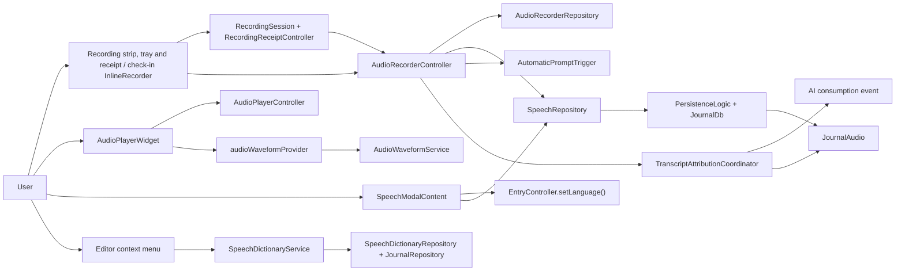
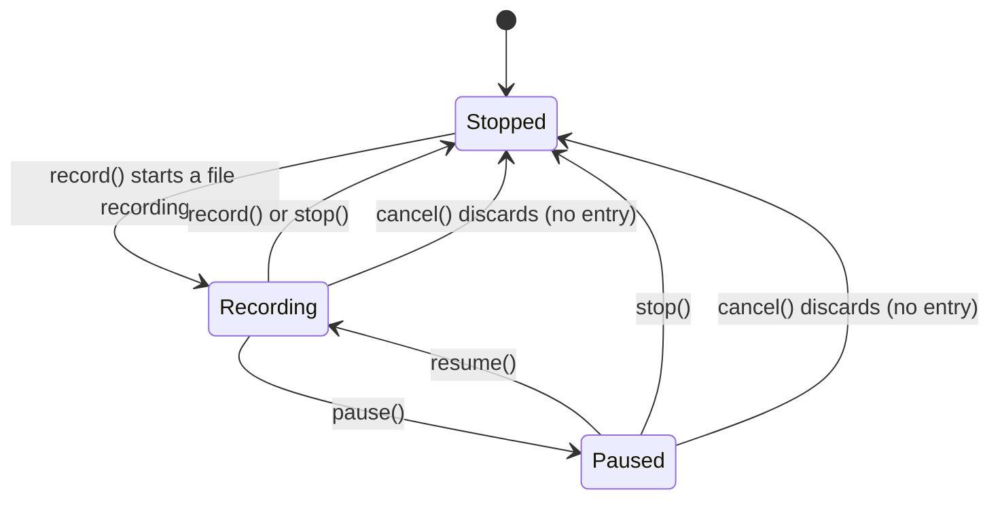
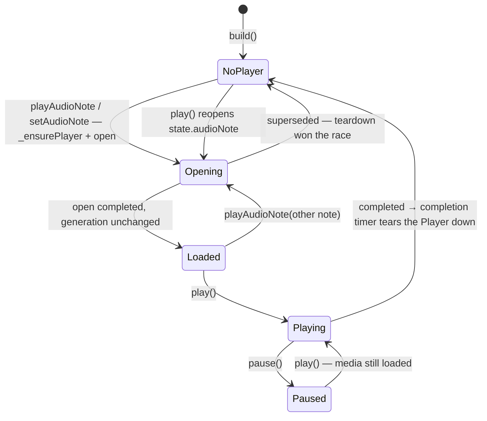

The speech feature owns audio capture, playback, waveform extraction and
transcript-adjacent tools for `JournalAudio` entries. It does three concrete
jobs: capture audio and persist it, play it back with progress/speed/waveform
scrubbing, and maintain speech-specific metadata — language, transcripts, and
category speech dictionaries.

**It does not own provider configuration or the inference stack.** Transcription
and linked-task automation call into AI-side services *after* the recording is on
disk, and **there is no streaming or realtime transcription path** — transcription
is always a batch pass over the finished file, with dictionary and context
biasing.

Nor does it own what happens next. A task-linked recording is **summarised**
after transcription, into a one-liner / TLDR / full-markdown AI entry linked to
the `JournalAudio`; the collapsed audio card shows that one-liner in place of
the transcript's opening line. **Generation** lives on the AI side — see
[execution paths](../ai/execution-paths.md#audio-summaries) — while resolving
the persisted summary and rendering its tiers belongs to the journal UI
(`audioSummaryOneLiner`, `AiResponseSummary`), not to speech.

# Recording

`AudioRecorderRepository` wraps the `record` package: permission checks,
file-backed recording at 48 kHz, pause/resume, stop/dispose, and **amplitude
sampling every 20 ms**.

It records with `autoGain` everywhere except iOS. `record_darwin` turns
`autoGain` (or `echoCancel`) into the platform's voice-processing unit —
AVAudioEngine voice processing on iOS, the voice-processing I/O unit on
macOS — and on iOS 26 a take with voice processing on can bring the Dart VM
down a few seconds in, in an exiting worker thread
([flutter/flutter#193852](https://github.com/flutter/flutter/issues/193852)).
So iOS records without it, as `record_ios` did before `record_darwin`
replaced it. The chat recorder (`ChatRecorderController`) follows the same
rule.

`AudioRecorderController` adds Riverpod state, live dBFS for the recorder's
level line and the recording strip's bars, linked-entry and category
context, the take's `RecordingOrigin` (where it started, held while it
runs), whether a check-in draws the take in place (`inlineHostVisible`),
coordination with app-wide playback, persistence through `SpeechRepository`,
and optional hand-off to profile-driven transcription automation.

The recorder draws the level line from that dBFS feed, and nothing else: no
orb, no VU meter. The whole recorder — the level line and the transport
row (discard ✕, pause ⏸ / resume ▶, then the red Stop pill carrying the
running time — Stop last, as on the strip) —
is `RecordingStage` in
[`recording_controls.dart`](../../../lib/features/speech/ui/widgets/recording/recording_controls.dart),
laid out in [Recording UI](recording-ui.md). A microphone starts its take
through `RecordingSession.start`, at once, on the
[recording strip](recording-ui.md#the-recording-strip), whose tray draws the
stage; a person's check-in composer and page and a goal's check-in sheet
record in place with the one
[`InlineRecorder`](recording-ui.md#the-inline-recorder), which starts the
take as it mounts. Both ask one start rule, `decideRecordingStart`. The host
keeps the meaning of each act (where a stopped take goes, what a discard
loses); the controls are inert while a stop or a discard is in flight. The
stage runs no ticker of its own: the level line repaints only when the
recorder reports a sample.

## `record()` is a toggle

If paused it resumes; if already recording it stops and saves; otherwise it
starts a new recording.

**A stop or discard wins over a pause or resume.** A pause asked for while
`stop()` or `cancel()` holds the take, after it ended, or of a take not
recording (a resume, of one not paused) does nothing at all. Each that does
go ahead waits on the platform recorder before it sets the status; one that
was waiting when a stop or discard claimed the take applies nothing, so a
stopped take never reads as paused (or recording) again.

Before any of that, `record()` silences what the app is playing, so the
microphone never captures the app's own sound: it pauses the recordings player
(see *Playback and waveforms* below) and stops the read-aloud voice through
`stopReadAloudForRecording` (see
[text-to-speech](../tts.md#a-microphone-stops-the-voice)). A failure to
silence either is logged and never blocks the recording.

Concurrent starts are rejected with `AudioRecordingFailure.busy` before changing
the linked subject. Permission denial and failed starts return typed failures
for localized UI feedback rather than silently swallowing the tap — the
strip's tray opens on the failure card, a check-in rests on it. An
`InlineRecorder`'s startup cancellation callback (`shouldCancel`) checks route
currency as well as mounting, preventing microphone startup as soon as
dismissal begins, including the exit animation; a late platform start is
stopped and its partial file discarded. A null stop/save result opens the
tray on the *not saved* card (or the check-in's) instead of passing as
though it succeeded. `transcriptionHandledByCaller` suppresses the
recorder's automatic trigger for that recording.
The flag survives the take leaving its screen and resets on stop/cancel; it
never changes shared preferences. The caller owns the explicit request after
save. Starting a new recording clears a previous category even when its new
category is null.

**Both `stop()` and `cancel()` land in `Stopped`, but only `stop()` persists.**
`stop()` creates a `JournalAudio` and normally fires automatic prompts; `cancel()` stops
the recorder, **deletes the partial file** and creates no entry — nothing is
transcribed and no task agent is woken. The tray's discard control asks for
confirmation first, so the page returns to exactly how it looked before.
Discard lives only in the tray and the check-ins: the strip's own Stop always
saves, and the receipt's *Undo* is what takes a saved take back.

`stop(deferAutomation: true)` — the strip's stop — saves the entry but holds
its automatic prompts until the receipt commits the take
(`commitAutomation`), or forgets them on *Undo* (`dropAutomation`); see
[the commit moment](recording-ui.md#the-receipt-and-the-commit-moment).

There is no asynchronous recorder initialization state: `build()` returns
`stopped` immediately. The strip shows while `isTakeActive &&
!inlineHostVisible`; there is no separate indicator flag.

**`build()` must never touch the microphone.** `AudioRecorderRepository
.hasPermission()` delegates to the `record` package, where on Android and iOS
the check *is* the permission request. The app shell watches
`recordingStripContentProvider`, which watches
`audioRecorderControllerProvider`, to reserve room for the recording strip
([`recording_strip_shell.dart`](../../../lib/beamer/chrome/recording_strip_shell.dart)),
so the controller is constructed on the first frame of any route — a probe in `build()` popped the OS microphone dialog over
the task list on a fresh install. Permission is requested lazily, in `record()`.

## Ordinary recordings run automation, and a goal gets its own gate

Unless transcription is handled by its caller, `stop()` hands each linked
created entry to `AutomaticPromptTrigger`, whichever
control stopped it — the strip's Stop, the tray's, or a check-in's — at once
from a check-in, and at commit from the strip. That is why the
post-recording decision lives here and not in the surface that opened the
recorder: a surface only learns of a recording it awaited, and a check-in
dismissed mid-recording never hears back. The trigger
gates on the linked subject's category; a goal check-in has no category, so
when the category gate declines and the subject's agent is a goal agent, the
trigger falls back to that agent's automatic-updates switch and calls
`triggerSkillProvider` with no task context. Switched off records a visible
decline instead of skipping. The goal side of this is in
[goals](../goals.md).

## A take answers its caller at commit

`RecordingSession.start` returns a future that completes when the take is
**committed** — its receipt timed out, opened, or replaced by a new take —
with the audio entry's id, or with `null` when it was discarded, undone or
never started. There is no sheet route to pop, and nothing navigates at
commit: an unlinked recording opens its entry (`/journal/<id>`) only from the
receipt's *Open*. A caller that links the take itself — a goal's charter
recording, which must not take the parent link that would make it a check-in
(ADR 0140) — keeps the user on the goal.

The persisted `JournalAudio` is created from `AudioData` through
`PersistenceLogic`, and the file lives under `/audio/YYYY-MM-DD/`.

# Playback and waveforms

`AudioPlayerController` is a **keep-alive** Riverpod notifier backed by
`media_kit.Player`, owning the active `JournalAudio`, playback and buffered
progress, speed, pause position, and native player setup and cleanup. It
subscribes to `media_kit` position, buffer and completion streams.

Because it is app-wide, starting a recording pauses active playback rather than
letting the two compete for the output device. For the same reason it lives below
the features, in `lib/providers/audio_player_controller.dart`: the agents' query
audio plays through it as well as the speech cards.

## One player, one queue

There is a single `media_kit.Player` behind every audio card on screen, so the
controller **serializes every player-mutating call** — `playAudioNote`,
`setAudioNote`, `play`, `pause`, `seek`, `setSpeed` — onto one queue. Each
operation observes the finished state of the one before it; none of them can
interleave across an `await` and issue `open`/`play` in an order neither chose.

`playAudioNote(note)` is **the** entry point for "play this recording": it
queues selection and playback as one operation. Calling `setAudioNote` and then
`play` as two separate un-awaited calls is what made a second recording in a
task play the first one — `play` ran while `setAudioNote` was still resolving
the new path, took its reopen branch against the not-yet-replaced
`state.audioNote`, and re-opened the previous file on top of the new one.

Teardown does not go through that queue: the completion timer and provider
disposal dispose the `Player` directly. A generation counter, bumped on every
note change and every teardown, lets an operation suspended on an `await`
detect that its player is gone and abandon the rest of its work rather than
issue it against a disposed player.

The states below are the **`media_kit.Player`'s** lifecycle — whether a native
player exists and what it has loaded. They are not `AudioPlayerStatus`
(`initializing`, `playing`, `paused`, `stopped`), which `AudioPlayerState`
tracks separately and which the UI reads for its play/pause glyph.

Waveforms are extracted by `AudioWaveformService` and exposed through
`audioWaveformProvider`, which caches them so scrubbing does not re-analyse the
file. The player, speed control, timeline, and waveform expose localized
semantics; timeline and waveform scrubbing use slider semantics with five-second
increment and decrement actions. The progress bar throttles drag seeks at
60 milliseconds, flushes the pending target on drag end or cancellation, and
cancels its timer on disposal. Its elapsed-time checks use `clock.now()` so
the timer and deadline advance together in fake-time widget tests.

Disk-cache writes queue their prune passes per service instance, so two
concurrent extractions cannot recursively list and delete the cache tree at the
same time. Pruning retains the 1,000 newest files by modification time. A file
that disappears after listing but before its metadata is read is treated as
already cleaned up; the pass continues and preserves the cache bound without a
spurious error log.

Goal check-in timelines derive failed transcription UI from the latest durable
audio-transcription attribution as well as the live inference controller. A
running retry temporarily outranks the stored failure; a later successful
transcript supersedes it. This keeps “Transcription failed” and Retry available
after the short-lived inference provider is disposed or the app restarts.

# Related

* [AI provider routing](../ai/provider-routing.md) - the transcription endpoints and the audio transcoding pipeline.
* [Sync node profiles](../sync/node-profiles-and-auto-trigger.md) - how audio recorded here can be transcribed on another device.
* [Daily OS capture](../daily_os_next/capture-and-planning.md) - the durable batch-first capture path built on this recorder.
