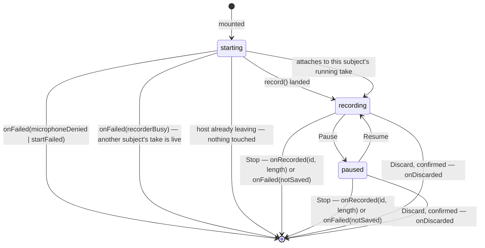
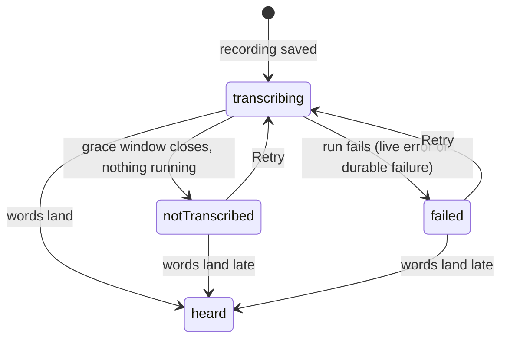

The recording UI is **one recorder on every surface**: a level line, a
transport row whose red Stop carries the running time, and nothing else. A
task's microphone, a project's, a goal's check-in and a person's all open the
same thing, and a field that takes dictation draws the voice with the same
bars. There is no orb and no VU meter: both drew the one number the level
line already shows, as the largest thing on the sheet.

Every recorder is one layout, `RecordingStage` in
[`recording_controls.dart`](../../../lib/features/speech/ui/widgets/recording/recording_controls.dart):
one centred column whose parts share one measure — the level line takes the
transport row's width (`RecordingTransportControls.rowWidth`: two rings, two
gaps and the Stop pill at its held width), so the two share their edges in
every host. Every word on it that is not the running time speaks in one
caption voice (`recordingCaptionStyle`). Top to bottom:

- **The level line** — `RecordingLevelLine`, the app's one voice waveform
  ([`DesignSystemVoiceWaveform`](../../../lib/features/design_system/components/chat_input/design_system_voice_waveform.dart),
  see [the chat input](../design_system/component-contracts.md#one-chat-input-for-typing-and-talking)):
  thin accent bars travelling from *now*, at the right, towards the past,
  over a hairline that is what silence looks like, fading out at the oldest
  end. Each bar stands for 40 ms of the take wherever it is drawn, so the
  bars move at one pace on the recorder and in a chat field. The line keeps
  a window of normalised levels (`normaliseDbfs`, in
  [`recording_levels.dart`](../../../lib/utils/recording_levels.dart) — the
  one loudness scale, the chat recorder's too), one per recorder sample — a
  steady level too, so silence ages loud bars out — holds still while
  paused and empties when a take stops. Under reduced motion the hairline
  lies still and no bar is drawn.
- **The transport row** — `RecordingTransportControls`: discard ✕ and
  pause ⏸ / resume ▶ (filled glyphs, a size below the stroked ✕ so the
  two weigh the same) as 48px border-only rings either side
  of Stop, which carries the running time. Stop is the app's running-clock
  control,
  [`DesignSystemTimerPill`](../../../lib/features/design_system/components/buttons/design_system_timer_pill.dart)
  — the pill a task's *Track time* wears while it runs: alert red, a white
  stop square in an inset circle, the elapsed time (`formatElapsed` in
  [`entry_tools.dart`](../../../lib/utils/entry_tools.dart), `mm:ss` then
  `hh:mm:ss` — as a saved take's length, playback and a chat field's
  dictation clock read too) in tabular figures, its width held to `00:00`
  so the rings never shift mid-take. Here its whole body stops the take, so
  it is one button named *Stop* whose value is the time. The controls have
  one name and one key each on every surface (`discardKey`, `pauseKey`,
  `stopKey`). Taps are felt (a firmer one on Stop) when the user's haptics
  switch is on.
- **A footer**, where a host has a setting for the take — the sheet's
  *Transcribe* toggle (`RecordingOption`: the caption, then a small
  design-system toggle).

The level line is one semantics label the host names; it is a live region
where no status line of the host's announces each transition.

**A recorder shows no model or provider name, and no hint about what to
say.** Where the words are made is an implementation detail of the user's AI
profile, shown in its settings; the sheet's title says what the recording is
about.

The dBFS values come from `AudioRecorderController`, which samples amplitude
every 20 ms. See [the speech overview](overview.md).

# The inline recorder

[`InlineRecorder`](../../../lib/features/speech/ui/widgets/recording/inline_recorder.dart)
is the recorder itself: the recording sheet hosts it, and so does every
surface that records in place — a person's check-in composer and page, a
goal's check-in sheet. It starts the app-wide `AudioRecorderController` on
mount — the user already pressed a microphone, *Speak* or *Dictate*, so no
surface asks for a second tap — with the subject as `linkedId` (null for a
recording that stands on its own), hides the floating indicator while it is up,
and hands back the saved entry id and the length the clock stood at
(`onRecorded`), a confirmed discard (`onDiscarded`), or why there is nothing
to hand back (`onFailed`, an `InlineRecordingFailure`: `microphoneDenied`,
`startFailed`, `recorderBusy`, `notSaved`). The host decides what each means
and who transcribes (`transcriptionHandledByCaller`), may put an option
under the controls (`footer`) and may say in its own words what a discard
loses (`discardMessage`).

Why a recorder has nothing to hand back is one card,
[`RecordingFailureCallout`](../../../lib/features/speech/ui/widgets/recording/recording_failure_callout.dart):
the reason, *Open settings* for a refused microphone, *Stop that recording*
where another subject's take holds the recorder. The recording sheet and a
goal's check-in rest on it over their own record button, which is the retry.

**It never takes a running take over.** `AudioRecorderController.record` is a
toggle: called while a take is live it stops that take and files it under the
new `linkedId`. So before starting, the recorder reads the controller: a take
running for another subject is `recorderBusy` and `record` is never called; a
take already running for this subject is attached to, not restarted. The
subject is compared on every start; there is no host flag that skips it. A
recorder mounted on a host that is already on its way out (a popped route is
mounted until its exit animation ends) does nothing at all: it neither hides
a running take's indicator nor starts a take behind a sheet that is gone.
Dismissing the host mid-take does not stop it — the host hands the floating
indicator back (`setModalVisible(false)`) and the take is stopped from there.

`spokenClockLabel` reads a take's length to assistive technology in words.
`appSettingsOpenerProvider` (`speech/state/app_settings_opener.dart`) is the
seam over the system's settings page that a refused microphone's *Open
settings* goes through, on every surface.

# Where the indicators are, and are not

| Surface | Shows |
|---------|-------|
| Recording sheet | `InlineRecorder` under the sheet's title — the linked task's, project's or entry's name, *Record a voice note* otherwise (`recordingSubjectTitle`) — with *Transcribe* as its footer; recording from the moment it opens |
| Goal check-in sheet | `InlineRecorder` under the sheet's title — the goal's name — and the agent's question — no status line: the red Stop pill carrying the running time says it is recording, as on the recording sheet |
| Check-in page dock | The stage embedded in place by `CheckInInlineRecorder` (the person's wrapper over `InlineRecorder`), with its own status line in the stage's notice slot (`showStatus`: `● Recording` / `Paused` in the composer header's grammar, a live region), since no header above it says so |
| Check-in composer and *Speak about …* sheet | The stage, under the composer's header and its status line, or under the sheet's title |
| Chat and dictation fields | The same bars in the field's own row: ✕, a red dot, the time, the bars, ✓ Done — the take becomes words in the field, not an entry, so Done is a check rather than Stop |
| Mobile recording pill | A compact live indicator |
| Desktop sidebar row | A red accent card, a pulsing dot, the subject's name and elapsed time, while a take is recording *or paused* with its sheet closed — **deliberately no dBFS reaction** |
| Goal and person page bar | The *Speak* pill reads *Recording* on the alert fill while a take linked to that goal or person is recording or paused (`subjectTakeLiveProvider`, which never builds the recorder just to ask). On a phone these pages slide the navigation bar and its indicator away, so the pill is the only sign on the screen — **no level, no time** |
| Task, entry and event action bars | `GlassRecordButton`: the accent-ringed mic takes the alert fill while a session linked to *that* task, entry or event is recording or paused — **no level, no time** |

The desktop row is intentionally inert to level: it is ambient status in a
navigation rail, and a reacting meter there would pull attention away from
whatever the user is actually doing.

The action bars' mic
([`glass_record_button.dart`](../../../lib/features/speech/ui/widgets/recording/glass_record_button.dart))
is inert to level by construction, not just by design: it watches the
recorder's state through a selector on
`AudioRecorderState.isActiveSessionFor(linkedId)` — recording or paused, and
linked to its own task or entry — so the level and progress updates streaming
through the state during a recording rebuild neither the button nor the bar
around it. Both sticky bars render this one widget, which is what keeps the
app's lead-action mic to one look, one active state and one accessibility
story.

# The words under a recording

What a recording's words look like after it stops is shared too, in
[`lib/widgets/transcript/`](../../../lib/widgets/transcript), so a check-in
recording reads the same on a goal's rail and charter, in the People
composer and on the person timeline, and on the events rail. The
[assessment](../../../docs/design/check_in_transcripts/assessment.md)
records why the People patterns became the standard.

- **One status.** `TranscriptStatus` is `heard`, `transcribing`,
  `notTranscribed` or `failed`, and `transcriptStatusOf` is the one rule:
  - words win;
  - otherwise a running transcription is transcribing and a failure on
    record is failed;
  - otherwise a recording is transcribing until `kTranscriptGrace`
    (10 minutes) after it started, then not transcribed.

  A host that cannot see a run's progress, such as the person timeline,
  passes neither flag and gets the grace rule alone, so an old recording
  stops promising words. A host that stays on screen arms
  `TranscriptGraceRebuild`, so the window closing is itself a rebuild.
- **One look.** `RecordingTranscript` draws heard words through
  `FoldedWords`. Every other state is one status line:
  - a spinner while the words are coming, or the warning glyph in the
    warning tone when they are not;
  - the one caption label for that state, at full ink when it is news;
  - a tertiary dense *Retry* on the two missing states, when the host can
    honour one;
  - the host's own detail under the label: a provider's reason, or the
    composer's *you can save now*.

  The status line is a live region. The host draws the recording above it
  (a player, or a take's header), and the recording is never withheld for
  want of words.
- **One fold.** `FoldedWords` is the user's words, typed or spoken: `bodySmall`
  at full ink, three lines, then a quiet-ink *Show more* that announces
  its expanded state and can lead with a summary. It keeps itself alive in a
  lazy list while open, so scrolling never undoes it. The People composer
  shows a take's words unfolded (`folded: false`), because there the user is
  reviewing what they just said.
- **Light playback.** A history row plays its recording through
  `RecordingPlayback`
  ([`recording_playback.dart`](../../../lib/features/speech/ui/widgets/recording_playback.dart)):
  closed, one small tertiary *Play audio* action (its length in the
  semantics label — the row's meta already shows it); tapped, it plays and
  the row eases open (`AnimatedSize`, motion tokens) to the waveform
  `AudioPlayerWidget` while that recording is the one the app's single
  player holds and has not finished, folding back when it stops or another
  starts. The design panel chose this over a player card under every
  recording, unanimously: a history is for reading. The person timeline
  plays a voice note's recording and a check-in's newest; its waiting
  recordings watch their inference status and offer *Retry*
  (`PersonTimelineActions.retryTranscript`), as a goal's do.

