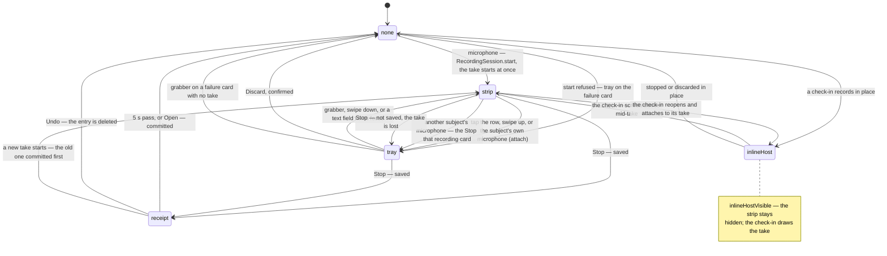
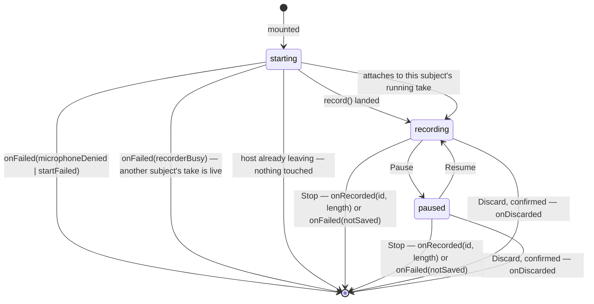
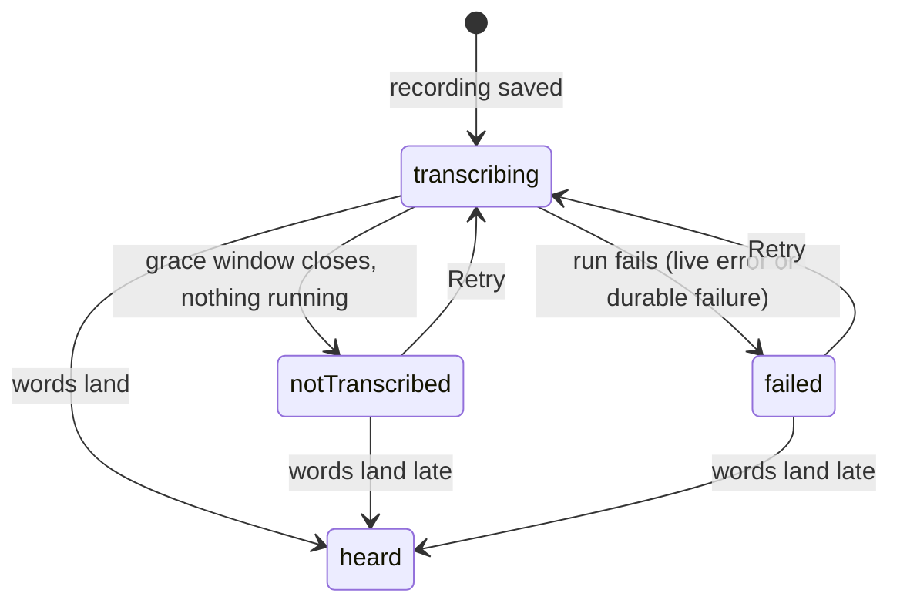

The recording UI is **one recorder on every surface**: a level line, a
transport row whose red Stop carries the running time, and nothing else. A
task's microphone, a project's, a goal's check-in and a person's all draw the
same thing, and a field that takes dictation draws the voice with the same
bars. There is no orb and no VU meter: both drew the one number the level
line already shows, as the largest thing on the screen.

**A microphone starts the take at once, on the recording strip** — a slim row
at the bottom of the app that stays on every page while the take runs, opens
into the full recorder (its *tray*), takes the user back to where the take
started, and turns into a five-second *receipt* with Undo once the take is
stopped. There is no recording sheet any more. Only the check-ins — a goal's
and a person's — still record in place, with
[`InlineRecorder`](#the-inline-recorder), and hand a running take to the
strip when their screen closes.

Every recorder is made of the same parts in
[`recording_controls.dart`](../../../lib/features/speech/ui/widgets/recording/recording_controls.dart).
The check-ins lay them out as `RecordingStage`: one centred column whose
parts share one measure — the level line takes the
transport row's width (`RecordingTransportControls.rowWidth`: two rings, two
gaps and the Stop pill at its held width), so the two share their edges in
every host. The strip's tray lays the same parts across its own width
instead ([the tray](#the-tray)). Every word on it that is not the running time speaks in one
caption voice (`recordingCaptionStyle`). Top to bottom:

- **The level line** — `RecordingLevelLine`, the app's one voice waveform
  ([`DesignSystemVoiceWaveform`](../../../lib/features/design_system/components/chat_input/design_system_voice_waveform.dart),
  see [the chat input](../design_system/component-contracts.md#one-chat-input-for-typing-and-talking)):
  thin accent bars travelling from *now*, at the right, towards the past,
  over a hairline that is what silence looks like, fading out at the oldest
  end. Each bar stands for 40 ms of the take wherever it is drawn, so the
  bars move at one pace on the recorder and in a chat field. The line keeps
  a window of normalised levels (`normaliseDbfs`, in
  [`recording_levels.dart`](../../../lib/utils/recording_levels.dart) — the
  one loudness scale, the chat recorder's too), one per recorder sample — a
  steady level too, so silence ages loud bars out — holds still while
  paused and empties when a take stops. Under reduced motion the hairline
  lies still and no bar is drawn.
- **The transport row** — `RecordingTransportControls`: discard ✕ and
  pause ⏸ / resume ▶ (filled glyphs, a size below the stroked ✕ so the
  two weigh the same) as 48px border-only rings either side
  of Stop, which carries the running time. Stop is the app's running-clock
  control,
  [`DesignSystemTimerPill`](../../../lib/features/design_system/components/buttons/design_system_timer_pill.dart)
  — the pill a task's *Track time* wears while it runs: alert red, a white
  stop square in an inset circle, the elapsed time (`formatElapsed` in
  [`entry_tools.dart`](../../../lib/utils/entry_tools.dart), `mm:ss` then
  `hh:mm:ss` — as a saved take's length, playback and a chat field's
  dictation clock read too) in tabular figures, its width held to `00:00`
  so the rings never shift mid-take. Here its whole body stops the take, so
  it is one button named *Stop* whose value is the time. The controls have
  one name and one key each on every surface (`discardKey`, `pauseKey`,
  `stopKey`). Taps are felt (a firmer one on Stop) when the user's haptics
  switch is on.
- **A footer**, where a host has something to add under the controls.

There is no per-take *Transcribe* option: a take linked to a subject whose
profile automates transcription is transcribed once committed, and one that
is not, is not — the receipt says which (`hasProfileTranscriptionProvider`).

The level line is one semantics label the host names; it is a live region
where no status line of the host's announces each transition.

**A recorder shows no model or provider name, and no hint about what to
say.** Where the words are made is an implementation detail of the user's AI
profile, shown in its settings; the strip's leading part, or a check-in
sheet's title, says what the recording is about.

The dBFS values come from `AudioRecorderController`, which samples amplitude
every 20 ms. See [the speech overview](overview.md).

# The recording strip

Every microphone that is not a check-in's goes through one call,
`RecordingSession.start` in
[`recording_session.dart`](../../../lib/features/speech/state/recording_session.dart)
— a task's, project's and entry's action bar and the Add sheet's *Record a
voice note* (all through `EntryCreationService.startRecording`), a task's
first-run actions, a goal's charter card and reflection voice note, and the
Daily OS shutdown reflection. It:

- asks the one start rule,
  [`decideRecordingStart`](../../../lib/features/speech/state/recording_start_guard.dart),
  which `InlineRecorder` asks too. `AudioRecorderController.record` is a
  toggle that would stop a running take and file it under the new subject,
  so: nothing running is **start**; a take already running for this subject
  is **attach** — the tray opens over it, and the caller gets that take's
  own future; a take running for anything else is **busy** — the tray opens
  on the *Stop that recording* card and the caller gets `null`;
- commits a receipt still on screen, folds the tray, and starts the
  app-wide recorder with the take's
  [`RecordingOrigin`](../../../lib/features/speech/state/recording_origin.dart)
  — the route on screen (`NavService.activeRoute`), the subject id, and the
  scroll offset its page reported, captured by `captureRecordingOrigin` —
  which the recorder holds in its state for as long as the take runs;
- opens the tray on a failure card when the recorder refuses the start
  (`microphoneDenied` → *Open settings*, `startFailed`);
- returns a future that completes when the take is **committed**, with the
  audio entry's id, or with `null` when it is discarded, undone or never
  started.

## What the strip's place shows

The shell mounts one
[`RecordingStripLayer`](../../../lib/features/speech/ui/widgets/recording/strip/recording_strip_layer.dart);
`recordingStripContentProvider` decides what it shows, and the shell
reserves room by the same rule: **the receipt** while one lasts; else **the
tray** while it is open over a take or for a failure; else **the strip**
while a take is recording or paused that no check-in screen draws in place
(`inlineHostVisible`); else nothing. A recorder that fails to build counts
as nothing recording, so it never takes the shell down. The layer cross-fades
and slides its content in `RecordingStripLayer.motion`, at once under
reduced motion, caps itself at the prose measure (`kProseMeasureWidth`) and
centres there. Where the shell puts it is in
[navigation](../../architecture/navigation.md#the-recording-strip-shell).

## The row

[`RecordingStrip`](../../../lib/features/speech/ui/widgets/recording/strip/recording_strip.dart)
is one glass capsule (the island's chip glass), 56 px at the default text
size and growing with the text scale (`RecordingStrip.height`, which the
receipt's two lines share). It carries no words: a title cut to a few
letters said little, so the level takes that room. Left to right:

- **The leading glyph**
  ([`RecordingStripLeading`](../../../lib/features/speech/ui/widgets/recording/strip/recording_strip_leading.dart)
  with `compact: true`), a `spacing.step9` square that follows the route on
  screen (`NavService.activeRouteChanges`):
  - **away** from the origin — ↩, one button back
    (`RecordingSession.returnToOrigin`), named *Back to …* with the status
    (*Recording for* / *Paused*) as its value;
  - **here**, on the origin — a red dot (a pause glyph while paused),
    labelled *Recording here* (*Paused here*), not a button.
    `isOnRecordingOrigin` compares the two routes without query or trailing
    slash;
  - **voice note** — a take linked to nothing, or whose subject is gone —
    the dot, labelled *Voice note*, never a button. A subject that is there
    but has no title keeps its way back.

  The words are a live region, so a pause or resume is announced once, not
  every second.
- **The bars** — the level line over all the room between the glyph and
  pause, held still while paused; the one part of the row that watches
  every sample.
- **Pause / resume** — the transport row's ring; while paused, resume is the
  filled accent disc, the one primary on the row.
- **Stop** — the timer pill carrying the running time, always last; a quiet
  neutral fill while paused. **Stop always saves**; the ✕ that discards
  lives only in the tray.

From the Stop tap until the receipt is up, `recordingSavingProvider` holds
the strip's place with an inert empty capsule (`RecordingStripContent.saving`),
so the page never drops back under a second tap.

The row watches the recorder through selectors — status, whole seconds,
origin, subject — so a level sample never rebuilds it.

## The tray

Tapping the row anywhere outside its buttons, or swiping it up, opens
[`RecordingStripTray`](../../../lib/features/speech/ui/widgets/recording/strip/recording_strip_tray.dart)
in the strip's place (`RecordingTrayController`): a grabber, the leading part
with its words — ↩ and the subject's title on one line, or *Recording here* /
*Voice note* by the dot — then the level line and the transport row across
the tray's whole width (`RecordingTransportControls(spread: true)`): discard
✕ (asked first) at the start, pause and Stop at the end, where the strip
keeps them. It has no
scrim — the page above stays usable — and it folds back on the grabber, a
swipe down, or when a text field takes focus. A failed start opens it on
`RecordingFailureCallout` instead, over the live stage when a take still
runs. It is presentational: it never mounts `InlineRecorder` and never
starts a take of its own.

## The receipt and the commit moment

`RecordingSession.stop` stops the take with `deferAutomation: true` and
hands it to
[`RecordingReceiptController`](../../../lib/features/speech/state/recording_receipt_controller.dart),
which replaces the strip in place for `recordingReceiptWindow` (5 s) with
[`RecordingReceiptRow`](../../../lib/features/speech/ui/widgets/recording/strip/recording_receipt.dart):
a tick, then *Saved · 0:42* (*· transcribing* only where the recorder's own
automation will run) over the subject's title (*Voice note* for a take saved
to nothing), then **Undo** as a neutral outline and **Open** as the primary
at the trailing edge — shown only where it leads somewhere: away from the
origin to a subject still there, or into a voice note's own entry. The row
takes no tap for `RecordingReceiptRow.armDelay` after it appears, with or
without motion, so a second tap meant for Stop never lands on Undo.

**A take is committed when its receipt times out, when Open is tapped, or
when a new take starts.** Only then does `commitAutomation` start the take's
automatic prompts and the caller hear the id — so an Undo never pays for
inference, and a caller such as the goal charter never links a recording
about to be deleted. **Undo** deletes the entry through
`JournalRepository.deleteJournalEntity`, drops the owed prompts, and the
caller hears `null`; a delete that does not land commits the take after
all. Nothing is deleted without Undo: if the app dies inside the window the
entry stays, untranscribed, and reads *Not transcribed · Retry* by the grace
rule below. **Open** goes back to the origin for a subject's take, or into
a voice note's own entry. Nothing navigates on its own at commit: Open is
the only way the receipt moves the user.

## Back to the exact place

`RecordingSession.returnToOrigin` beams to the origin route when
`NavService.canBeamTo` says an enabled tab owns it; else to the subject's
own page by kind (`recordingSubjectRoute` — a task, project, person or
journal entry; a goal has none by entry id); a subject deleted since leaves
nowhere to go. A page that opts in with
[`RecordingOriginScrollAnchor`](../../../lib/features/speech/ui/widgets/recording/recording_origin_scroll_anchor.dart)
— task detail does — reports its scroll offset under its route, and the way
back restores it once, clamped (`recordingOriginScrollProvider`); a page
that does not lands at its top. Arriving at a subject signals
`recordingArrivalProvider`, and that subject's live `GlassRecordButton`
swells once (`GlassRecordButton.arrivalDuration`), not under reduced motion.

# The inline recorder

[`InlineRecorder`](../../../lib/features/speech/ui/widgets/recording/inline_recorder.dart)
is the recorder a check-in draws in place — a person's check-in composer and
page, a goal's check-in sheet. It starts the app-wide
`AudioRecorderController` on mount — the user already pressed *Speak* or
*Dictate*, so no surface asks for a second tap — with the subject as
`linkedId`, captures the take's origin as the strip does, marks the take as
drawn in place (`setInlineHostVisible(visible: true)`, which hides the
strip), and hands back the saved entry id and the length the clock stood at
(`onRecorded`), a confirmed discard (`onDiscarded`), or why there is nothing
to hand back (`onFailed`, an `InlineRecordingFailure`: `microphoneDenied`,
`startFailed`, `recorderBusy`, `notSaved`). The host decides what each means
and who transcribes (`transcriptionHandledByCaller`), may put an option
under the controls (`footer`) and may say in its own words what a discard
loses (`discardMessage`). A take it stops is not held for a receipt: the
check-in shows the take itself.

Why a recorder has nothing to hand back is one card,
[`RecordingFailureCallout`](../../../lib/features/speech/ui/widgets/recording/recording_failure_callout.dart):
the reason, *Open settings* for a refused microphone, *Stop that recording*
where another subject's take holds the recorder. The strip's tray and a
goal's check-in rest on it; in the check-in its own record button is the
retry.

**It never takes a running take over.** Before starting it asks
`decideRecordingStart`, the strip's rule: a take running for another subject
is `recorderBusy` and `record` is never called; a take already running for
this subject is attached to, not restarted. The subject is compared on every
start; there is no host flag that skips it. A recorder mounted on a host that
is already on its way out (a popped route is mounted until its exit
animation ends) does nothing at all: it neither hides the strip nor starts a
take behind a sheet that is gone. Dismissing the host mid-take does not stop
it — the host hands the take to the strip
(`setInlineHostVisible(visible: false)`) and it is stopped from there, with
the strip's receipt.

`spokenClockLabel` reads a take's length to assistive technology in words.
`appSettingsOpenerProvider` (`speech/state/app_settings_opener.dart`) is the
seam over the system's settings page that a refused microphone's *Open
settings* goes through, on every surface.

# Where the indicators are, and are not

| Surface | Shows |
|---------|-------|
| Recording strip | The leading glyph (↩ back / the live dot), the bars filling the row, pause, and the Stop pill carrying the running time — no words — on every page, phone and desktop, while a take runs that no check-in draws in place. Not on Flatpak |
| Strip tray | The subject's title by the way back, the level line, and discard ✕ · pause · Stop across its width — or a failure card |
| Receipt | ✓ *Saved · 0:42* (*· transcribing* where it will be) over the subject, *Undo*, and *Open* where it leads somewhere — for 5 s after Stop |
| Goal check-in sheet | `InlineRecorder` under the sheet's title — the goal's name — and the agent's question — no status line: the red Stop pill carrying the running time says it is recording |
| Check-in page dock | The stage embedded in place by `CheckInInlineRecorder` (the person's wrapper over `InlineRecorder`), with its own status line in the stage's notice slot (`showStatus`: `● Recording` / `Paused` in the composer header's grammar, a live region), since no header above it says so |
| Check-in composer and *Speak about …* sheet | The stage, under the composer's header and its status line, or under the sheet's title |
| Chat and dictation fields | The same bars in the field's own row: ✕, a red dot, the time, the bars, ✓ Done — the take becomes words in the field, not an entry, so Done is a check rather than Stop |
| Goal and person page bar | The *Speak* pill reads *Recording* on the alert fill while a take linked to that goal or person is recording or paused (`subjectTakeLiveProvider`, which never builds the recorder just to ask) — **no level, no time**; the strip below carries those |
| Task, entry and event action bars | `GlassRecordButton`: the accent-ringed mic takes the alert fill while a session linked to *that* task, entry or event is recording or paused, and swells once when the strip brings the user back to it — **no level, no time** |

The phone island and the desktop sidebar show no recording any more: the
island is timer-only, and the sidebar's activity summary lists the timer and
agent wakes.

The action bars' mic
([`glass_record_button.dart`](../../../lib/features/speech/ui/widgets/recording/glass_record_button.dart))
is inert to level by construction, not just by design: it watches the
recorder's state through a selector on
`AudioRecorderState.isActiveSessionFor(linkedId)` — recording or paused, and
linked to its own task or entry — so the level and progress updates streaming
through the state during a recording rebuild neither the button nor the bar
around it. Both sticky bars render this one widget, which is what keeps the
app's lead-action mic to one look, one active state and one accessibility
story. Pressed while its own take runs, it opens the strip's tray rather than
starting again.

# The words under a recording

What a recording's words look like after it stops is shared too, in
[`lib/widgets/transcript/`](../../../lib/widgets/transcript), so a check-in
recording reads the same on a goal's rail and charter, in the People
composer and on the person timeline, and on the events rail. The
[assessment](../../../docs/design/check_in_transcripts/assessment.md)
records why the People patterns became the standard.

- **One status.** `TranscriptStatus` is `heard`, `transcribing`,
  `notTranscribed` or `failed`, and `transcriptStatusOf` is the one rule:
  - words win;
  - otherwise a running transcription is transcribing and a failure on
    record is failed;
  - otherwise a recording is transcribing until `kTranscriptGrace`
    (10 minutes) after it started, then not transcribed.

  A host that cannot see a run's progress, such as the person timeline,
  passes neither flag and gets the grace rule alone, so an old recording
  stops promising words. A host that stays on screen arms
  `TranscriptGraceRebuild`, so the window closing is itself a rebuild.
- **One look.** `RecordingTranscript` draws heard words through
  `FoldedWords`. Every other state is one status line:
  - a spinner while the words are coming, or the warning glyph in the
    warning tone when they are not;
  - the one caption label for that state, at full ink when it is news;
  - a tertiary dense *Retry* on the two missing states, when the host can
    honour one;
  - the host's own detail under the label: a provider's reason, or the
    composer's *you can save now*.

  The status line is a live region. The host draws the recording above it
  (a player, or a take's header), and the recording is never withheld for
  want of words.
- **One fold.** `FoldedWords` is the user's words, typed or spoken: `bodySmall`
  at full ink, three lines, then a quiet-ink *Show more* that announces
  its expanded state and can lead with a summary. It keeps itself alive in a
  lazy list while open, so scrolling never undoes it. The People composer
  shows a take's words unfolded (`folded: false`), because there the user is
  reviewing what they just said.
- **Light playback.** A history row plays its recording through
  `RecordingPlayback`
  ([`recording_playback.dart`](../../../lib/features/speech/ui/widgets/recording_playback.dart)):
  closed, one small tertiary *Play audio* action (its length in the
  semantics label — the row's meta already shows it); tapped, it plays and
  the row eases open (`AnimatedSize`, motion tokens) to the one-row
  `AudioPlayerWidget` (play, waveform, one time label, speed; 40 px tall on
  every width) while that recording is the one the app's single
  player holds and has not finished, folding back when it stops or another
  starts. The design panel chose this over a player card under every
  recording, unanimously: a history is for reading. The person timeline
  plays a voice note's recording and a check-in's newest; its waiting
  recordings watch their inference status and offer *Retry*
  (`PersonTimelineActions.retryTranscript`), as a goal's do.

