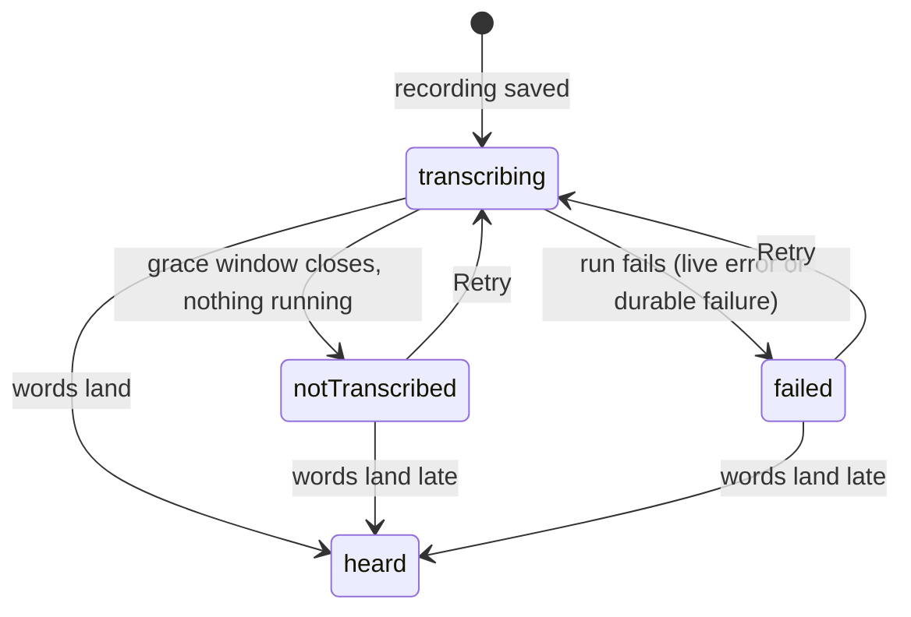

The recording UI offers **a selectable analog VU meter or an energy orb**, plus
recording controls and status indicators — all driven by **the same live dBFS
stream**.

`AnalogVuMeter` is custom-drawn: a traditional analog needle responding to audio
level in real time. The energy orb is the shader-driven alternative. Which one
renders is a user preference (*Settings → Recording Style*), and **the feed is
identical either way** — the choice is purely presentational, so neither variant
can report a different level than the other.

Every recorder is one studio layout, `RecordingStage` in
[`recording_controls.dart`](../../../lib/features/speech/ui/widgets/recording/recording_controls.dart):
one centred column no wider than `RecordingLevelLine.maxWidth`, whose parts
share one measure: the level line takes the transport row's width
(`RecordingTransportControls.rowWidth` — two rings, two gaps and the Stop
pill at its held width), so the two share their edges in every host. Every word on it that is
not the running time speaks in one caption voice (`recordingCaptionStyle`).
Top to bottom:

- **The look the user chose** — `RecordingLevelVisualizer`, the orb or the
  meter, left out when the host asks for `compact` (the check-in page's
  dock, so dictating never covers the check-in). On a light surface the orb
  sits on a *lit pool*: a radial gradient from the brightest surface at the
  centre through the orb's glint at the ring to nothing, so its light has
  something to glow against. The orb's canvas keeps a margin of glow below
  its ring, and that margin is the whole gap to the line.
- **The level line** — `RecordingLevelLine`, the level bars from
  [`live_waveform.dart`](../../../lib/features/speech/ui/widgets/recording/live_waveform.dart)
  at the transport row's width, fading in at its
  oldest end only so the newest bars are at full strength: accent under the
  orb, neutral under the meter, the pair the user chose the look from in
  onboarding. Silence is a hairline (`baselineColor`) from the oldest
  sample to now, not a row of idle dots. It keeps a window of normalised
  levels (`normaliseDbfs`, in
  [`recording_levels.dart`](../../../lib/features/speech/state/recording_levels.dart)),
  one per recorder tick — a steady level too, so silence ages loud bars
  out — draws each bar as the louder of a pair of samples, holds still
  while paused and empties when a take stops. Daily OS Capture and the
  onboarding previews draw the same bars from the same helpers.
- **The transport row** — `RecordingTransportControls`: discard ✕ and
  pause ⏸ / resume ▶ (filled glyphs, a size below the stroked ✕ so the
  two weigh the same) as 48px border-only rings either side
  of Stop, which carries the running time. Stop is the app's running-clock
  control,
  [`DesignSystemTimerPill`](../../../lib/features/design_system/components/buttons/design_system_timer_pill.dart)
  — the pill a task's *Track time* wears while it runs: alert red, a white
  stop square in an inset circle, the elapsed time (`formatElapsed` in
  [`entry_tools.dart`](../../../lib/utils/entry_tools.dart), `mm:ss` then
  `hh:mm:ss` — as a saved take's length and playback read too) in tabular
  figures, its width held to `00:00` so the
  rings never shift mid-take. Here its whole body stops the take, so it is
  one button named *Stop* whose value is the time. Taps are felt (a firmer
  one on Stop) when the user's haptics switch is on. Before a take starts
  the sheet puts its record button in this slot.
- **A footer**, where a host has a setting for the take — the sheet's
  *Transcribe* toggle (`RecordingOption`: the caption, then a small
  design-system toggle). The check-in recorder has none: a line reassuring
  that audio is saved as you go said nothing the user had to act on.

The pictures (orb or meter, and the level line) are one semantics label the
host names — on the level line when `compact` leaves it the only picture;
the sheet makes it a live region, the check-in hosts do not, because their
status line already announces each transition.

The orb takes its colours by role from one palette,
[`AiVoiceOrbPalette`](../../../lib/features/ai/ui/animation/ai_voice_orb_palette.dart),
built from the tokens of the surface it sits on — the recording sheet, Daily OS's
voice button and onboarding's style previews all use it. The shader draws light:
its body is the accent, its glints the brightest parts, a soft halo around each
strand. On a dark surface the palette is the accent, white glints and the accent
deepened for the halo, as the orb always was. On a light surface the energy must
still read *lighter*, so the glint is the accent's hue at the dark theme's
lightness, the halo the lit teal between them, and the shader's `uLightSurface`
narrows and softens the halos and glints — every light-surface change written as
`mix(dark, light, L)`, so dark mode is unchanged to the pixel. The text ink once
fed the glints, which on a light sheet drew the peaks as black strands. There the
recorder's clock takes the neutral ink, leaving the teal to the live parts.

The dBFS values come from `AudioRecorderController`, which samples amplitude every
20 ms and derives VU through the standalone `VuMeter` sliding-window unit. See
[the speech overview](overview.md).

# Where the indicators are, and are not

| Surface | Shows |
|---------|-------|
| Recording modal | The whole `RecordingStage`: VU meter or orb, level line, record / discard–timed Stop–pause, *Transcribe* |
| Check-in page dock | The stage `compact` — no orb or meter — embedded in place by `CheckInInlineRecorder`, with its own status line in the stage's notice slot (`showStatus`: `● Recording` / `Paused` in the composer header's grammar, a live region), since no header above it says so |
| Check-in composer | The whole stage, under the composer's header and its status line |
| Mobile recording pill | A compact live indicator |
| Desktop sidebar row | A red accent card, a pulsing dot and elapsed time — **deliberately no dBFS reaction** |
| Task, entry and event action bars | `GlassRecordButton`: the accent-ringed mic takes the alert fill while a session linked to *that* task, entry or event is recording or paused — **no level, no time** |

The desktop row is intentionally inert to level: it is ambient status in a
navigation rail, and a reacting meter there would pull attention away from
whatever the user is actually doing.

The action bars' mic
([`glass_record_button.dart`](../../../lib/features/speech/ui/widgets/recording/glass_record_button.dart))
is inert to level by construction, not just by design: it watches the
recorder's state through a selector on
`AudioRecorderState.isActiveSessionFor(linkedId)` — recording or paused, and
linked to its own task or entry — so the level and progress updates streaming
through the state during a recording rebuild neither the button nor the bar
around it. Both sticky bars render this one widget, which is what keeps the
app's lead-action mic to one look, one active state and one accessibility
story.

# The words under a recording

What a recording's words look like after it stops is shared too, in
[`lib/widgets/transcript/`](../../../lib/widgets/transcript), so a check-in
recording reads the same on a goal's rail and charter, in the People
composer and on the person timeline, and on the events rail. The
[assessment](../../../docs/design/check_in_transcripts/assessment.md)
records why the People patterns became the standard.

- **One status.** `TranscriptStatus` is `heard`, `transcribing`,
  `notTranscribed` or `failed`, and `transcriptStatusOf` is the one rule:
  - words win;
  - otherwise a running transcription is transcribing and a failure on
    record is failed;
  - otherwise a recording is transcribing until `kTranscriptGrace`
    (10 minutes) after it started, then not transcribed.

  A host that cannot see a run's progress, such as the person timeline,
  passes neither flag and gets the grace rule alone, so an old recording
  stops promising words. A host that stays on screen arms
  `TranscriptGraceRebuild`, so the window closing is itself a rebuild.
- **One look.** `RecordingTranscript` draws heard words through
  `FoldedWords`. Every other state is one status line:
  - a spinner while the words are coming, or the warning glyph in the
    warning tone when they are not;
  - the one caption label for that state, at full ink when it is news;
  - a tertiary dense *Retry* on the two missing states, when the host can
    honour one;
  - the host's own detail under the label: a provider's reason, or the
    composer's *you can save now*.

  The status line is a live region. The host draws the recording above it
  (a player, or a take's header), and the recording is never withheld for
  want of words.
- **One fold.** `FoldedWords` is the user's words, typed or spoken: `bodySmall`
  at full ink, three lines, then a quiet-ink *Show more* that announces
  its expanded state and can lead with a summary. It keeps itself alive in a
  lazy list while open, so scrolling never undoes it. The People composer
  shows a take's words unfolded (`folded: false`), because there the user is
  reviewing what they just said.

