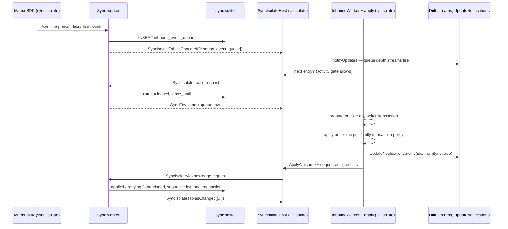
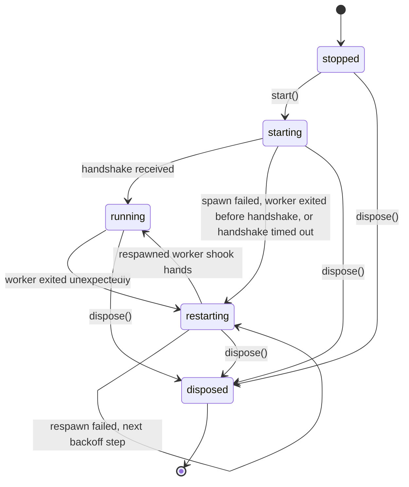

# The sync isolate

Sync is moving off the UI isolate into one long-lived worker isolate, step by
step, behind the `use_isolate_sync` config flag. The flag is **off by
default**, and off it constructs nothing: production sync runs exactly as the
rest of this bundle describes. The decision, the ownership split and the step
plan are [ADR 0142](../../../docs/adr/0142-sync-moves-into-an-isolate-that-owns-sync-sqlite.md);
this concept is how the pieces work.

**Where it stands.** The host, its supervision and a worker that answers
liveness exist (step 1). With the flag on, the worker is started at launch and
its handshake time is written to the sync log; all sync work still runs on the
UI isolate, and [the cost meter](#measuring-it) measures what it costs
(step 2). The apply path no longer needs a live `Room` (step 3, first half,
[below](#applying-without-a-room)), which is what lets the receive side move
without taking the apply step with it.

# Who will own what

The split is by database, so every database keeps exactly one writer:

| Isolate | Owns | Writes |
|---------|------|--------|
| Sync isolate | Matrix client (the app's existing device), SDK database, `/sync` loop, decryption, admission, bridge walks, attachment downloads, outbox sending | `sync.sqlite` only |
| UI isolate | The apply step (`InboundWorker` → `SyncEventProcessor`) and its activity gate, outbox enqueue requests, every UI reader | Every other database |

The hand-off is `inbound_event_queue`. The UI isolate pulls the next entry
when its activity gate allows; the sync isolate leases it and keeps it until
the UI isolate acknowledges the apply with its `ApplyOutcome`. A lease that
expires unacknowledged is delivered again — **an apply is never
fire-and-forget**, because the sequence log and backfill only work if
something knows what is still missing.

# How the hand-off works

The decision is [ADR 0142](../../../docs/adr/0142-sync-moves-into-an-isolate-that-owns-sync-sqlite.md#writes-refreshes-and-notifications-across-the-boundary);
this is the shape it takes in code once the receive side has moved (steps 4
and 5). Nothing below the diagram exists yet; what does exist is
[the apply path it depends on](#applying-without-a-room).



Three things to read off it. The worker is the only writer of `sync.sqlite`,
on its own Drift connection with the SQLite work on the worker itself and the
directories it needs handed over at the handshake. Data refresh does not
change: the apply step, and with it the `fromSync` fan-out, stays on the UI
isolate. Sync-state refresh is the one new piece: a Drift `watch()` sees only
its own connection's writes, so the worker names the tables it wrote and the
host replays them into the UI isolate's connection with `notifyUpdates`; the
pages keep their streams. An entry whose lease expires unacknowledged is
leased again, which is why apply stays idempotent.

# Applying without a Room

Step 3's first half, in place. `SyncEventProcessor.prepare` and `apply` read a
`SyncEnvelope` — event id, room id, sender, timestamp and the base64 body,
which is everything they ever read from the SDK's `Event` — and
`QueueApplyAdapter` rebuilds one from the decrypted JSON the queue stores
(`InboundQueueEntry.toEnvelope`), so no `Room` is built and the inbound worker
no longer resolves one before a batch. The one place the apply path reached
through the room, exact descriptor recovery after a restart or a missed file
event, asks a `SyncDescriptorFetcher` instead: `MatrixDescriptorFetcher` answers
from the UI isolate's own client today, and in step 4 the host answers it over
a request to the worker. `StoredSyncEnvelope` is plain values, so it is also
what the lease above will carry.

The one observable change: a queued entry applies as soon as its turn comes,
even before the SDK has emitted the room; it used to be retried every two
seconds until it had. The second half — `AttachmentIndex` holding Room-free
descriptors, and downloads behind an interface of the same kind — is still
to come.

# What runs regardless of activity

`UserActivityGate` (`canProcess` once a second has passed since the last
pointer, key or scroll event) is checked by three consumers, each once before
it starts, never during: the outbox drain pass, the inbound worker per entry,
and each queued attachment download. Nothing in `lib/features/sync` reacts to
the app being backgrounded; the only pausing tied to visibility is in the sync
pages' own pollers.

Everything else runs on the UI isolate whenever it is triggered — the work the
isolate is for:

| Work | Where it starts | Cost on the UI isolate |
|------|-----------------|------------------------|
| Matrix SDK `/sync` loop — response parsing, Olm/Megolm decryption | `lib/features/sync/matrix/client.dart` | High in bursts |
| Live admission — a `jsonDecode(jsonEncode(...))` copy per event, trust check, queue insert | `queue/queue_lifecycle.dart`, `queue/queue_response_admission.dart` | Medium–high |
| Bridge and catch-up walks — `/messages` pages, decrypt, enqueue | `queue/bridge_coordinator.dart` | High during catch-up |
| `fromSync` fan-out — every `updateStream` listener re-queries; goal, synced-audio and project-agent dispatchers run | `lib/services/db_notification.dart` | Medium–high |
| Live descriptor indexing, with a synchronous file stat | `queue/queue_pipeline_coordinator.dart` | Low–medium |
| Backfill requests and sync recovery, every 2 minutes | `backfill/backfill_request_service.dart`, `backfill/sync_recovery_service.dart` | Medium |
| Outbox enqueue writers — JSON, file, vector clock | `outbox/outbox_enqueue_writer*.dart` | Medium per message |
| Outbox watchdog every 10 s, daily prune, media-request timers, conflict watch, queue stats | `outbox/`, `media/`, `state/`, `queue/` | Low |

`JournalEntity.fromJson` also always runs on the UI isolate inside the gated
apply; only payloads of 4 KB and more, gzip and large file decryption are
already sent to one-off isolates.

# Measuring it

`SyncCostMeter` (`lib/features/sync/instrumentation/`) times the work above
before any of it moves. One instance is built with the sync stack and threaded
into the code it times; code built without one — most tests — gets an inert
meter that only emits timeline spans.

| Section | What one run is | Hooked in |
|---------|-----------------|-----------|
| `sdk` | The Matrix SDK handling one `/sync` response, from its `processing` status to `finished` or `error`. The response's JSON decode comes before `processing` and is not in it | `observeSdkSync(client.onSyncStatus.stream)`, wired in `lib/get_it_sync.dart` |
| `copy` | The synchronous deep copy of a live response's events | `queue/queue_response_admission.dart` |
| `admit` | Admitting one live response: decrypt, enqueue | `queue/queue_response_admission.dart` |
| `live` | One live timeline event | `queue/queue_pipeline_coordinator.dart` |
| `bridge` | One catch-up walk | `queue/bridge_coordinator.dart` |
| `apply` | Applying one inbound entry — the **gated** work, timed for comparison | `queue/inbound_worker.dart` |
| `backfill` | One automatic backfill-request pass | `backfill/backfill_request_service.dart` |
| `recovery` | One sync recovery pass | the recovery closure in `lib/get_it_sync.dart` |

Two outputs:

- **Timeline spans, always** — `sync.<section>` in a DevTools timeline, so a
  profile-mode capture on a phone labels the sync work beside the frames it
  overlapped. They do nothing in release builds.
- **A summary in the sync log, while the `sync` log domain is on** (Settings →
  Advanced → Logging; off by default). Once a minute, if anything ran:

  ```text
  sync cost 60s: sdk 1240ms/18 (max 310) · copy 40ms/18 (max 9) · admit 220ms/18 (max 41) · apply 900ms/40 (max 120) | ui stall 1830ms (1510ms with sync running), worst 420ms, 12 over 50ms
  ```

  Per section: total time, runs, and the longest run. Times are wall clock:
  for `copy`, which is synchronous, that is UI-isolate time; for the rest,
  which await the database and the network, it is an upper bound. The
  **ui stall** part is what measures blocking itself — a probe ticks every
  100 ms while the domain is on, and whatever a tick is late by was spent on
  something that held the UI isolate. A stall counts as *with sync running*
  when a section was open at any point during it. The probe starts with the
  first sync work counted after the log is switched on, so a burst right after
  switching it on is measured. A gap of five seconds or more between ticks is
  the app having been suspended — backgrounded, the phone asleep — not a stall,
  and is dropped. Section times are plain wall clock and do include a
  suspension that falls inside a run.

To measure a phone: turn the sync log on, use the app through a catch-up (a
device that has been offline, or a fresh login), and read the `cost` lines in
the sync log; for detail, capture a profile-mode DevTools timeline over the
same burst.

# The host

`SyncIsolateHost` is the UI isolate's side. `start()` returns at once — nothing
waits on a spawn — and the host spawns the worker with `Isolate.spawn` (same
isolate group, so the typed messages in `sync_isolate_protocol.dart` travel by
value), adopts it on its handshake, and numbers every request so its reply
finds the caller. Callers that need the worker watch `states` for `running`. Requests fail with a
typed `SyncIsolateFailure`: `timeout`, `isolateExited`, `notRunning`, or the
worker's own `failed`.



**Supervision** is the part the removed actor never had
([ADR 0046](../../../docs/adr/0046-sync-actor-isolate-removed-and-how-to-rebuild.md)).
The worker's own messages, the VM's report of its uncaught error (`onError`)
and its exit (`onExit`) all arrive on **one** port, which keeps their order:
the error and its trace are logged before the exit they caused, never lost to
an exit that overtook them on a second port. An exit nobody asked for fails
every request still out with `isolateExited` at once and schedules a respawn
— as does a worker that could not be started at all — after
`SyncTuning.syncIsolateRespawnBackoff`: 1 s, 5 s, 15 s, then a minute, by
consecutive crash, repeating the last step forever. The respawn timer is
injectable, so tests fire each respawn themselves and read the backoff it was
given. A worker that
ran for `syncIsolateStableUptime` (five minutes) before exiting resets the
streak.

**Shutdown** asks the worker to exit, which lets it finish the command it
holds, and kills it only if it has not exited within the request timeout. A
worker that finishes starting after the host was disposed is killed on
arrival, never adopted. The
host is registered in getIt with `dispose`, so a profile switch shuts it down
with the rest of the sync stack.

**The worker uses no Flutter plugins.** Whatever it needs from the platform —
paths, credentials, connectivity — the host passes in. Its log lines come back
as `SyncIsolateLog` events and are written to the sync log under the
`isolate` sub-domain.

# The flag

`use_isolate_sync` is seeded off, sits in the Advanced group of the Config
Flags page, and is hidden in guest worlds with the other sync-only flags. It
is read once, by `registerSyncIsolateIfEnabled` at the end of the real
profile's sync-stack registration in `lib/get_it_sync.dart`: toggling it takes
effect at the next start. Startup never waits on the spawn, and a worker
that cannot start is logged and retried by the host, never thrown into
startup.

# Tests

- `test/features/sync/isolate/` spawns real isolates — the production worker
  and fake top-level workers that exit, throw, hang or reject — with zero
  backoffs and timeouts instead of waits.
- `integration_test/sync_isolate_test.dart` runs the flag-to-worker path in
  the app build, first in `integration_test/run_matrix_tests.sh`. Later steps
  grow it into the two-device suite the isolated sync is specified by.
