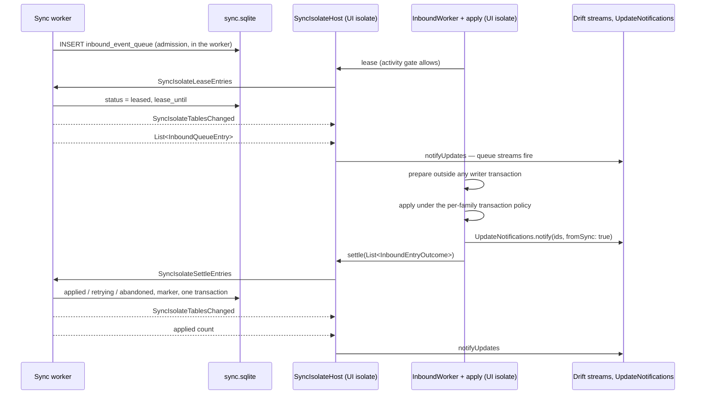
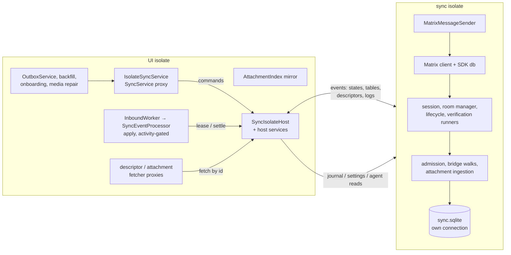
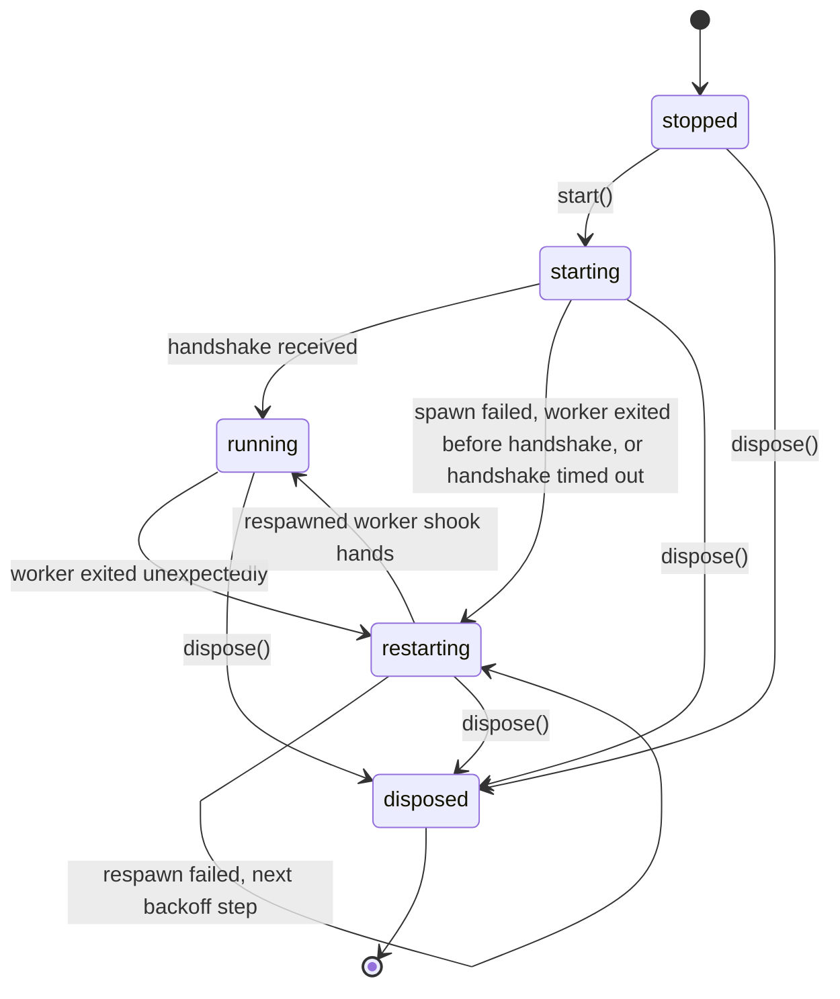

# The sync isolate

Sync is moving off the UI isolate into one long-lived worker isolate, step by
step, behind the `use_isolate_sync` config flag. The flag is **off by
default**, and off it constructs nothing: production sync runs exactly as the
rest of this bundle describes. The decision, the ownership split and the step
plan are [ADR 0142](../../../docs/adr/0142-sync-moves-into-an-isolate-that-owns-sync-sqlite.md);
this concept is how the pieces work.

**Where it stands.** The host and its supervision exist (step 1), and
[the cost meter](#measuring-it) measures what sync costs the UI isolate
(step 2). The apply path needs no live `Room` and no SDK `Event`
([below](#applying-without-a-room); step 3, both halves). With the flag on,
the worker opens its own connection to `sync.sqlite` and owns the inbound
queue's leases and acknowledgements, which the UI isolate's inbound worker
sends it ([the hand-off](#how-the-hand-off-works)); the writes it reports
reach the UI isolate's Drift streams. The UI no longer sees the SDK: every
page, sheet and controller above the sync feature talks to
[`SyncService`](#what-the-ui-sees) in plain types (step 4, first half).
With the flag on, the worker hosts the Matrix stack — the client, admission,
bridge walks, attachment ingestion and the message sender — and answers
`SyncService` over the port through `IsolateSyncService`; the UI isolate
composes around that proxy and never constructs a client
([the stack in the worker](#the-stack-in-the-worker); step 4, second
half). What remains of the plan is the outbox drain itself (step 5),
dogfooding with the flag on, and retiring the in-process path.

# Who will own what

The split is by database, so that every database has exactly one writer.
With the flag on this is what runs — the UI isolate's own connection to
`sync.sqlite` reads, and leases and settles through the host, as
[the hand-off](#how-the-hand-off-works) spells out; with it off the UI
isolate is the only isolate and writes everything:

| Isolate | Owns | Writes |
|---------|------|--------|
| Sync isolate | Matrix client (the app's existing device), SDK database, `/sync` loop, decryption, admission, bridge walks, attachment downloads, outbox sending | `sync.sqlite` only |
| UI isolate | The apply step (`InboundWorker` → `SyncEventProcessor`) and its activity gate, outbox enqueue requests, every UI reader | Every other database |

The hand-off is `inbound_event_queue`. The UI isolate pulls the next entry
when its activity gate allows; the sync isolate leases it and keeps it until
the UI isolate acknowledges the apply with its `ApplyOutcome`. A lease that
expires unacknowledged is delivered again — **an apply is never
fire-and-forget**, because the sequence log and backfill only work if
something knows what is still missing.

# How the hand-off works

The decision is [ADR 0142](../../../docs/adr/0142-sync-moves-into-an-isolate-that-owns-sync-sqlite.md#writes-refreshes-and-notifications-across-the-boundary);
this is the shape it takes in code. Everything in the diagram runs with the
flag on: the worker, receiving from Matrix, inserts the rows itself; with
the flag off the same queue is fed and drained in-process.



Three things to read off it. The worker writes `sync.sqlite` on its own
Drift connection, and records only queue state — the sequence-log receipts
an apply produces are written by the apply itself, on the UI isolate, as
today. The worker writes with the SQLite work on the worker itself and the
documents and temporary directories handed to it in the `SyncIsolateBoot` it is
spawned with (the opener would otherwise ask a path plugin); it shakes hands only once
that database answers. Data refresh does not change: the apply step, and with
it the `fromSync` fan-out, stays on the UI isolate. Sync-state refresh is the
one new piece: a Drift `watch()` sees only its own connection's writes, so the
worker names the tables it wrote (`SyncIsolateTablesChanged`) and the startup
replays them into the UI isolate's connection with `notifyUpdates`; the pages
keep their streams. An entry whose lease expires unacknowledged is leased
again, so apply must remain idempotent — which vector-clock supersession
already makes it.

In code, `InboundWorker` talks to the queue's owner through an
`InboundQueueGateway`: lease, settle, the next ready time, and a change
signal. In-process that is `LocalInboundQueueGateway` over the UI isolate's
own `InboundQueue`; with the flag on, `IsolateInboundQueueGateway` sends the
lease and the acknowledgement to the worker, answers empty while the worker is
starting or respawning, and wakes the loop when it is back. Both owners apply
the same rule book, `InboundQueueSettlement` — commit, the per-reason backoff
ladders, the attempt and wall-clock budgets — so an acknowledgement means the
same thing on either side. Reads stay local: the UI isolate's connection sees
every committed row, so queue statistics and the next ready time need no round
trip — and while the worker is not running, the gateway reports no ready time
at all, so the loop waits for the worker's `running` state instead of polling.

Until step 4 moves the receive side, `inbound_event_queue` has two writers,
split by operation rather than by column. The worker records leases and
acknowledgements on the rows the UI isolate's inbound worker drains. The UI
isolate still writes the rest of the table's life: admission inserts rows,
`pruneStrandedEntries` abandons the rows of a room that is no longer current
when the room changes, and the resurrections — `resurrectByPaths` when an
attachment lands, `resurrectByReason` at start and after a device is
verified, `readmitUntrusted`, and the user's "retry skipped" — re-arm
abandoned rows. Only the prune can touch a row the worker holds under lease —
it abandons the leased rows of a room the device has left — and the
acknowledgement that follows records its outcome over that, exactly as the
in-process owner does when a prune races a running batch today. Step 4 moves
all of them across with admission.

# Applying without a Room

Step 3, in place. `SyncEventProcessor.prepare` and `apply` read a
`SyncEnvelope` — event id, room id, sender, timestamp and the base64 body,
which is everything they ever read from the SDK's `Event` — and
`QueueApplyAdapter` rebuilds one from the decrypted JSON the queue stores
(`InboundQueueEntry.toEnvelope`), so no `Room` is built and the inbound worker
no longer resolves one before a batch. `StoredSyncEnvelope` is plain values,
which is what the lease above carries.

Attachments follow the same shape. `AttachmentIndex` holds
`AttachmentDescriptor`s — event id, room id, path, MIME type, declared size,
encoding — not SDK events, and everything that downloads an attachment's
bytes or purges the client's cached copy goes through `SyncAttachmentFetcher`.
The two places the apply path reached through the SDK ask an interface
instead: exact descriptor recovery after a restart or a missed file event
asks `SyncDescriptorFetcher` for the event by id, and downloads ask the
attachment fetcher by descriptor. `MatrixDescriptorFetcher` and
`MatrixAttachmentFetcher` answer both from the UI isolate's own client today —
the attachment fetcher finds the event through the descriptor fetcher, which
remembers decrypted descriptors so a download after a recovery costs no
second lookup — and in step 4 the host answers them over requests to the
worker. Ingestion, which records live events into the index and saves their
files, stays on the SDK event; it moves with the client.

The one observable change: a queued entry applies as soon as its turn comes,
even before the SDK has emitted the room; it used to be retried every two
seconds until it had.

# What the UI sees

Step 4, first half, in place. Nothing above `lib/features/sync` imports the
Matrix SDK any more. The pages, the device and verification sheets, the
outbox, onboarding and provisioning hold a `SyncService`
(`lib/features/sync/sync_service.dart`), which `MatrixService` implements
in-process and `IsolateSyncService` answers over the port when the flag is
on.
Everything that crosses the seam is a plain value, because it is about to
cross a port:

- **Devices** are `SyncDeviceInfo` rows. `hasKeys` replaces the SDK's
  `DeviceKeys` object: it says whether a verification can be started, which
  is all the roster ever asked the keys. `verifyDevice` takes the
  `(userId, deviceId)` pair and resolves the keys on the service side; a
  keyless session is refused with a `StateError`.
- **Login** is `SyncLoginState`, mapped one-to-one from the SDK's enum by
  `loginStateChanges`. The outbox's post-login nudge and the login-state
  provider read it; neither reaches for the client.
- **Verification** is `SyncVerificationState`: a snapshot per change, with
  the ceremony's `id` (the SDK transaction id, or one the service mints),
  its direction, the peer, the last step, the emoji once they exist and the
  `KeyVerificationOutcome`. The UI drives a ceremony by id —
  `acceptVerification`, `acceptEmojiVerification`, `cancelVerification`,
  `handOffOutgoingVerificationTo` — and the service finds the runner, or
  the not-yet-answered request it remembers, behind that id. The glare rules
  in `matrix/verification_glare.dart` compare states, and the hand-off that
  used to be assembled in the wrapper is one service call.
- **Failures** the UI acts on are its own types: a refused credential on a
  device removal is `SyncReauthRequiredException`, mapped from the SDK's
  `M_FORBIDDEN` inside the service; everything else passes through.

`MatrixService` keeps its SDK-typed surface for the sync feature's own
internals — the runners, the gateway, the pipeline — which move with the
client. The tests mirror the split: the UI suites build states and device
rows from `test/features/sync/sync_verification_fixtures.dart` and never
import the SDK; the runner and service suites still do.

# The stack in the worker

Step 4, second half. With the flag on, the ownership table above is what
runs: the worker hosts the Matrix client and everything that needs it, the
UI isolate keeps the apply step and every other database, and the two meet
on `sync.sqlite` and the port. With the flag off, nothing in this section is
constructed.

## What runs where



- **Worker.** The client (`createMatrixClient` — sqflite FFI and the SDK
  database need no plugin; vodozemac is initialised per isolate, so the
  worker calls `vod.init()` itself, as the SDK's crypto isolates already do),
  the gateway, session and room managers, the lifecycle coordinator, the
  SAS runners, admission and the catch-up bridge (`QueuePipelineCoordinator`
  without its `InboundWorker`), attachment ingestion and downloads, the
  sent-event registry, and the message sender. It is the only writer of
  `inbound_event_queue`, `queue_markers` and the attachment files on disk
  that ingestion saves.
- **UI isolate.** `InboundWorker` with the isolate gateway and the apply
  step, every other database, the outbox queue and its drain loop (the send
  itself crosses the port), backfill, onboarding, media repair and deep
  backfill — all of which only enqueue and read — the pages, and the host.

## What crosses the port

Three kinds of traffic, all plain values (the ones `SyncService` already
speaks, plus a few the worker needs from the UI side):

1. **Commands, host → worker**, one reply each — the `SyncService` surface:
   login and connect with the stored `MatrixConfig` and the display name the
   host resolved (device info is a plugin), logout; room create / join / find
   / save / clear and the rotation proof; the device roster and
   `deleteDeviceById`; `verifyDevice` and the id-based ceremony actions;
   `sendMatrixMsg` with its `SyncMessage`; `forceRescan`, `retryNow`,
   metrics and diagnostics; the existing lease and settle; and what the UI
   isolate used to write on the queue itself — the resurrections after an
   attachment lands, a journal update, a verification, a user's retry.
2. **Events, worker → host**, unprompted — what the UI used to read off the
   client: login-state changes, room-id changes, every
   `SyncVerificationState` snapshot on its three streams, the stats, the
   tables written, each attachment descriptor as ingestion records it (so
   the UI isolate's `AttachmentIndex` mirror answers the apply step's
   synchronous lookups and its `pathRecorded` subscribers), and log lines.
3. **Requests, worker → host**, one reply each — the few UI-owned reads the
   stack makes, answered by host services over the same ports: the three
   settings keys (sync room id, the legacy last-read marker, the megolm
   rotation marker), the sender's journal reads (the entity for a queued
   id, an open conflict version, the resend-attachments flag), the vector
   clock's host id, and the agent-clock dominance check ingestion asks
   before a download. Connectivity changes are pushed the other way, as a
   command, because `connectivity_plus` is a plugin.

Payload bytes travel by value — an attachment downloaded for the apply step
is copied once across the port, which is what the removed actor did too and
costs far less than decrypting it on the UI isolate did.

## The proxies

`IsolateSyncService` implements `SyncService` over the host: every call is a
command, every stream is fed from events, and the plain readers
(`isLoggedIn`, `ownUserId`, `syncRoomId`, the latest verification states)
answer from the last event received, so a page reads them without a round
trip. `loadConfig` / `setConfig` / `deleteConfig` keep the keychain on the UI
isolate — secure storage is a plugin — and tell the worker what changed.
`inboundQueue` stays the UI isolate's own connection, read-only, as today.

`IsolateDescriptorFetcher` and `IsolateAttachmentFetcher` answer the apply
step's two SDK lookups by command, replacing `MatrixDescriptorFetcher` /
`MatrixAttachmentFetcher` when the flag is on; the processor is built the
same way either side of the flag.

## Startup

`_registerMatrixSyncStack` (`lib/get_it_sync.dart`) splits at the flag.
Off, `_composeInProcessSyncCore` is exactly the in-process composition. On,
`_composeIsolateSyncCore` (`lib/get_it_sync_isolate.dart`) reads the stored
`MatrixConfig` from the keychain and the display name from device info —
both plugins the worker cannot call — and starts the host with
`hostMatrixStack`, those two values, the metrics flag and
`DatabaseSyncIsolateHostServices` over `SettingsDb`, `JournalDb`, the vector
clock and the agent-clock dominance check. The worker's entry point composes
`SyncIsolateStack` after the handshake and reports `SyncIsolateStackChanged`;
the host's supervision restarts it like any other worker, and the proxy
fails calls fast with `notRunning` in between and runs the stack's `init`
again when the worker is back.

On the UI side the composition is the `AttachmentIndex` mirror, this
isolate's own `InboundQueue` connection, `IsolateSyncService`, the apply
step — built by the shared `_buildSyncEventProcessor` with
`IsolateDescriptorRecovery` and `IsolateAttachmentFetcher` — and
`IsolateApplyLoop`: the `InboundWorker` over the isolate gateway plus the
debounced journal-changed relay that re-arms rows the worker parked for a
missing base. It is registered after the host, so a reset stops the loop
before the worker. The shared tail — outbox, onboarding, backfill, media
repair, deep backfill — is built once over a `_SyncCore` record either way,
and `SyncService` is the type getIt registers — its `queueControl` is the
producer side the backfill page drives; `MatrixService` is no longer a
registered type. That is the
`startSyncServices()` seam the ADR names: with the flag on, no in-process
client, coordinator or sender is ever constructed.

## What proves it

- Unit, in `test/features/sync/isolate/`: the proxy against a scripted host
  (`isolate_sync_service_test.dart`); the worker hosting a fake stack and
  routing every command (`sync_isolate_worker_test.dart`); the stack's
  command handling and event mapping over a mocked service
  (`sync_isolate_stack_test.dart`); the host client's request channel; the
  host services over the databases; the apply loop; the fetcher proxies;
  and the startup wiring, through a worker that echoes its boot.
- Integration (`integration_test/sync_isolate_test.dart`): the worker
  composes the real stack in the compiled app — its own vodozemac and SDK
  database — reports it ready and answers a snapshot.
- The docker crossing suite (`integration_test/verification_crossing_test.dart`)
  runs twice from `integration_test/run_matrix_tests.sh`: in-process, and with
  the second device's stack hosted in the worker (`SYNC_STACK_IN_ISOLATE`),
  so the SAS ceremony — requests, glare hand-off, emoji confirmation — is
  proven across the port against a real homeserver. The device helper's
  hosted mode is the UI-isolate half of `lib/get_it_sync_isolate.dart` over
  the test's databases. The first device stays in-process because the suite
  invites by SDK room, which the app never does; `sync_resilience_test.dart`
  and `matrix_service_test.dart` drive the SDK directly and stay in-process.

# What runs regardless of activity

`UserActivityGate` (`canProcess` once a second has passed since the last
pointer, key or scroll event) is checked by three consumers, each once before
it starts, never during: the outbox drain pass, the inbound worker per entry,
and each queued attachment download. Nothing in `lib/features/sync` reacts to
the app being backgrounded; the only pausing tied to visibility is in the sync
pages' own pollers.

Everything else runs on the UI isolate whenever it is triggered — the work the
isolate is for:

| Work | Where it starts | Cost on the UI isolate |
|------|-----------------|------------------------|
| Matrix SDK `/sync` loop — response parsing, Olm/Megolm decryption | `lib/features/sync/matrix/client.dart` | High in bursts |
| Live admission — a `jsonDecode(jsonEncode(...))` copy per event, trust check, queue insert | `queue/queue_lifecycle.dart`, `queue/queue_response_admission.dart` | Medium–high |
| Bridge and catch-up walks — `/messages` pages, decrypt, enqueue | `queue/bridge_coordinator.dart` | High during catch-up |
| `fromSync` fan-out — every `updateStream` listener re-queries; goal, synced-audio and project-agent dispatchers run | `lib/services/db_notification.dart` | Medium–high |
| Live descriptor indexing, with a synchronous file stat | `queue/queue_pipeline_coordinator.dart` | Low–medium |
| Backfill requests and sync recovery, every 2 minutes | `backfill/backfill_request_service.dart`, `backfill/sync_recovery_service.dart` | Medium |
| Outbox enqueue writers — JSON, file, vector clock | `outbox/outbox_enqueue_writer*.dart` | Medium per message |
| Outbox watchdog every 10 s, daily prune, media-request timers, conflict watch, queue stats | `outbox/`, `media/`, `state/`, `queue/` | Low |

`JournalEntity.fromJson` also always runs on the UI isolate inside the gated
apply; only payloads of 4 KB and more, gzip and large file decryption are
already sent to one-off isolates.

# Measuring it

`SyncCostMeter` (`lib/features/sync/instrumentation/`) times the work above
before any of it moves. One instance is built with the sync stack and threaded
into the code it times; code built without one — most tests — gets an inert
meter that only emits timeline spans.

| Section | What one run is | Hooked in |
|---------|-----------------|-----------|
| `sdk` | The Matrix SDK handling one `/sync` response, from its `processing` status to `finished` or `error`. The response's JSON decode comes before `processing` and is not in it | `observeSdkSync(client.onSyncStatus.stream)`, wired in `lib/get_it_sync.dart` |
| `copy` | The synchronous deep copy of a live response's events | `queue/queue_response_admission.dart` |
| `admit` | Admitting one live response: decrypt, enqueue | `queue/queue_response_admission.dart` |
| `live` | One live timeline event | `queue/queue_pipeline_coordinator.dart` |
| `bridge` | One catch-up walk | `queue/bridge_coordinator.dart` |
| `apply` | Applying one inbound entry — the **gated** work, timed for comparison | `queue/inbound_worker.dart` |
| `backfill` | One automatic backfill-request pass | `backfill/backfill_request_service.dart` |
| `recovery` | One sync recovery pass | the recovery closure in `lib/get_it_sync.dart` |

Two outputs:

- **Timeline spans, always** — `sync.<section>` in a DevTools timeline, so a
  profile-mode capture on a phone labels the sync work beside the frames it
  overlapped. They do nothing in release builds.
- **A summary in the sync log, while the `sync` log domain is on** (Settings →
  Advanced → Logging; off by default). Once a minute, if anything ran:

  ```text
  sync cost 60s: sdk 1240ms/18 (max 310) · copy 40ms/18 (max 9) · admit 220ms/18 (max 41) · apply 900ms/40 (max 120) | ui stall 1830ms (1510ms with sync running), worst 420ms, 12 over 50ms
  ```

  Per section: total time, runs, and the longest run. Times are wall clock:
  for `copy`, which is synchronous, that is UI-isolate time; for the rest,
  which await the database and the network, it is an upper bound. The
  **ui stall** part is what measures blocking itself — a probe ticks every
  100 ms while the domain is on, and whatever a tick is late by was spent on
  something that held the UI isolate. A stall counts as *with sync running*
  when a section was open at any point during it. The probe starts with the
  first sync work counted after the log is switched on, so a burst right after
  switching it on is measured. A gap of five seconds or more between ticks is
  the app having been suspended — backgrounded, the phone asleep — not a stall,
  and is dropped. Section times are plain wall clock and do include a
  suspension that falls inside a run.

To measure a phone: turn the sync log on, use the app through a catch-up (a
device that has been offline, or a fresh login), and read the `cost` lines in
the sync log; for detail, capture a profile-mode DevTools timeline over the
same burst.

# The host

`SyncIsolateHost` is the UI isolate's side. `start()` returns at once — nothing
waits on a spawn — and the host spawns the worker with `Isolate.spawn` (same
isolate group, so the typed messages in `sync_isolate_protocol.dart` travel by
value), adopts it on its handshake, and numbers every request so its reply
finds the caller. Callers that need the worker watch `states` for `running`. Requests fail with a
typed `SyncIsolateFailure`: `timeout`, `isolateExited`, `notRunning`, or the
worker's own `failed`.



**Supervision** is the part the removed actor never had
([ADR 0046](../../../docs/adr/0046-sync-actor-isolate-removed-and-how-to-rebuild.md)).
The worker's own messages, the VM's report of its uncaught error (`onError`)
and its exit (`onExit`) all arrive on **one** port, which keeps their order:
the error and its trace are logged before the exit they caused, never lost to
an exit that overtook them on a second port. An exit nobody asked for fails
every request still out with `isolateExited` at once and schedules a respawn
— as does a worker that could not be started at all — after
`SyncTuning.syncIsolateRespawnBackoff`: 1 s, 5 s, 15 s, then a minute, by
consecutive crash, repeating the last step forever. The respawn timer is
injectable, so tests fire each respawn themselves and read the backoff it was
given. A worker that
ran for `syncIsolateStableUptime` (five minutes) before exiting resets the
streak.

**Shutdown** asks the worker to exit, which lets it finish the command it
holds, and kills it only if it has not exited within the request timeout. A
worker that finishes starting after the host was disposed is killed on
arrival, never adopted. The
host is registered in getIt with `dispose`, so a profile switch shuts it down
with the rest of the sync stack.

**The worker uses no Flutter plugins.** Whatever it needs from the platform —
paths, credentials, connectivity — the host passes in. Its log lines come back
as `SyncIsolateLog` events and are written to the sync log under the
`isolate` sub-domain.

# The flag

`use_isolate_sync` is seeded off, sits in the Advanced group of the Config
Flags page, and is hidden in guest worlds with the other sync-only flags. It
is read once, by `_registerMatrixSyncStack` in `lib/get_it_sync.dart`, which
picks the composition: toggling it takes effect at the next start. Off,
nothing in this concept is constructed. On, the host is given the documents
and temporary directories, the stored credentials, the display name and the
host services, the worker hosts the stack ([startup](#startup)), and the
tables it reports are bridged into the UI isolate's `SyncDatabase`. Startup
never waits on the spawn, and a worker that cannot start is logged and
retried by the host, never thrown into startup.

# Tests

- `test/features/sync/isolate/` spawns real isolates — the production worker
  and fake top-level workers that exit, throw, hang or reject — with zero
  backoffs and timeouts instead of waits. The hand-off is tested end to end
  over a real `sync.sqlite` file in a temporary directory that the test's own
  connection and the spawned worker share: the UI isolate's `InboundWorker`
  drains rows the worker leases and settles, an unacknowledged lease stays
  leased, and a settlement the database refuses comes back as a failure with
  the rows still leased.
- `test/features/sync/queue/inbound_queue_settlement_test.dart` and
  `inbound_queue_gateway_test.dart` pin the rule book and the in-process
  owner; the worker tests drive the ladders through it.
- `integration_test/sync_isolate_test.dart` runs the flag-to-worker path in
  the app build, first in `integration_test/run_matrix_tests.sh`, with and
  without the hosted stack.
