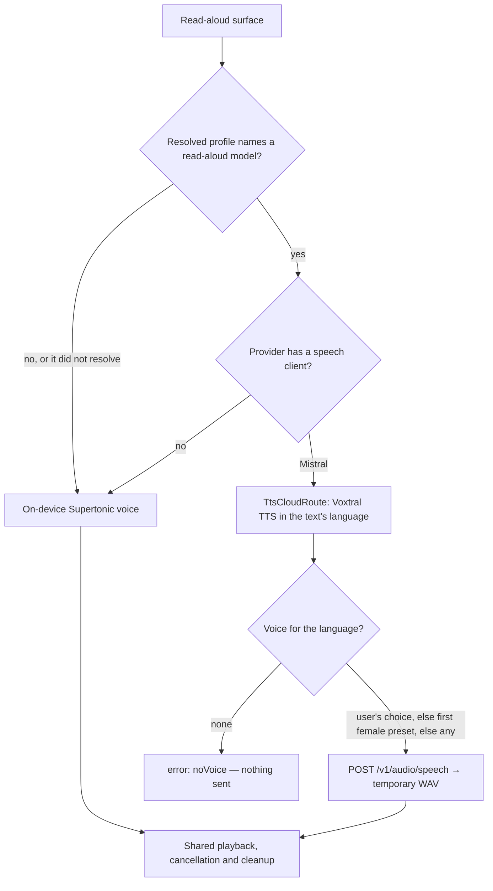
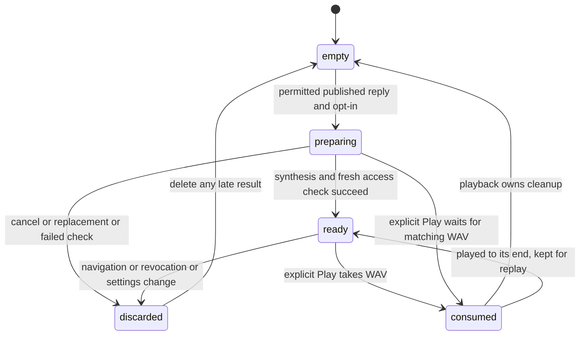
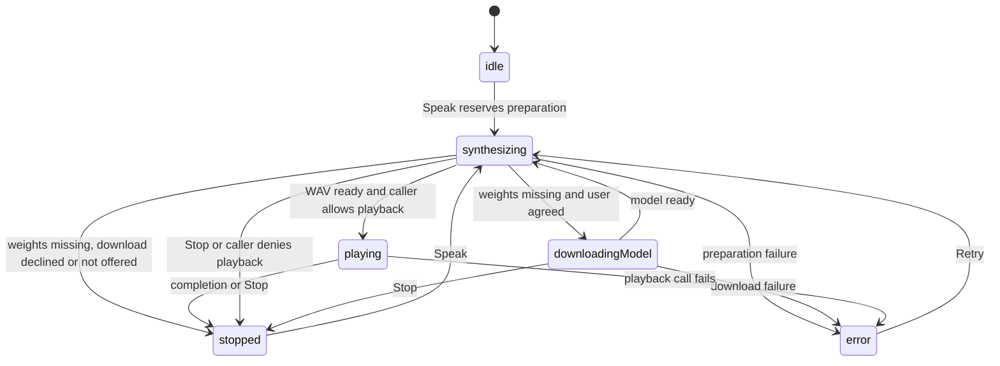

Text-to-speech that reads a task's AI **TL;DR**, a goal report or a saved
query answer aloud. By default it runs the Supertonic 3 ONNX model (~99M
params, 44.1 kHz 16-bit WAV) locally via `flutter_onnxruntime`; when the
profile that resolved for the surface names a read-aloud model, that cloud
voice speaks instead (see [which voice speaks](#which-voice-speaks)). Either
way the result plays through the app's existing `media_kit` stack.

**On-device synthesis never leaves the device — but the model has to arrive
first.** The
weights are not bundled. `TtsModelRepository` checks the model directory for the
six files the model's `TtsModelOption.files` lists (four `.onnx` graphs plus
`tts.json` and `unicode_indexer.json`) and downloads whichever are missing from
`https://huggingface.co/<repo>/resolve/<revision>/onnx/<file>`. So the first
synthesis on a fresh install needs the network; every one after it does not, and
no text or audio is sent anywhere.

# Which voice speaks

An inference profile has an optional **Read aloud** slot
(`AiConfigInferenceProfile.speechModelId`, resolved into
`ResolvedProfile.speechProvider` / `speechModel` — see
[profile resolution](ai/profile-resolution.md)). A surface resolves the
profile it already uses and hands `TtsCloudRoute.fromProfile` the result
together with the text's language:

| Surface | Profile | Language |
|---|---|---|
| Task summary card and its companion stage | the task agent's resolved setup | the task's `languageCode`, else the app's |
| Goal report | the goal agent's resolved setup | the app's |
| Query answer | `queryProfileProvider` for the chat | the scope task's `languageCode`, else the app's |
| Day briefing, onboarding companion | none | — |

`fromProfile` returns a route only for a provider with a speech client here —
Mistral (Voxtral TTS) today; another provider joins by adding its case. Every
other outcome, including an empty slot or one that no longer resolves, is the
on-device voice. The on-device voice is never replaced silently by a cloud one,
and a cloud voice never falls back to sending the text somewhere else.

A cloud route needs neither the on-device model nor platform support for it,
so a surface shows its control when **either** the on-device engine is
supported **or** a cloud route exists.

# Cloud voices

`VoxtralTtsService` is the client: `synthesize` posts `model`, `input`,
`voice_id` and `response_format: wav` to the provider's `audio/speech` and
decodes the base64 `audio_data`; `fetchVoices` pages `audio/voices` with
`type=all` at `limit=100` — the API's maximum, a larger page is a 422. The
provider's base URL and API key come from its inference provider config on
every call. Failures are typed (`VoxtralTtsFailure`: network, timeout,
unauthorized, rate limited with `Retry-After`, rejected, server, invalid
response, no voice) with `isRetryable`. A non-200 answer also keeps the
server's own reason (`apiError`: its `message`, or each validation detail as
`loc: msg`, so a 422 names the field) and its request id. Every failure is
logged with the call it ended — endpoint, text length, voice, model, format
or catalog page. Its logs carry text lengths, voice and model ids and byte
counts — never the text, the key, or the raw response body: a validation
detail's `input` is dropped because it echoes the rejected value, and a body
that is not JSON is not kept at all. Failures the client does not log itself —
a missing voice, the on-device engine, the player — are logged by
`TtsPlaybackController` before it turns to the error state the toast reports.
It refuses redirects, which would carry the bearer token to another host, and
plain HTTP anywhere but loopback.

`CloudSpeechSynthesizer` turns a route and a text into the same temporary WAV
the on-device engine writes, so everything after synthesis — playback,
`canPlay`, stop, deletion — is the path described below.

**Voices.** `VoxtralVoiceCatalogRepository` caches each provider's catalog in
`SettingsDb` (`TTS_VOXTRAL_VOICES_<providerId>`), device-locally like the
provider's credentials. A cached catalog younger than a day answers without a
request; an older one is refreshed and kept if the refresh fails, so voices
still resolve offline. `VoxtralVoiceCatalog.resolve` picks the voice for a
language: the user's choice for that language while the catalog still has it
(`TtsSettings.cloudVoiceByLanguage`, `TTS_CLOUD_VOICES`), else the language's
first female preset, else its first voice. The API has no voice-per-language
default of its own. A language with no voice fails with `noVoice` before any
text is sent, rather than reading German in an English voice. Each voice
keeps the API's mood `tags` (cached with it) so voices of one language can
be told apart before they are heard.

**Speech settings → Cloud voices.** `TtsCloudVoicesSection` lists, per
provider, the user's own languages — the app's and every language with a
pick — then folds the rest of the catalog behind one "Other languages (N)"
header, which says how many of them have a choice of voices. Each row names the voice in use, "Your pick" when chosen, and the
number of voices when there is a choice; its speaker plays the voice in use.
A language with several voices opens `showCloudVoicePicker`; a language with
one plays it from the row. Grouping holds while the page is open: a language
picked from the open list keeps its row until the list is collapsed, so an
edited row never jumps.

The picker sheet (`CloudVoicePicker`) pins the default voice and the pick it
opened with (labelled "Your pick" while in use, "Previous" once another is
tapped) above a Female/Male filter (`TtsGenderFilter`, shared with the
on-device list, shown for more than eight voices of both genders). A tap
picks a voice and plays it; picking the default clears the choice. The
sheet stays open, and closing it on a different voice than it opened with
shows a toast with Undo back to that voice. Previews go through a
`TtsCloudRoute` carrying the previewed `voiceId`, which wins over the user's
choice and is part of the route's cache key, so a preview never plays as
another voice. The sentence is `cloudVoiceSample`: the app's own
`speechSettingsCloudVoiceSample` for a shipped language, a native sentence
for the other languages Voxtral speaks, else English — every voice can be
heard before it is picked. The on-device voice list and the picker share one
row, `TtsVoiceRadioRow`.

**Model and speed.** There is one hosted TTS family and no quality or speed
parameter to tune; the curated model is `voxtral-mini-tts-3-0` (Mistral
documents no `-latest` alias for it). WAV keeps the uncompressed format's
lower time to first audio. Speed stays a playback rate, as for the on-device
voice.

**Catalog classification.** Voxtral ships transcription and TTS models under
one prefix. `isSpeechSynthesisModelId` (a `tts` segment, separated by `-`, `_`, `.`,
`/` or `:`) marks
the TTS ones text in / audio out in the live Mistral catalog and keeps them off
the transcription route — see [provider routing](ai/provider-routing.md).

# The download is always asked for

The model is about 398.4 MB, and App Store guideline 4.2.3(ii) requires the app
to disclose that size and let the user choose before fetching it. So nothing
downloads it implicitly:

- **The size ships with the app.** `TtsModelOption` pins the Hugging Face
  `revision` (`kSupertonic3Revision`) and lists every file with its byte count
  at that commit (`kSupertonic3Files`); `totalBytes` sums them. Pinning keeps
  the disclosed size true however the repository's default branch moves —
  moving the pin means re-measuring the files.
- **Only `speak` downloads, and only on a yes.** With the model missing it asks
  its `confirmModelDownload` callback (a `TtsModelDownloadConsent`), which every
  read-aloud control fills with
  [`confirmTtsModelDownload`](../../lib/features/tts/ui/tts_model_download_prompt.dart):
  a confirmation modal showing the size, rounded up by `formatDownloadMegabytes`.
  Without a callback, or on a no, nothing is fetched and the utterance ends
  quietly in `stopped`, with no error.
- **`prepare` never downloads.** With the model missing it does nothing.
- **The onboarding companion** only speaks when the model is already installed.
- **Speech settings** show the size under the model name.

The engine sits behind a `TtsEngine` interface, with `SupertonicOnnxEngine` wired
on macOS, iOS, Linux and Android.

# The Apple linkage workaround

On Apple platforms onnxruntime ships as a **statically linked binary**, which
CocoaPods rejects under the project's dynamic `use_frameworks!`.

The global fix — `use_frameworks! :linkage => :static` — **breaks
`super_native_extensions`' Rust FFI**. So both `macos/Podfile` and `ios/Podfile`
instead use a **targeted `pre_install` hook** that forces static linkage for only
the `flutter_onnxruntime` plugin and its `onnxruntime-*` dependencies.

That narrowness is the point: the workaround is scoped to the one plugin that
needs it, so the rest of the project keeps dynamic frameworks.

# Gating

Task-card and query-answer speak buttons are hidden unless `enable_ai_summary_tts` is enabled in
config flags. **It seeds off** while local TTS model quality and runtime behaviour
are still being evaluated — see [AI provider routing](ai/provider-routing.md).

# Preparation and cancellation

`TtsPlaybackController` owns one utterance. It reserves its busy state before
awaiting model discovery, serializes preparation through the shared ONNX
session, and uses a generation check after asynchronous work. Stop invalidates
that generation immediately. Native synthesis can finish after cancellation,
but the resulting file is deleted without playback. A caller may provide a
`canPlay` callback for a fresh visibility check after synthesis; query chat's
[privacy and lifecycle rules](agents/query-chat.md#audio-evidence-and-spoken-answers)
use that boundary. Source-specific stopping cannot stop another surface's
utterance. `MediaKitTtsAudioPlayer` also invalidates in-flight open/rate changes
on stop or disposal. Temporary utterance WAV files are removed on stop,
cancellation, error or disposal; one that plays to its end is kept as the
prepared result (below) for a replay. Model weights remain installed. Cleanup reports
native shutdown failures and still attempts file deletion. It ignores only a
confirmed missing-file error; other filesystem failures are reported through
the speech logging domain without including the temporary file path or content.

Speech settings also expose **Prepare chat audio automatically**, off by default.
`TtsSettingsController` persists this device-local opt-in under
`TTS_AUTO_PREPARE_CHAT_AUDIO`; the existing TTS feature flag still applies.
It enables synthesis, never autoplay, and never downloads: until the user has
agreed to the model download on an explicit play, preparation does nothing.
It never calls a cloud voice either: with a cloud route, `prepare` returns at
once, and query chat's `canPrepare` declines when the chat's profile names one,
so answer text reaches a provider only on an explicit play.

`prepare` keeps at most one disposable result outside playback state, sharing
`_preparation` with explicit speech so the ONNX session is never used concurrently.
Its key includes source ID, exact answer text, voice, model and language; on a
cloud route the model is the route's `cacheKey` and the voice the route's own or
the one chosen for its language, so another voice never replays the old one's
clip. Speed is applied at playback and does not invalidate the WAV.

**A replay plays the kept clip.** The same slot holds the WAV of an utterance
that played to its end, under that utterance's key, so pressing play again on
the same words starts at once — no second synthesis and, for a cloud voice, no
second upload of the text. When playback ends the clip goes into the slot at
once, so a discard, other speech and disposal reach it from then on, and the
utterance's own `canPlay` is asked again; a no takes it out and deletes it. An
owner that lost access or let go of the utterance never leaves a clip behind,
however its cleanup and the completion interleave, and a question that is
never answered leaves the clip where disposal still deletes it. A replay
rechecks `canPlay` too, and a denied replay deletes the clip. Anything else spoken or prepared, `discardPrepared`
and disposal delete it like any prepared result; a stop while playing deletes
the clip it stopped, as before. `speak` waits for a
matching job and takes ownership of its file instead of synthesizing again;
`canPlay` still rechecks live access. A speculative failure remains silent and a
later tap retries normally. `discardPrepared` invalidates a pending job and
removes a completed result, without interrupting an explicitly playing utterance.
A plain playback `stop` leaves this separate cache available for the query
controller's stop-before-play handoff; the chat owner explicitly discards it on
cancellation and navigation.

The selected query chat owns scheduling and access checks; see its
[audio lifecycle](agents/query-chat.md#audio-evidence-and-spoken-answers).
Model weights remain installed when prepared answer audio is discarded.

# Who else listens to an utterance

`TtsPlaybackState` is the one thing a surface reads about an utterance: its
status, its `sourceId`, the playhead `position`, and — while it is `playing`,
and only then — `clip`, the WAV being played together with the text it was
synthesized from. The two travel as one record, so a reader never pairs a clip
with words the screen shows now but the voice was never given. The
[companion](companion.md) reads that clip once to shape her mouth and follows
`position` each frame. The voice imports nothing of hers. `clip` is cleared on
stop, completion and error, because the utterance is over — on stop and error
its file is deleted, on completion it is only kept for a replay — and a reader
that gets there late may find no file; the companion then falls back to the
words alone.

A failure never reaches the caller of `speak` as an exception: it is the
`error` status above. A surface that asks the voice to speak calls
`listenForPlaybackFailure` (`ui/playback_failure_toast.dart`) from its build,
which shows one error toast per failure of *its* `sourceId` — the AI summary
card and the Daily OS day briefing both do.
