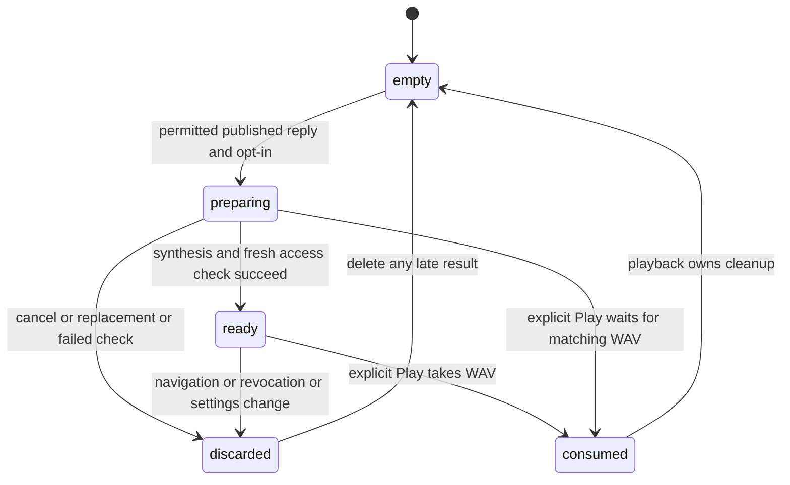
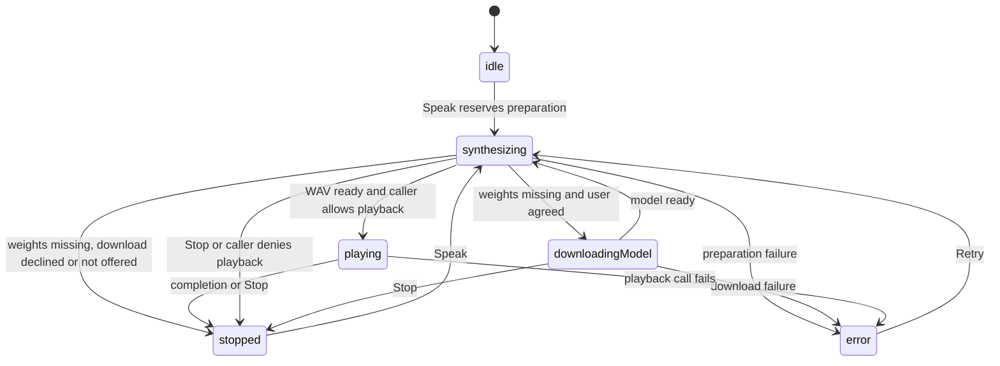

On-device text-to-speech that reads a task's AI **TL;DR** or a saved query
answer aloud. It runs the
Supertonic 3 ONNX model (~99M params, 44.1 kHz 16-bit WAV) locally via
`flutter_onnxruntime` and plays the result through the app's existing `media_kit`
stack.

**Synthesis never leaves the device — but the model has to arrive first.** The
weights are not bundled. `TtsModelRepository` checks the model directory for the
six files the model's `TtsModelOption.files` lists (four `.onnx` graphs plus
`tts.json` and `unicode_indexer.json`) and downloads whichever are missing from
`https://huggingface.co/<repo>/resolve/<revision>/onnx/<file>`. So the first
synthesis on a fresh install needs the network; every one after it does not, and
no text or audio is ever sent anywhere.

# The download is always asked for

The model is about 398.4 MB, and App Store guideline 4.2.3(ii) requires the app
to disclose that size and let the user choose before fetching it. So nothing
downloads it implicitly:

- **The size ships with the app.** `TtsModelOption` pins the Hugging Face
  `revision` (`kSupertonic3Revision`) and lists every file with its byte count
  at that commit (`kSupertonic3Files`); `totalBytes` sums them. Pinning keeps
  the disclosed size true however the repository's default branch moves —
  moving the pin means re-measuring the files.
- **Only `speak` downloads, and only on a yes.** With the model missing it asks
  its `confirmModelDownload` callback (a `TtsModelDownloadConsent`), which every
  read-aloud control fills with
  [`confirmTtsModelDownload`](../../lib/features/tts/ui/tts_model_download_prompt.dart):
  a confirmation modal showing the size, rounded up by `formatDownloadMegabytes`.
  Without a callback, or on a no, nothing is fetched and the utterance ends
  quietly in `stopped`, with no error.
- **`prepare` never downloads.** With the model missing it does nothing.
- **The onboarding companion** only speaks when the model is already installed.
- **Speech settings** show the size under the model name.

The engine sits behind a `TtsEngine` interface, with `SupertonicOnnxEngine` wired
on macOS, iOS, Linux and Android.

# The Apple linkage workaround

On Apple platforms onnxruntime ships as a **statically linked binary**, which
CocoaPods rejects under the project's dynamic `use_frameworks!`.

The global fix — `use_frameworks! :linkage => :static` — **breaks
`super_native_extensions`' Rust FFI**. So both `macos/Podfile` and `ios/Podfile`
instead use a **targeted `pre_install` hook** that forces static linkage for only
the `flutter_onnxruntime` plugin and its `onnxruntime-*` dependencies.

That narrowness is the point: the workaround is scoped to the one plugin that
needs it, so the rest of the project keeps dynamic frameworks.

# Gating

Task-card and query-answer speak buttons are hidden unless `enable_ai_summary_tts` is enabled in
config flags. **It seeds off** while local TTS model quality and runtime behaviour
are still being evaluated — see [AI provider routing](ai/provider-routing.md).

# Preparation and cancellation

`TtsPlaybackController` owns one utterance. It reserves its busy state before
awaiting model discovery, serializes preparation through the shared ONNX
session, and uses a generation check after asynchronous work. Stop invalidates
that generation immediately. Native synthesis can finish after cancellation,
but the resulting file is deleted without playback. A caller may provide a
`canPlay` callback for a fresh visibility check after synthesis; query chat's
[privacy and lifecycle rules](agents/query-chat.md#audio-evidence-and-spoken-answers)
use that boundary. Source-specific stopping cannot stop another surface's
utterance. `MediaKitTtsAudioPlayer` also invalidates in-flight open/rate changes
on stop or disposal. Temporary utterance WAV files are removed after playback,
cancellation or disposal; model weights remain installed. Cleanup reports
native shutdown failures and still attempts file deletion. It ignores only a
confirmed missing-file error; other filesystem failures are reported through
the speech logging domain without including the temporary file path or content.

Speech settings also expose **Prepare chat audio automatically**, off by default.
`TtsSettingsController` persists this device-local opt-in under
`TTS_AUTO_PREPARE_CHAT_AUDIO`; the existing TTS feature flag still applies.
It enables synthesis, never autoplay, and never downloads: until the user has
agreed to the model download on an explicit play, preparation does nothing.

`prepare` keeps at most one disposable result outside playback state, sharing
`_preparation` with explicit speech so the ONNX session is never used concurrently.
Its key includes source ID, exact answer text, voice, model and language. Speed
is applied at playback and does not invalidate the WAV. `speak` waits for a
matching job and takes ownership of its file instead of synthesizing again;
`canPlay` still rechecks live access. A speculative failure remains silent and a
later tap retries normally. `discardPrepared` invalidates a pending job and
removes a completed result, without interrupting an explicitly playing utterance.
A plain playback `stop` leaves this separate cache available for the query
controller's stop-before-play handoff; the chat owner explicitly discards it on
cancellation and navigation.

The selected query chat owns scheduling and access checks; see its
[audio lifecycle](agents/query-chat.md#audio-evidence-and-spoken-answers).
Model weights remain installed when prepared answer audio is discarded.

# Who else listens to an utterance

`TtsPlaybackState` is the one thing a surface reads about an utterance: its
status, its `sourceId`, the playhead `position`, and — while it is `playing`,
and only then — `clip`, the WAV being played together with the text it was
synthesized from. The two travel as one record, so a reader never pairs a clip
with words the screen shows now but the voice was never given. The
[companion](companion.md) reads that clip once to shape her mouth and follows
`position` each frame. The voice imports nothing of hers. `clip` is cleared on
stop, completion and error, because the file is deleted then, and a reader
that gets there late finds no file — the companion falls back to the words
alone.

A failure never reaches the caller of `speak` as an exception: it is the
`error` status above. A surface that asks the voice to speak calls
`listenForPlaybackFailure` (`ui/playback_failure_toast.dart`) from its build,
which shows one error toast per failure of *its* `sourceId` — the AI summary
card and the Daily OS day briefing both do.
