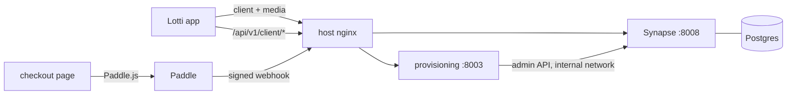

# Paid Lotti Sync — production runbook

One Compose stack (`../docker-compose.sync-prod.yml`) on one server, behind the
host's nginx: Synapse + Postgres as the encrypted mailbox, and the provisioning
service that turns a Paddle payment into a signed sync account. The plan and
the reasoning behind it are in
[docs/implementation_plans/2026-10-17_paid_web_sync_subscription.md](../../docs/implementation_plans/2026-10-17_paid_web_sync_subscription.md).



| Hostname | Serves |
|---|---|
| `matrix.example.com` | Synapse client and media API only |
| `api.example.com` | the app's subscription routes and the Paddle webhook |
| `sync.example.com` | static pricing, checkout and legal pages — the domain Paddle approves |

## 1. Secrets

Create `/etc/lotti-sync/sync.env`, owned by root, mode `0600`, never in git:

```sh
SYNAPSE_SERVER_NAME=example.com
MATRIX_PUBLIC_BASEURL=https://matrix.example.com
SYNAPSE_DB_PASSWORD=$(openssl rand -hex 24)
SYNAPSE_MACAROON_SECRET=$(openssl rand -hex 32)
SYNAPSE_FORM_SECRET=$(openssl rand -hex 32)
SYNAPSE_REGISTRATION_SECRET=$(openssl rand -hex 32)
API_KEY=$(openssl rand -hex 32)
ADMIN_API_KEY=$(openssl rand -hex 32)
SUBSCRIPTION_ENCRYPTION_KEY_ID=escrow-2026-10
SUBSCRIPTION_ENCRYPTION_KEY_BASE64=$(openssl rand -base64 32)
ACCOUNT_BINDING_KEY_BASE64=$(openssl rand -base64 32)
PADDLE_ENVIRONMENT=sandbox
PADDLE_API_KEY=…              # Paddle → Developer tools → Authentication
PADDLE_WEBHOOK_SECRET=…       # from the notification destination, step 5
PADDLE_PRICE_IDS=pri_…,pri_…  # monthly and annual
WEB_CHECKOUT_PAGE_URL=https://sync.example.com/checkout
WEB_CHECKOUT_ORIGIN=https://sync.example.com
MATRIX_ADMIN_TOKEN=…          # step 3
# Step 7, once the app release that verifies signatures is out:
BUNDLE_SIGNING_KEY_BASE64=
BUNDLE_SIGNING_KEY_ID=
```

Keep an offline copy of `SUBSCRIPTION_ENCRYPTION_KEY_BASE64` and, later, the
signing key. Losing the escrow key strands unclaimed bundles; losing the
signing key means shipping a new public key in an app release.

## 2. Synapse

```sh
services/sync-deploy/render-synapse-config.sh /etc/lotti-sync/sync.env
cd services
docker compose -f docker-compose.sync-prod.yml --env-file /etc/lotti-sync/sync.env up -d postgres synapse
```

The template is deliberately narrow: registration closed, no federation
listener, presence and previews off, retention on. Re-run the render script
after editing it.

## 3. The provisioning admin

Create the one admin account through the shared-secret endpoint (reachable
only from the host) and mint a long-lived token for the service:

```sh
docker exec -it lotti-sync-synapse register_new_matrix_user \
  -c /data/homeserver.yaml -u lotti-provisioner --admin http://localhost:8008
curl -s -X POST http://127.0.0.1:8008/_matrix/client/v3/login \
  -d '{"type":"m.login.password","identifier":{"type":"m.id.user","user":"lotti-provisioner"},"password":"…"}'
```

Put the returned `access_token` into `MATRIX_ADMIN_TOKEN`, then start the rest:

```sh
docker compose -f docker-compose.sync-prod.yml --env-file /etc/lotti-sync/sync.env up -d --build
```

Startup fails closed if Synapse cannot suspend accounts or any Paddle setting
is missing — read `docker logs lotti-sync-provisioning` before anything else.

## 4. nginx and the site

```sh
sudo cp services/sync-deploy/nginx/lotti-sync.conf /etc/nginx/sites-available/
# replace the three example hostnames, then:
sudo ln -s /etc/nginx/sites-available/lotti-sync.conf /etc/nginx/sites-enabled/
sudo certbot --nginx -d matrix.example.com -d api.example.com -d sync.example.com
sudo mkdir -p /srv/lotti-sync/site && sudo cp services/sync-deploy/site/* /srv/lotti-sync/site/
sudo cp /srv/lotti-sync/site/config.example.js /srv/lotti-sync/site/config.js   # then fill in
sudo nginx -t && sudo systemctl reload nginx
```

Paddle's domain review also needs, on `sync.example.com` and without a login:
a pricing page, Terms that name Paddle as merchant of record, a refund policy
and a privacy policy. Those texts depend on who the legal seller is and are not
in this repository.

## 5. Paddle

1. Catalog: product "Lotti Sync" with a monthly and an annual price; their ids
   go into `PADDLE_PRICE_IDS`.
2. Notifications → new destination `https://api.example.com/api/v1/webhooks/paddle`,
   events `subscription.created`, `.activated`, `.updated`, `.past_due`,
   `.paused`, `.resumed`, `.canceled`. Copy its secret into
   `PADDLE_WEBHOOK_SECRET`.
3. Checkout settings: default payment link `https://sync.example.com/checkout`,
   PayPal enabled.
4. Develop against `PADDLE_ENVIRONMENT=sandbox` and a `test_` client token;
   switch both, and the API key, once the domain is approved.

## 6. Smoke test from outside

```sh
curl -s -o /dev/null -w '%{http_code}\n' https://matrix.example.com/_matrix/client/versions      # 200
curl -s -o /dev/null -w '%{http_code}\n' https://matrix.example.com/_synapse/admin/v1/server_version  # 404
curl -s -o /dev/null -w '%{http_code}\n' https://matrix.example.com/_matrix/federation/v1/version     # 404
curl -s -o /dev/null -w '%{http_code}\n' https://api.example.com/api/v1/bundles                        # 404
curl -s -o /dev/null -w '%{http_code}\n' -X POST https://api.example.com/api/v1/client/subscriptions/entitlements  # 201
```

Then buy with a Paddle sandbox card from a debug build and watch
`docker logs -f lotti-sync-provisioning` for the webhook and the claim.

## 7. Signed bundles

```sh
docker exec lotti-sync-provisioning python -m src.services.bundle_signer
```

prints a fresh server seed and the matching public key. Put the public key and
the homeserver URL into `kLottiSyncBundleTrust` in
`lib/features/sync/state/bundle_attestation.dart` and ship that release. Once
it is what people run, set `BUNDLE_SIGNING_KEY_BASE64` / `BUNDLE_SIGNING_KEY_ID`
and restart: from then on every bundle is v3 and an unsigned or forged one for
this homeserver is refused by the app.

## Purging — the mailbox never fills up

| Layer | Removes | When |
|---|---|---|
| Room `m.room.retention` + Synapse purge jobs | events older than 30 days | every 12 h |
| Provisioning retention sweep | history and media older than 30 days | every 24 h |
| Synapse `media_retention` | media older than 30 days | Synapse background |
| Synapse `delete_stale_devices_after` | devices silent for 60 days and their queued key shares | Synapse background |
| Lapsed-account reaper | media, room, the account itself (erased) | 30 days after suspension |

A device offline longer than 30 days catches up from its peers rather than
from the server. A subscriber who renews inside the 30 days after suspension
finds everything where it was.

## Backups

Nightly, from the host:

```sh
docker exec lotti-sync-postgres pg_dump -U synapse synapse | gzip > synapse-$(date +%F).sql.gz
docker exec lotti-sync-provisioning python -c "import sqlite3; s=sqlite3.connect('data/provisioning.db'); s.backup(sqlite3.connect('data/backup.db'))"
docker cp lotti-sync-provisioning:/app/data/backup.db provisioning-$(date +%F).db
```

Encrypt them before they leave the host and keep 14 days. The server holds
only ciphertext of anyone's memories; the provisioning database holds who paid
for which anonymous account, so treat it as personal data.
